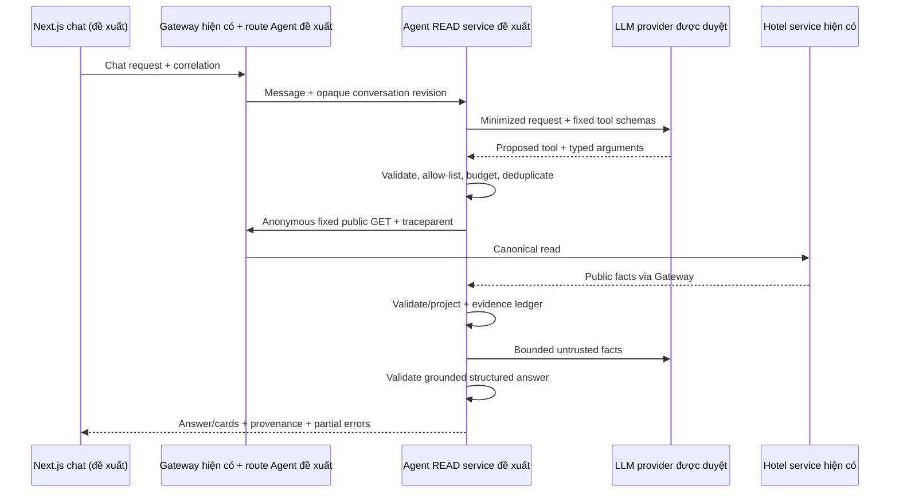

# AI Agent READ architecture — Batch 10A

> **Checkpoint 10B.4A — 23/11/2026:** Gemini SDK adapter implemented/offline verified; default feature OFF/FAKE/live OFF. Only internal compile-time synthetic fixture harness can authorize outbound requests. Generic conversation/backend/evidence requests are denied, regardless of a caller's synthetic claim. [10B.4A report](BATCH10B4A_GEMINI_PROVIDER_INTEGRATION_REPORT.md) supersedes older provider-only/fake-only descriptions; live/model-account/quota-billing/TLS acceptance remains NOT_VERIFIED/NOT_RUN. No 10B.4B/ingress/UI rollout.

## Implemented Gemini boundary 10B.4A

`ProviderConfiguration` selects FAKE or GEMINI without fallback; selected GEMINI fails initialization unless enabled, explicit live opt-in, exact reviewed model ID, trusted environment key, synthetic-only mode, finite budgets and operator verification gates all pass. `GeminiProperties` uses separate `checkinn.gemini` prefix to preserve strict existing `checkinn.agent` binding and constructors. Key is resolved only after all nonsecret gates pass; never bound as a property, logged or sent in model data.

`GeminiLlmProviderAdapter` implements one native LangChain4j exchange via real 1.17.0 SDK and guarded HTTP SPI. Production destination is fixed Google generateContent HTTPS endpoint. Transport reconstructs headers; retry/redirect/compression/auth negotiation disabled. No domain adapters/callbacks/built-in search/URL/code/streaming. Internal fixture grants bind exact immutable request identity and owning thread, consume once, then clear in finally. Public `generate` rejects arbitrary prompts, cloned fixtures, backend projections and cross-thread/session requests before HTTP. Generic AgentOrchestrator cannot send real state or Gateway results to Gemini in this batch.

Gemini protocol separates passive tool proposals from strict JSON evidence selection. With maximum budget3, requests1–2 may propose tools; the last available request has no tools and requires `{evidenceIds:[]}`. Proposal prose never becomes factual final output. PolicyExecutor still alone admits proposals; GroundingGate validates citations and renders facts. Reduced model budgets reserve the last request for selection, never add a fourth call. This protocol is fake-orchestration verified; connecting real domain state to live provider remains denied.

`GeminiRequestProtocol` converts registry nested raw child tool schemas to supported SDK typed hints, retaining full server-side validation. Raw root `responseJsonSchema` retains grounding maxItems/additionalProperties; no combined JSON-schema+tools request is accepted. All10 existing tool specs traverse the real SDK offline. This is serializer compatibility, not evidence of a model enforcing the entire JSON Schema dialect.

Provider safeguards: conservative input estimate `2 × serialized UTF-8 bytes + 1024` (NOT actual tokenizer usage), hard output cap, fixed1 request/smoke run, configured run cap1..3/process cap1..9/concurrency1, nonrefundable maximum-exposure reservations. Required positive configured cost upper bounds are independent of assumed free pricing. Unknown usage, quota exhaustion or reported over-cap usage stops further process calls. JVM counters cannot enforce account-wide cost across restarts/processes/other clients; external project quota/billing and model pricing verification gates default NOT_VERIFIED.

CallControl exposes remaining monotonic time and a registered transport abort. Apache request cancellation and deadline watchdog close sockets; loopback verifies stalled headers/body EOF/reset. Caller deadline TIMEOUT, transport PROVIDER_TIMEOUT and CANCELLED are distinct; late responses are discarded before state/tool execution. Live Google TLS/network cancellation and external financial controls remain acceptance gates. Metrics contain bounded counts/duration/categories/tokens only, no prompts/completions/tool data/key/PII or payload spans.

> **Checkpoint 10B.3 — 22/11/2026:** Application-owned sequential `AgentOrchestrator` + `PolicyExecutor`, enforced turn budgets, in-memory conversation store, structured criteria/revision, evidence ledger và deterministic grounding đã triển khai cho internal fake testing. Không public endpoint/live model/frontend/persistence. Chỉ expose tool theo intent/confirmed criteria/evidence; model chỉ chọn evidence IDs, application dựng facts. [Báo cáo 10B.3](BATCH10B3_ORCHESTRATION_POLICY_REPORT.md) là checkpoint hiện hành; các đoạn “chưa orchestration/state” của 10B.1/2 bên dưới là lịch sử.

## Implemented orchestration 10B.3

`orchestration/AgentOrchestrator` nhận internal structured request, không phải ingress hoặc natural-language extraction API. Scope và criteria patch do caller local/testing cung cấp; model không được sửa chúng. `SEARCH` hỏi destination → dates → confirmed rooms/adults/children; `BROWSE` là mode riêng cho catalog không ngày/occupancy. Model context có system policy cố định, tối đa 8 recent messages và bounded current projected evidence; JSON response schema chỉ cho `evidenceIds` (≤6). Không AI Services/callback, retry hoặc fallback.

PolicyExecutor sở hữu batch admission: reserve toàn bộ proposals trước round/execution, kiểm closed GET allow-list, tool thực sự offered trong request, quyền hiện tại, strict registry validation, exact confirmed criteria, target/room-hotel evidence, dedup theo tool/normalized args/revision/relationship. A07/A08 chỉ khi cần filter codes; A05 sau public room evidence; A09 bị loại nếu A01 current đã có summary. Không implicit dependent HTTP calls. Sequential execution cho phép chứng minh attempt accounting bằng ledger thực của adapter; guard chạy ngay trước execute HTTP. Tool deadline ≤ min(configured tool cap, remaining turn), với maximum 10s/tool và 30s/turn; model workers bounded2/no queue, cancellation polling và future cancellation, không tuyên bố forced termination của provider không cooperative.

`ConversationStore.Lease` tách storage implementation: per-session busy admission + expected revision; commit một lần rồi release. In-memory TTL idle30m/cap1000, recent8, evidence24, không global cache, không durable history. Tổng lượt chat không giới hạn8; test10 user turns/20 messages. Structured criteria có provenance USER_PROVIDED/USER_CONFIRMED/MODEL_PROPOSED/BACKEND_DERIVED; occupancy chỉ USER_CONFIRMED mới admission. Edits dates/location/occupancy thay group tương ứng để không giữ ngầm các slot cũ; criteria revision tăng khi values/provenance đổi. Invalid updates không commit; timeout/cancel/provider failure giữ explicit valid criteria nhưng không commit evidence mới của failed turn. Stored recent user messages là intent summaries, không raw user prose/model text/tool transcripts. Chỉ current request prose tồn tại tạm trong fake model call; structured criteria vẫn độc lập với message window.

Evidence chỉ từ OK/EMPTY projections, giữ route/request/fingerprint/retrievedAt/server checkedAt/revision/IDs/facts/status/turn. Local conservative freshness30s (không evaluation/SLO approval); A01/A05 không reuse qua turn dù cùng revision. Old evidence không vào model/current response; errors không thành observation, negative availability vẫn valid. `GroundingGate` reject free-text synthesis, extra claims, nonexistent/cross-session/stale refs; giá/availability/policy được dựng từ whitelist facts, có base-price/no-hold/general-only semantics. Descriptions/FAQ/free-text policies không được render thành factual narrative. Name/label strings vẫn là untrusted display data cần escape khi có UI về sau.

Micrometer đếm turn/model/proposal/round/actual HTTP/policy denial/evidence/tool outcomes/timeouts/cancellation; fixed category tags, không payload/session tags hoặc raw logs. Server tracer tạo payload-free turn span, wrap provider worker, và truyền server-owned traceparent qua policy→adapter. Loopback header verified, full Gateway→Agent→Hotel trace **NOT_RUN**. D05 chỉ partially approved cho internal ephemeral testing; ingress/ownership/privacy/retention/restoration vẫn chờ quyết định.

> **Checkpoint 10B.2 — 22/11/2026:** D04 được duyệt chỉ cho **10 internal READ tools A01–A10 và minimal public projection**. Registry, validation, fixed anonymous GET adapters, bounded projection và deterministic mock HTTP tests đã triển khai. Không public API/chat, không tự expose toàn registry cho LLM, không automatic tool execution/WRITE. Feature OFF, fake provider giữ nguyên. Các caps adapter 256KiB/depth32/data12KiB là biện pháp an toàn local theo task, không tuyên bố D03 được duyệt toàn bộ. [Báo cáo 10B.2](BATCH10B2_READ_TOOLS_IMPLEMENTATION_REPORT.md) ghi evidence và giới hạn hiện hành; checkpoint 10B.1 bên dưới là lịch sử. **Không triển khai 10B.3 trong batch này.**

> **Checkpoint 10B.1 — 22/11/2026:** Java 21 Agent Service độc lập và LangChain4j đã được duyệt; implementation giới hạn ở skeleton offline. Chọn LangChain4j core **1.17.0**, Spring Boot **3.3.4**, không starter/AI Services. Gemini Free Tier trước, Gemini Paid/OpenAI về sau; model, budget và provider data terms chưa duyệt, **không live calls**. Chỉ các hard limits 10s/tool, 30s/turn, 6 HTTP attempts, 6 proposals, 3 model requests, 2 rounds, retry0 được duyệt; các giới hạn khác trong 10A vẫn là đề xuất. Local pilot được duyệt với feature OFF; không phải approval bật ingress/UI hoặc start stack trong batch này. [Báo cáo 10B.1](BATCH10B1_LANGCHAIN4J_SKELETON_REPORT.md) là checkpoint hiện hành; nội dung 10A bên dưới là thiết kế và bằng chứng lịch sử khi có khác biệt.

Ngày: 22/11/2026, Asia/Ho_Chi_Minh. **DESIGN PROPOSED / APPROVAL REQUIRED**, không production-ready. Không triển khai application code. Evidence và baseline: [architecture review](BATCH10A_ARCHITECTURE_REVIEW.md). Contract hiện hành: [READ_TOOL_CONTRACT](READ_TOOL_CONTRACT.md); chi tiết mới: [tool design](AI_AGENT_READ_TOOL_DESIGN.md).

## 1. Kiến trúc hiện tại, đã đối chiếu source

Backend Maven reactor có 13 module, Java 21 (`../../pom.xml`). Hotel/Booking sở hữu catalog/inventory và reservation/payment tương ứng; payment không có service độc lập. Gateway Boot 3.3.4/Cloud 2023.0.2 dùng WebFlux, Hotel Boot 3.3.4/Cloud 2023.0.3 dùng MVC/JPA/gRPC. Không đồng nhất phiên bản từ Config Server Boot 4.0.0/Cloud 2025.1.0-RC1 sang module khác. Xem [E01–E04](BATCH10A_ARCHITECTURE_REVIEW.md#source-evidence-index).

Gateway `application.yml`: explicit route `/api/hotel/**` rewrite bỏ prefix, `lb://hotel-service`; `/api/bookings/**` giữ path, `lb://booking-service`. Discovery locator cũng enabled, vì vậy Agent phải giới hạn route chính xác dù Gateway chấp nhận nhiều alias. Gateway security `anyExchange().permitAll()`; authorization thực nằm ở service, không được xem Gateway là authentication firewall. Eureka 8761, Gateway 8080; Config Server 8888 trỏ Git configuration repository. Không fetch repository cấu hình từ xa, không chứng minh deployment hiện tại dùng cùng giá trị. Hotel có config client; cấu hình runtime phải xác minh theo profile, không chỉ file mặc định.

Hotel public reads qua controller → service → repository/public mapper. Hotel phải active + APPROVED, room active + effective inventory approval; predicate gồm evidence, quantity, effective pointer/revision, reviewer/time/source, không phải boolean hay stock dương. Search chọn **một room type** thỏa capacity/price/quantity. Dated search đọc inventory snapshot; undated search chỉ xét approved totalRooms, `availableRooms/checkIn/checkOut/checkedAt=null`. Booking public dependency duy nhất cần xét là cancellation-policy. Auth/User không có dependency READ cần thiết cho MVP; không login để đọc catalog. Private owner documents, review identities và user profile không cần đưa vào Agent. [E05–E12]

Frontend Next App Router ^16.0.8, React 19.2, TypeScript strict; `lib/api/hotels.ts` gọi Gateway qua `NEXT_PUBLIC_API_BASE_URL` (default localhost:8080), `readJson` giới hạn cả headers/body 10s. `lib/api/availability.ts` dùng alias `/api/v1/availability/check`; Agent chọn canonical prefixed route trong contract, không fallback alias. Search page dùng loading/error riêng, `current=false` khi effect cleanup để ngăn response cũ thay thế state. HotelCard hiển thị facts có nguồn, phân biệt review zero với unknown. Không tái sử dụng card bằng cách điền giá/rating giả khi Agent thiếu dữ liệu. NextAuth credentials giữ internal token/id/role; `lib/auth/session.ts` chỉ là shape adapter, không phải xác minh quyền. [E13–E16]

## 2. Phương án và quyết định đề xuất

| Phương án | Microservices / bảo trì | Phức tạp / vận hành | Security / scale | Observability | AI WRITE tương lai |
|---|---|---|---|---|---|
| **A. Java Agent READ service độc lập** | Không gắn LLM vào domain; HTTP qua Gateway, độc lập BOM | Thêm process/image/config và readiness; chi phí idle cao hơn BFF | Không DB/JWT/service credential; scale riêng model/tool concurrency | Span Agent + Gateway + Hotel; model usage riêng | Boundary riêng cho proposal/confirmation sau phê duyệt khác; không thêm WRITE tools hôm nay |
| B. Gắn vào Hotel hoặc Booking | Tận dụng deploy hiện tại nhưng coupling orchestration vào chủ sở hữu domain | Ít process; dependency AI ảnh hưởng regression domain | Scale LLM kéo domain; credential và transaction cùng blast radius | Chung process dễ khởi đầu, khó tách latency model/domain | Nguy cơ gọi trực tiếp service methods vượt policy; không phù hợp READ MVP |
| C. Next.js BFF orchestration | Gần UI, reuse TS contracts; cần server-only adapters | MVP ít process; timeout/deploy lifecycle Next gánh model | Giữ key server-side, nhưng cần tránh leak bundle/session forwarding; scale chung frontend | Cần span Node→Gateway + usage; không tự kế thừa Brave Java | Có thể mở rộng nhưng domain write vẫn phải service ownership và user-bound confirmation |

**Đề xuất A**, một service orchestration chuyên READ, Java 21, không persistence domain. Phù hợp đội backend Spring và ranh giới đã chuẩn hóa; cho phép thử SDK/framework trong module riêng thay vì nâng Boot toàn hệ thống. Phương án A đã được duyệt trong 10B.1; B/C không được triển khai.

Route chat dự kiến `POST /api/ai/read/chat` **chưa tồn tại**: POST gửi câu hội thoại không phải domain WRITE tool; không tạo booking/hold/payment. Chỉ thêm khi 10B được duyệt. Agent→Gateway dùng origin server-config cố định; không gọi route chat ngược lại, không truy cập domain DB hay gRPC. Không đặt orchestration blocking vào Gateway reactive filters.

## 3. Trách nhiệm thành phần

- Chat UI: input, loading, cancel, retry tường minh, hotel links, trạng thái partial/unknown. Slot tích hợp đề xuất `components/ai/ReadChat.tsx` và riêng search/detail; root layout chỉ mount sau review, tránh ảnh hưởng Place. Không có UI chat READ được xác nhận trong khảo sát này.
- Chat boundary: validate message 4KiB, conversation/revision, origin/CORS, request rate/admission và cancellation. Authentication user không cần cho public facts; anonymous session token chỉ bảo vệ state/rate, không là quyền domain.
- Orchestrator: structured extraction, hỏi thiếu slot, revision, deadlines, tool proposal validation, evidence ledger, câu trả lời tiếng Việt và so sánh cùng criteria.
- Tool executor: hard-coded method/path/query templates, public anonymous GET, no redirects, input/output validation, projection và typed failure. LLM không được truyền URL/header/method.
- Provider adapter: server-only key, pinned model ID/options; không automatic failover sang provider chưa duyệt, không SDK retry ngoài budget.
- Grounding renderer: số tiền, inventory, review/count và URL lấy trực tiếp evidence IDs. Reject unsupported factual claim; fallback template từ facts nếu synthesis lỗi. Không chỉ dựa prompt để bảo đảm correctness.

## 4. Framework, provider, model, state và RAG là các quyết định khác nhau

**Quyết định 10B.1:** LangChain4j là framework chính thức. Dùng core libraries 1.17.0 với module Boot 3.3.4 riêng; không Spring AI, không starter, không AI Services. Maven spike Java21 đã resolve/compile trước skeleton. Starter hiện tại mang beta và yêu cầu Boot mới hơn; core giữ application-owned dispatch/proposal validation/budgets/retry/deadline/revision/grounding/cancellation mà không nâng các service hiện có. Không import LangChain4j BOM ở root.

Provider boundary: `LlmProviderAdapter.generate(ChatRequest, CallControl)` thực hiện đúng một exchange; giữ messages/model parameters/tool declarations/response schema và ChatResponse metadata/usage/finish reason/proposals. Không executable callback, không memory tự động. Fake là bean duy nhất; feature OFF chặn trước model counter và invocation, live provider enum bị validation từ chối. Chat endpoint và domain tools chưa tồn tại. Cancellation/deadline là cooperative control của fake; transport cancellation của live adapter phải được kiểm chứng trước live phase.

Gemini Free Tier được chọn trước; Gemini Paid/OpenAI là hướng sau, không automatic failover. Cả `langchain4j-google-ai-gemini:1.17.0` và `langchain4j-open-ai:1.17.0` có trong module để compile compatibility. SDK builders và JSON exchange đã chạy qua transport giả trong test offline, không phải live integration. Không chọn model/account/region hoặc chấp nhận data terms thay người dùng. Không resolve key ở runtime skeleton, chỉ cấu hình tên environment variable nguồn key cho phase sau. [Compatibility findings và nguồn chính thức](BATCH10B1_LANGCHAIN4J_SKELETON_REPORT.md#2-compatibility-findings).

Conversation state: đề xuất context hữu hạn 8 message gần nhất + typed slots/evidence, 30 phút idle TTL, không bền vững, một replica thử nghiệm. Server-issued opaque session + in-memory map bounded 1.000 session, không client tự khai toàn bộ tool history. Restart mất context thì hỏi lại. Multi-replica cần sticky routing hoặc state store riêng được duyệt, không tận dụng Redis sessions của User như storage Agent. Session token không log, không là user identity.

Memory dài hạn, embeddings, vector DB, RAG **không cần** để tìm inventory/giá có cấu trúc từ API hiện tại. RAG chỉ xét lại khi có knowledge corpus được chủ quản duyệt và use case không thể đáp ứng bằng public API. Không dùng index/cache lâu dài để trả availability.

## 5. Security và observability

Public READ cũng có model cost/abuse risk: đề xuất admission limiter tại Agent, không khẳng định Gateway hiện có rate limiter (không thấy RequestRateLimiter/RedisRateLimiter trong source Gateway). Allow-list nhỏ hơn tập public routes. Không forward JWT/cookie/X-User-Id/X-Role; không dùng service identity nâng quyền. No owner/admin/internal/preview/hold/Place endpoints; không browser/web/SQL/code tool. Chặn URL arbitrary, encoded slash/dot traversal, query injection, redirects và SSRF; UUID typed path, query encoding thư viện.

Descriptions/FAQ/policies là **dữ liệu không đáng tin về chỉ dẫn** dù public. Không thực thi hướng dẫn trong đó; source text không được sửa system policy, tool registry hay header. Secret không trong prompt/log. Drop contact mặc định, ownerId, createdBy/reviewer, recentReviews/user fields; không tải ảnh/doc URL qua Agent. Nhận yêu cầu WRITE: không thực hiện, hướng người dùng sang chức năng website, không tạo draft tự động.

Tiếp nối W3C `traceparent` qua UI→Gateway→Agent→Gateway→Hotel; Agent tạo child span cho model/tool, không dùng random X-Request-ID làm chứng cứ trace xuyên suốt. Sanitize incoming trace headers theo tracing library, không nhận client metadata làm auth. Browser CORS expose X-Request-ID nếu cần đọc header phải test, không suy từ allowHeaders. Body chat đề xuất có requestId; giữ downstream requestId theo tool để support partial failures.

Log allow-list: traceId/spanId, turnId, revision, tool name, duration, status/code, byte/token counts, finish reason, policy/model version, dedup/budget stop. Không prompt/response nguyên văn, query hotelName/cityName, JWT, cookie, API key, IP/PII không cần thiết. Metrics: request latency/p95, HTTP and model failures, unknown/partial rate, call count, rejection, tokens/cost estimate; low-cardinality tags. Reuse Micrometer/Prometheus, file logs→Promtail/Loki conventions; thêm Agent ingestion và trace smoke trong 10B, không khẳng định đã verified. Hosted exporter/log retention là quyết định riêng.

## 6. Trade-offs và điều kiện triển khai

Hai lần đi Gateway tăng latency nhưng giữ HTTP public boundary kiểm thử được; không tối ưu bằng direct DB/internal RPC. Search backend thực hiện candidate matching trước paging, nên size nhỏ không bảo đảm chi phí query nhỏ. Không auto-scan mọi page. Empty search chỉ “không có lựa chọn phù hợp bộ lọc”, không chứng minh mọi khách sạn hết phòng. Bảng so sánh tối đa 3 khách sạn, không đánh giá “tốt nhất toàn hệ thống” từ một trang.

Giới hạn cụ thể ở [tool design](AI_AGENT_READ_TOOL_DESIGN.md#execution-budgets-proposed), thresholds tại [evaluation](AI_AGENT_READ_EVALUATION_PLAN.md). D01 và phần hard limits D03 đã được duyệt; D02 một phần, D06 chỉ local pilot/OFF. D04/D05/D07/D08 vẫn chưa duyệt trong [review](BATCH10A_ARCHITECTURE_REVIEW.md). 10B.1 chỉ là nền tảng; các phase tiếp theo chưa triển khai.

## Implemented adapter architecture 10B.2

`ReadToolConfiguration` tạo internal ToolRegistry với cùng feature flag OFF, tool timeout từ AgentProperties, origin/connect timeout trusted `checkinn.read-tools`. Không controller mới hoặc Config Server. Apache HttpClient5 (Boot-managed5.3.1) riêng, no system proxy/cookie/credentials/auth cache/compression/redirect/retry; TLS verification mặc định giữ nguyên. Chỉ application/json, identity encoding; compressed response bị reject (không decompress ngầm). 256KiB byte counter trước parse, Jackson depth32. Pool2 connections + executor tối đa2 workers/no queue là local adapter safety, không thay quyết định global concurrency D03.

Monotonic deadline≤10s bắt đầu trước validation và bao gồm admission/headers/body/parse/projection; caller Future wait/cancel đóng request, không chỉ socket idle timeout. Worker parsing bounded256KiB có thể hoàn tất CPU work ngắn sau cancellation, không được trả late success; không có Java forced thread termination. Deadline tests dùng stalled headers/body ở loopback. Không hứa deadlineOS scheduling cứng hoặc tested live network stack. Request-local context cấp attempt counting cho10B.3 nhưng chưa thực thi per-turn budgets. Full W3C Gateway→Agent→Gateway trace/live integration vẫn NOT_RUN; system X-Request-ID propagation và upstream evidence đã mock verified.
