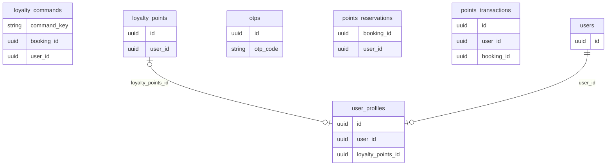
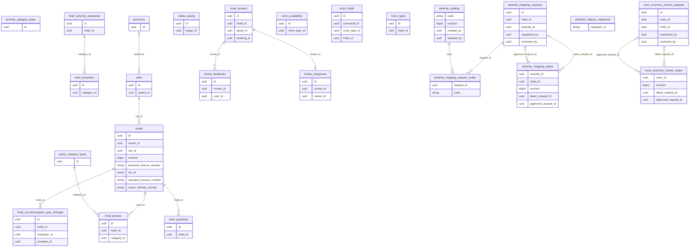
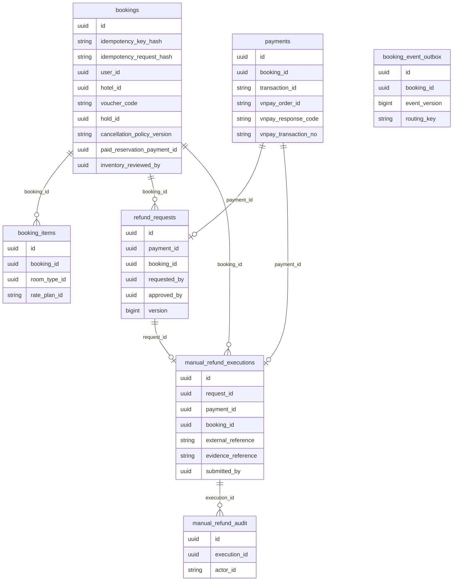
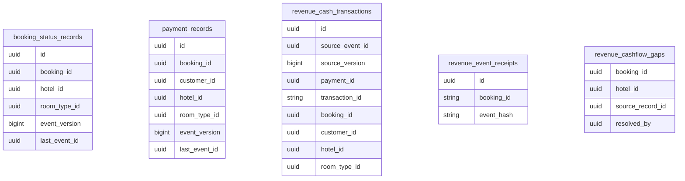
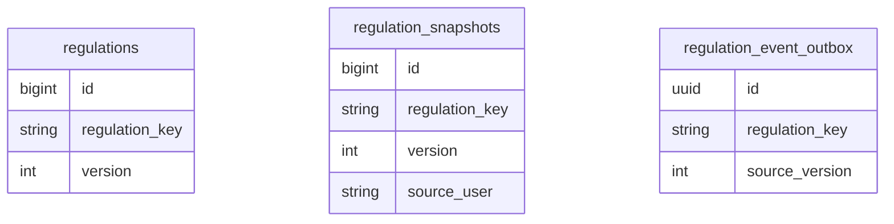
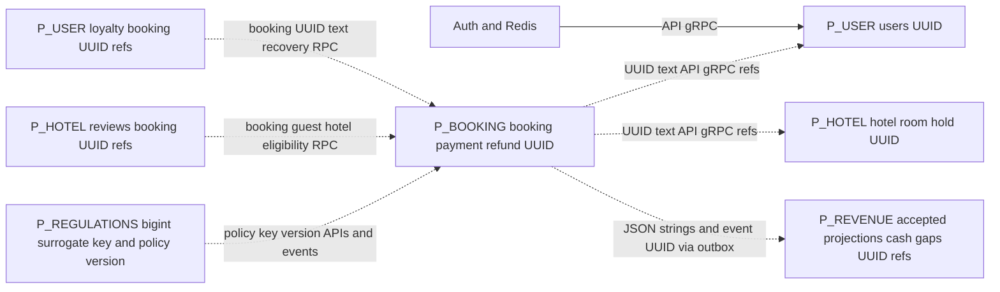

# ERD — Batch 4.1 UUID / Five Independent Databases

> Current status: Batch5A U01/U03/U04 APPROVED;38 source conversions implemented, PARTIAL acceptance. Earlier pending/proposed statements below record Batch4.1 history; see Batch5A checkpoint at end. No database migration applied.

13/11/2026. UUID changes proposed pending approval; five-project topology confirmed by user. public is a namespace proposal within **each independent project/database**. Physical edges below never cross project. [Complete types/nulls/constraints](CANONICAL_DATABASE_SCHEMA_V1.md), [ID exceptions](ID_STANDARDIZATION_CONTRACT.md). Tooling history table independently Flyway-owned in each database.

## P_USER — independent user database / public

## P_HOTEL — independent hotel database / public

## P_BOOKING — independent booking database / public

## P_REVENUE — independent revenue database / public

## P_REGULATIONS — independent regulations database / public

## Logical integration — no physical FK or database transaction

Explicit unresolved/exception references: RoomType→Hotel deletion/FK D04 stays logical pending review; media.target_id polymorphic UUID and inventory/amenity audit target IDs no FK by lifecycle. manual_refund_audit.actor_id and regulation source_user remain mixed String human/system/service actors. revenue_event_receipts.booking_id stays raw nullable TEXT for invalid source events, not a typed accepted booking FK. rate_plan_id stays opaque String compatibility alias/U04. Provider transaction/document/evidence IDs, command/hash/catalog/policy keys are strings; event/version/revision counters remain numeric. Same physical FK key types align; amenity code FK is varchar→varchar, not UUID. Place excluded/protected; Hotel city UUID wire format retained, fresh dataset identity alignment must be checked without editing Place.

## Batch 5A implementation checkpoint — 13/11/2026

U01 approved38 conversions implemented in source (User3 / Booking21 / Revenue14); U03 approved fresh databases without demo import; U04 approved ratePlanId String. U02 evidence: golden legacy/new PASS, eight backend builds PASS (901 tests,39 existing skips), three isolated PostgreSQL contract tests PASS, frontend regression211 PASS. JSON/protobuf strings, Booking/hold UUIDv3 recipes, hashes, provider refs, raw Revenue receipts and domain policies retained.

**Batch5A PARTIAL:** frontend tsc retains baseline protected Place showDistance error; no Place/frontend edits allowed. Full broker/Gateway/multi-node/restart and canonical migration acceptance NOT RUN. Current source mapping is UUID; actual supplied snapshot types and historical migrations remain unchanged. Never start new code against old VARCHAR schema. Native create-only synthetic tests are not canonical Flyway V1/JPA validate acceptance.

Current model preserves batch4_1_* provenance; current source/binding status supersedes earlier pending-U01 language. Historical reports/inventories remain as-of Batch4.1; this checkpoint records the approved implementation. Five independent Supabase projects unchanged. STD-021 IN_PROGRESS, STD-006 OPEN; Batch5B/6 not started. No current DB/Supabase/runtime-config/history/Place or Git index/commit mutations. [Batch5A report](../BATCH5A_UUID_CONTRACT_IMPLEMENTATION_2026-11-13.md), [evidence](../evidence/batch-5a-uuid/implementation-inventory.md).
