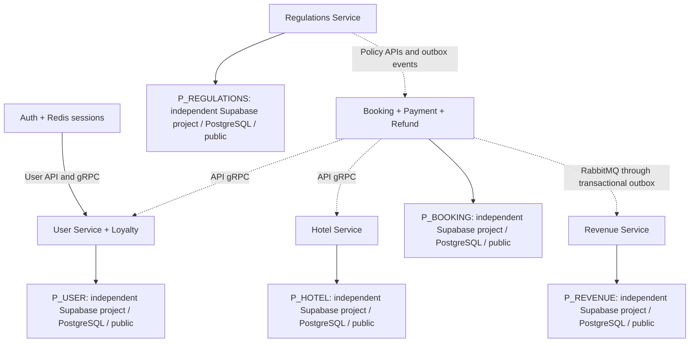

# Five Supabase Projects — One PostgreSQL Database Per Service Owner

> Current: Batch5B local canonical acceptance DONE (14/11/2026); see appended checkpoint. Older statuses are dated history. Supabase/Batch6 not executed.

> Current status: Batch5A U01/U03/U04 APPROVED;38 source conversions implemented, PARTIAL acceptance. Earlier pending/proposed statements below record Batch4.1 history; see Batch5A checkpoint at end. No database migration applied.


Batch4.1 revision, 13/11/2026, Asia/Saigon. **Topology APPROVED BY USER; projects được người dùng báo đã tạo, configuration/connectivity/deployment NOT VERIFIED.** Batch4 one-project/five-schema recommendation **SUPERSEDED**, không là target dự phòng tự động. Không đọc/ghi/kết nối Supabase trong batch này. [ID contract](ID_STANDARDIZATION_CONTRACT.md), [canonical schema](CANONICAL_DATABASE_SCHEMA_V1.md), [staged plan](MIGRATION_IMPLEMENTATION_PLAN.md).

## Architecture và ownership



| Alias, không real project ref | Owner/domain | Tables | Database/namespace/history |
|---|---|---:|---|
| P_USER | User identity/OTP/profile/Loyalty | 7 | Own supplied PostgreSQL database, public.flyway_schema_history |
| P_HOTEL | Hotel/Room/inventory/content/audit/catalog | 24 | Own database, public.flyway_schema_history |
| P_BOOKING | Booking/items/Payment/Refund/outbox/audit | 7 | Own database, public.flyway_schema_history |
| P_REVENUE | Projections/immutable cash/receipt/gaps | 5 | Own database, public.flyway_schema_history |
| P_REGULATIONS | Global policies/snapshots/outbox | 3 | Own database, public.flyway_schema_history |

Public namespace là **đề xuất thiết kế có security acceptance gates**, không claim projects đang cấu hình như vậy. PostgreSQL database name/endpoint lấy từ mỗi Connect panel lúc deployment, thường postgres; aliases trên không phải tên/URL thật. Same public.table name ở hai projects không có shared ownership hoặc FK. Auth không project thứ sáu; Redis session/revocation vẫn riêng. Media storage/Hotel metadata không đổi, chưa xác nhận storage project mapping và không tự relink. Place protected ngoài provision/schema/UUID/runtime changes.

## Namespace decision: public trong từng project

Ưu tiên public vì datasource/local dump/native JDBC/guards hiện chủ yếu unqualified public objects; mỗi project chỉ một domain owner nên custom schema không thêm service isolation. Public tương thích Spring/JPA/Flyway mà ít search_path changes hơn Batch4. Tuy nhiên **public không an toàn mặc định**; Data API/default privileges phải được kiểm.

| Choice | Benefit | Risk / decision |
|---|---|---|
| public per project — proposed | Ít namespace refactor, existing JDBC/regclass/schema guards dễ giữ | Data API exposure/default grants: disable business API access + revoke scoped grants/default grants + negative tests |
| dedicated app schema per project | Extra unexposed namespace boundary nếu project không thể disable/remove public API | Chỉ chọn qua documented security blocker; vẫn five independent projects, revise model/profile/history/search_path đồng bộ |

Không tự fallback shared project hoặc expose public để làm startup green. Local Batch5B dùng **năm fresh PostgreSQL databases**, có thể cùng disposable local server với independent database ownership; không cùng database/năm schemas. Supabase Batch6 năm independent projects/DB endpoints; managed auth/storage/extensions schemas không sửa. Public object search_path explicitly public, pg_catalog built-ins implicit; loại writable user-selected schemas và CREATE rights khỏi runtime role.

## Permissions, Data API và RLS

Proposed per-project NOLOGIN owner, LOGIN migrator được SET ROLE owner trong migration job, LOGIN app không owner/superuser/BYPASSRLS/DDL. App chỉ CONNECT own database, USAGE public và DML/sequence grants theo current workflows; không dùng postgres/service_role/Supabase API key làm JDBC runtime credential. Default privileges **FOR ROLE thực sự tạo object**, sequences riêng; Flyway history chỉ migrator writes. Ledger/audit append-only tables ưu tiên SELECT+INSERT sau kiểm current callers, không blanket grant UPDATE/DELETE vào immutable cash/audit.

Vì backend là business boundary, đề xuất **disable Data API từng project nếu không có dependency cần dùng**, và kiểm/remove public khỏi exposed schemas nếu áp dụng; không giả đã disabled. Revoke scoped existing/default table/sequence/function permissions cho anon/authenticated/service_role và inappropriate PUBLIC privileges; kiểm inherited roles/defaults của creator thực tế. Không revoke managed storage/auth privileges toàn database. Nếu còn API cần dùng cho managed components, phải verify cấu hình hỗ trợ + business tables inaccessible qua anonymous/authenticated/service-role Data API và RLS plan riêng trước chọn public. Không viết blanket USING(true) để bypass; backend app access phải có explicit grants/RLS behavior nếu bật RLS. Service-role BYPASSRLS khiến RLS một mình không bảo vệ business access; grants/exposure cần kiểm độc lập. [Official Data API security](https://supabase.com/docs/guides/api/securing-your-api).

Không claim JPA JDBC tự có per-user RLS: Gateway/owner authorization vẫn bắt buộc. Staging test guest/authenticated browser cannot SELECT/INSERT/update business data ngoài backend; runtime app denied DDL/history writes; migrator creates objects đúng owner. [Supabase roles](https://supabase.com/docs/guides/database/postgres/roles).

## Connections: independent endpoint/credentials/pool per service

Direct endpoint là ưu tiên long-lived Spring Boot/Hikari nếu network hỗ trợ IPv6/IPv4 add-on của target. Session pooler phù hợp IPv4 khi direct unavailable; lấy exact host/port/user từ từng project's Connect panel. Migration/backup dùng direct, hoặc session đã kiểm nếu direct inaccessible. Transaction pooler không mặc định: session state/prepared statement behavior/schema/advisory-lock assumptions phải test theo endpoint/pgJDBC; không đổi port để đoán. [Supabase connections](https://supabase.com/docs/guides/database/connecting-to-postgres), [IPv4](https://supabase.com/docs/guides/platform/ipv4-address).

Template không real credentials, mỗi service một bộ riêng:

```text
jdbc:postgresql://<owner-project-endpoint>:<dashboard-port>/<dashboard-database>?currentSchema=public&sslmode=verify-full&sslrootcert=<mounted-ca-path>
```

Password từ secret manager/runtime injection, không prompt/Git/URL/log; không yêu cầu người dùng gửi password trong chat. verify-full + trusted CA/hostname và rotation, không sslmode=disable. Pin endpoint/session and prepared statement behavior trước acceptance. [pgJDBC parameters](https://jdbc.postgresql.org/documentation/use/).

Hikari maxPoolSize/minimumIdle/connectionTimeout/maxLifetime tính **từng project**: replicas × maxPoolSize + migrator/backup/admin/managed reserve <= budget thực. Không một shared budget hoặc copy default10 cho mọi replica. Plan/limits/regions/versions chưa biết; để symbolic inputs, không invented limits. Direct/session long-lived pools giữ backend resources, measure server/pool metrics. Network failure fail-closed, bounded retry/backoff và durable intents; không retry payment/refund mutation như query vô hại. Transaction advisory locks vẫn ở owner local transaction, không distributed locking. [Pool limits](https://supabase.com/docs/guides/database/connecting-to-postgres/pooling-and-limits).

## Configuration mapping — future implementation only

| Owner | Compose wrapper inputs hiện có | Proposed runtime inputs |
|---|---|---|
| User | USER_DB_URL | Per-container SPRING_DATASOURCE_URL/USERNAME/PASSWORD, owned P_USER endpoint |
| Hotel | HOTEL_DB_URL | Same Boot variables, different P_HOTEL values |
| Booking | BOOKING_DB_URL; application DB_URL fallback | Same Boot vars, reconcile DB_URL conflict, P_BOOKING |
| Revenue | REVENUE_DB_URL; application DB_URL fallback | Same Boot vars, reconcile DB_URL conflict, P_REVENUE |
| Regulations | REGULATIONS_DB_URL | Same Boot vars, P_REGULATIONS |

Variables reused by name inside independent container scopes; values/credentials never shared across services. Runtime `hibernate.default_schema=public`, JDBC currentSchema=public; Flyway defaultSchema/schemas=public **on the matching project URL**. Histories all named public.flyway_schema_history but physically independent. Migrator FLYWAY_URL/USER/PASSWORD/LOCATIONS per deployment job, unique secret target allowlist; runtime Flyway disabled if dedicated jobs selected. Canonical JPA validate transition Batch5B, no ddl-auto change here. JVM/JDBC time zone remains D03 review; UUID audit does not convert timestamps.

## Flyway, deployment order và recovery

Năm independent canonical chains `db/canonical/V1__baseline.sql` (proposed names, no SQL created here), exclusive locations, no old migration scan. Fresh V1 creates objects via migrate, no baseline marker substituting DDL. Preserve old migration/history bytes. One deployment job per owner, checksum validation/cleanDisabled/role target assertions; không cross-project FK/FDW/dblink/database transaction. API/gRPC/RabbitMQ/outbox remain boundaries. [Flyway schemas/history](https://documentation.red-gate.com/flyway/reference/configuration/environments-namespace/environment-schemas-setting).

Batch5A approved UUID code/adapters → Batch5B five fresh local databases/V1/runtime gates → Batch6 provisioned existing five projects identity/security/network review → per-project V1 + validate → broker/User/Hotel/Regulations readiness → Revenue consumers + Booking producers/Gateway → E2E/restore/cutover. Independent migrations không có FK ordering xuyên project; startup order là operational RPC/event readiness. No application start against old varchar DB with new UUID binds.

Backup/restore per project, actual plan retention/PITR/RPO/RTO verified separately, không assume purchased features. Financial consistency across projects không có shared snapshot: record event checkpoints, outbox/event IDs, ledger source_event/version, pending commands và reconciliation plan. Restoring only Booking hoặc Revenue can replay/diverge; pause affected writers/consumers, restore isolated target, reconcile dedup/evidence before resume. Do not mutate original receipts/ledger to hide mismatch. Cutover quiesces mixed old/new writers/queues/cache/clients, retains old databases intact; post-write rollback requires reconciliation, not blind config flip.

## Staging acceptance gates / known risks

- Five existing project identities mapped without real URLs in Git; target allowlist, PG/Flyway/JDBC versions, backup/recovery verified privately. Creation alone proves none of these.
- Each direct/session SSL connection verified, own app/migrator credentials/namespace/grants/history, negative business Data API and DDL tests; managed components unaffected.
- Pool/replica budgets and network outage/recovery per project; no cross-project transaction dependency.
- Approved 38 UUID conversions with JDBC UUID binds, string wire validators, producer/consumer/hash/fixture regression; raw receipt/system actors/external references remain legal.
- Batch1–2 Booking/Hotel no oversell, payment retry, Internal Refund receipt/outbox/single DEBIT, Revenue CREDIT/DEBIT, loyalty reversal, policy snapshot/outbox acceptance on new target.
- Existing D01/D02 money/rate, D03 time, D04 deletion, D07 retention, D08 cutover, D09 seeds remain independent gates. UUID consistency/topology design does not close them.

Historical decision: Batch4 one-project/five-service-schema alternative superseded by explicit user decision in Batch4.1; all current canonical documents/model now target five projects, public per owned database proposal.

## Batch 5A implementation checkpoint — 13/11/2026

U01 approved38 conversions implemented in source (User3 / Booking21 / Revenue14); U03 approved fresh databases without demo import; U04 approved ratePlanId String. U02 evidence: golden legacy/new PASS, eight backend builds PASS (901 tests,39 existing skips), three isolated PostgreSQL contract tests PASS, frontend regression211 PASS. JSON/protobuf strings, Booking/hold UUIDv3 recipes, hashes, provider refs, raw Revenue receipts and domain policies retained.

**Batch5A PARTIAL:** frontend tsc retains baseline protected Place showDistance error; no Place/frontend edits allowed. Full broker/Gateway/multi-node/restart and canonical migration acceptance NOT RUN. Current source mapping is UUID; actual supplied snapshot types and historical migrations remain unchanged. Never start new code against old VARCHAR schema. Native create-only synthetic tests are not canonical Flyway V1/JPA validate acceptance.

Current model preserves batch4_1_* provenance; current source/binding status supersedes earlier pending-U01 language. Historical reports/inventories remain as-of Batch4.1; this checkpoint records the approved implementation. Five independent Supabase projects unchanged. STD-021 IN_PROGRESS, STD-006 OPEN; Batch5B/6 not started. No current DB/Supabase/runtime-config/history/Place or Git index/commit mutations. [Batch5A report](../BATCH5A_UUID_CONTRACT_IMPLEMENTATION_2026-11-13.md), [evidence](../evidence/batch-5a-uuid/implementation-inventory.md).


## Batch 5B implementation checkpoint — 14/11/2026

**DONE for local canonical acceptance; Supabase/Batch6 NOT STARTED.** Five standalone canonical V1 chains/service db/canonical,46 tables/458 columns, five independent PostgreSQL databases/public histories. Bootstrap/rerun/catalog/Hibernate5/5 PASS;32 repositories/guards; runtime roles deny DDL/history/cross-service CONNECT. Guarded external job, opt-in runtime canonical validates/disables Flyway/SQL init; legacy defaults/migrations retained.

D01 historical unbounded Loyalty input/result/reservation total/discount and Revenue cash NUMERIC retained; bounded money38,2 unchanged. D02 exact rate; D03 Instant/timestamptz vs LocalDateTime/timestamp/date retained, JVM/JDBC/sessionUTC tested; D04 logical Room–Hotel/no cascade; D09 Java sole seed owner. Earlier proposal/model provenance stays historical design, executed local facts are recorded separately in5B evidence.

901 backend regressions executed/47 opt-in skips,8 packages PASS;5 canonical native tests PASS. Actual5 apps UP/restart5/5 with owned RabbitMQ/Redis; positive-points Booking/Hotel/User/Payment/refund/Revenue/concurrency/broker-outage/outbox/replay PASS. Place showDistance fixed minimally, tsc PASS,3 component+211 regressions PASS, lint0 errors/2 existing warnings. Minimal repository parameter correction findByRoomTypeId(UUID).

STD-021 local canonical gate complete; hosted deployment/managed security/backup/cutover and vendor PG/Flyway version certification future gates. STD-006 stock provenance OPEN/no default10/import. Full Gateway/provider/SMTP/Media/multi-node/all skipped opt-ins NOT VERIFIED. No Supabase connection/automatic Batch6. [Report](../BATCH5B_CANONICAL_FLYWAY_IMPLEMENTATION_2026-11-14.md), [evidence](../evidence/batch-5b-canonical-flyway/REPRODUCE.md).
