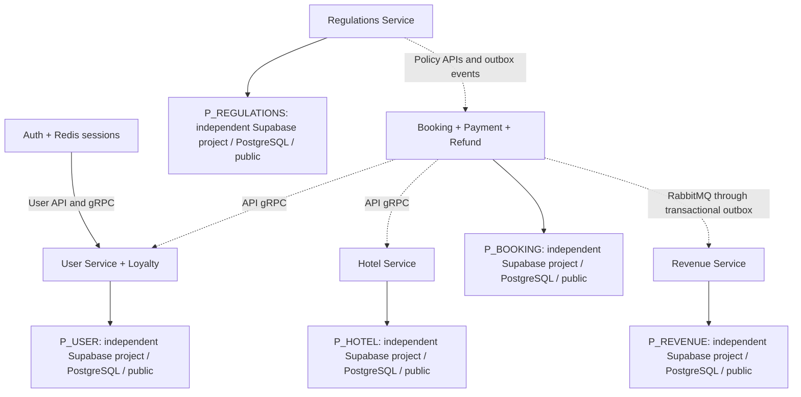

# Five Supabase Projects — One PostgreSQL Database Per Service Owner

> **Provider closure 17/11/2026 — Batch6B: DONE cho phạm vi local development + VNPay Sandbox/Storage.** Actual NCB card/OTP → return00 → payment COMPLETED, booking CONFIRMED, một Revenue CREDIT; callback replay/negative checks PASS. Storage upload/private signing PASS; fixture đã dọn. [Evidence và giới hạn](../BATCH6B_VNPAY_SANDBOX_ACCEPTANCE_2026-11-17.md). Các provider BLOCKED/PARTIAL ở checkpoint16/11 phía dưới là lịch sử; không tự đóng production/IPN/refund, batch khác hoặc parent standardization findings.

> Trạng thái hiện hành 16/11/2026: **Batch 6B overall PARTIAL; core database/local integration VERIFIED/PASS, provider acceptance BLOCKED (VNPay code 71, Storage NXDOMAIN).** Năm projects / 46 business tables / 5 Flyway histories / 32 JPA entities; startup/restart và 117 workflow checks đã PASS theo evidence. Backend cloud deployment chưa thực hiện. Fixtures đã cleanup 192 rows; cấu hình daily Supabase=`docker/.env`, Test=`docker/.env.test`; private runtime fallback đã tắt. Quan sát runtime cuối ghi stopped trước configuration cleanup, không khẳng định đang chạy. [Báo cáo tổng kết](../BATCH6B_FINAL_COMPLETION_REPORT_2026-11-16.md). Các kết luận phía dưới giữ nguyên theo checkpoint lịch sử; trạng thái hiện hành ưu tiên ghi chú này.

> Historical status (superseded by checkpoint 16/11/2026): Current: Batch5B local canonical acceptance DONE (14/11/2026); see appended checkpoint. Older statuses are dated history. Supabase/Batch6 not executed.

> Historical status (superseded by checkpoint 16/11/2026): Current status: Batch5A U01/U03/U04 APPROVED;38 source conversions implemented, PARTIAL acceptance. Earlier pending/proposed statements below record Batch4.1 history; see Batch5A checkpoint at end. No database migration applied.


Batch4.1 revision, 13/11/2026, Asia/Saigon. **Topology APPROVED BY USER; projects được người dùng báo đã tạo, configuration/connectivity/deployment NOT VERIFIED.** Batch4 one-project/five-schema recommendation **SUPERSEDED**, không là target dự phòng tự động. Không đọc/ghi/kết nối Supabase trong batch này. [ID contract](ID_STANDARDIZATION_CONTRACT.md), [canonical schema](CANONICAL_DATABASE_SCHEMA_V1.md), [staged plan](MIGRATION_IMPLEMENTATION_PLAN.md).

## Architecture và ownership



| Alias, không real project ref | Owner/domain | Tables | Database/namespace/history |
|---|---|---:|---|
| P_USER | User identity/OTP/profile/Loyalty | 7 | Own supplied PostgreSQL database, public.flyway_schema_history |
| P_HOTEL | Hotel/Room/inventory/content/audit/catalog | 24 | Own database, public.flyway_schema_history |
| P_BOOKING | Booking/items/Payment/Refund/outbox/audit | 7 | Own database, public.flyway_schema_history |
| P_REVENUE | Projections/immutable cash/receipt/gaps | 5 | Own database, public.flyway_schema_history |
| P_REGULATIONS | Global policies/snapshots/outbox | 3 | Own database, public.flyway_schema_history |

Public namespace là **đề xuất thiết kế có security acceptance gates**, không claim projects đang cấu hình như vậy. PostgreSQL database name/endpoint lấy từ mỗi Connect panel lúc deployment, thường postgres; aliases trên không phải tên/URL thật. Same public.table name ở hai projects không có shared ownership hoặc FK. Auth không project thứ sáu; Redis session/revocation vẫn riêng. Media storage/Hotel metadata không đổi, chưa xác nhận storage project mapping và không tự relink. Place protected ngoài provision/schema/UUID/runtime changes.

## Namespace decision: public trong từng project

Ưu tiên public vì datasource/local dump/native JDBC/guards hiện chủ yếu unqualified public objects; mỗi project chỉ một domain owner nên custom schema không thêm service isolation. Public tương thích Spring/JPA/Flyway mà ít search_path changes hơn Batch4. Tuy nhiên **public không an toàn mặc định**; Data API/default privileges phải được kiểm.

| Choice | Benefit | Risk / decision |
|---|---|---|
| public per project — proposed | Ít namespace refactor, existing JDBC/regclass/schema guards dễ giữ | Data API exposure/default grants: disable business API access + revoke scoped grants/default grants + negative tests |
| dedicated app schema per project | Extra unexposed namespace boundary nếu project không thể disable/remove public API | Chỉ chọn qua documented security blocker; vẫn five independent projects, revise model/profile/history/search_path đồng bộ |

Không tự fallback shared project hoặc expose public để làm startup green. Local Batch5B dùng **năm fresh PostgreSQL databases**, có thể cùng disposable local server với independent database ownership; không cùng database/năm schemas. Supabase Batch6 năm independent projects/DB endpoints; managed auth/storage/extensions schemas không sửa. Public object search_path explicitly public, pg_catalog built-ins implicit; loại writable user-selected schemas và CREATE rights khỏi runtime role.

## Permissions, Data API và RLS

Proposed per-project NOLOGIN owner, LOGIN migrator được SET ROLE owner trong migration job, LOGIN app không owner/superuser/BYPASSRLS/DDL. App chỉ CONNECT own database, USAGE public và DML/sequence grants theo current workflows; không dùng postgres/service_role/Supabase API key làm JDBC runtime credential. Default privileges **FOR ROLE thực sự tạo object**, sequences riêng; Flyway history chỉ migrator writes. Ledger/audit append-only tables ưu tiên SELECT+INSERT sau kiểm current callers, không blanket grant UPDATE/DELETE vào immutable cash/audit.

Vì backend là business boundary, đề xuất **disable Data API từng project nếu không có dependency cần dùng**, và kiểm/remove public khỏi exposed schemas nếu áp dụng; không giả đã disabled. Revoke scoped existing/default table/sequence/function permissions cho anon/authenticated/service_role và inappropriate PUBLIC privileges; kiểm inherited roles/defaults của creator thực tế. Không revoke managed storage/auth privileges toàn database. Nếu còn API cần dùng cho managed components, phải verify cấu hình hỗ trợ + business tables inaccessible qua anonymous/authenticated/service-role Data API và RLS plan riêng trước chọn public. Không viết blanket USING(true) để bypass; backend app access phải có explicit grants/RLS behavior nếu bật RLS. Service-role BYPASSRLS khiến RLS một mình không bảo vệ business access; grants/exposure cần kiểm độc lập. [Official Data API security](https://supabase.com/docs/guides/api/securing-your-api).

Không claim JPA JDBC tự có per-user RLS: Gateway/owner authorization vẫn bắt buộc. Staging test guest/authenticated browser cannot SELECT/INSERT/update business data ngoài backend; runtime app denied DDL/history writes; migrator creates objects đúng owner. [Supabase roles](https://supabase.com/docs/guides/database/postgres/roles).

## Connections: independent endpoint/credentials/pool per service

Direct endpoint là ưu tiên long-lived Spring Boot/Hikari nếu network hỗ trợ IPv6/IPv4 add-on của target. Session pooler phù hợp IPv4 khi direct unavailable; lấy exact host/port/user từ từng project's Connect panel. Migration/backup dùng direct, hoặc session đã kiểm nếu direct inaccessible. Transaction pooler không mặc định: session state/prepared statement behavior/schema/advisory-lock assumptions phải test theo endpoint/pgJDBC; không đổi port để đoán. [Supabase connections](https://supabase.com/docs/guides/database/connecting-to-postgres), [IPv4](https://supabase.com/docs/guides/platform/ipv4-address).

Template không real credentials, mỗi service một bộ riêng:

```text
jdbc:postgresql://<owner-project-endpoint>:<dashboard-port>/<dashboard-database>?currentSchema=public&sslmode=verify-full&sslrootcert=<mounted-ca-path>
```

Password từ secret manager/runtime injection, không prompt/Git/URL/log; không yêu cầu người dùng gửi password trong chat. verify-full + trusted CA/hostname và rotation, không sslmode=disable. Pin endpoint/session and prepared statement behavior trước acceptance. [pgJDBC parameters](https://jdbc.postgresql.org/documentation/use/).

Hikari maxPoolSize/minimumIdle/connectionTimeout/maxLifetime tính **từng project**: replicas × maxPoolSize + migrator/backup/admin/managed reserve <= budget thực. Không một shared budget hoặc copy default10 cho mọi replica. Plan/limits/regions/versions chưa biết; để symbolic inputs, không invented limits. Direct/session long-lived pools giữ backend resources, measure server/pool metrics. Network failure fail-closed, bounded retry/backoff và durable intents; không retry payment/refund mutation như query vô hại. Transaction advisory locks vẫn ở owner local transaction, không distributed locking. [Pool limits](https://supabase.com/docs/guides/database/connecting-to-postgres/pooling-and-limits).

## Configuration mapping — future implementation only

| Owner | Compose wrapper inputs hiện có | Proposed runtime inputs |
|---|---|---|
| User | USER_DB_URL | Per-container SPRING_DATASOURCE_URL/USERNAME/PASSWORD, owned P_USER endpoint |
| Hotel | HOTEL_DB_URL | Same Boot variables, different P_HOTEL values |
| Booking | BOOKING_DB_URL; application DB_URL fallback | Same Boot vars, reconcile DB_URL conflict, P_BOOKING |
| Revenue | REVENUE_DB_URL; application DB_URL fallback | Same Boot vars, reconcile DB_URL conflict, P_REVENUE |
| Regulations | REGULATIONS_DB_URL | Same Boot vars, P_REGULATIONS |

Variables reused by name inside independent container scopes; values/credentials never shared across services. Runtime `hibernate.default_schema=public`, JDBC currentSchema=public; Flyway defaultSchema/schemas=public **on the matching project URL**. Histories all named public.flyway_schema_history but physically independent. Migrator FLYWAY_URL/USER/PASSWORD/LOCATIONS per deployment job, unique secret target allowlist; runtime Flyway disabled if dedicated jobs selected. Canonical JPA validate transition Batch5B, no ddl-auto change here. JVM/JDBC time zone remains D03 review; UUID audit does not convert timestamps.

## Flyway, deployment order và recovery

Năm independent canonical chains `db/canonical/V1__baseline.sql` (proposed names, no SQL created here), exclusive locations, no old migration scan. Fresh V1 creates objects via migrate, no baseline marker substituting DDL. Preserve old migration/history bytes. One deployment job per owner, checksum validation/cleanDisabled/role target assertions; không cross-project FK/FDW/dblink/database transaction. API/gRPC/RabbitMQ/outbox remain boundaries. [Flyway schemas/history](https://documentation.red-gate.com/flyway/reference/configuration/environments-namespace/environment-schemas-setting).

Batch5A approved UUID code/adapters → Batch5B five fresh local databases/V1/runtime gates → Batch6 provisioned existing five projects identity/security/network review → per-project V1 + validate → broker/User/Hotel/Regulations readiness → Revenue consumers + Booking producers/Gateway → E2E/restore/cutover. Independent migrations không có FK ordering xuyên project; startup order là operational RPC/event readiness. No application start against old varchar DB with new UUID binds.

Backup/restore per project, actual plan retention/PITR/RPO/RTO verified separately, không assume purchased features. Financial consistency across projects không có shared snapshot: record event checkpoints, outbox/event IDs, ledger source_event/version, pending commands và reconciliation plan. Restoring only Booking hoặc Revenue can replay/diverge; pause affected writers/consumers, restore isolated target, reconcile dedup/evidence before resume. Do not mutate original receipts/ledger to hide mismatch. Cutover quiesces mixed old/new writers/queues/cache/clients, retains old databases intact; post-write rollback requires reconciliation, not blind config flip.

## Staging acceptance gates / known risks

- Five existing project identities mapped without real URLs in Git; target allowlist, PG/Flyway/JDBC versions, backup/recovery verified privately. Creation alone proves none of these.
- Each direct/session SSL connection verified, own app/migrator credentials/namespace/grants/history, negative business Data API and DDL tests; managed components unaffected.
- Pool/replica budgets and network outage/recovery per project; no cross-project transaction dependency.
- Approved 38 UUID conversions with JDBC UUID binds, string wire validators, producer/consumer/hash/fixture regression; raw receipt/system actors/external references remain legal.
- Batch1–2 Booking/Hotel no oversell, payment retry, Internal Refund receipt/outbox/single DEBIT, Revenue CREDIT/DEBIT, loyalty reversal, policy snapshot/outbox acceptance on new target.
- Existing D01/D02 money/rate, D03 time, D04 deletion, D07 retention, D08 cutover, D09 seeds remain independent gates. UUID consistency/topology design does not close them.

Historical decision: Batch4 one-project/five-service-schema alternative superseded by explicit user decision in Batch4.1; all current canonical documents/model now target five projects, public per owned database proposal.

## Batch 5A implementation checkpoint — 13/11/2026

U01 approved38 conversions implemented in source (User3 / Booking21 / Revenue14); U03 approved fresh databases without demo import; U04 approved ratePlanId String. U02 evidence: golden legacy/new PASS, eight backend builds PASS (901 tests,39 existing skips), three isolated PostgreSQL contract tests PASS, frontend regression211 PASS. JSON/protobuf strings, Booking/hold UUIDv3 recipes, hashes, provider refs, raw Revenue receipts and domain policies retained.

**Batch5A PARTIAL:** frontend tsc retains baseline protected Place showDistance error; no Place/frontend edits allowed. Full broker/Gateway/multi-node/restart and canonical migration acceptance NOT RUN. Current source mapping is UUID; actual supplied snapshot types and historical migrations remain unchanged. Never start new code against old VARCHAR schema. Native create-only synthetic tests are not canonical Flyway V1/JPA validate acceptance.

Current model preserves batch4_1_* provenance; current source/binding status supersedes earlier pending-U01 language. Historical reports/inventories remain as-of Batch4.1; this checkpoint records the approved implementation. Five independent Supabase projects unchanged. STD-021 IN_PROGRESS, STD-006 OPEN; Batch5B/6 not started. No current DB/Supabase/runtime-config/history/Place or Git index/commit mutations. [Batch5A report](../BATCH5A_UUID_CONTRACT_IMPLEMENTATION_2026-11-13.md), [evidence](../evidence/batch-5a-uuid/implementation-inventory.md).


## Batch 5B implementation checkpoint — 14/11/2026

**DONE for local canonical acceptance; Supabase/Batch6 NOT STARTED.** Five standalone canonical V1 chains/service db/canonical,46 tables/458 columns, five independent PostgreSQL databases/public histories. Bootstrap/rerun/catalog/Hibernate5/5 PASS;32 repositories/guards; runtime roles deny DDL/history/cross-service CONNECT. Guarded external job, opt-in runtime canonical validates/disables Flyway/SQL init; legacy defaults/migrations retained.

D01 historical unbounded Loyalty input/result/reservation total/discount and Revenue cash NUMERIC retained; bounded money38,2 unchanged. D02 exact rate; D03 Instant/timestamptz vs LocalDateTime/timestamp/date retained, JVM/JDBC/sessionUTC tested; D04 logical Room–Hotel/no cascade; D09 Java sole seed owner. Earlier proposal/model provenance stays historical design, executed local facts are recorded separately in5B evidence.

901 backend regressions executed/47 opt-in skips,8 packages PASS;5 canonical native tests PASS. Actual5 apps UP/restart5/5 with owned RabbitMQ/Redis; positive-points Booking/Hotel/User/Payment/refund/Revenue/concurrency/broker-outage/outbox/replay PASS. Place showDistance fixed minimally, tsc PASS,3 component+211 regressions PASS, lint0 errors/2 existing warnings. Minimal repository parameter correction findByRoomTypeId(UUID).

STD-021 local canonical gate complete; hosted deployment/managed security/backup/cutover and vendor PG/Flyway version certification future gates. STD-006 stock provenance OPEN/no default10/import. Full Gateway/provider/SMTP/Media/multi-node/all skipped opt-ins NOT VERIFIED. No Supabase connection/automatic Batch6. [Report](../BATCH5B_CANONICAL_FLYWAY_IMPLEMENTATION_2026-11-14.md), [evidence](../evidence/batch-5b-canonical-flyway/REPRODUCE.md).

## Batch6A checkpoint — 14/11/2026: Supabase readiness/security

**DESIGN/AUDIT DONE (static); Batch6B NOT READY for execution.** [Report](../BATCH6A_SUPABASE_READINESS_SECURITY_AUDIT_2026-11-14.md), [6B execution plan](../evidence/batch-6a-supabase-readiness/batch-6b-execution-plan.md), [risk matrix](../evidence/batch-6a-supabase-readiness/remaining-risks.md). This current checkpoint supersedes earlier “Batch6 not started” statements only for static6A; historical5A/5B results above remain unchanged.

Five existing independent projects retained; actual identity/endpoints/credentials/server versions/plans/API/RLS/grants/backups all NOT VERIFIED, no HOSTED VERIFIED items. Current V1 hashes match5B; canonical runtime validates/disables Flyway/SQL init when correctly selected. Compose currently selects docker only; base four ddl-auto=update and User baseline=true are deployment blockers until reviewed canonical overlay/resolved configuration. Existing5B runner is loopback-only, not hosted deploy tooling.

Direct TLS or accepted session pooler for persistent JDBC; dedicated guarded Flyway runner, verify-full/CA/hostname; transaction mode not selected for current session-init workload. Hikari5.1.0 default max10, each project budget replicas*max+migration+headroom; plan/replica allocation unknown, candidate lower pools not applied. Flyway10.10 major16 threshold requires actual server-version support review; no dependency upgrade performed.

Public Data API/default ACL/managed-role exposure requires pre-creation hardening and SQL/API negative tests, runtime/migrator separation, owner-specific grants; local5B permission PASS is not Supabase acceptance. Backup/PITR/RPO/RTO/restore drill and fresh broker/Redis/cutover/financial reconciliation gates documented. No demo import/cache/old event replay; STD-006 remains OPEN, no guessed stock10.

No hosted query/migration/DDL/DML/role/RLS/dashboard/backup/cutover, no Place/history/source/config/real.env changes or Git stage/commit/push.6B requires metadata/hosting/recovery inputs and explicit execution authorization after blockers close, not topology reapproval.


## Batch6B checkpoint — 14/11/2026: local backend → five Supabase databases

**PARTIAL; hosted execution BLOCKED, chưa DONE.** Đã thêm opt-in supabase-dev/local profiles, per-owner environment contract/startup guards, standalone guarded Flyway preflight/migrate runner, dedicated local RabbitMQ/Redis compose và local tests. Legacy defaults/V1/history/Place/business rules không sửa. Runtime validate/SQL never/Flyway false, fail-closed/no fallback; secrets không lưu report.

Actual five refs/org/Connect/TLS/version/budget/roles/Data API chưa cấu hình/xác minh riêng cho6B; không hosted SQL/DDL/dashboard/grants/fixtures. Phải có preflight/security PASS và user approval chính xác project/service/migration trước DDL. Active event triggers hoặc managed non-extension public objects cần review guard allowlist; không bypass. Hibernate/startup/business hosted đều BLOCKED; local regression không thay hosted acceptance. Backend/frontend/Gateway/Eureka/RabbitMQ/Redis tiếp tục chạy local, không cloud deployment.

[Báo cáo6B](../BATCH6B_SUPABASE_LOCAL_DATABASE_INTEGRATION_2026-11-14.md), [hướng dẫn/evidence](../evidence/batch-6b-supabase-local-integration/reproduction-guide.md). Historical5A/5B/6A giữ nguyên as-of scope; STD-021 hosted IN_PROGRESS, STD-006 provenance OPEN.


## Batch6B PostgreSQL17 follow-up — 15/11/2026

Standalone runner1.1.0/Flyway10.22.0 đã kiểm trên new isolated PostgreSQL17.11:13 tests PASS,5 V1+validate+rerun no-op và scoped role/grant SQL local PASS. Service POMs/Boot/V1/history/business/Place/frontend không đổi. Package role/security review và admin read-only inspector đã chuẩn bị; chưa apply hosted, chưa tạo roles/passwords hoặc bật runtime. PostgreSQL17 version blocker đã đóng ở tooling/local; actual identity/TLS/Supavisor/Data API/managed permissions/event-trigger/security/approval vẫn BLOCKED. Overall6B PARTIAL, không hosted PASS từ local tests.

[Follow-up report](../BATCH6B_POSTGRES17_RUNNER_ROLE_REVIEW_2026-11-15.md), [runner runbook](../../tools/supabase-runner/README.md). Không stage/commit/push/cloud deployment/Batch7.


## Batch6B User hosted preflight —16/11/2026

Actual User-only Management API identity + migrator/runtime JDBC + client TLSv1.3/CA/hostname negatives + empty/history/default ACL/event-policy checks PASS in read-only scope. Runner1.3.0 now separates client TLS from pooler backend. Observed backend pg_stat_ssl=false, so migration remains BLOCKED; no TLS downgrade or backend-TLS exception for migrate. PUBLIC TEMP inheritance and Data API401 limitation retained.18 local tests PASS; other4 hosted preflights/roles/migrations/JPA/workflows NOT RUN. Overall6B PARTIAL, no DDL/DML/settings/app startup.

[16/11 report](../BATCH6B_USER_HOSTED_PREFLIGHT_2026-11-16.md), [redacted evidence](../evidence/batch-6b-supabase-local-integration/user-hosted-preflight-summary-2026-11-16.json).

## Approved hosted migration checkpoint —16/11/2026

All five canonical V1 migrations + Flyway validation + immediate no-op reruns PASS after explicit five-target approval. Scoped runtime grants applied; hosted catalog/role/API-right checks and32 standalone Hibernate entity validations PASS.46 business tables plus5 history tables;30 actual expected permission-denied probes; no business rows read/modified by probes. No local service startup. Runtime PUBLIC TEMP and operator-confirmed Data API setting limitations remain; pool budgets, dedicated broker/cache isolation/startup and business workflows pending. Overall6B PARTIAL.

See [hosted migration acceptance](../BATCH6B_HOSTED_MIGRATION_ACCEPTANCE_2026-11-16.md) for actual evidence and scope; prior checkpoint statements remain historical as-of observations.

## Final16/11/2026 — DONE cho local development

Cả5 Supabase DB, independent security config (SSL enforced/exposed schemas rỗng), V1/history/catalog/Hibernate và actual startup/restart PASS.117 hosted workflow checks,5 cross-project negative logins,30 privilege denials,5 bounded pool exhaustion/recovery probes PASS. Pool max2/min1; fresh broker/cache session, Mailpit local; NextAuth end-to-end PASS.848 backend executed PASS/47 optional skip, frontend214 PASS và typecheck. Không business-rule/Place/frontend/base SQL/YAML changes, cloud backend hoặc destructive cleanup. Synthetic rows giữ lại.

VNPay provider thật/Storage uploads NOT RUN; callbacks chỉ HTTP local giả lập, SMTP chỉ Mailpit. PUBLIC TEMP/legacy STD-006 vẫn được ghi nhận; không chứng nhận production readiness. Các checkpoint PARTIAL/BLOCKED phía trên là lịch sử as-of.

[Final report](../BATCH6B_SUPABASE_LOCAL_DATABASE_INTEGRATION_2026-11-16.md); [final evidence](../evidence/batch-6b-supabase-local-integration/final-verification-2026-11-16.json).

## Checkpoint đồng bộ và xét đóng Batch 6B — 16/11/2026

Core database/local acceptance đã đủ evidence; overall PARTIAL do phạm vi provider thực tế còn BLOCKED. Các checkpoint cũ NOT STARTED/BLOCKED/DONE phản ánh phạm vi và thời điểm trước đó, không được dùng thay current status. Cleanup fixtures và consolidation thay thế các ghi chú cũ về giữ synthetic rows, stack đang chạy và private `.local` fallback.

Giữ mở PUBLIC TEMP, STD-006 stock provenance, legacy cutover/recovery, real provider payment/refund/Storage, production backup/PITR/restore/RPO/RTO, broad outage/load và backend cloud deployment. Không tự đóng toàn bộ standardization hoặc mở Batch 7.

### Kiến trúc đang được xác nhận

| Project alias | Owner | Business tables | Hosted JDBC / V1 / history / Hibernate |
|---|---|---:|---|
| P_USER | User + Loyalty | 7 | PASS |
| P_HOTEL | Hotel + Room | 24 | PASS |
| P_BOOKING | Booking + Payment/Refund | 7 | PASS |
| P_REVENUE | Revenue | 5 | PASS |
| P_REGULATIONS | Regulations | 3 | PASS |

Mỗi database dùng public và một Flyway history độc lập; không cross-project FK/join. Auth dùng User API/gRPC, Media Storage project cũ riêng và Place ngoài scope. Local backend/Docker kết nối hosted Supabase, không phải cloud backend. Accepted session pooler verify-full/CA/hostname/hai TLS legs, runtime role riêng; migrator chỉ ở guarded job. Runtime validate/SQL init never/Flyway disabled, max pool2/min1. 30 privilege denials và 5 cross-project negative pairs PASS; không suy exhaustive mọi pair hoặc mọi managed schema.

Profile `supabase-dev` là hosted overlay đang được kiểm. `local` compatibility selector lịch sử không chứng nhận UUID code tương thích demo VARCHAR. Daily `docker/stack.ps1 -Environment Supabase` hoặc `-Environment Test`; xem [Docker runbook](../../docker/README.md). SSL enforcement và exposed schemas rỗng đã xác minh độc lập 5/5. PUBLIC TEMP vẫn kế thừa, API/PUBLIC business-object rights denied. Không đổi canonical specification hoặc historical SQL.
