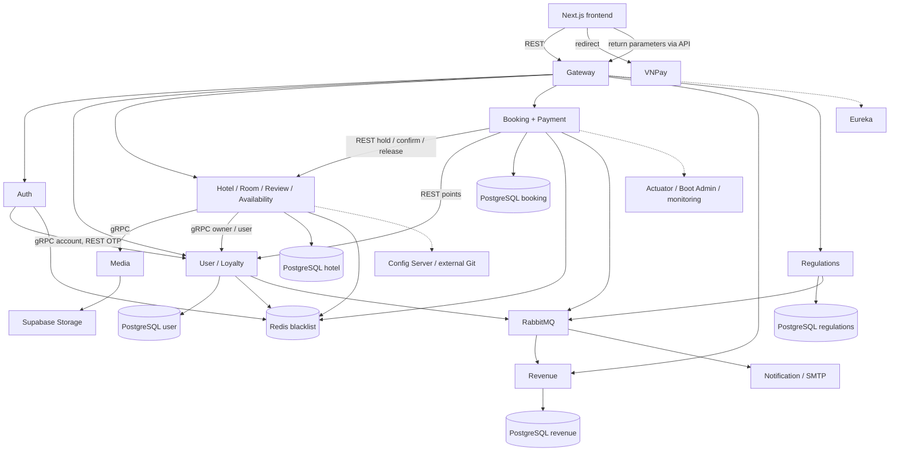
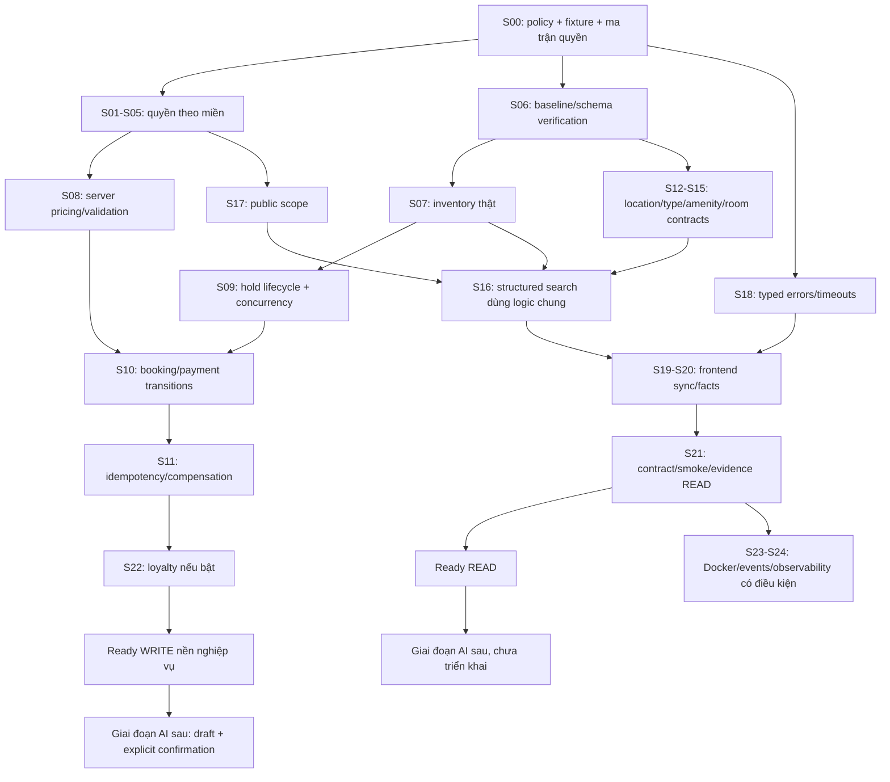

# PROJECT STANDARDIZATION PLAN

**Dự án:** Hệ thống Đặt phòng Khách sạn dựa trên Kiến trúc Microservices Tích hợp Trợ lý Du lịch Thông minh
**Ngày khảo sát ban đầu:** 26/10/2026; **cập nhật hiện tại:** 13/11/2026 — Asia/Saigon

**Canonical location — Batch 2, 13/11/2026:** `checkinn/Docs/standardization/PROJECT_STANDARDIZATION_PLAN.md`. Root DA1 file is a pointer. Historical statements that this plan is outside Git describe their original checkpoints; this canonical file is now an unstaged Git candidate.

**Checkpoint hiện hành Batch 2:** **DONE trong phạm vi Booking–Hotel/Availability unpaid Gateway lifecycle**; 57 Gateway/SQL/setup assertions PASS, 627 focused service tests PASS +34 SKIPPED, 2 PostgreSQL opt-in PASS riêng. Parent standardization vẫn PARTIAL; Refund Backend/API Demo closure giữ nguyên. Xem [Batch 2 report](../BATCH2_BOOKING_HOTEL_GATEWAY_ACCEPTANCE_2026-11-13.md) và mục75. Next: G2 schema/applied-history/provenance, không tự mở Place/provider.

**Checkpoint lịch sử 13/11 — Batch 1–1.7:** **DONE — Refund Backend/API Demo Accepted** cho Sandbox Internal Refund qua Gateway/PostgreSQL/RabbitMQ/Revenue; không phải hoàn tiền VNPay thật. Toàn STD-002/007 và overall standardization vẫn IN_PROGRESS/PARTIAL. Xem [audit hiện hành](PROJECT_STANDARDIZATION_AUDIT_2026-11-12.md#d1-refund-demo-closure-reviewed-2026-11-13), [Batch 1.6](../BATCH1_6_REFUND_FINAL_ACCEPTANCE_2026-11-13.md) và mục74. Các checkpoint/status/“chưa làm” bên dưới giữ nguyên theo ngày và scope gốc; audit hiện hành quyết định trạng thái tổng hợp. Batch 1.7 chỉ chỉnh Markdown, không cấp quyền triển khai roadmap hoặc sửa Place.

**Checkpoint lịch sử11/11: mục73 — media client write state và partial-upload recovery**, nhánh `fix/media-client-write-state` cả2 repo. Frontend211/211 Node,13/13 media browser +8/8 content +7/7 amenities PASS trên Next Webpack dev. Chỉ selected scopes của STD-011/012/018/024/026/028/030 được VERIFIED; không sửa place/backend production/schema/provider, không commit/push. Typecheck còn baseline place showDistance. Root plan ngoài Git; checkpoint trong frontend tests/MEDIA_CLIENT_2026-11-11.md.

**Checkpoint10/11: mục72 — media metadata, chặn xóa DRAFT còn phòng, amenity request shape và pending content writes.** Nhánh `fix/media-metadata-consistency` cả2 repo; 364 hotel tests thực thi PASS +32 skipped/JAR success, PostgreSQL10/10, rebuilt native HTTP16/16, frontend164/164 và browser15/15. Chỉ các phạm vi issue ghi tại72 được VERIFIED; live cloud/reconciliation và place-owned build blocker vẫn mở. Cumulative diff gồm69–71 chưa commit cần review; root plan nằm ngoài Git.

**Checkpoint lịch sử09/11: mục67 — media/private-document boundaries**, nhánh `fix/media-storage-boundaries` cả2 repo. Sáu STD được sửa/kiểm thử trong phạm vi ghi rõ bên dưới; authorization hiện có được kiểm tra lại. Không sửa place, không commit/push, không claim live provider hoặc database hotel đã được nghiệm thu.

**Batch mới buổi tối07/11: mục66 — regulation write/read consistency trên nhánh mới `fix/regulation-write-consistency` cả2 repo.** Các batch60–65 đã được tách vào các nhánh review riêng; batch66 không tự merge chúng. Không sửa place-service/place frontend. User yêu cầu tắt máy sau khi hoàn tất; lưu mọi thay đổi và bằng chứng trước shutdown, không commit/push.

**Review checkpoint mới nhất: mục60–65 cập nhật6 STD trong phạm vi xác minh, source outbox/ordered cash reporting, explicit transaction-day policy đã được user chọn, native33/33 và frontend106+6 PASS.** Các status lịch sử bên dưới cần đọc cùng cập nhật này. Production frontend build còn blocker place props; legacy receipts/provider còn cần môi trường/bằng chứng. Không sửa place-service/place frontend, không commit/push.
**Trạng thái lịch sử tổng hợp tới11/11 (đọc cùng checkpoint13/11 và audit):** Đang triển khai toàn dự án. **STD-018 đã FIXED/VERIFIED, STD-032 public pin/distance boundary đã verified (mục35–36); STD-020 internal credentials/session contract đã FIXED/VERIFIED, Google được disable an toàn (mục36); related RPC reset P0 và account-wide OTP-reset revocation đã FIXED/VERIFIED (mục41–42). STD-026 core hotel/booking đã VERIFIED (mục40); STD-014 global pagination VERIFIED (mục44), STD-024 canonical text VERIFIED (mục45); related unknown-room-facts/concurrent mutation fixes VERIFIED (mục46). STD-025 bounded review summaries VERIFIED (mục43), dated-read và selective location hydration VERIFIED (mục47–48), toàn STD-025 còn tiếp tục.** **STD-007 onsite reservation V1 đã FIXED/VERIFIED ngày05/11 theo policy được duyệt (mục34); toàn STD-007 vẫn IN_PROGRESS cho reconciliation/provider/outbox còn lại.** **STD-009, STD-012 và STD-019 đã FIXED/VERIFIED ngày05/11 (mục31–33); STD-016 catalog ADMIN/manual reviewed mapping đã FIXED/VERIFIED ngày06/11 (mục39), không backfill tự động.** **STD-010/011/013/015/017 đã FIXED/VERIFIED ngày04/11 (mục28–29); STD-022/023 giữ VERIFIED ngày03/11 (mục24/27).** Chính sách hủy/hoàn mục18 giữ nguyên. Các mục20–23 là lịch sử từng batch, không dùng trạng thái IN_PROGRESS cũ để ghi đè kết luận mới.
**Phạm vi lịch sử trước Batch 1.7:** Được phép sửa source/test trong hai repo và cập nhật báo cáo. Giới hạn chỉ ghi tài liệu của đợt khảo sát 26/10 đã được yêu cầu mới thay thế.

> Đọc **mục59 cho notification SMTP/retry/DLQ/privacy mới nhất; mục58 là checkpoint trước batch này, mục54–57 giữ kết quả auth/OTP/session và workflow xác minh tồn phòng**; mục49–53 giữ các phép đo query và guard counter; mục46–48 giữ unknown-room-facts/location; mục29–30 giữ kết quả search/accommodation. Checklist đóng STD-022 giữ tại mục24. Các mô tả “chưa chạy test”, “chưa chỉnh file” và giới hạn trong khảo sát ban đầu là lịch sử26/10; nhật ký batch được giữ theo ngày, không phải danh sách blocker hiện tại. Một issue VERIFIED không đồng nghĩa toàn hệ thống đã đạt gate READ/WRITE.

## 1. Executive Summary

Project có nền nghiệp vụ thực: 12 module Maven, Next.js frontend, hotel/room/availability, booking/payment, account, review, reporting, regulations và notification. Cần chuẩn hóa có chọn lọc trước AI; không cần thay framework, database hoặc viết lại hệ thống.

Các rủi ro được xác minh trực tiếp trong code gồm: endpoint nghiệp vụ nhạy cảm chưa có authorization đầy đủ; booking tin user/giá từ client; tồn phòng thiếu cấu hình bị giả định là 10; booking có thể được đánh dấu xác nhận dù confirm hold lỗi. Đây là nhóm P0, cần xử lý trước các chức năng phụ thuộc và trước khi vận hành với dữ liệu thật.

Đối với tìm kiếm: nhiều filter chỉ chạy ở frontend; capacity đang tính theo tổng phòng còn trống thay vì số phòng yêu cầu; giá thấp nhất không gắn với phòng còn trống/đủ sức chứa; lỗi có thể thành danh sách rỗng; UI sinh tiện nghi/rating/giá gạch và hiển thị tổng kho như số phòng còn lại. Sidebar và parent còn lệch state/default. Loại hình lưu trú chưa có field chuẩn trong model/DTO đã khảo sát, dù UI công bố lựa chọn.

**Hướng ít thay đổi:** giữ hotel-service làm chủ dữ liệu và logic tìm kiếm; mở rộng hợp lý endpoint search hiện có bằng contract rõ, dùng cùng tiêu chí cho frontend và tool tương lai. Chỉ thêm endpoint/version nếu cần tránh phá response hiện tại. Chuẩn hóa dữ liệu theo expand–backfill–validate–contract, kiểm chứng trên database test trước.

Hai cổng sẵn sàng khác nhau:

- **READ:** AI tìm kiếm chỉ đọc, cần search contract, dữ liệu có căn cứ, lỗi phân biệt, read access và test; không cần GA/RAG/vector DB.
- **WRITE:** AI đặt phòng, cần thêm authorization, server pricing, hold/payment consistency, idempotency và xác nhận rõ của người dùng.
- P0 không được bỏ qua trong hệ thống được đưa vào vận hành. Có thể phát triển READ trên môi trường cô lập trong khi sửa nhánh booking; điều đó không có nghĩa project đã được nghiệm thu chung.

### Cách đọc mức độ ưu tiên và xác minh

| Nhãn | Nghĩa |
|---|---|
| P0 — Blocker | Sai tiền/tồn phòng, thay đổi dữ liệu trái quyền hoặc trạng thái giao dịch sai; chặn luồng tương ứng |
| P1 — Trước AI | Cần để tool đọc/ghi đã chọn đáng tin cậy; ghi rõ cổng READ/WRITE khi chỉ liên quan một nhánh |
| P2 — Nên cải thiện | Bảo trì, vận hành hoặc hiệu năng chưa có bằng chứng chặn MVP local |
| P3 — Sau | Năng lực chưa cần trong giai đoạn chuẩn hóa |
| Đã xác minh | Có đường đi/logic trực tiếp trong source; không đồng nghĩa đã chạy tái hiện |
| Nghi vấn | Dấu hiệu trong source nhưng tác động phụ thuộc dữ liệu, runtime hoặc concurrency |
| Chưa xác minh | Chưa có đủ bằng chứng; đưa thành câu hỏi/verification task |

## 2. Scope and Method

### 2.1. Cơ sở khảo sát

Workspace gốc chứa hai Git repository con: `checkinn` và `checkinn-frontend`; thư mục `DA1` không phải Git repository. File kế hoạch đặt ở DA1 theo yêu cầu, do đó không tự xuất hiện trong Git status của hai repository con. Nếu cần version-control tài liệu này, người dùng quyết định vị trí theo dõi ở lần triển khai sau.

Đã đọc lại code ngày 26/10, không sao chép nguyên kết luận cũ. Ví dụ cron `processExpiredPaymentHolds` hiện là `0 */5 * * * *` (mỗi 5 phút); lỗi cron 5 giây từng được nêu trước đây **không còn là phát hiện hiện tại**.

Đã lần theo:

- SearchFilters → SearchPage → hotelApi → HotelController/Service/Repository → Hotel/Room/Availability → DTO → UI.
- Hotel detail → URL booking → CreateBookingRequest → hold → booking/payment → scheduler/events.
- Host create/update room → request DTO → entity/response.
- Security filter và controller/service của booking, payment, hotel/room/media/review, loyalty và reports.
- POM, cấu trúc migration, DDL, cấu hình không nhạy cảm được chọn lọc, Docker/monitoring và test nghiệp vụ.

Không đọc `.env`, giá trị key/token/password hoặc private documents; không đưa dữ liệu cấu hình nhạy cảm vào tài liệu. Với application/compose chỉ kiểm tra các dòng cần cho topology, route, migration và storage mode; không trích credential.

### 2.2. Giới hạn và bằng chứng

Không chạy build/test/server/Docker/migration, không truy cập DB hoặc tài khoản ngoài. Vì vậy chưa xác minh schema/index/FK thật, dữ liệu hiện có, kết quả test, exploit runtime, latency, số lượng hotel thực hoặc cấu hình được Config Server cấp. Tên bảng/constraint trong tài liệu là bằng chứng từ source/DDL, không phải kết quả introspection DB.

Working tree backend có sẵn thay đổi tài liệu, file mới và ảnh đã stage xóa; frontend ban đầu sạch. Không reset, restore, stage hoặc sửa các thay đổi này. Không đọc toàn bộ binary, generated code, node_modules, target hoặc log có thể chứa dữ liệu cá nhân.

Các mã nguồn H/F/K... bên dưới trỏ tới đường dẫn thật, tuyệt đối. Mỗi issue bổ sung tên function/endpoint làm điểm neo; line number không được coi là ổn định qua các lần sửa.

### 2.3. Chỉ mục bằng chứng

- [B0: pom.xml](<C:/Users/ACER/IdeaProjects/DA1/checkinn/pom.xml>) — `checkinn/pom.xml`.
- [F0: package.json](<C:/Users/ACER/IdeaProjects/DA1/checkinn-frontend/package.json>) — `checkinn-frontend/package.json`.
- [F1: SearchFilters.tsx](<C:/Users/ACER/IdeaProjects/DA1/checkinn-frontend/components/SearchFilters.tsx>) — `checkinn-frontend/components/SearchFilters.tsx`.
- [F2: page.tsx](<C:/Users/ACER/IdeaProjects/DA1/checkinn-frontend/app/search/page.tsx>) — `checkinn-frontend/app/search/page.tsx`.
- [F3: hotels.ts](<C:/Users/ACER/IdeaProjects/DA1/checkinn-frontend/lib/api/hotels.ts>) — `checkinn-frontend/lib/api/hotels.ts`.
- [F4: availability.ts](<C:/Users/ACER/IdeaProjects/DA1/checkinn-frontend/lib/api/availability.ts>) — `checkinn-frontend/lib/api/availability.ts`.
- [F5: HotelSearchBar.tsx](<C:/Users/ACER/IdeaProjects/DA1/checkinn-frontend/components/HotelSearchBar.tsx>) — `checkinn-frontend/components/HotelSearchBar.tsx`.
- [F6: HotelLocationPicker.tsx](<C:/Users/ACER/IdeaProjects/DA1/checkinn-frontend/components/HotelLocationPicker.tsx>) — `checkinn-frontend/components/HotelLocationPicker.tsx`.
- [F7: page.tsx](<C:/Users/ACER/IdeaProjects/DA1/checkinn-frontend/app/hotel/[id]/page.tsx>) — `checkinn-frontend/app/hotel/[id]/page.tsx`.
- [F8: page.tsx](<C:/Users/ACER/IdeaProjects/DA1/checkinn-frontend/app/booking/page.tsx>) — `checkinn-frontend/app/booking/page.tsx`.
- [F9: booking.ts](<C:/Users/ACER/IdeaProjects/DA1/checkinn-frontend/lib/api/booking.ts>) — `checkinn-frontend/lib/api/booking.ts`.
- [F10: page.tsx](<C:/Users/ACER/IdeaProjects/DA1/checkinn-frontend/app/host/hotels/[id]/rooms/new/page.tsx>) — `checkinn-frontend/app/host/hotels/[id]/rooms/new/page.tsx`.
- [F11: page.tsx](<C:/Users/ACER/IdeaProjects/DA1/checkinn-frontend/app/host/hotels/[id]/rooms/[roomId]/page.tsx>) — `checkinn-frontend/app/host/hotels/[id]/rooms/[roomId]/page.tsx`.
- [F12: route.ts](<C:/Users/ACER/IdeaProjects/DA1/checkinn-frontend/app/api/auth/[...nextauth]/route.ts>) — `checkinn-frontend/app/api/auth/[...nextauth]/route.ts`.
- [F13: useAuth.ts](<C:/Users/ACER/IdeaProjects/DA1/checkinn-frontend/hooks/useAuth.ts>) — `checkinn-frontend/hooks/useAuth.ts`.
- [F14: middleware.ts](<C:/Users/ACER/IdeaProjects/DA1/checkinn-frontend/middleware.ts>) — `checkinn-frontend/middleware.ts`.
- [F15: cities.ts](<C:/Users/ACER/IdeaProjects/DA1/checkinn-frontend/lib/api/cities.ts>) — `checkinn-frontend/lib/api/cities.ts`.
- [F16: AIAgentButton.tsx](<C:/Users/ACER/IdeaProjects/DA1/checkinn-frontend/components/AIAgentButton.tsx>) — `checkinn-frontend/components/AIAgentButton.tsx`.
- [F17: tsconfig.json](<C:/Users/ACER/IdeaProjects/DA1/checkinn-frontend/tsconfig.json>) — `checkinn-frontend/tsconfig.json`.
- [H1: HotelController.java](<C:/Users/ACER/IdeaProjects/DA1/checkinn/hotel-service/src/main/java/com/example/hotelservice/Hotel/controller/HotelController.java>) — `checkinn/hotel-service/src/main/java/com/example/hotelservice/Hotel/controller/HotelController.java`.
- [H2: HotelServiceImpl.java](<C:/Users/ACER/IdeaProjects/DA1/checkinn/hotel-service/src/main/java/com/example/hotelservice/Hotel/service/HotelServiceImpl.java>) — `checkinn/hotel-service/src/main/java/com/example/hotelservice/Hotel/service/HotelServiceImpl.java`.
- [H3: HotelRepository.java](<C:/Users/ACER/IdeaProjects/DA1/checkinn/hotel-service/src/main/java/com/example/hotelservice/Hotel/repository/HotelRepository.java>) — `checkinn/hotel-service/src/main/java/com/example/hotelservice/Hotel/repository/HotelRepository.java`.
- [H4: Hotel.java](<C:/Users/ACER/IdeaProjects/DA1/checkinn/hotel-service/src/main/java/com/example/hotelservice/Hotel/entity/Hotel.java>) — `checkinn/hotel-service/src/main/java/com/example/hotelservice/Hotel/entity/Hotel.java`.
- [H5: HotelResponse.java](<C:/Users/ACER/IdeaProjects/DA1/checkinn/hotel-service/src/main/java/com/example/hotelservice/Hotel/dto/response/HotelResponse.java>) — `checkinn/hotel-service/src/main/java/com/example/hotelservice/Hotel/dto/response/HotelResponse.java`.
- [H6: HotelCreateRequest.java](<C:/Users/ACER/IdeaProjects/DA1/checkinn/hotel-service/src/main/java/com/example/hotelservice/Hotel/dto/request/HotelCreateRequest.java>) — `checkinn/hotel-service/src/main/java/com/example/hotelservice/Hotel/dto/request/HotelCreateRequest.java`.
- [H7: HotelMapper.java](<C:/Users/ACER/IdeaProjects/DA1/checkinn/hotel-service/src/main/java/com/example/hotelservice/Hotel/mapper/HotelMapper.java>) — `checkinn/hotel-service/src/main/java/com/example/hotelservice/Hotel/mapper/HotelMapper.java`.
- [H8: SecurityConfig.java](<C:/Users/ACER/IdeaProjects/DA1/checkinn/hotel-service/src/main/java/com/example/hotelservice/config/SecurityConfig.java>) — `checkinn/hotel-service/src/main/java/com/example/hotelservice/config/SecurityConfig.java`.
- [R1: RoomType.java](<C:/Users/ACER/IdeaProjects/DA1/checkinn/hotel-service/src/main/java/com/example/hotelservice/Room/entity/RoomType.java>) — `checkinn/hotel-service/src/main/java/com/example/hotelservice/Room/entity/RoomType.java`.
- [R2: RoomTypeCreateRequest.java](<C:/Users/ACER/IdeaProjects/DA1/checkinn/hotel-service/src/main/java/com/example/hotelservice/Room/dto/request/RoomTypeCreateRequest.java>) — `checkinn/hotel-service/src/main/java/com/example/hotelservice/Room/dto/request/RoomTypeCreateRequest.java`.
- [R3: RoomTypeUpdateRequest.java](<C:/Users/ACER/IdeaProjects/DA1/checkinn/hotel-service/src/main/java/com/example/hotelservice/Room/dto/request/RoomTypeUpdateRequest.java>) — `checkinn/hotel-service/src/main/java/com/example/hotelservice/Room/dto/request/RoomTypeUpdateRequest.java`.
- [R4: RoomTypeResponse.java](<C:/Users/ACER/IdeaProjects/DA1/checkinn/hotel-service/src/main/java/com/example/hotelservice/Room/dto/response/RoomTypeResponse.java>) — `checkinn/hotel-service/src/main/java/com/example/hotelservice/Room/dto/response/RoomTypeResponse.java`.
- [R5: RoomTypeServiceImpl.java](<C:/Users/ACER/IdeaProjects/DA1/checkinn/hotel-service/src/main/java/com/example/hotelservice/Room/service/RoomTypeServiceImpl.java>) — `checkinn/hotel-service/src/main/java/com/example/hotelservice/Room/service/RoomTypeServiceImpl.java`.
- [R6: RoomTypeController.java](<C:/Users/ACER/IdeaProjects/DA1/checkinn/hotel-service/src/main/java/com/example/hotelservice/Room/controller/RoomTypeController.java>) — `checkinn/hotel-service/src/main/java/com/example/hotelservice/Room/controller/RoomTypeController.java`.
- [R7: CapacityDto.java](<C:/Users/ACER/IdeaProjects/DA1/checkinn/hotel-service/src/main/java/com/example/hotelservice/Room/dto/request/CapacityDto.java>) — `checkinn/hotel-service/src/main/java/com/example/hotelservice/Room/dto/request/CapacityDto.java`.
- [R8: RoomTypeMapper.java](<C:/Users/ACER/IdeaProjects/DA1/checkinn/hotel-service/src/main/java/com/example/hotelservice/Room/mapper/RoomTypeMapper.java>) — `checkinn/hotel-service/src/main/java/com/example/hotelservice/Room/mapper/RoomTypeMapper.java`.
- [A1: AvailabilityService.java](<C:/Users/ACER/IdeaProjects/DA1/checkinn/hotel-service/src/main/java/com/example/hotelservice/Room/availability/service/AvailabilityService.java>) — `checkinn/hotel-service/src/main/java/com/example/hotelservice/Room/availability/service/AvailabilityService.java`.
- [A2: AvailabilityController.java](<C:/Users/ACER/IdeaProjects/DA1/checkinn/hotel-service/src/main/java/com/example/hotelservice/Room/availability/controller/AvailabilityController.java>) — `checkinn/hotel-service/src/main/java/com/example/hotelservice/Room/availability/controller/AvailabilityController.java`.
- [A3: RoomAvailabilityRepository.java](<C:/Users/ACER/IdeaProjects/DA1/checkinn/hotel-service/src/main/java/com/example/hotelservice/Room/availability/repository/RoomAvailabilityRepository.java>) — `checkinn/hotel-service/src/main/java/com/example/hotelservice/Room/availability/repository/RoomAvailabilityRepository.java`.
- [A4: RoomHoldRepository.java](<C:/Users/ACER/IdeaProjects/DA1/checkinn/hotel-service/src/main/java/com/example/hotelservice/Room/availability/repository/RoomHoldRepository.java>) — `checkinn/hotel-service/src/main/java/com/example/hotelservice/Room/availability/repository/RoomHoldRepository.java`.
- [A5: RoomAvailability.java](<C:/Users/ACER/IdeaProjects/DA1/checkinn/hotel-service/src/main/java/com/example/hotelservice/Room/availability/entity/RoomAvailability.java>) — `checkinn/hotel-service/src/main/java/com/example/hotelservice/Room/availability/entity/RoomAvailability.java`.
- [C1: CityController.java](<C:/Users/ACER/IdeaProjects/DA1/checkinn/hotel-service/src/main/java/com/example/hotelservice/City/controller/CityController.java>) — `checkinn/hotel-service/src/main/java/com/example/hotelservice/City/controller/CityController.java`.
- [C2: LocationService.java](<C:/Users/ACER/IdeaProjects/DA1/checkinn/hotel-service/src/main/java/com/example/hotelservice/City/service/LocationService.java>) — `checkinn/hotel-service/src/main/java/com/example/hotelservice/City/service/LocationService.java`.
- [C3: CityResponse.java](<C:/Users/ACER/IdeaProjects/DA1/checkinn/hotel-service/src/main/java/com/example/hotelservice/City/dto/response/CityResponse.java>) — `checkinn/hotel-service/src/main/java/com/example/hotelservice/City/dto/response/CityResponse.java`.
- [C4: LocationResponse.java](<C:/Users/ACER/IdeaProjects/DA1/checkinn/hotel-service/src/main/java/com/example/hotelservice/City/dto/response/LocationResponse.java>) — `checkinn/hotel-service/src/main/java/com/example/hotelservice/City/dto/response/LocationResponse.java`.
- [C5: City.java](<C:/Users/ACER/IdeaProjects/DA1/checkinn/hotel-service/src/main/java/com/example/hotelservice/City/entity/City.java>) — `checkinn/hotel-service/src/main/java/com/example/hotelservice/City/entity/City.java`.
- [M1: MediaAssetController.java](<C:/Users/ACER/IdeaProjects/DA1/checkinn/hotel-service/src/main/java/com/example/hotelservice/MediaAsset/controller/MediaAssetController.java>) — `checkinn/hotel-service/src/main/java/com/example/hotelservice/MediaAsset/controller/MediaAssetController.java`.
- [M2: MediaServiceImpl.java](<C:/Users/ACER/IdeaProjects/DA1/checkinn/hotel-service/src/main/java/com/example/hotelservice/MediaAsset/service/MediaServiceImpl.java>) — `checkinn/hotel-service/src/main/java/com/example/hotelservice/MediaAsset/service/MediaServiceImpl.java`.
- [V1: ReviewController.java](<C:/Users/ACER/IdeaProjects/DA1/checkinn/hotel-service/src/main/java/com/example/hotelservice/Review/controller/ReviewController.java>) — `checkinn/hotel-service/src/main/java/com/example/hotelservice/Review/controller/ReviewController.java`.
- [V2: ReviewService.java](<C:/Users/ACER/IdeaProjects/DA1/checkinn/hotel-service/src/main/java/com/example/hotelservice/Review/service/ReviewService.java>) — `checkinn/hotel-service/src/main/java/com/example/hotelservice/Review/service/ReviewService.java`.
- [N1: HotelAmenity.java](<C:/Users/ACER/IdeaProjects/DA1/checkinn/hotel-service/src/main/java/com/example/hotelservice/Amenity/entity/HotelAmenity.java>) — `checkinn/hotel-service/src/main/java/com/example/hotelservice/Amenity/entity/HotelAmenity.java`.
- [N2: HotelAmenityCategory.java](<C:/Users/ACER/IdeaProjects/DA1/checkinn/hotel-service/src/main/java/com/example/hotelservice/Amenity/entity/HotelAmenityCategory.java>) — `checkinn/hotel-service/src/main/java/com/example/hotelservice/Amenity/entity/HotelAmenityCategory.java`.
- [K1: BookingController.java](<C:/Users/ACER/IdeaProjects/DA1/checkinn/booking-service/src/main/java/com/example/bookingservice/booking/controller/BookingController.java>) — `checkinn/booking-service/src/main/java/com/example/bookingservice/booking/controller/BookingController.java`.
- [K2: BookingService.java](<C:/Users/ACER/IdeaProjects/DA1/checkinn/booking-service/src/main/java/com/example/bookingservice/booking/service/BookingService.java>) — `checkinn/booking-service/src/main/java/com/example/bookingservice/booking/service/BookingService.java`.
- [K3: CreateBookingRequest.java](<C:/Users/ACER/IdeaProjects/DA1/checkinn/booking-service/src/main/java/com/example/bookingservice/booking/dto/CreateBookingRequest.java>) — `checkinn/booking-service/src/main/java/com/example/bookingservice/booking/dto/CreateBookingRequest.java`.
- [K4: CreateBookingItemRequest.java](<C:/Users/ACER/IdeaProjects/DA1/checkinn/booking-service/src/main/java/com/example/bookingservice/booking/dto/CreateBookingItemRequest.java>) — `checkinn/booking-service/src/main/java/com/example/bookingservice/booking/dto/CreateBookingItemRequest.java`.
- [K5: SecurityConfig.java](<C:/Users/ACER/IdeaProjects/DA1/checkinn/booking-service/src/main/java/com/example/bookingservice/config/SecurityConfig.java>) — `checkinn/booking-service/src/main/java/com/example/bookingservice/config/SecurityConfig.java`.
- [K6: BookingScheduledTask.java](<C:/Users/ACER/IdeaProjects/DA1/checkinn/booking-service/src/main/java/com/example/bookingservice/booking/service/BookingScheduledTask.java>) — `checkinn/booking-service/src/main/java/com/example/bookingservice/booking/service/BookingScheduledTask.java`.
- [K7: HotelAvailabilityClient.java](<C:/Users/ACER/IdeaProjects/DA1/checkinn/booking-service/src/main/java/com/example/bookingservice/integration/hotel/HotelAvailabilityClient.java>) — `checkinn/booking-service/src/main/java/com/example/bookingservice/integration/hotel/HotelAvailabilityClient.java`.
- [K8: RestClientConfig.java](<C:/Users/ACER/IdeaProjects/DA1/checkinn/booking-service/src/main/java/com/example/bookingservice/config/RestClientConfig.java>) — `checkinn/booking-service/src/main/java/com/example/bookingservice/config/RestClientConfig.java`.
- [K9: Booking.java](<C:/Users/ACER/IdeaProjects/DA1/checkinn/booking-service/src/main/java/com/example/bookingservice/booking/entity/Booking.java>) — `checkinn/booking-service/src/main/java/com/example/bookingservice/booking/entity/Booking.java`.
- [K10: BookingItem.java](<C:/Users/ACER/IdeaProjects/DA1/checkinn/booking-service/src/main/java/com/example/bookingservice/booking/entity/BookingItem.java>) — `checkinn/booking-service/src/main/java/com/example/bookingservice/booking/entity/BookingItem.java`.
- [P1: PaymentController.java](<C:/Users/ACER/IdeaProjects/DA1/checkinn/booking-service/src/main/java/com/example/bookingservice/payment/controller/PaymentController.java>) — `checkinn/booking-service/src/main/java/com/example/bookingservice/payment/controller/PaymentController.java`.
- [P2: PaymentService.java](<C:/Users/ACER/IdeaProjects/DA1/checkinn/booking-service/src/main/java/com/example/bookingservice/payment/service/PaymentService.java>) — `checkinn/booking-service/src/main/java/com/example/bookingservice/payment/service/PaymentService.java`.
- [P3: HotelPaymentCreationPolicy.java](<C:/Users/ACER/IdeaProjects/DA1/checkinn/booking-service/src/main/java/com/example/bookingservice/payment/service/factory/HotelPaymentCreationPolicy.java>) — `checkinn/booking-service/src/main/java/com/example/bookingservice/payment/service/factory/HotelPaymentCreationPolicy.java`.
- [P4: PaymentGrpcServer.java](<C:/Users/ACER/IdeaProjects/DA1/checkinn/booking-service/src/main/java/com/example/bookingservice/grpc/server/PaymentGrpcServer.java>) — `checkinn/booking-service/src/main/java/com/example/bookingservice/grpc/server/PaymentGrpcServer.java`.
- [P5: UserContextInterceptor.java](<C:/Users/ACER/IdeaProjects/DA1/checkinn/booking-service/src/main/java/com/example/bookingservice/grpc/interceptor/UserContextInterceptor.java>) — `checkinn/booking-service/src/main/java/com/example/bookingservice/grpc/interceptor/UserContextInterceptor.java`.
- [U1: LoyaltyPointsController.java](<C:/Users/ACER/IdeaProjects/DA1/checkinn/user-service/src/main/java/com/example/userservice/controller/LoyaltyPointsController.java>) — `checkinn/user-service/src/main/java/com/example/userservice/controller/LoyaltyPointsController.java`.
- [U2: LoyaltyPointsService.java](<C:/Users/ACER/IdeaProjects/DA1/checkinn/user-service/src/main/java/com/example/userservice/service/LoyaltyPointsService.java>) — `checkinn/user-service/src/main/java/com/example/userservice/service/LoyaltyPointsService.java`.
- [U3: SecurityConfig.java](<C:/Users/ACER/IdeaProjects/DA1/checkinn/user-service/src/main/java/com/example/userservice/config/SecurityConfig.java>) — `checkinn/user-service/src/main/java/com/example/userservice/config/SecurityConfig.java`.
- [U4: JwtMdcFilter.java](<C:/Users/ACER/IdeaProjects/DA1/checkinn/user-service/src/main/java/com/example/userservice/security/JwtMdcFilter.java>) — `checkinn/user-service/src/main/java/com/example/userservice/security/JwtMdcFilter.java`.
- [U5: PointsTransaction.java](<C:/Users/ACER/IdeaProjects/DA1/checkinn/user-service/src/main/java/com/example/userservice/model/PointsTransaction.java>) — `checkinn/user-service/src/main/java/com/example/userservice/model/PointsTransaction.java`.
- [U6: LoyaltyPointsRepository.java](<C:/Users/ACER/IdeaProjects/DA1/checkinn/user-service/src/main/java/com/example/userservice/repository/LoyaltyPointsRepository.java>) — `checkinn/user-service/src/main/java/com/example/userservice/repository/LoyaltyPointsRepository.java`.
- [AU1: LoginRequestDto.java](<C:/Users/ACER/IdeaProjects/DA1/checkinn/auth-service/src/main/java/com/example/authservice/dto/LoginRequestDto.java>) — `checkinn/auth-service/src/main/java/com/example/authservice/dto/LoginRequestDto.java`.
- [AU2: AuthResponseDto.java](<C:/Users/ACER/IdeaProjects/DA1/checkinn/auth-service/src/main/java/com/example/authservice/dto/AuthResponseDto.java>) — `checkinn/auth-service/src/main/java/com/example/authservice/dto/AuthResponseDto.java`.
- [G1: SecurityConfig.java](<C:/Users/ACER/IdeaProjects/DA1/checkinn/api-gateway/src/main/java/com/example/apigateway/config/SecurityConfig.java>) — `checkinn/api-gateway/src/main/java/com/example/apigateway/config/SecurityConfig.java`.
- [G2: application.yml](<C:/Users/ACER/IdeaProjects/DA1/checkinn/api-gateway/src/main/resources/application.yml>) — `checkinn/api-gateway/src/main/resources/application.yml`.
- [E1: RevenueReportController.java](<C:/Users/ACER/IdeaProjects/DA1/checkinn/revenue-service/src/main/java/com/example/revenueservice/controller/RevenueReportController.java>) — `checkinn/revenue-service/src/main/java/com/example/revenueservice/controller/RevenueReportController.java`.
- [E2: HotelEventPublisher.java](<C:/Users/ACER/IdeaProjects/DA1/checkinn/booking-service/src/main/java/com/example/bookingservice/messaging/HotelEventPublisher.java>) — `checkinn/booking-service/src/main/java/com/example/bookingservice/messaging/HotelEventPublisher.java`.
- [E3: EventIngestionService.java](<C:/Users/ACER/IdeaProjects/DA1/checkinn/revenue-service/src/main/java/com/example/revenueservice/service/EventIngestionService.java>) — `checkinn/revenue-service/src/main/java/com/example/revenueservice/service/EventIngestionService.java`.
- [D1: schema.sql](<C:/Users/ACER/IdeaProjects/DA1/checkinn/booking-service/src/main/resources/schema.sql>) — `checkinn/booking-service/src/main/resources/schema.sql`.
- [D2: V3__Refactor_To_Provinces_And_Cities.sql](<C:/Users/ACER/IdeaProjects/DA1/checkinn/hotel-service/src/main/resources/db/migration/V3__Refactor_To_Provinces_And_Cities.sql>) — `checkinn/hotel-service/src/main/resources/db/migration/V3__Refactor_To_Provinces_And_Cities.sql`.
- [D3: migration_add_total_rooms.sql](<C:/Users/ACER/IdeaProjects/DA1/migration_add_total_rooms.sql>) — `migration_add_total_rooms.sql`.
- [D4: migration_add_detailed_ratings.sql](<C:/Users/ACER/IdeaProjects/DA1/migration_add_detailed_ratings.sql>) — `migration_add_detailed_ratings.sql`.
- [D5: migration_media_assets_polymorphic.sql](<C:/Users/ACER/IdeaProjects/DA1/migration_media_assets_polymorphic.sql>) — `migration_media_assets_polymorphic.sql`.
- [O1: docker-compose.yml](<C:/Users/ACER/IdeaProjects/DA1/checkinn/docker/docker-compose.yml>) — `checkinn/docker/docker-compose.yml`.
- [O2: docker-compose.yml](<C:/Users/ACER/IdeaProjects/DA1/checkinn/monitoring/docker-compose.yml>) — `checkinn/monitoring/docker-compose.yml`.
- [O3: promtail-config.yml](<C:/Users/ACER/IdeaProjects/DA1/checkinn/monitoring/promtail/promtail-config.yml>) — `checkinn/monitoring/promtail/promtail-config.yml`.
- [T1: BookingServiceTest.java](<C:/Users/ACER/IdeaProjects/DA1/checkinn/booking-service/src/test/java/com/example/bookingservice/booking/service/BookingServiceTest.java>) — `checkinn/booking-service/src/test/java/com/example/bookingservice/booking/service/BookingServiceTest.java`.
- [T2: PaymentServiceTest.java](<C:/Users/ACER/IdeaProjects/DA1/checkinn/booking-service/src/test/java/com/example/bookingservice/payment/service/PaymentServiceTest.java>) — `checkinn/booking-service/src/test/java/com/example/bookingservice/payment/service/PaymentServiceTest.java`.
- [T3: RoomTypeServiceImplTest.java](<C:/Users/ACER/IdeaProjects/DA1/checkinn/hotel-service/src/test/java/com/example/hotelservice/Room/service/RoomTypeServiceImplTest.java>) — `checkinn/hotel-service/src/test/java/com/example/hotelservice/Room/service/RoomTypeServiceImplTest.java`.
- [DOC1: README.md](<C:/Users/ACER/IdeaProjects/DA1/checkinn/README.md>) — `checkinn/README.md`.
- [DOC2: SAD.md](<C:/Users/ACER/IdeaProjects/DA1/checkinn/Docs/SAD.md>) — `checkinn/Docs/SAD.md`.
- [DOC3: ToDo.md](<C:/Users/ACER/IdeaProjects/DA1/checkinn/Docs/ToDo.md>) — `checkinn/Docs/ToDo.md`.

## 3. Current Architecture

### 3.1. Thành phần thực tế

| Thành phần | Trách nhiệm/căn cứ |
|---|---|
| Frontend | Next.js/React/TypeScript, app router, fetch trong lib/api; [F0: package.json](<C:/Users/ACER/IdeaProjects/DA1/checkinn-frontend/package.json>) |
| API Gateway | REST routing/rewrite, discovery; security hiện permitAll — [G1: SecurityConfig.java](<C:/Users/ACER/IdeaProjects/DA1/checkinn/api-gateway/src/main/java/com/example/apigateway/config/SecurityConfig.java>), [G2: application.yml](<C:/Users/ACER/IdeaProjects/DA1/checkinn/api-gateway/src/main/resources/application.yml>) |
| Auth/User | Account/JWT/OTP, BCrypt, profile và loyalty; JWT blacklist Redis có implementation; không suy ra mọi endpoint đều có quyền |
| Hotel | City/province, hotel, room type, policies, FAQ, amenities, review, media metadata và inventory/hold |
| Booking | Booking và payment cùng service; VNPay/onsite, scheduler, phát RabbitMQ event |
| Media | gRPC upload/delete/signed URL, Supabase Storage; không phải MinIO chỉ vì comment cũ |
| Revenue | Nhận event và lưu record phục vụ báo cáo; không gọi đó là CQRS đầy đủ chỉ từ tên |
| Regulations/Notification | Giá trị quy định/snapshot/events; OTP/payment email qua listener |
| Eureka/Config/Admin | Discovery, remote config và Spring Boot Admin; Admin Server không phải nơi xử lý nghiệp vụ admin |
| Storage | PostgreSQL/JPA ở service nghiệp vụ; Redis blacklist; RabbitMQ; object storage |
| Deploy/monitor | Compose hiện có cho Redis/RabbitMQ và monitoring; chưa có Dockerfile cho ứng dụng trong cây khảo sát |

POM chính xác nhận 12 module ([B0: pom.xml](<C:/Users/ACER/IdeaProjects/DA1/checkinn/pom.xml>)). Java 21, phần lớn Spring Boot 3.3.4; Eureka POM dùng 3.3.0. Sự khác version tự nó chưa chứng minh lỗi. Frontend khai báo Next ^16.0.8/React 19.2.0; đây là dependency khai báo, không khẳng định version đã cài.

### 3.2. Sơ đồ hiện trạng



Không có node LLM/vector/GA trong sơ đồ hiện trạng. Chúng chưa được triển khai trong nhiệm vụ này.

### 3.3. Những phần nên giữ và tái sử dụng

- Backend đã có controller/service/repository, DTO, UUID, BigDecimal, LocalDate và JSONB; không cần đổi DB.
- Availability đã tính min tồn theo các ngày trong [checkIn, checkOut), có transaction, unique room/date và PESSIMISTIC_WRITE.
- Có ownership check trong một số service hotel/room; có JWT/Redis revocation. Giữ và mở rộng kiểm soát, không thay toàn bộ auth.
- VNPay REST return có HMAC check; callback có replay guard; không kết luận tất cả callback đều thiếu bảo vệ.
- Có unit test Mockito/AssertJ và k6 script, cần mở rộng phần thiếu; không bắt đầu một hệ test hoàn toàn mới.
- Public DTO HotelResponse đã tách khỏi entity chứa giấy tờ pháp lý; tiếp tục giữ ranh giới đó.

## 4. Issue Inventory

Tổng **32 vấn đề**: P0: 7; P1: 17; P2: 7; P3: 1. Mức ưu tiên áp dụng cho luồng/cổng được ghi trong mỗi issue. Với nghi vấn, task đầu tiên là verification; chưa được ghi đã sửa hoặc coi giả thuyết là incident.

| ID | Vấn đề | Ưu tiên | Xác minh | Cổng/tác động |
|---|---|---|---|---|
| STD-001 | Booking xác thực token nhưng chưa ràng buộc tài nguyên với principal | P0 | Đã xác minh | WRITE; P0 chung |
| STD-002 | Payment mutation/read và callback gRPC thiếu trust boundary rõ | P0 | Đã xác minh | WRITE; P0 chung |
| STD-003 | Hotel/catalog/media/review có thao tác ghi thiếu authorization hoặc tin header | P0 | Đã xác minh | READ và WRITE; P0 chung |
| STD-004 | Loyalty và reports chưa kiểm soát quyền ở các luồng khảo sát | P0 | Đã xác minh | WRITE và quyền dữ liệu; P0 chung |
| STD-005 | Giá và quan hệ booking/payment chưa lấy từ nguồn nghiệp vụ | P0 | Đã xác minh | WRITE; P0 chung |
| STD-006 | Tồn phòng thiếu cấu hình bị tạo thành 10 phòng | P0 | Đã xác minh | READ và WRITE; P0 chung |
| STD-007 | Trạng thái booking/payment có thể tách khỏi tồn phòng | P0 | Đã xác minh | WRITE; P0 chung |
| STD-008 | Hold transition thiếu expiry guard; concurrency cần kiểm chứng | P1 | Đã xác minh (expiry/lock thiếu); nghi vấn (race runtime) | WRITE; ảnh hưởng độ tin cậy READ |
| STD-009 | Hold mồ côi, tạo booking lặp và timeout bị hiểu thành hold không hợp lệ | P1 | Đã xác minh | WRITE |
| STD-010 | Matching search trộn sức chứa, số phòng và giá giữa các phương án | P1 | Đã xác minh | READ |
| STD-011 | Lỗi API bị đổi thành không có kết quả hoặc hết phòng | P1 | Đã xác minh | READ |
| STD-012 | UI sinh dữ kiện và hiển thị tổng kho như tồn phòng theo ngày | P1 | Đã xác minh | READ |
| STD-013 | Filter price/sidebar và state/query không đồng bộ | P1 | Đã xác minh | READ |
| STD-014 | Sort chỉ có giao diện; search chưa có phân trang và thứ tự ổn định | P2 | FIXED/VERIFIED — mục44 | READ contract tối thiểu; nâng cao P2 |
| STD-015 | Loại hình lưu trú có filter UI nhưng chưa có model chuẩn | P1 | Đã xác minh trong source; dữ liệu DB chưa xác minh | READ nếu công bố filter |
| STD-016 | Tiện nghi đang là nhãn tự do và ID theo từng hotel, chưa phải catalog tìm kiếm chung | P1 | Đã xác minh | READ cho amenities |
| STD-017 | Location contract dùng tên thay ID và có khai báo TypeScript thiếu field | P1 | Đã xác minh | READ |
| STD-018 | Validation khai báo chưa được kích hoạt và thiếu cross-field constraints | P1 | Đã xác minh | READ/WRITE theo endpoint |
| STD-019 | Form phòng gửi description nhưng backend không có field round-trip | P1 | Đã xác minh | READ nếu dùng room description |
| STD-020 | NextAuth/custom auth không cùng request-response và identity schema | P1 | FIXED/VERIFIED supported credentials + RPC/reset sessions — mục36/41/42; OAuth disable | WRITE/login; READ nếu yêu cầu đăng nhập |
| STD-021 | Nguồn migration/schema phân tán, có DDL không khớp và chưa có baseline chứng minh | P1 | Đã xác minh (source drift); chưa xác minh schema DB | READ/WRITE dữ liệu |
| STD-022 | Loyalty tính giảm giá và ledger chưa thống nhất nguồn quy tắc/idempotency | P1 | Đã xác minh | WRITE/loyalty; có thể loại khỏi phạm vi READ |
| STD-023 | Public retrieval chưa enforce active/approved ở nguồn | P1 | FIXED/VERIFIED — mục27 | READ |
| STD-024 | JSONB/String và parse lặp ở frontend che dấu sai hình dạng dữ liệu | P2 | FIXED/VERIFIED mapper/codec boundary — mục45 | READ chất lượng dữ liệu; chỉ chặn nếu tái hiện |
| STD-025 | Fan-out/N+1 và mapper đầy đủ cho search chưa có baseline hiệu năng | P2 | Đã xác minh (hình dạng truy vấn); chưa đo hiệu năng | P2; bounded READ response là yêu cầu P1 |
| STD-026 | Error schema và timeout chưa đủ ổn định cho client/tool | P1 | Core hotel/booking VERIFIED — mục40; ngoài scope còn OPEN | READ và WRITE |
| STD-027 | Chưa có Dockerfile/application topology tái lập | P2 | Đã xác minh (file); chưa xác minh deployment ngoài repo | P2; P1 nếu nghiệm thu bắt buộc Docker |
| STD-028 | Test đang chủ yếu unit mock, thiếu bằng chứng security/DB/API contract end-to-end | P1 | Đã xác minh trong test inventory; chưa chạy suite | READ/WRITE tương ứng |
| STD-029 | Events/reporting có thể mất hoặc bị ghi đè sai thứ tự | P2 | Đã xác minh (flow); nghi vấn (mức sai dữ liệu runtime) | P2; không chặn READ |
| STD-030 | Observability, tài liệu và kiểu trùng làm khó truy vết | P2 | Đã xác minh (code/docs); runtime log path chưa xác minh | P2 |
| STD-031 | Search request/state có thể hiển thị kết quả cũ sau thay tiêu chí | P2 | Đã xác minh (thiếu cancellation); nghi vấn (race tái hiện) | P2; nâng P1 nếu tái hiện chặn search |
| STD-032 | Tọa độ hotel có fallback city centroid nhưng chưa có provenance | P3 | Đã xác minh | P3, chỉ cần khi near-POI/itinerary |

### STD-001 — Booking xác thực token nhưng chưa ràng buộc tài nguyên với principal

- **Cập nhật 29/10/2026 — Classification: CONFIRMED; Status: VERIFIED (authorization booking REST/gRPC).** Đã tái hiện đọc/list/hủy chéo bằng MockMvc; đọc/list chéo còn được tái hiện trên Docker test qua service và gateway. Thêm `BookingAccess`, method authorization trên `BookingController`, lấy userId create từ principal, đối chiếu owner qua hotel-service và bảo vệ counts cho ADMIN. gRPC xác thực Bearer JWT/Redis revocation thay vì tin `x-user-id`, dùng cùng resource checks và map lỗi sang gRPC status.
- **Files changed:** `BookingController.java`, `SecurityConfig.java`, `security/BookingAccess.java`, `grpc/interceptor/{UserContextInterceptor,GrpcAccess}.java`, `grpc/server/BookingGrpcServer.java`; `BookingAuthorizationTest.java`, `UserContextInterceptorTest.java`, `GrpcBookingAuthorizationTest.java`; `docker/booking-security-smoke.py`; README booking/docker.
- **Regression/bằng chứng:** `mvn -B -ntp -pl booking-service verify` PASS 43 tests (gồm payment và test cũ); runtime bản sửa PASS 18/18 REST checks và 2/2 gRPC rejection checks. Chi tiết lệnh/log ở mục 14. Chủ booking/owner đúng hotel/admin đọc hợp lệ; guest 401; user/owner chéo 403; thiếu booking 404; ownership dependency lỗi 503; customer không thể tự set status; create userId khác bị từ chối, bỏ userId thì dùng principal.
- **Giới hạn:** Không sửa state machine/cancel financial semantics ở STD-007. Ownership lookup phụ thuộc dữ liệu hotel-service; lỗ hổng ghi catalog STD-003 vẫn phải sửa. Mọi client gRPC ngoài hai repo cần gửi Bearer JWT; chưa xác minh caller ngoài repository.

- **Ưu tiên / lý do:** P0; Người đã đăng nhập có thể chỉ định chủ thể khác hoặc thao tác booking ngoài phạm vi nếu không có lớp ngoài source bảo vệ.
- **Trạng thái xác minh:** Đã xác minh. Cổng liên quan: WRITE; P0 chung.
- **Hiện trạng:** `/api/bookings/**` yêu cầu đăng nhập, nhưng create lấy userId từ body; get/user/hotel/status/cancel nhận ID và gọi service không truyền actor. updateBookingStatus gán status trực tiếp.
- **Bằng chứng:** [K5: SecurityConfig.java](<C:/Users/ACER/IdeaProjects/DA1/checkinn/booking-service/src/main/java/com/example/bookingservice/config/SecurityConfig.java>) — `securityFilterChain`; [K1: BookingController.java](<C:/Users/ACER/IdeaProjects/DA1/checkinn/booking-service/src/main/java/com/example/bookingservice/booking/controller/BookingController.java>) — `createBooking/getBooking/getUserBookings/getHotelBookings/updateBookingStatus/cancelBooking`; [K2: BookingService.java](<C:/Users/ACER/IdeaProjects/DA1/checkinn/booking-service/src/main/java/com/example/bookingservice/booking/service/BookingService.java>) — `createBooking/getBooking/updateBookingStatus`.
- **Tác động nghiệp vụ:** Người đã đăng nhập có thể chỉ định chủ thể khác hoặc thao tác booking ngoài phạm vi nếu không có lớp ngoài source bảo vệ.
- **Thành phần phụ thuộc bị ảnh hưởng:** Lịch sử khách, host/admin bookings, points, payment và tool booking tương lai.
- **Nguyên nhân gốc:** Authentication được dùng thay authorization theo resource; danh tính request được tin như dữ liệu nghiệp vụ.
- **Giải pháp đề xuất:** Lấy customer từ principal; kiểm tra ownership/owner-hotel/admin theo action. Định nghĩa transition matrix; không cho customer tự gán trạng thái thanh toán.
- **File dự kiến chỉnh:** [K1: BookingController.java](<C:/Users/ACER/IdeaProjects/DA1/checkinn/booking-service/src/main/java/com/example/bookingservice/booking/controller/BookingController.java>); [K2: BookingService.java](<C:/Users/ACER/IdeaProjects/DA1/checkinn/booking-service/src/main/java/com/example/bookingservice/booking/service/BookingService.java>); [K5: SecurityConfig.java](<C:/Users/ACER/IdeaProjects/DA1/checkinn/booking-service/src/main/java/com/example/bookingservice/config/SecurityConfig.java>); [F9: booking.ts](<C:/Users/ACER/IdeaProjects/DA1/checkinn-frontend/lib/api/booking.ts>). File test/migration mới và task nhỏ tương ứng được xác định tại mục 10; chưa file nào được chỉnh trong nhiệm vụ này.
- **Phụ thuộc trước khi xử lý:** Không phụ thuộc issue khác; cần policy/fixture liên quan trong S00.
- **Test cần bổ sung/cập nhật:** Security integration: guest, customer A/B, owner đúng/sai hotel, admin; giả userId; sửa status không được phép.
- **Tiêu chí nghiệm thu:** Không đọc/ghi chéo; create không nhận chủ thể tùy ý; 401/403/404 theo policy; trạng thái trái phép bị chặn.
- **Rủi ro / tương thích dữ liệu và API:** Đồng bộ host/admin clients và internal caller; giữ userId cũ chỉ như field deprecated bị bỏ qua/so khớp có chủ ý, không tiếp tục tin body.

### STD-002 — Payment mutation/read và callback gRPC thiếu trust boundary rõ

- **13/11 — Internal Refund Backend/API demo DONE theo Batch 1.6; authorization, approved execute, rejection, concurrent/retry/lost-response và financial invariants được kiểm chứng. Provider query/refund/settlement chưa triển khai, parent IN_PROGRESS; không đổi yêu cầu real-money gốc. Xem mục74/audit D1.**

- **Cập nhật 30/10/2026 — Classification: CONFIRMED; Status: IN_PROGRESS.** Người dùng đã chốt customer/OWNER chỉ yêu cầu hoàn, ADMIN duyệt/thực hiện. REST và gRPC refund execution nay yêu cầu ADMIN; không còn giả REFUNDED bằng cập nhật DB. Thêm request/approval có actor/timestamp/amount server, unique theo payment; approve chỉ trả APPROVED_PENDING_EXECUTION và giữ nguyên paidAmount. Execution hiện trả 503/UNAVAILABLE vì adapter refund/querydr và xác minh settlement chưa được triển khai; đây không chỉ là thiếu credentials. REST return kiểm HMAC trước khi tra cứu, merchant, amount nguyên nhân 100, transaction number và trạng thái giao dịch. Chi tiết policy, tests, runtime giả lập ở mục 15. Provider refund thực vẫn OPEN/NEEDS_ENVIRONMENT.

- **Cập nhật 29/10/2026 — Classification: CONFIRMED; Status: IN_PROGRESS.** Test trước sửa tái hiện anonymous read 200, cross-payment read 200, cross-booking payment create 201, customer onsite confirm 200. Đã yêu cầu authentication cho payments, kiểm tra chủ booking khi create/init, resource scope khi read/refund, owner/admin khi onsite confirm; gRPC dùng cùng resource checks. Legacy callback RPC luôn bị từ chối vì proto không thể mang đủ signed provider parameters; không tìm thấy caller trong hai repo. REST return HMAC vẫn hoạt động công khai và có test chữ ký đúng/sai.
- **Files changed:** `PaymentController.java`, `PaymentGrpcServer.java`, các file security/gRPC/test dùng chung STD-001. Test cũ callback replay vẫn PASS trong suite 43 tests.
- **Còn mở:** Người dùng đã chọn **“Chưa chốt; giữ issue này mở”** cho quyền refund; hiện chỉ thêm ràng buộc tài nguyên, chưa tự áp đặt role/policy tài chính mới. HMAC REST hiện không đối chiếu amount với booking/payment — thuộc STD-005, chưa tuyên bố payment an toàn toàn diện. Chưa chạy giao dịch VNPay sandbox, callback đồng thời/late hoặc đối soát tiền thật. Chưa đổi hợp đồng provider.

- **Ưu tiên / lý do:** P0; Có thể thay trạng thái/tài chính trái quyền; không được coi biết bookingId là quyền thanh toán.
- **Trạng thái xác minh:** Đã xác minh. Cổng liên quan: WRITE; P0 chung.
- **Hiện trạng:** Booking SecurityConfig chỉ bảo vệ bookings, còn payments mặc định permitAll. PaymentController create/confirm/refund/get chưa kiểm tra actor. REST VNPay return có HMAC; PaymentGrpcServer.processVNPayCallback gọi service trực tiếp, không qua HMAC REST.
- **Bằng chứng:** [K5: SecurityConfig.java](<C:/Users/ACER/IdeaProjects/DA1/checkinn/booking-service/src/main/java/com/example/bookingservice/config/SecurityConfig.java>) — `securityFilterChain anyRequest permitAll`; [P1: PaymentController.java](<C:/Users/ACER/IdeaProjects/DA1/checkinn/booking-service/src/main/java/com/example/bookingservice/payment/controller/PaymentController.java>) — `createPayment/confirmHotelPayment/refundPayment/vnpayReturn`; [P4: PaymentGrpcServer.java](<C:/Users/ACER/IdeaProjects/DA1/checkinn/booking-service/src/main/java/com/example/bookingservice/grpc/server/PaymentGrpcServer.java>) — `processVNPayCallback`; [P5: UserContextInterceptor.java](<C:/Users/ACER/IdeaProjects/DA1/checkinn/booking-service/src/main/java/com/example/bookingservice/grpc/interceptor/UserContextInterceptor.java>) — `UserContextInterceptor`.
- **Tác động nghiệp vụ:** Có thể thay trạng thái/tài chính trái quyền; không được coi biết bookingId là quyền thanh toán.
- **Thành phần phụ thuộc bị ảnh hưởng:** Payment UI, host onsite confirm, VNPay, internal gRPC.
- **Nguyên nhân gốc:** Không phân biệt user API, owner operation và callback/service identity. Metadata user ID không tương đương xác thực.
- **Giải pháp đề xuất:** Bảo vệ create/get theo chủ booking, onsite confirm theo owner, refund theo policy; giữ REST return với HMAC riêng. Khóa/loại callback gRPC không được dùng hoặc xác thực service và kiểm tra payload tương đương.
- **File dự kiến chỉnh:** [K5: SecurityConfig.java](<C:/Users/ACER/IdeaProjects/DA1/checkinn/booking-service/src/main/java/com/example/bookingservice/config/SecurityConfig.java>); [P1: PaymentController.java](<C:/Users/ACER/IdeaProjects/DA1/checkinn/booking-service/src/main/java/com/example/bookingservice/payment/controller/PaymentController.java>); [P2: PaymentService.java](<C:/Users/ACER/IdeaProjects/DA1/checkinn/booking-service/src/main/java/com/example/bookingservice/payment/service/PaymentService.java>); [P4: PaymentGrpcServer.java](<C:/Users/ACER/IdeaProjects/DA1/checkinn/booking-service/src/main/java/com/example/bookingservice/grpc/server/PaymentGrpcServer.java>); [P5: UserContextInterceptor.java](<C:/Users/ACER/IdeaProjects/DA1/checkinn/booking-service/src/main/java/com/example/bookingservice/grpc/interceptor/UserContextInterceptor.java>). File test/migration mới và task nhỏ tương ứng được xác định tại mục 10; chưa file nào được chỉnh trong nhiệm vụ này.
- **Phụ thuộc trước khi xử lý:** STD-001
- **Test cần bổ sung/cập nhật:** Anonymous/customer/owner/admin matrix; callback chữ ký sai; gRPC caller không xác thực; không làm hỏng valid return.
- **Tiêu chí nghiệm thu:** Endpoint nhạy cảm không chạy bằng ID/header tùy ý; callback hợp lệ vẫn hoạt động; route discovery không bypass.
- **Rủi ro / tương thích dữ liệu và API:** Khi thêm auth nội bộ phải cập nhật caller cùng đợt; chưa xác minh port/network gRPC ngoài runtime.

### STD-003 — Hotel/catalog/media/review có thao tác ghi thiếu authorization hoặc tin header

- **10/11, mục72:** Media metadata mutation tái kiểm owner/parent dưới khóa, DRAFT deletion chặn409 khi còn phòng theo quyết định user; service/HTTP/DB regression VERIFIED trong phạm vi72. Cloud mutation/reconciliation chưa được nghiệm thu.

- **09/11/2026, mục68 — CONFIRMED → FIXED/VERIFIED cho review identity/history và owner-reply locking.** Private `/me` chỉ lấy JWT subject; frontend bỏ aggregate public reviews và identity headers. Signature được kiểm trước revocation; session outage fail-closed UNAVAILABLE. Ownership checks giữ nguyên, parent lock bảo vệ reply writes. Files/tests/runtime/giới hạn tại68; không đóng toàn bộ catalog/media authorization ngoài scope.

**09/11, mục67:** current media authentication bypass NOT_REPRODUCED; real JWT/socket denials và principal/owner checks được verify lại. Authorized live bucket operations vẫn NEEDS_ENVIRONMENT; không nới role policy hoặc đóng toàn issue.

- **Batch 9, 02/11/2026 — Review eligibility: FIXED và VERIFIED trong ma trận mục20.** Tạo review phải có booking, actor phải đúng guest của booking, hotel phải trùng và trạng thái phải CHECKED_OUT; REST/gRPC dùng chung service guard. Lookup lỗi giữ503/UNAVAILABLE, không cho tạo review. Duplicate concurrency và private retrieval đã FIXED/VERIFIED trong phạm vi review tại mục25; public review moderation status cũng đã kiểm chứng. Hotel publication/preview và các phần còn lại của STD-003/023 không được đóng theo kết quả này.

- **Batch 8, 30/10/2026 — Classification: CONFIRMED (media); Status: IN_PROGRESS.** Media REST mutation yêu cầu Bearer và service kiểm target ROOM_TYPE→hotel→owner trước storage/metadata write; ADMIN quản lý được media. Upload chặn cross-owner trước đọc bytes/gọi storage. Delete storage trả false không xóa metadata. Media gRPC (gồm private signed URLs) chỉ nhận signed subject hotel-service/role HOTEL_SERVICE; tất cả MediaClient calls gửi token 5 phút + deadline10s. Tests/commands/runtime được cập nhật mục 17. Không gọi Supabase để kiểm thử ghi/xóa file thật.
- **Điều chỉnh nhận định hotel gRPC:** `HotelGrpcService` chỉ có GetHotelById/GetRoomTypesByHotel/GetRoomTypeById, không có mutation. Nhận định cần đóng "hotel gRPC write" ở surface này là **NOT_AN_ISSUE** theo proto/implementation hiện tại; ReviewGrpcService mutations đã sửa mục 16. Public/pending/inactive read policy vẫn thuộc STD-023, không được coi đã VERIFIED.

- **Cập nhật tiếp 30/10/2026 — Classification: CONFIRMED; Status: IN_PROGRESS.** Đã sửa và kiểm chứng phần review REST/gRPC principal/authorization (chi tiết mục 16): bỏ tin X-User-Id/X-Is-Admin và identity/admin fields trong proto, xác minh Bearer/revocation cho review gRPC, kiểm hotel ownership khi thêm/sửa/xóa phản hồi. Các trường hợp đã kiểm thử đạt VERIFIED trong phạm vi này; issue tổng vẫn mở vì media, các hotel gRPC surface khác, eligibility booking CHECKED_OUT/hotel/guest của review và concurrency/duplicate chưa hoàn tất. Không suy ra toàn review domain hoặc hotel-service đã an toàn.

- **Cập nhật 30/10/2026 — Status: IN_PROGRESS.** Đã đóng thêm inventory hold/get/confirm/release/cancel cho caller thông thường: chỉ JWT subject `booking-service`, role `BOOKING_SERVICE` đã ký hợp lệ; booking HTTP client tạo token 5 phút. ADMIN/OWNER/user JWT không được xem là service identity, header tên service không cấp quyền. Public availability check giữ nguyên. Frontend không gọi trực tiếp mutation inventory; các caller nội bộ đã cập nhật cùng batch. Media/review và hotel gRPC còn mở.

- **Cập nhật 29/10/2026 — Classification: CONFIRMED; Status: IN_PROGRESS.** Baseline filter chain chỉ bảo vệ `/hotels/owner/**`; test mới tái hiện anonymous activate hotel 200, anonymous delete city 204, anonymous room activation bằng X-OWNER-ID 200. Đã bảo vệ mutation city, hotel approve/reject/activate/deactivate và pending theo signed JWT ADMIN; các hotel/room writes được yêu cầu đăng nhập; room activate/deactivate lấy subject JWT thay header. SecurityException từ kiểm ownership có HTTP 403 qua handler chung. Public city/hotel reads và internal availability giữ contract hiện có.
- **Files changed:** hotel `config/SecurityConfig.java`, `Room/controller/RoomTypeController.java`, `exception/GlobalExceptionHandler.java`; `security/CatalogAuthorizationTest.java`; `docker/catalog-security-smoke.py`, Docker README. Frontend hotel/room activation đã gửi authHeaders sẵn; không cần đổi caller để thêm header định danh.
- **Tests:** Trước sửa 7/10 catalog authorization cases FAIL; sau sửa 11/11 PASS, trong suite hotel 44/44 với build JAR PASS. Runtime qua service/gateway 16/16 PASS; chỉ sử dụng UUID xác nhận không tồn tại, admin hợp lệ tới resource lookup 404, không sửa/xóa dữ liệu thật. Test MockMvc riêng xác minh admin thao tác hợp lệ và room service nhận signed subject dù header giả.
- **Còn mở:** media/review, các catalog surface khác và hotel gRPC authorization chưa được đóng; issue tổng thể chưa VERIFIED. Ma trận trên không phải cam kết mọi endpoint hotel-service đã an toàn.

- **Ưu tiên / lý do:** P0; Thay đổi kho nội dung, ảnh, trạng thái công bố và review trái quyền; phá độ tin cậy nguồn cho search/AI.
- **Trạng thái xác minh:** Đã xác minh. Cổng liên quan: READ và WRITE; P0 chung.
- **Hiện trạng:** Hotel SecurityConfig chỉ yêu cầu auth rõ cho /hotels/owner/**. activate/deactivate hotel không kiểm tra admin; room activate/deactivate lấy X-OWNER-ID; media upload/delete/thumbnail không nhận actor; review lấy X-User-Id và X-Is-Admin. City mutation có comment Admin only nhưng không có check trong controller.
- **Bằng chứng:** [H8: SecurityConfig.java](<C:/Users/ACER/IdeaProjects/DA1/checkinn/hotel-service/src/main/java/com/example/hotelservice/config/SecurityConfig.java>) — `filterChain`; [H1: HotelController.java](<C:/Users/ACER/IdeaProjects/DA1/checkinn/hotel-service/src/main/java/com/example/hotelservice/Hotel/controller/HotelController.java>) — `activateHotel/deactivateHotel`; [R6: RoomTypeController.java](<C:/Users/ACER/IdeaProjects/DA1/checkinn/hotel-service/src/main/java/com/example/hotelservice/Room/controller/RoomTypeController.java>) — `activate/deactivate`; [M1: MediaAssetController.java](<C:/Users/ACER/IdeaProjects/DA1/checkinn/hotel-service/src/main/java/com/example/hotelservice/MediaAsset/controller/MediaAssetController.java>) — `uploadMedia/delete/updateThumbnail`; [M2: MediaServiceImpl.java](<C:/Users/ACER/IdeaProjects/DA1/checkinn/hotel-service/src/main/java/com/example/hotelservice/MediaAsset/service/MediaServiceImpl.java>) — `uploadMultipart/delete`; [V1: ReviewController.java](<C:/Users/ACER/IdeaProjects/DA1/checkinn/hotel-service/src/main/java/com/example/hotelservice/Review/controller/ReviewController.java>) — `createReview/deleteReview`; [C1: CityController.java](<C:/Users/ACER/IdeaProjects/DA1/checkinn/hotel-service/src/main/java/com/example/hotelservice/City/controller/CityController.java>) — `createCity/updateCity/deleteCity`.
- **Tác động nghiệp vụ:** Thay đổi kho nội dung, ảnh, trạng thái công bố và review trái quyền; phá độ tin cậy nguồn cho search/AI.
- **Thành phần phụ thuộc bị ảnh hưởng:** Host media/room, catalog, review ratings, public search.
- **Nguyên nhân gốc:** Identity/role từ header hoặc comment chưa được enforce bằng principal/resource check.
- **Giải pháp đề xuất:** Chặn ở service boundary và controller phù hợp; resolve target media → room/hotel → owner; principal thay identity header; role admin cho catalog; review ownership và quyền xóa.
- **File dự kiến chỉnh:** [H8: SecurityConfig.java](<C:/Users/ACER/IdeaProjects/DA1/checkinn/hotel-service/src/main/java/com/example/hotelservice/config/SecurityConfig.java>); [H1: HotelController.java](<C:/Users/ACER/IdeaProjects/DA1/checkinn/hotel-service/src/main/java/com/example/hotelservice/Hotel/controller/HotelController.java>); [R6: RoomTypeController.java](<C:/Users/ACER/IdeaProjects/DA1/checkinn/hotel-service/src/main/java/com/example/hotelservice/Room/controller/RoomTypeController.java>); [M1: MediaAssetController.java](<C:/Users/ACER/IdeaProjects/DA1/checkinn/hotel-service/src/main/java/com/example/hotelservice/MediaAsset/controller/MediaAssetController.java>); [M2: MediaServiceImpl.java](<C:/Users/ACER/IdeaProjects/DA1/checkinn/hotel-service/src/main/java/com/example/hotelservice/MediaAsset/service/MediaServiceImpl.java>); [V1: ReviewController.java](<C:/Users/ACER/IdeaProjects/DA1/checkinn/hotel-service/src/main/java/com/example/hotelservice/Review/controller/ReviewController.java>); [V2: ReviewService.java](<C:/Users/ACER/IdeaProjects/DA1/checkinn/hotel-service/src/main/java/com/example/hotelservice/Review/service/ReviewService.java>); [C1: CityController.java](<C:/Users/ACER/IdeaProjects/DA1/checkinn/hotel-service/src/main/java/com/example/hotelservice/City/controller/CityController.java>). File test/migration mới và task nhỏ tương ứng được xác định tại mục 10; chưa file nào được chỉnh trong nhiệm vụ này.
- **Phụ thuộc trước khi xử lý:** Không phụ thuộc issue khác; cần policy/fixture liên quan trong S00.
- **Test cần bổ sung/cập nhật:** Tách regression theo hotel, room, media, review và city; anonymous, header giả, owner chéo; chứng minh owner hợp lệ vẫn dùng được.
- **Tiêu chí nghiệm thu:** Không có mutation công bố trong nhóm này dựa chỉ vào header do client đặt; 401/403 nhất quán.
- **Rủi ro / tương thích dữ liệu và API:** Làm thành các PR/task nhỏ theo miền; không rewrite tất cả controller trong một task; cập nhật API headers FE tương ứng.

### STD-004 — Loyalty và reports chưa kiểm soát quyền ở các luồng khảo sát

**Cập nhật batch66 — CONFIRMED → FIXED/VERIFIED bổ sung cho regulation audit:** snapshot history từng public200 chứa actor/history; nay ADMIN-only401/403/200, giữ public typed-rate reads. Session-store outage giữ fail-closed nhưng503, không giả401. Files/tests/runtime tại66.

- **Batch 8, 30/10/2026 — Classification: CONFIRMED; Status: VERIFIED trong phạm vi loyalty/report HTTP/service authorization đã kiểm thử (mục 17).** Loyalty đọc theo token subject hoặc ADMIN/booking-service; earn/use/refund chỉ subject booking-service + role BOOKING_SERVICE. Booking Feign caller thay credential cùng batch, scoped client-only; không dùng global interceptor để phát tán token. Booking-ledger lookup hiện service/ADMIN-only vì frontend không có caller cá nhân và service chưa cung cấp safe user-scoped lookup. Reports dùng JWT signature/expiry + Redis revocation; admin/system aggregate cần ADMIN, ownerId và hotelId được kiểm scope backend, hotel owner không xác minh được→503 fail closed. Frontend reports/proxy loyalty gửi Bearer; proxy giữ401/403 thay biến thành500. Không sửa rates/points cap/idempotency ledger STD-022 trong batch này.

- **Cập nhật 29/10/2026 — Classification: CONFIRMED (source); Status: CONFIRMED.** Đọc lại `LoyaltyPointsController`, user `SecurityConfig` và `RevenueReportController`: loyalty tin userId/bookingId và user filter chain permitAll; reports nhận ownerId/admin scope mà controller không kiểm actor. Chưa sửa: phải bổ sung trust boundary cho booking→loyalty cùng caller, tránh chặn nhầm earn/use/refund nội bộ. Chưa có runtime exploit test nhóm này.

- **Ưu tiên / lý do:** P0; Điểm có thể bị cộng/trừ trái phép; báo cáo doanh thu có nguy cơ lộ dữ liệu ngoài chủ thể.
- **Trạng thái xác minh:** Đã xác minh. Cổng liên quan: WRITE và quyền dữ liệu; P0 chung.
- **Hiện trạng:** User SecurityConfig permitAll; JwtMdcFilter chỉ ghi MDC và bỏ qua token lỗi. Loyalty endpoints nhận userId/amount từ URL/body, không xác thực nội bộ. Revenue controller nhận ownerId/hotelId và có admin endpoints nhưng không kiểm tra actor; không thấy security filter trong revenue source.
- **Bằng chứng:** [U1: LoyaltyPointsController.java](<C:/Users/ACER/IdeaProjects/DA1/checkinn/user-service/src/main/java/com/example/userservice/controller/LoyaltyPointsController.java>) — `earnPoints/usePoints/refundPoints/getPoints`; [U3: SecurityConfig.java](<C:/Users/ACER/IdeaProjects/DA1/checkinn/user-service/src/main/java/com/example/userservice/config/SecurityConfig.java>) — `securityFilterChain`; [U4: JwtMdcFilter.java](<C:/Users/ACER/IdeaProjects/DA1/checkinn/user-service/src/main/java/com/example/userservice/security/JwtMdcFilter.java>) — `doFilterInternal`; [E1: RevenueReportController.java](<C:/Users/ACER/IdeaProjects/DA1/checkinn/revenue-service/src/main/java/com/example/revenueservice/controller/RevenueReportController.java>) — `ownerRevenue/adminSummary`; [U2: LoyaltyPointsService.java](<C:/Users/ACER/IdeaProjects/DA1/checkinn/user-service/src/main/java/com/example/userservice/service/LoyaltyPointsService.java>) — `earnPoints/usePoints`.
- **Tác động nghiệp vụ:** Điểm có thể bị cộng/trừ trái phép; báo cáo doanh thu có nguy cơ lộ dữ liệu ngoài chủ thể.
- **Thành phần phụ thuộc bị ảnh hưởng:** Booking loyalty client, host/admin reports và tool đọc tài khoản tương lai.
- **Nguyên nhân gốc:** Endpoint được coi là nội bộ chỉ theo comment, trong khi Gateway có route công khai; danh tính/logging không enforce quyền.
- **Giải pháp đề xuất:** Phân tách quyền đọc cá nhân và mutation service-only; actor không lấy từ query. Kiểm soát reports owner/admin ở backend. Rà soát service caller trước khi chặn.
- **File dự kiến chỉnh:** [U1: LoyaltyPointsController.java](<C:/Users/ACER/IdeaProjects/DA1/checkinn/user-service/src/main/java/com/example/userservice/controller/LoyaltyPointsController.java>); [U2: LoyaltyPointsService.java](<C:/Users/ACER/IdeaProjects/DA1/checkinn/user-service/src/main/java/com/example/userservice/service/LoyaltyPointsService.java>); [U3: SecurityConfig.java](<C:/Users/ACER/IdeaProjects/DA1/checkinn/user-service/src/main/java/com/example/userservice/config/SecurityConfig.java>); [U4: JwtMdcFilter.java](<C:/Users/ACER/IdeaProjects/DA1/checkinn/user-service/src/main/java/com/example/userservice/security/JwtMdcFilter.java>); [E1: RevenueReportController.java](<C:/Users/ACER/IdeaProjects/DA1/checkinn/revenue-service/src/main/java/com/example/revenueservice/controller/RevenueReportController.java>). File test/migration mới và task nhỏ tương ứng được xác định tại mục 10; chưa file nào được chỉnh trong nhiệm vụ này.
- **Phụ thuộc trước khi xử lý:** STD-001
- **Test cần bổ sung/cập nhật:** Anonymous không earn/use/refund; customer không xem điểm người khác; reports owner A/B/admin; caller booking hợp lệ.
- **Tiêu chí nghiệm thu:** Không thể điều khiển điểm bằng request tùy ý; reports giới hạn đúng actor.
- **Rủi ro / tương thích dữ liệu và API:** Ảnh hưởng internal points calls chưa gửi credential; chuyển caller và protection cùng một đợt. Không kết luận đã khai thác runtime.

### STD-005 — Giá và quan hệ booking/payment chưa lấy từ nguồn nghiệp vụ

- **Cập nhật 30/10/2026 — Classification: CONFIRMED; Status: VERIFIED cho base-price/catalog/date/capacity/payment-amount hiện có.** Booking lấy basePrice/name/hotel relationship/capacity/active/approval từ hotel-service, từ chối giá stale/tamper trước hold, tính nights và snapshot giá/tên server; items phải cùng ngày và room type, quantity dương và không dùng toàn kho làm sức chứa số phòng đã yêu cầu. Payment HOTEL so amount với booking total trước hold/insert; init VNPay dùng total server và encoding chính xác không overflow/truncate; return đối chiếu signed amount với payment. DB clone xác minh rate_plan_id NOT NULL, frontend hiện gửi roomId làm alias; backend giữ alias roomId tương thích, không tạo rate plan giả hoặc chấp nhận ID rate plan tùy ý. Tests và runtime tamper/canonical snapshots PASS (mục 15). Chưa có rate-plan/dynamic-price engine; loyalty/rate/ledger STD-004/022 vẫn mở, nên không suy ra mọi discount/tổng tiền đã an toàn trước các lỗ hổng đó.

- **Cập nhật 29/10/2026 — Classification: CONFIRMED (source); Status: CONFIRMED.** `BookingService.createBooking` vẫn nhân unitPrice client; `PaymentService.createPayment` vẫn truyền request.amount vào creation policy. `PaymentController.vnpayReturn` kiểm HMAC nhưng chỉ truyền orderId/responseCode/transactionNo vào service, chưa đối chiếu signed amount. Batch quyền không giải quyết các invariant này. Cần chốt quote/price-change, phí/điểm và callback reconciliation trước khi coi WRITE sẵn sàng.

- **Ưu tiên / lý do:** P0; Client có thể thay giá, hotel/name/room relationship; onsite payment amount và booking total lệch.
- **Trạng thái xác minh:** Đã xác minh. Cổng liên quan: WRITE; P0 chung.
- **Hiện trạng:** FE truyền roomPrice qua URL → unitPrice; BookingService tính tổng từ request. Chưa kiểm tra room thuộc hotel hay capacity theo khách. Onsite payment policy lấy request.amount; validateHotelPaymentRequest chỉ kiểm tra method, trong khi VNPay init đã lấy booking total.
- **Bằng chứng:** [F7: page.tsx](<C:/Users/ACER/IdeaProjects/DA1/checkinn-frontend/app/hotel/[id]/page.tsx>) — `handleBookRoom`; [F8: page.tsx](<C:/Users/ACER/IdeaProjects/DA1/checkinn-frontend/app/booking/page.tsx>) — `handleProceed`; [K2: BookingService.java](<C:/Users/ACER/IdeaProjects/DA1/checkinn/booking-service/src/main/java/com/example/bookingservice/booking/service/BookingService.java>) — `createBooking`; [K3: CreateBookingRequest.java](<C:/Users/ACER/IdeaProjects/DA1/checkinn/booking-service/src/main/java/com/example/bookingservice/booking/dto/CreateBookingRequest.java>) — `CreateBookingRequest`; [K4: CreateBookingItemRequest.java](<C:/Users/ACER/IdeaProjects/DA1/checkinn/booking-service/src/main/java/com/example/bookingservice/booking/dto/CreateBookingItemRequest.java>) — `CreateBookingItemRequest`; [P2: PaymentService.java](<C:/Users/ACER/IdeaProjects/DA1/checkinn/booking-service/src/main/java/com/example/bookingservice/payment/service/PaymentService.java>) — `createPayment/validateHotelPaymentRequest/initVnPayPayment`; [P3: HotelPaymentCreationPolicy.java](<C:/Users/ACER/IdeaProjects/DA1/checkinn/booking-service/src/main/java/com/example/bookingservice/payment/service/factory/HotelPaymentCreationPolicy.java>) — `createPayment`.
- **Tác động nghiệp vụ:** Client có thể thay giá, hotel/name/room relationship; onsite payment amount và booking total lệch.
- **Thành phần phụ thuộc bị ảnh hưởng:** Payment, points, notifications, reports, quote/AI tương lai.
- **Nguyên nhân gốc:** Nguồn giá/danh tính room bị trộn giữa dữ liệu trình bày và dữ liệu có thẩm quyền.
- **Giải pháp đề xuất:** Backend resolve room/hotel/active/capacity và giá; tính nights/subtotal/total bằng BigDecimal; payment amount từ booking/quote. Client chỉ gửi lựa chọn; chốt tiền tệ/thuế/phí trước contract.
- **File dự kiến chỉnh:** [K1: BookingController.java](<C:/Users/ACER/IdeaProjects/DA1/checkinn/booking-service/src/main/java/com/example/bookingservice/booking/controller/BookingController.java>); [K2: BookingService.java](<C:/Users/ACER/IdeaProjects/DA1/checkinn/booking-service/src/main/java/com/example/bookingservice/booking/service/BookingService.java>); [K3: CreateBookingRequest.java](<C:/Users/ACER/IdeaProjects/DA1/checkinn/booking-service/src/main/java/com/example/bookingservice/booking/dto/CreateBookingRequest.java>); [K4: CreateBookingItemRequest.java](<C:/Users/ACER/IdeaProjects/DA1/checkinn/booking-service/src/main/java/com/example/bookingservice/booking/dto/CreateBookingItemRequest.java>); [K7: HotelAvailabilityClient.java](<C:/Users/ACER/IdeaProjects/DA1/checkinn/booking-service/src/main/java/com/example/bookingservice/integration/hotel/HotelAvailabilityClient.java>); [P2: PaymentService.java](<C:/Users/ACER/IdeaProjects/DA1/checkinn/booking-service/src/main/java/com/example/bookingservice/payment/service/PaymentService.java>); [P3: HotelPaymentCreationPolicy.java](<C:/Users/ACER/IdeaProjects/DA1/checkinn/booking-service/src/main/java/com/example/bookingservice/payment/service/factory/HotelPaymentCreationPolicy.java>); [F8: page.tsx](<C:/Users/ACER/IdeaProjects/DA1/checkinn-frontend/app/booking/page.tsx>); [F9: booking.ts](<C:/Users/ACER/IdeaProjects/DA1/checkinn-frontend/lib/api/booking.ts>). File test/migration mới và task nhỏ tương ứng được xác định tại mục 10; chưa file nào được chỉnh trong nhiệm vụ này.
- **Phụ thuộc trước khi xử lý:** STD-001, STD-002
- **Test cần bổ sung/cập nhật:** Tamper URL/negative or changed price, wrong hotel-room, inconsistent dates/items, insufficient capacity, payment amount khác total.
- **Tiêu chí nghiệm thu:** Server quyết định giá và quan hệ; không tạo hold/booking cho request không hợp lệ; response giữ các snapshot được server xác minh.
- **Rủi ro / tương thích dữ liệu và API:** Giữ snapshot giá booking cũ; không tính lại lịch sử. Có giai đoạn tiếp nhận field cũ nhưng kiểm tra/ignore rõ ràng; thông báo giá đổi trước create.

### STD-006 — Tồn phòng thiếu cấu hình bị tạo thành 10 phòng

- **09/11/2026, mục70 — CONFIRMED → FIXED/VERIFIED selected catalog RPC guard.** RoomTypeBasic từng unbox null và trả0/âm; dùng existing inventory-not-configured rule, trả FAILED_PRECONDITION thay INTERNAL hoặc total giả. Native fixture null kiểm chứng pass. Không đổi dữ liệu tồn kho/provenance hoặc date-specific availability; parent issue giữ residual scope.

- **Cập nhật 29/10/2026 — Classification: CONFIRMED; Status: IN_PROGRESS (code fix đã kiểm thử; provenance dữ liệu cũ còn mở).** Đã bỏ fallback 10 trong `AvailabilityService.requireTotalRooms`; null/0/âm ném `InventoryNotConfiguredException` trước khi đọc/ghi counters hoặc tạo hold. `GlobalExceptionHandler` map riêng HTTP 409, tránh generic IllegalState handler chuyển thành 400. Frontend chỉ dùng totalRooms nguyên dương rõ ràng; thiếu/invalid là null và không tự suy từ roomAmount/availableRooms hoặc số 10.
- **Files changed:** `AvailabilityService.java`, `InventoryNotConfiguredException.java`, `exception/GlobalExceptionHandler.java`, `AvailabilityServiceTest.java`; frontend `app/search/page.tsx`, `lib/search/inventory.ts`, `tests/search-inventory.test.mjs`, script `test:inventory`; `docker/inventory-smoke.py`.
- **Regression:** Trước sửa, 6/8 backend cases lỗi và 2/3 frontend tests lỗi; sau sửa backend 11 inventory cases PASS trong 33 hotel tests, frontend 3/3 PASS. Kiểm thử API bao gồm GlobalExceptionHandler thật; tồn 10 rõ ràng vẫn hợp lệ, min availability theo ngày giữ nguyên; release hold cũ không phụ thuộc totalRooms hợp lệ. Runtime dùng fixture UUID mới trong PostgreSQL clone, xóa riêng fixture đó khi kết thúc; xem kết quả cuối mục 14.
- **Còn mở:** Không sửa migration backfill cũ, không tự đổi các room có giá trị 10. Chưa biết room nào có 10 do owner xác nhận hay script; cần audit provenance/owner review. Chưa xác minh concurrency bằng nhiều transaction. Lỗi availability bị frontend đổi thành 0 vẫn ở STD-011, không được coi đã sửa ở đây.

- **Ưu tiên / lý do:** P0; Cho phép giữ/đặt lượng tồn không có căn cứ; sai dữ liệu cung ứng.
- **Trạng thái xác minh:** Đã xác minh. Cổng liên quan: READ và WRITE; P0 chung.
- **Hiện trạng:** AvailabilityService.requireTotalRooms trả 10 khi null/<=0; SearchPage cũng fallback 10. Migration ở workspace backfill total_rooms=10 cho NULL.
- **Bằng chứng:** [A1: AvailabilityService.java](<C:/Users/ACER/IdeaProjects/DA1/checkinn/hotel-service/src/main/java/com/example/hotelservice/Room/availability/service/AvailabilityService.java>) — `requireTotalRooms/checkAndHold`; [F2: page.tsx](<C:/Users/ACER/IdeaProjects/DA1/checkinn-frontend/app/search/page.tsx>) — `getConfiguredRoomCount`; [D3: migration_add_total_rooms.sql](<C:/Users/ACER/IdeaProjects/DA1/migration_add_total_rooms.sql>) — `UPDATE room_types SET total_rooms = 10`.
- **Tác động nghiệp vụ:** Cho phép giữ/đặt lượng tồn không có căn cứ; sai dữ liệu cung ứng.
- **Thành phần phụ thuộc bị ảnh hưởng:** Search, booking, availability và mọi lời giải thích AI.
- **Nguyên nhân gốc:** Default kỹ thuật thay cho số lượng vật lý được owner xác nhận.
- **Giải pháp đề xuất:** Fail closed/UNKNOWN cho inventory thiếu cấu hình; rà dữ liệu đã backfill và xác nhận với owner; không đổi toàn bộ 10 thành 0 vì không biết provenance.
- **File dự kiến chỉnh:** [A1: AvailabilityService.java](<C:/Users/ACER/IdeaProjects/DA1/checkinn/hotel-service/src/main/java/com/example/hotelservice/Room/availability/service/AvailabilityService.java>); [R5: RoomTypeServiceImpl.java](<C:/Users/ACER/IdeaProjects/DA1/checkinn/hotel-service/src/main/java/com/example/hotelservice/Room/service/RoomTypeServiceImpl.java>); [R1: RoomType.java](<C:/Users/ACER/IdeaProjects/DA1/checkinn/hotel-service/src/main/java/com/example/hotelservice/Room/entity/RoomType.java>); [F2: page.tsx](<C:/Users/ACER/IdeaProjects/DA1/checkinn-frontend/app/search/page.tsx>); [D3: migration_add_total_rooms.sql](<C:/Users/ACER/IdeaProjects/DA1/migration_add_total_rooms.sql>). File test/migration mới và task nhỏ tương ứng được xác định tại mục 10; chưa file nào được chỉnh trong nhiệm vụ này.
- **Phụ thuộc trước khi xử lý:** Không phụ thuộc issue khác; cần policy/fixture liên quan trong S00.
- **Test cần bổ sung/cập nhật:** NULL/0/negative và total=10 hợp lệ; hold trên invalid inventory; kiểm tra không làm mất booked/held cũ.
- **Tiêu chí nghiệm thu:** Không có con đường coi inventory thiếu là tồn thật; phòng lỗi được báo cấu hình thay vì bán.
- **Rủi ro / tương thích dữ liệu và API:** Chưa biết migration đã chạy. Backfill mới phải có danh sách đối chiếu/nguồn xác nhận, không dùng đoán theo giá trị 10.

### STD-007 — Trạng thái booking/payment có thể tách khỏi tồn phòng

- **13/11 — Giữ các scope reservation V1 đã verified; internal Refund demo DONE, parent IN_PROGRESS. Booking create/cancel Gateway BLOCKED riêng trong smoke thiếu hotel-service/catalog/availability; full booking/payment/cancel/refund E2E NOT VERIFIED, không quy thành production Booking bug. Follow-up S08/S09/S10/S21 với S06/S23 prerequisites, audit G1.**

- **06/11/2026 — CONFIRMED → FIXED/VERIFIED cho new verified-provider receipt/inventory V1 recovery (mục37); overall IN_PROGRESS.** Native image cũ tái hiện receipt transaction rollback nhưng hotel hold đã CONFIRMED. New receipt commit cùng durable bound-payment intent; chỉ confirm original hold sau commit, tự phục hồi timeout/local completion fault/restart, cancellation wins. ADMIN reviewed retry có audit, customer không bypass review. Actual provider QueryDR/refund/settlement và general reliable event outbox vẫn chưa VERIFIED; legacy NULL không auto backfill.

- **05/11/2026 — Classification: CONFIRMED; Status: IN_PROGRESS toàn issue; onsite reservation V1: FIXED / VERIFIED (mục34).** User đã duyệt đề xuất xác nhận booking sau inventory acknowledgement, giữ reservation theo ngày lưu trú, payment ONSITE_PENDING/paidAmount0 tới khi host ghi nhận thu tiền; attendance/no-show thủ công, không đặt deadline/phí mới. Blocker nghiệp vụ onsite được giải quyết trong lượt này. Durable source-row intent/retry sau timeout/restart/local completion rollback, idempotent payment choice/receipt, deferred cancel/no-show release và frontend truthful state đã có regression/runtime evidence. Không tự backfill legacy NULL. Provider query/refund/actual settlement và general reliable event outbox vẫn chưa được kết luận hoàn tất. Hold validation/idempotent booking creation giữ VERIFIED tại mục31.

- **Cập nhật 30/10/2026 — Status: IN_PROGRESS.** Đã tách financial receipt khỏi room confirmation: hold confirm lỗi thì ghi nhận tiền nhưng không gán booking CONFIRMED, không phát booking-confirmed event/award points ở nhánh đó; scheduler không tự hủy booking có tiền đã nhận. Email và frontend phân biệt hai trạng thái, không mời thanh toán lại. Generic status chỉ cho cạnh stay-state đã chọn, không thể tự set CONFIRMED/CANCELLED để bypass payment/policy. Hủy có policy snapshot/ADMIN review gọi cancelReservation idempotent cho HELD/CONFIRMED, giảm đúng held/booked, tạo yêu cầu hoàn và giữ payment receipt. Late/legacy paid cancellation cần review; retry không hoàn kho/ghi request hai lần. Còn thiếu automatic reconciliation/outbox khi remote thành công nhưng local commit thất bại, provider refund settlement, một số quy tắc stay-calendar và onsite reservation TTL hiện có; không đóng toàn issue.

- **Cập nhật 29/10/2026 — Classification: CONFIRMED (source); Status: CONFIRMED.** `BookingService.updateBookingStatus` vẫn gán enum; callback/onsite confirm và cancel vẫn cần state machine/reconciliation. Chỉ bổ sung quyền gọi status, chưa thay business transitions. Refund/cancel booking đã trả tiền cần quyết định nghiệp vụ; không giả rollback được payment thực bằng transaction local.

- **Ưu tiên / lý do:** P0; Booking báo xác nhận dù không có inventory; booking hủy nhưng booked chưa được xử lý theo policy.
- **Trạng thái xác minh:** Đã xác minh. Cổng liên quan: WRITE; P0 chung.
- **Hiện trạng:** Payment callback và onsite confirm lưu booking CONFIRMED, rồi catch lỗi confirm hold mà không đổi kết quả. cancelBooking cho phép CONFIRMED nhưng chỉ releaseHold(HELD), lỗi bị bỏ qua. updateBookingStatus chỉ gán enum.
- **Bằng chứng:** [P2: PaymentService.java](<C:/Users/ACER/IdeaProjects/DA1/checkinn/booking-service/src/main/java/com/example/bookingservice/payment/service/PaymentService.java>) — `processVNPayCallback/confirmHotelPayment`; [K2: BookingService.java](<C:/Users/ACER/IdeaProjects/DA1/checkinn/booking-service/src/main/java/com/example/bookingservice/booking/service/BookingService.java>) — `cancelBooking/updateBookingStatus`; [A1: AvailabilityService.java](<C:/Users/ACER/IdeaProjects/DA1/checkinn/hotel-service/src/main/java/com/example/hotelservice/Room/availability/service/AvailabilityService.java>) — `releaseHold/confirmHold`.
- **Tác động nghiệp vụ:** Booking báo xác nhận dù không có inventory; booking hủy nhưng booked chưa được xử lý theo policy.
- **Thành phần phụ thuộc bị ảnh hưởng:** Khách/host, payment, inventory, points, reports.
- **Nguyên nhân gốc:** State transition phân tán chưa có invariant và recovery thống nhất.
- **Giải pháp đề xuất:** Chốt state machine; tách payment financial success khỏi reservation confirmation. Có pending reconciliation/compensation khi remote error; chặn transition không hỗ trợ. Cancel confirmed phải có nghiệp vụ hoàn tồn/hoàn tiền được xác định, không trừ booked mù.
- **File dự kiến chỉnh:** [P2: PaymentService.java](<C:/Users/ACER/IdeaProjects/DA1/checkinn/booking-service/src/main/java/com/example/bookingservice/payment/service/PaymentService.java>); [K2: BookingService.java](<C:/Users/ACER/IdeaProjects/DA1/checkinn/booking-service/src/main/java/com/example/bookingservice/booking/service/BookingService.java>); [A1: AvailabilityService.java](<C:/Users/ACER/IdeaProjects/DA1/checkinn/hotel-service/src/main/java/com/example/hotelservice/Room/availability/service/AvailabilityService.java>); [K6: BookingScheduledTask.java](<C:/Users/ACER/IdeaProjects/DA1/checkinn/booking-service/src/main/java/com/example/bookingservice/booking/service/BookingScheduledTask.java>). File test/migration mới và task nhỏ tương ứng được xác định tại mục 10; chưa file nào được chỉnh trong nhiệm vụ này.
- **Phụ thuộc trước khi xử lý:** STD-002, STD-005, STD-006
- **Test cần bổ sung/cập nhật:** Confirm hold timeout/not found/expired; cancel HELD và CONFIRMED; replay/callback muộn; không double-release booked.
- **Tiêu chí nghiệm thu:** Không trả booking CONFIRMED như phòng đã bảo đảm khi hold confirm chưa thành công; các trạng thái có đường recovery kiểm thử.
- **Rủi ro / tương thích dữ liệu và API:** Payment thật đã thành công không thể rollback chỉ bằng @Transactional; cần đối soát, không tự đổi thành thất bại rồi quên tiền.

### STD-008 — Hold transition thiếu expiry guard; concurrency cần kiểm chứng

- **Cập nhật 30/10/2026 — Classification: CONFIRMED; Status: VERIFIED trong các lifecycle/concurrency scenarios mục 15.** Confirm kiểm expiresAt tại transition. Confirm/release/cancel/expiry khóa cùng hold; confirm/release/cancel retry idempotent theo state hợp lệ. Hold creation khóa room type để serialize first availability-row creation, rồi lock counters theo ngày. Cleanup chuyển sang scheduler bean gọi từng `expireHold` qua proxy transaction riêng và đọc lại state/expiry dưới lock; snapshot cleanup cũ không thể release CONFIRMED. Không clamp counter âm để che dữ liệu lỗi. Runtime cuối PASS 11/11: internal identity, 4 request phòng cuối, first-row creation, replay confirm/cancel, expiry, scheduled cleanup và confirm-vs-release. Lỗi HTTP 400 thay vì 409 đã có test red và sửa; chạy lại race PASS. Không có bằng chứng overbooking từ lần HTTP-status failure đó; không diễn giải test này thành load benchmark nhiều node.

- **Cập nhật 29/10/2026 — Classification: CONFIRMED (expiry source), NOT_REPRODUCED (race runtime); Status: CONFIRMED.** Đọc lại `confirmHold`: vẫn không kiểm expiresAt; chưa sửa trong batch inventory. PostgreSQL clone đã chạy được nhưng chưa có kiểm thử multi-transaction cho locking/first-row race; không kết luận đã xảy ra overbooking.

- **Ưu tiên / lý do:** P1; Hold quá hạn có thể được confirm trước cleanup; confirm/release đồng thời có nguy cơ dùng state cũ; create-row race có thể gây conflict.
- **Trạng thái xác minh:** Đã xác minh (expiry/lock thiếu); nghi vấn (race runtime). Cổng liên quan: WRITE; ảnh hưởng độ tin cậy READ.
- **Hiện trạng:** confirmHold chỉ tìm HELD, không kiểm expiresAt. RoomHoldRepository không lock/version; inventory lock có sẵn. getAvailabilityForUpdate có nhánh create khi chưa có row.
- **Bằng chứng:** [A1: AvailabilityService.java](<C:/Users/ACER/IdeaProjects/DA1/checkinn/hotel-service/src/main/java/com/example/hotelservice/Room/availability/service/AvailabilityService.java>) — `confirmHold/releaseHold/cleanupExpiredHolds/getAvailabilityForUpdate`; [A3: RoomAvailabilityRepository.java](<C:/Users/ACER/IdeaProjects/DA1/checkinn/hotel-service/src/main/java/com/example/hotelservice/Room/availability/repository/RoomAvailabilityRepository.java>) — `PESSIMISTIC_WRITE`; [A4: RoomHoldRepository.java](<C:/Users/ACER/IdeaProjects/DA1/checkinn/hotel-service/src/main/java/com/example/hotelservice/Room/availability/repository/RoomHoldRepository.java>) — `findByIdAndStatus`.
- **Tác động nghiệp vụ:** Hold quá hạn có thể được confirm trước cleanup; confirm/release đồng thời có nguy cơ dùng state cũ; create-row race có thể gây conflict.
- **Thành phần phụ thuộc bị ảnh hưởng:** Booking/payment, scheduler và kết quả availability.
- **Nguyên nhân gốc:** Lock tồn theo ngày chưa serialize lifecycle của cùng hold; chưa có integration evidence cho create-row race.
- **Giải pháp đề xuất:** Kiểm expiry tại transition, khóa/CAS hold, thống nhất lock order; xử lý first-row conflict phù hợp. Tái hiện bằng transaction PostgreSQL trước khi chọn sửa race.
- **File dự kiến chỉnh:** [A1: AvailabilityService.java](<C:/Users/ACER/IdeaProjects/DA1/checkinn/hotel-service/src/main/java/com/example/hotelservice/Room/availability/service/AvailabilityService.java>); [A3: RoomAvailabilityRepository.java](<C:/Users/ACER/IdeaProjects/DA1/checkinn/hotel-service/src/main/java/com/example/hotelservice/Room/availability/repository/RoomAvailabilityRepository.java>); [A4: RoomHoldRepository.java](<C:/Users/ACER/IdeaProjects/DA1/checkinn/hotel-service/src/main/java/com/example/hotelservice/Room/availability/repository/RoomHoldRepository.java>); [A5: RoomAvailability.java](<C:/Users/ACER/IdeaProjects/DA1/checkinn/hotel-service/src/main/java/com/example/hotelservice/Room/availability/entity/RoomAvailability.java>). File test/migration mới và task nhỏ tương ứng được xác định tại mục 10; chưa file nào được chỉnh trong nhiệm vụ này.
- **Phụ thuộc trước khi xử lý:** STD-006
- **Test cần bổ sung/cập nhật:** Confirm đúng sau expiry trước cleanup; confirm-confirm/release-cleanup song song; ngày chưa có row; invariant held+booked <= total.
- **Tiêu chí nghiệm thu:** Expiry không phụ thuộc tần suất cleanup; một transition hợp lệ/hold; test đa transaction chứng minh invariant.
- **Rủi ro / tương thích dữ liệu và API:** Không kết luận overbooking đã xảy ra chỉ từ code; nếu tái hiện corrupt inventory, nâng nhánh đó lên P0 ngay.

### STD-009 — Hold mồ côi, tạo booking lặp và timeout bị hiểu thành hold không hợp lệ

**Cập nhật07/11 — FIXED/VERIFIED bổ sung:** deferred source commit rollback compensation; root cause/files/red-green và native evidence tại61.1/65. COMMITTED/UNKNOWN không release hold; outage cleanup giữ TTL/recovery.

- **05/11/2026 — Classification: CONFIRMED; Status: FIXED / VERIFIED cho command contract V1 và hold verification.** Checklist/evidence mục31. New frontend gửi UUID idempotencyKey theo attempt; REST/gRPC nhận key scoped signed customer. Concurrent/retry cùng key trả cùng booking; changed input409; inventory command/stable booking ID phục hồi cùng hold sau local commit failure. Unknown dependency/malformed expiry503, terminal/expired409, không save/publish cancellation rồi throw. Không bịa15 phút; wire UTC, UI fail closed. Tương thích: caller không gửi key vẫn là unkeyed legacy request, không có retry guarantee; client phải giữ key qua các retry/lost response. Không suy kết quả này thành gate WRITE hoặc financial reconciliation/outbox STD-007/029. Không tự liên kết/backfill orphan lịch sử.

- **Cập nhật 30/10/2026 — Status: IN_PROGRESS.** Voucher/qty/dates/price/catalog/capacity validation chuyển trước hold. RuntimeException ở bước persist sau hold kích hoạt release compensation; unit test DB failure xác minh release. Client timeout được giới hạn 3s connect/5s read (có property override). Tạo booking chưa có command idempotency key; release compensation lỗi vẫn cần cleanup/reconciliation và hasUsableHold còn cần phân biệt transport/unknown với expiry. Không coi issue này đã hoàn thành.

- **Ưu tiên / lý do:** P1; Giữ kho thừa đến TTL, người dùng retry tạo nhiều booking; timeout bị coi như mất quyền giữ phòng. Nhánh save rồi throw cần kiểm chứng rollback thực tế.
- **Trạng thái xác minh:** Đã xác minh. Cổng liên quan: WRITE.
- **Hiện trạng:** createBooking giữ phòng trước khi kiểm voucher và persist; chưa có release khi bước sau thất bại. Chưa thấy idempotency key. hasUsableHold catch mọi lỗi rồi false; ensureActiveHold lưu CANCELLED và ném runtime exception trong transaction.
- **Bằng chứng:** [K2: BookingService.java](<C:/Users/ACER/IdeaProjects/DA1/checkinn/booking-service/src/main/java/com/example/bookingservice/booking/service/BookingService.java>) — `createBooking/ensureActiveHold/hasUsableHold`; [K7: HotelAvailabilityClient.java](<C:/Users/ACER/IdeaProjects/DA1/checkinn/booking-service/src/main/java/com/example/bookingservice/integration/hotel/HotelAvailabilityClient.java>) — `holdRooms/getHold`; [K8: RestClientConfig.java](<C:/Users/ACER/IdeaProjects/DA1/checkinn/booking-service/src/main/java/com/example/bookingservice/config/RestClientConfig.java>) — `restTemplate`.
- **Tác động nghiệp vụ:** Giữ kho thừa đến TTL, người dùng retry tạo nhiều booking; timeout bị coi như mất quyền giữ phòng. Nhánh save rồi throw cần kiểm chứng rollback thực tế.
- **Thành phần phụ thuộc bị ảnh hưởng:** Payment retry, stock, UX và tool ghi.
- **Nguyên nhân gốc:** Transaction local không bù remote side effect; lỗi transport trộn với kết luận domain.
- **Giải pháp đề xuất:** Validate trước hold; idempotent create ở service chủ; compensation/reconciliation theo hold/booking correlation. Phân biệt timeout/unknown với RELEASED/EXPIRED; test rollback bằng Spring thật.
- **File dự kiến chỉnh:** [K2: BookingService.java](<C:/Users/ACER/IdeaProjects/DA1/checkinn/booking-service/src/main/java/com/example/bookingservice/booking/service/BookingService.java>); [K7: HotelAvailabilityClient.java](<C:/Users/ACER/IdeaProjects/DA1/checkinn/booking-service/src/main/java/com/example/bookingservice/integration/hotel/HotelAvailabilityClient.java>); [K8: RestClientConfig.java](<C:/Users/ACER/IdeaProjects/DA1/checkinn/booking-service/src/main/java/com/example/bookingservice/config/RestClientConfig.java>); [K1: BookingController.java](<C:/Users/ACER/IdeaProjects/DA1/checkinn/booking-service/src/main/java/com/example/bookingservice/booking/controller/BookingController.java>). File test/migration mới và task nhỏ tương ứng được xác định tại mục 10; chưa file nào được chỉnh trong nhiệm vụ này.
- **Phụ thuộc trước khi xử lý:** STD-005, STD-007, STD-008
- **Test cần bổ sung/cập nhật:** Voucher/DB failure sau hold; response lost sau create; duplicate key; hotel 503/timeout; trạng thái persist khi exception.
- **Tiêu chí nghiệm thu:** Một command ID không tạo hai booking; known orphan được release/reconcile; outage không bị trả như hold hết hạn.
- **Rủi ro / tương thích dữ liệu và API:** Tạo bảng idempotency/migration nếu cần; khóa scope theo user+operation; không retry POST mù.

### STD-010 — Matching search trộn sức chứa, số phòng và giá giữa các phương án

- **04/11/2026 — CONFIRMED → FIXED/VERIFIED.** Đã hoàn tất checklist riêng tại mục29; không suy rộng thành toàn hệ thống đạt READ/WRITE.

- **Ưu tiên / lý do:** P1; 1 phòng/4 người có thể lọt bằng kho nhiều phòng 2 người; giá hiển thị có thể thuộc phòng hết chỗ; minPrice còn loại hotel có phòng khác trong khoảng.
- **Trạng thái xác minh:** Đã xác minh. Cổng liên quan: READ.
- **Hiện trạng:** evaluateHotelAvailability nhân capacity với availableRooms; chỉ so availableRooms >= requestedRooms. Giá lọc ở hotelApi dựa min mọi room type; giá hiển thị lowestPrice không ràng buộc room type đã đạt availability/capacity.
- **Bằng chứng:** [F2: page.tsx](<C:/Users/ACER/IdeaProjects/DA1/checkinn-frontend/app/search/page.tsx>) — `evaluateHotelAvailability/fetchHotels`; [F3: hotels.ts](<C:/Users/ACER/IdeaProjects/DA1/checkinn-frontend/lib/api/hotels.ts>) — `searchHotels price filter`; [H7: HotelMapper.java](<C:/Users/ACER/IdeaProjects/DA1/checkinn/hotel-service/src/main/java/com/example/hotelservice/Hotel/mapper/HotelMapper.java>) — `calculateLowestPrice`.
- **Tác động nghiệp vụ:** 1 phòng/4 người có thể lọt bằng kho nhiều phòng 2 người; giá hiển thị có thể thuộc phòng hết chỗ; minPrice còn loại hotel có phòng khác trong khoảng.
- **Thành phần phụ thuộc bị ảnh hưởng:** Search UI, detail/booking và tool search tương lai.
- **Nguyên nhân gốc:** Đơn vị matching là hotel rời rạc thay vì một offer roomType+quantity+dates.
- **Giải pháp đề xuất:** Ở hotel-service chọn offer cùng room type, quantity yêu cầu, ngày, giá và capacity; nhóm hotel sau khi có offer. Giữ quy tắc một room type/booking hiện có đến khi đổi nghiệp vụ.
- **File dự kiến chỉnh:** [F2: page.tsx](<C:/Users/ACER/IdeaProjects/DA1/checkinn-frontend/app/search/page.tsx>); [F3: hotels.ts](<C:/Users/ACER/IdeaProjects/DA1/checkinn-frontend/lib/api/hotels.ts>); [H3: HotelRepository.java](<C:/Users/ACER/IdeaProjects/DA1/checkinn/hotel-service/src/main/java/com/example/hotelservice/Hotel/repository/HotelRepository.java>); [H2: HotelServiceImpl.java](<C:/Users/ACER/IdeaProjects/DA1/checkinn/hotel-service/src/main/java/com/example/hotelservice/Hotel/service/HotelServiceImpl.java>); [A1: AvailabilityService.java](<C:/Users/ACER/IdeaProjects/DA1/checkinn/hotel-service/src/main/java/com/example/hotelservice/Room/availability/service/AvailabilityService.java>). File test/migration mới và task nhỏ tương ứng được xác định tại mục 10; chưa file nào được chỉnh trong nhiệm vụ này.
- **Phụ thuộc trước khi xử lý:** STD-006, STD-016, STD-017
- **Test cần bổ sung/cập nhật:** 1 phòng/4 adults; 2 phòng cùng loại; phòng rẻ hết chỗ/phòng đắt còn; min/max inclusive; children capacity.
- **Tiêu chí nghiệm thu:** Giá/capacity/availability của mỗi kết quả truy về cùng offer; hard constraints đúng.
- **Rủi ro / tương thích dữ liệu và API:** Chốt capacity chia phòng và trẻ em trước; không mở solver phối nhiều loại phòng ngoài phạm vi.

### STD-011 — Lỗi API bị đổi thành không có kết quả hoặc hết phòng

- **11/11, mục73:** Media/draft SDK giữ safe typed error; private preview phân biệt[] thật với outage, read lỗi không tự mở lại gallery writes. Selected FIXED/VERIFIED tại73; không đóng các API khác.

- **10/11/2026, mục71 — CONFIRMED → FIXED/VERIFIED selected category reads.** Empty/failing amenity/policy lookup lặp vô hạn vì loading state là effect dependency; lỗi chỉ log rồi UI không có lựa chọn. Tải1 lần/open hoặc explicit retry, error riêng + stale completion guard; SDK readJson/readArray phân biệt genuine[] với null/malformed/outage.6 browser mới +6 compatibility PASS; không claim mọi lookup đã audit.

- **09/11/2026, mục68 — CONFIRMED → FIXED/VERIFIED cho review SDK/account history.** Lookup503/network/malformed200 không thành null/false; history lỗi không thành `[]`. Chỉ genuine lookup404 là chưa review; owner reply giữ tương thích legacy200-null. Node134 + browser4 và HTTP/gRPC runtime23 PASS riêng; chi tiết68.

- **04/11/2026 — CONFIRMED → FIXED/VERIFIED.** Checklist, source changes và regression evidence tại mục28. API/search/autocomplete phân biệt lỗi với empty success; partial availability failure làm request UNKNOWN/error, không SOLD_OUT.

- **Ưu tiên / lý do:** P1; Mất phân biệt no match và dependency failure; AI có thể giải thích sai hoặc đề nghị nới điều kiện vô ích.
- **Trạng thái xác minh:** Đã xác minh. Cổng liên quan: READ.
- **Hiện trạng:** searchHotelsByName catch trả []; locations response không OK có thể dẫn cityIds rỗng; SearchPage availability catch đặt availableRooms=0.
- **Bằng chứng:** [F3: hotels.ts](<C:/Users/ACER/IdeaProjects/DA1/checkinn-frontend/lib/api/hotels.ts>) — `searchHotelsByName/searchHotels`; [F2: page.tsx](<C:/Users/ACER/IdeaProjects/DA1/checkinn-frontend/app/search/page.tsx>) — `evaluateHotelAvailability`; [F4: availability.ts](<C:/Users/ACER/IdeaProjects/DA1/checkinn-frontend/lib/api/availability.ts>) — `checkAvailability`.
- **Tác động nghiệp vụ:** Mất phân biệt no match và dependency failure; AI có thể giải thích sai hoặc đề nghị nới điều kiện vô ích.
- **Thành phần phụ thuộc bị ảnh hưởng:** Autocomplete, search, availability, agent retries.
- **Nguyên nhân gốc:** Error contract và fallback đang che lỗi nghiệp vụ/transport.
- **Giải pháp đề xuất:** Typed ApiError, phân biệt validation/not found/conflict/upstream/timeout. Empty chỉ khi truy vấn thành công. Partial failure phải gắn trạng thái; giữ lỗi phòng trống là UNKNOWN.
- **File dự kiến chỉnh:** [F3: hotels.ts](<C:/Users/ACER/IdeaProjects/DA1/checkinn-frontend/lib/api/hotels.ts>); [F2: page.tsx](<C:/Users/ACER/IdeaProjects/DA1/checkinn-frontend/app/search/page.tsx>); [F4: availability.ts](<C:/Users/ACER/IdeaProjects/DA1/checkinn-frontend/lib/api/availability.ts>); [A2: AvailabilityController.java](<C:/Users/ACER/IdeaProjects/DA1/checkinn/hotel-service/src/main/java/com/example/hotelservice/Room/availability/controller/AvailabilityController.java>); [K1: BookingController.java](<C:/Users/ACER/IdeaProjects/DA1/checkinn/booking-service/src/main/java/com/example/bookingservice/booking/controller/BookingController.java>). File test/migration mới và task nhỏ tương ứng được xác định tại mục 10; chưa file nào được chỉnh trong nhiệm vụ này.
- **Phụ thuộc trước khi xử lý:** Không phụ thuộc issue khác; cần policy/fixture liên quan trong S00.
- **Test cần bổ sung/cập nhật:** 404/400/500/503/timeout/malformed response/no matches; partial availability errors.
- **Tiêu chí nghiệm thu:** Không trả NO_RESULTS/SOLD_OUT chỉ vì API lỗi; user/tool nhận mã lỗi ổn định.
- **Rủi ro / tương thích dữ liệu và API:** Thay behavior [] có thể đổi autocomplete UX; cập nhật caller để hiển thị lỗi thay vì crash.

### STD-012 — UI sinh dữ kiện và hiển thị tổng kho như tồn phòng theo ngày

- **11/11, mục73:** Bốn host screens áp dụng ACK đúng, serialize media writes, giữ confirmed delete khi promotion lỗi, wizard không replay partial uploads, gallery multiple đúng UI. FIXED/VERIFIED scoped tại73.

- **10/11, mục72:** Thumbnail acknowledgement phản ánh cờ vừa ghi; exclusive thumbnail được kiểm trên HOTEL/ROOM_TYPE và request cạnh tranh tại72. Không suy rộng sang dữ liệu UI/place khác.

- **10/11/2026, mục71 — CONFIRMED → FIXED/VERIFIED selected amenities editor facts.** Bỏ lọc mất incomplete category/item, giữ draft + inline alert; user phải hoàn thiện/xóa dòng. Explicit[] clear optional collection, không tự thêm minimum1 trái contract backend. Empty catalog không gây layout nhảy/cản nút xóa; read failure giữ selection, không fake empty/write success. Không sửa place hoặc source dữ liệu availability.

- **09/11/2026, mục69 — CONFIRMED → FIXED/VERIFIED cho policy/FAQ draft facts.** Create/edit forms không còn lọc bỏ dòng chưa hoàn chỉnh rồi báo lưu thành công; yêu cầu hoàn thiện hoặc xóa dòng, giữ draft và báo lỗi ngay trong modal. Explicit[] vẫn clear hợp lệ. Browser6 PASS, không sửa place/UI ngoài hai content sections.

- **09/11/2026, mục68 — CONFIRMED → FIXED/VERIFIED cho dữ kiện review.** “Đánh giá của tôi” từng hiển thị public reviews của người khác và truncate100/hotel. Dùng private paged API, giữ total/page; unknown lookup không sinh nút viết/xem review hoặc empty-state. Browser4 PASS; không mở lại inventory/place UI đã loại khỏi scope.

**09/11, mục67 — FIXED/VERIFIED bổ sung:** document outage là unknown/retry, không fake Chưa có; lỗi refresh không để stale preview; lưu hồ sơ không tự khẳng định PENDING.

**Cập nhật07/11 — FIXED/VERIFIED bổ sung:** report calendar/refund/error/estimate UI và unknown room notification facts tại63–65; không sửa place frontend. Production frontend build còn blocker place props đã có.

- **05/11/2026 — Classification: CONFIRMED; Status: FIXED / VERIFIED.** Bỏ random/fake amenities, originalPrice×1.2, tự tính points và fallback địa danh/rating; giữ full amenity set cho filter. Detail không tự thêm policy/FAQ/bữa sáng/refund/loại giường; tổng kho có nhãn total, không là dated availability. Public amenities active-only; seed hotelCount ẩn khỏi autocomplete. Missing review stats khác no reviews; rating-filter dependency fail giữ error/retry. Evidence và giới hạn ở mục32.

- **Ưu tiên / lý do:** P1; Lọc tiện nghi không lặp lại ổn định; khẳng định policy/discount/availability không có căn cứ. hotelCount trong migration là số seed, chưa chứng minh là count hiện tại.
- **Trạng thái xác minh:** Đã xác minh. Cổng liên quan: READ.
- **Hiện trạng:** SearchPage random subset/fallback amenities, fallback location/rating, originalPrice=price*1.2, type Hotel và points tự tính. Detail fallback amenities/policies; availableRooms chỉ lọc active; badge 'Chỉ còn' dùng totalRooms.
- **Bằng chứng:** [F2: page.tsx](<C:/Users/ACER/IdeaProjects/DA1/checkinn-frontend/app/search/page.tsx>) — `transformedHotels`; [F7: page.tsx](<C:/Users/ACER/IdeaProjects/DA1/checkinn-frontend/app/hotel/[id]/page.tsx>) — `amenityList/policyList/availableRooms; room badge`; [F6: HotelLocationPicker.tsx](<C:/Users/ACER/IdeaProjects/DA1/checkinn-frontend/components/HotelLocationPicker.tsx>) — `hotelCount display`; [D2: V3__Refactor_To_Provinces_And_Cities.sql](<C:/Users/ACER/IdeaProjects/DA1/checkinn/hotel-service/src/main/resources/db/migration/V3__Refactor_To_Provinces_And_Cities.sql>) — `seed hotel_count`.
- **Tác động nghiệp vụ:** Lọc tiện nghi không lặp lại ổn định; khẳng định policy/discount/availability không có căn cứ. hotelCount trong migration là số seed, chưa chứng minh là count hiện tại.
- **Thành phần phụ thuộc bị ảnh hưởng:** Search ranking, detail, niềm tin người dùng và evidence AI.
- **Nguyên nhân gốc:** Fallback trình bày bị dùng như dữ kiện nghiệp vụ; totalRooms khác availableRooms nhưng UI coi như nhau.
- **Giải pháp đề xuất:** Không sinh facts. Giữ full amenities cho filter, slice chỉ để render. Review thiếu là unrated; totalRooms ghi tổng cấu hình; availability lấy theo ngày/checkedAt. Chính sách thiếu ghi chưa cung cấp; hotelCount tính từ nguồn thật hoặc ẩn/đánh dấu sample.
- **File dự kiến chỉnh:** [F2: page.tsx](<C:/Users/ACER/IdeaProjects/DA1/checkinn-frontend/app/search/page.tsx>); [F7: page.tsx](<C:/Users/ACER/IdeaProjects/DA1/checkinn-frontend/app/hotel/[id]/page.tsx>); [F6: HotelLocationPicker.tsx](<C:/Users/ACER/IdeaProjects/DA1/checkinn-frontend/components/HotelLocationPicker.tsx>); [H5: HotelResponse.java](<C:/Users/ACER/IdeaProjects/DA1/checkinn/hotel-service/src/main/java/com/example/hotelservice/Hotel/dto/response/HotelResponse.java>); [H7: HotelMapper.java](<C:/Users/ACER/IdeaProjects/DA1/checkinn/hotel-service/src/main/java/com/example/hotelservice/Hotel/mapper/HotelMapper.java>). File test/migration mới và task nhỏ tương ứng được xác định tại mục 10; chưa file nào được chỉnh trong nhiệm vụ này.
- **Phụ thuộc trước khi xử lý:** STD-006, STD-011
- **Test cần bổ sung/cập nhật:** Cùng input lặp không đổi filter; hotel không amenities/policy/reviews; tổng=10 nhưng booked/held>0; seed count không thành sự thật.
- **Tiêu chí nghiệm thu:** Mọi fact dùng filter/giải thích có source field; placeholder ảnh vẫn được phép nếu rõ là placeholder.
- **Rủi ro / tương thích dữ liệu và API:** Không xóa policy thật/dữ liệu lịch sử; không bỏ mọi fallback UX, chỉ loại fallback tạo thông tin kinh doanh.

### STD-013 — Filter price/sidebar và state/query không đồng bộ

- **04/11/2026 — CONFIRMED → FIXED/VERIFIED.** Đã hoàn tất checklist riêng tại mục29; không suy rộng thành toàn hệ thống đạt READ/WRITE.

- **Ưu tiên / lý do:** P1; UI nói một khoảng nhưng dữ liệu được lọc khoảng khác; đổi một filter tác động filter khác; reload/back không tái lập tiêu chí.
- **Trạng thái xác minh:** Đã xác minh. Cổng liên quan: READ.
- **Hiện trạng:** SearchFilters mặc định [0,24000000], SearchPage [0,5000000]. Sidebar sở hữu state riêng và mọi onFilterChange gửi tất cả filter, nên bật tiện nghi có thể đổi luôn khoảng giá. Nhiều filter không được serialize URL.
- **Bằng chứng:** [F1: SearchFilters.tsx](<C:/Users/ACER/IdeaProjects/DA1/checkinn-frontend/components/SearchFilters.tsx>) — `useState/handleAmenityChange/handleResetPrice`; [F2: page.tsx](<C:/Users/ACER/IdeaProjects/DA1/checkinn-frontend/app/search/page.tsx>) — `priceRange/handleFilterChange/onSearch`; [F5: HotelSearchBar.tsx](<C:/Users/ACER/IdeaProjects/DA1/checkinn-frontend/components/HotelSearchBar.tsx>) — `handleSearch`.
- **Tác động nghiệp vụ:** UI nói một khoảng nhưng dữ liệu được lọc khoảng khác; đổi một filter tác động filter khác; reload/back không tái lập tiêu chí.
- **Thành phần phụ thuộc bị ảnh hưởng:** UX search, chia sẻ URL và criteria schema của AI.
- **Nguyên nhân gốc:** Hai nguồn state/default và contract patch không rõ.
- **Giải pháp đề xuất:** Parent/reducer sở hữu canonical criteria; sidebar controlled; quy định default/omitted/clear. URL encode/decode cùng schema, giữ backward params có adapter.
- **File dự kiến chỉnh:** [F1: SearchFilters.tsx](<C:/Users/ACER/IdeaProjects/DA1/checkinn-frontend/components/SearchFilters.tsx>); [F2: page.tsx](<C:/Users/ACER/IdeaProjects/DA1/checkinn-frontend/app/search/page.tsx>); [F5: HotelSearchBar.tsx](<C:/Users/ACER/IdeaProjects/DA1/checkinn-frontend/components/HotelSearchBar.tsx>). File test/migration mới và task nhỏ tương ứng được xác định tại mục 10; chưa file nào được chỉnh trong nhiệm vụ này.
- **Phụ thuộc trước khi xử lý:** STD-010, STD-017
- **Test cần bổ sung/cập nhật:** Initial/reset, đổi từng filter, reload/back, đổi city/ngày, giá 0/null, no input.
- **Tiêu chí nghiệm thu:** Giá hiển thị = giá áp dụng; thay tiện nghi không đổi budget; criteria round-trip ổn định.
- **Rủi ro / tương thích dữ liệu và API:** URL cũ còn hoạt động qua parser chuyển tiếp; không ép toàn bộ filter thành required.

### STD-014 — Sort chỉ có giao diện; search chưa có phân trang và thứ tự ổn định

- **Cập nhật06/11 — CONFIRMED → FIXED/VERIFIED (mục44):** additive server page API; global filters/sort/counts trước offset; stable UUID ties; controlled URL/dropdown/page size/navigation. Legacy list giữ shape; Java226/Node88/browser83/native84 và overlap regressions PASS. Candidate scan/projection performance STD-025 giữ riêng.

- **Ưu tiên / lý do:** P2; Người dùng chọn sắp xếp nhưng kết quả không đổi; dữ liệu tăng gây payload/fan-out lớn. Chưa đo mức chậm.
- **Trạng thái xác minh:** Đã xác minh. Cổng liên quan: READ contract tối thiểu; nâng cao P2.
- **Hiện trạng:** SearchPage select không value/onChange/sort pipeline. HotelRepository trả List không Pageable cho name/city; UI render toàn bộ filteredHotels.
- **Bằng chứng:** [F2: page.tsx](<C:/Users/ACER/IdeaProjects/DA1/checkinn-frontend/app/search/page.tsx>) — `sort select/results map`; [H3: HotelRepository.java](<C:/Users/ACER/IdeaProjects/DA1/checkinn/hotel-service/src/main/java/com/example/hotelservice/Hotel/repository/HotelRepository.java>) — `findByCityId/findByNameContainingIgnoreCase`.
- **Tác động nghiệp vụ:** Người dùng chọn sắp xếp nhưng kết quả không đổi; dữ liệu tăng gây payload/fan-out lớn. Chưa đo mức chậm.
- **Thành phần phụ thuộc bị ảnh hưởng:** Search clients và tool giới hạn kết quả.
- **Nguyên nhân gốc:** UI công bố sort trước khi nối hành vi; backend chỉ có list retrieval.
- **Giải pháp đề xuất:** Hoặc ẩn sort chưa hỗ trợ ngay, hoặc implement sort whitelist với tie-break id. Pagination sau global filter/sort ở server; không page rồi mới lọc capacity ở browser.
- **File dự kiến chỉnh:** [F2: page.tsx](<C:/Users/ACER/IdeaProjects/DA1/checkinn-frontend/app/search/page.tsx>); [F3: hotels.ts](<C:/Users/ACER/IdeaProjects/DA1/checkinn-frontend/lib/api/hotels.ts>); [H1: HotelController.java](<C:/Users/ACER/IdeaProjects/DA1/checkinn/hotel-service/src/main/java/com/example/hotelservice/Hotel/controller/HotelController.java>); [H3: HotelRepository.java](<C:/Users/ACER/IdeaProjects/DA1/checkinn/hotel-service/src/main/java/com/example/hotelservice/Hotel/repository/HotelRepository.java>). File test/migration mới và task nhỏ tương ứng được xác định tại mục 10; chưa file nào được chỉnh trong nhiệm vụ này.
- **Phụ thuộc trước khi xử lý:** STD-010, STD-013
- **Test cần bổ sung/cập nhật:** Sort asc/desc/rating, tie, page boundary, total đúng; dữ liệu đổi giữa trang xử lý theo contract.
- **Tiêu chí nghiệm thu:** Không có control vô hiệu; công bố rõ page/size/sort/default.
- **Rủi ro / tương thích dữ liệu và API:** List→page phá response: dùng opt-in/version chuyển tiếp; READ MVP có thể giới hạn top-k ổn định trước, không bắt buộc tối ưu mọi trang.

### STD-015 — Loại hình lưu trú có filter UI nhưng chưa có model chuẩn

- **Plan tính năng mới:** [ACCOMMODATION_TYPE_IMPLEMENTATION_PLAN.md](../../../ACCOMMODATION_TYPE_IMPLEMENTATION_PLAN.md) — cập nhật ngày04/11/2026: FEAT-ACCOMMODATION-TYPE đã triển khai schema/API/owner-admin UI/public/search trên nhánh feat/accommodation-type; legacy NULL giữ nguyên, create bắt buộc, đổi loại APPROVED duyệt riêng; evidence và giới hạn ở mục12 plan feature. STD-015 vẫn giữ FIXED/VERIFIED theo phương án gỡ filter giả.

- **04/11/2026 — CONFIRMED → FIXED/VERIFIED.** Đã hoàn tất checklist riêng tại mục29; không suy rộng thành toàn hệ thống đạt READ/WRITE.

- **Ưu tiên / lý do:** P1; Chọn Villa/Apartment có thể rỗng do dữ liệu giả gán; không thể chuyển natural-language loại hình sang điều kiện thật.
- **Trạng thái xác minh:** Đã xác minh trong source; dữ liệu DB chưa xác minh. Cổng liên quan: READ nếu công bố filter.
- **Hiện trạng:** UI typeOptions là Hotel/Villa/Apartment/Guest House; SearchPage gán mọi hotel.type='Hotel'. Hotel entity/CreateRequest/HotelResponse khảo sát không có accommodation/property type.
- **Bằng chứng:** [F1: SearchFilters.tsx](<C:/Users/ACER/IdeaProjects/DA1/checkinn-frontend/components/SearchFilters.tsx>) — `typeOptions`; [F2: page.tsx](<C:/Users/ACER/IdeaProjects/DA1/checkinn-frontend/app/search/page.tsx>) — `type/filter`; [H4: Hotel.java](<C:/Users/ACER/IdeaProjects/DA1/checkinn/hotel-service/src/main/java/com/example/hotelservice/Hotel/entity/Hotel.java>) — `Hotel`; [H6: HotelCreateRequest.java](<C:/Users/ACER/IdeaProjects/DA1/checkinn/hotel-service/src/main/java/com/example/hotelservice/Hotel/dto/request/HotelCreateRequest.java>) — `HotelCreateRequest`; [H5: HotelResponse.java](<C:/Users/ACER/IdeaProjects/DA1/checkinn/hotel-service/src/main/java/com/example/hotelservice/Hotel/dto/response/HotelResponse.java>) — `HotelResponse`.
- **Tác động nghiệp vụ:** Chọn Villa/Apartment có thể rỗng do dữ liệu giả gán; không thể chuyển natural-language loại hình sang điều kiện thật.
- **Thành phần phụ thuộc bị ảnh hưởng:** Owner forms, migrations, DTO, filter và tool criteria.
- **Nguyên nhân gốc:** Feature được công bố khi chưa có nguồn dữ liệu tương ứng.
- **Giải pháp đề xuất:** Chốt danh mục thực sự cần. Nếu chưa có dữ liệu, ẩn/disable filter và khai báo unsupported. Nếu cần: code ổn định + label riêng, enum CHECK hoặc catalog nhỏ theo khả năng mở rộng; không tự ép HOTEL cho dữ liệu cũ.
- **File dự kiến chỉnh:** [F1: SearchFilters.tsx](<C:/Users/ACER/IdeaProjects/DA1/checkinn-frontend/components/SearchFilters.tsx>); [F2: page.tsx](<C:/Users/ACER/IdeaProjects/DA1/checkinn-frontend/app/search/page.tsx>); [H4: Hotel.java](<C:/Users/ACER/IdeaProjects/DA1/checkinn/hotel-service/src/main/java/com/example/hotelservice/Hotel/entity/Hotel.java>); [H6: HotelCreateRequest.java](<C:/Users/ACER/IdeaProjects/DA1/checkinn/hotel-service/src/main/java/com/example/hotelservice/Hotel/dto/request/HotelCreateRequest.java>); [H5: HotelResponse.java](<C:/Users/ACER/IdeaProjects/DA1/checkinn/hotel-service/src/main/java/com/example/hotelservice/Hotel/dto/response/HotelResponse.java>). File test/migration mới và task nhỏ tương ứng được xác định tại mục 10; chưa file nào được chỉnh trong nhiệm vụ này.
- **Phụ thuộc trước khi xử lý:** STD-021
- **Test cần bổ sung/cập nhật:** Unknown/null/valid code, create/update/filter round-trip; legacy records chưa phân loại.
- **Tiêu chí nghiệm thu:** Filter công bố có dữ liệu và query thật; hoặc được gỡ rõ khỏi phạm vi READ.
- **Rủi ro / tương thích dữ liệu và API:** Expand nullable → map owner-reviewed → validate → constraint; không suy từ tên hotel. HOTEL/RESORT/HOMESTAY chỉ là danh sách chờ quyết định.

### STD-016 — Tiện nghi đang là nhãn tự do và ID theo từng hotel, chưa phải catalog tìm kiếm chung

- **10/11/2026, mục71 — NOT_AN_ISSUE cho giả thuyết phải giữ approval khi replace bằng cùng text.** Migration/catalog contract chủ ý tạo raw IDs mới, giữ audit và chỉ effective-join current raw ID/title; không auto-alias theo label. Actual PostgreSQL + HTTP ADMIN proposal/review chứng minh APPROVED history còn nhưng raw mới chưa verified. Giữ quyết định nghiệp vụ đã duyệt tại39, không tự đổi policy/seed/migration; write-validation gaps sửa riêng ở71.

- **06/11/2026 — CONFIRMED → FIXED/VERIFIED** theo catalog ADMIN/manual reviewed mapping được duyệt.4 additive tables/no seeds; owner proposals/ADMIN reason+audit; canonical AND code filter, legacy label/URL/CRUD compatibility. Native79, hotel197, Node71, browser77 + build/typecheck PASS; đầy đủ files/root cause/commands/evidence/deploy constraints tại **mục39**. Không coi data migration từng legacy record hoặc room-level aliases đã được kiểm duyệt.

- **06/11/2026 — Quyết định nghiệp vụ đã được user duyệt:** catalog mã tiện nghi chung do ADMIN quản lý; chủ lưu trú gắn mã sẵn có; mapping được kiểm tra, giữ tương thích nhãn cũ, không tự gộp Wi-Fi/free/paid aliases. **Catalog/mapping scope: IN_PROGRESS**, blocker quyết định quản lý/mapping đã được giải quyết; active/literal subclaims verified trước đó giữ nguyên. Thực thi sau các batch đang kiểm chứng, không coi approval này là code/test đã hoàn tất.


- **05/11/2026 — Classification: CONFIRMED; Status: IN_PROGRESS.** Public item/category active guard, full deterministic label set, hotel-only literal AND và unknown-selection clearing đã VERIFIED mục32. UI nói rõ khớp tên chính xác/chưa gộp alias; không quảng bá instance UUID thành shared catalog code. Chưa chuẩn hóa semantic alias/code, không tự merge WiFi/Wi-Fi hoặc hotel/room scopes hay backfill dữ liệu. Nếu cần semantic amenity tool, cần chốt catalog/mapping/provenance; hiện API offers chưa nhận server-side amenity criterion. Không dùng scoped facts fix để tuyên bố semantic READ ready.

- **Ưu tiên / lý do:** P1; Khác chữ/ngôn ngữ có thể không khớp; inactive amenities vẫn xuất hiện; không được coi UUID instance của hotel A là catalog ID dùng mọi hotel.
- **Trạng thái xác minh:** Đã xác minh. Cổng liên quan: READ cho amenities.
- **Hiện trạng:** HotelAmenity.title theo category hotel; room amenities List<String>/JSONB. Sidebar lấy label từ kết quả hiện tại, so every includes exact; mapper amenities không lọc isActive dù entity có field đó.
- **Bằng chứng:** [N1: HotelAmenity.java](<C:/Users/ACER/IdeaProjects/DA1/checkinn/hotel-service/src/main/java/com/example/hotelservice/Amenity/entity/HotelAmenity.java>) — `HotelAmenity.title/isActive`; [N2: HotelAmenityCategory.java](<C:/Users/ACER/IdeaProjects/DA1/checkinn/hotel-service/src/main/java/com/example/hotelservice/Amenity/entity/HotelAmenityCategory.java>) — `HotelAmenityCategory`; [R1: RoomType.java](<C:/Users/ACER/IdeaProjects/DA1/checkinn/hotel-service/src/main/java/com/example/hotelservice/Room/entity/RoomType.java>) — `amenities`; [H7: HotelMapper.java](<C:/Users/ACER/IdeaProjects/DA1/checkinn/hotel-service/src/main/java/com/example/hotelservice/Hotel/mapper/HotelMapper.java>) — `getAmenities`; [F1: SearchFilters.tsx](<C:/Users/ACER/IdeaProjects/DA1/checkinn-frontend/components/SearchFilters.tsx>) — `amenityOptions`; [F2: page.tsx](<C:/Users/ACER/IdeaProjects/DA1/checkinn-frontend/app/search/page.tsx>) — `amenity filter`.
- **Tác động nghiệp vụ:** Khác chữ/ngôn ngữ có thể không khớp; inactive amenities vẫn xuất hiện; không được coi UUID instance của hotel A là catalog ID dùng mọi hotel.
- **Thành phần phụ thuộc bị ảnh hưởng:** Host amenities, search, semantic text và AI synonyms.
- **Nguyên nhân gốc:** Display label và semantic key đang cùng một trường; chưa có identity dùng chung.
- **Giải pháp đề xuất:** Trước hết loại random/fallback và lọc active; thống nhất AND/OR và scope hotel/room. Nếu filter multi-hotel cần: catalog code và mapping instance→code, giữ label gốc; alias có review, không merge mù.
- **File dự kiến chỉnh:** [N1: HotelAmenity.java](<C:/Users/ACER/IdeaProjects/DA1/checkinn/hotel-service/src/main/java/com/example/hotelservice/Amenity/entity/HotelAmenity.java>); [N2: HotelAmenityCategory.java](<C:/Users/ACER/IdeaProjects/DA1/checkinn/hotel-service/src/main/java/com/example/hotelservice/Amenity/entity/HotelAmenityCategory.java>); [R1: RoomType.java](<C:/Users/ACER/IdeaProjects/DA1/checkinn/hotel-service/src/main/java/com/example/hotelservice/Room/entity/RoomType.java>); [H7: HotelMapper.java](<C:/Users/ACER/IdeaProjects/DA1/checkinn/hotel-service/src/main/java/com/example/hotelservice/Hotel/mapper/HotelMapper.java>); [F1: SearchFilters.tsx](<C:/Users/ACER/IdeaProjects/DA1/checkinn-frontend/components/SearchFilters.tsx>); [F2: page.tsx](<C:/Users/ACER/IdeaProjects/DA1/checkinn-frontend/app/search/page.tsx>). File test/migration mới và task nhỏ tương ứng được xác định tại mục 10; chưa file nào được chỉnh trong nhiệm vụ này.
- **Phụ thuộc trước khi xử lý:** STD-012, STD-021
- **Test cần bổ sung/cập nhật:** Wi-Fi label aliases, multi-amenity AND/OR, hotel vs room amenities, inactive, unknown code.
- **Tiêu chí nghiệm thu:** Canonical code có nghĩa chung hoặc filter hạn chế rõ; label thay đổi không đổi nghĩa truy vấn.
- **Rủi ro / tương thích dữ liệu và API:** Không deduplicate theo substring; preserves raw data/unmapped queue. Không bắt buộc tách bảng mọi JSON field.

### STD-017 — Location contract dùng tên thay ID và có khai báo TypeScript thiếu field

- **04/11/2026 — CONFIRMED → FIXED/VERIFIED.** ID/type từ picker tới URL/request giữ nguyên; province expansion dùng relation; City/location có parentId additive. Checklist và bằng chứng tại mục29.

- **Batch11, 02/11/2026:** thống nhất City TypeScript contract, bỏ parentCode không có trong response và sửa nullable/date integration để typecheck/build PASS (mục22). Location identity/search/provenance đầy đủ vẫn OPEN, không đóng issue chỉ nhờ sửa type.

- **Ưu tiên / lý do:** P1; City đã chọn vẫn bị resolve lại bằng contains; province mapping phụ thuộc tên; truy cập property không có trong type là sai contract tĩnh. Chưa chạy tsc để kết luận toàn build.
- **Trạng thái xác minh:** Đã xác minh. Cổng liên quan: READ.
- **Hiện trạng:** SearchPage đọc cityName, nhưng không dùng cityId ban đầu để gọi searchHotels. hotelApi resolve province bằng parentName; local type của locations thiếu name nhưng truy cập province.name. CityResponse có parentName, chưa có provinceId; LocationResponse phân biệt CITY/PROVINCE bằng String.
- **Bằng chứng:** [F2: page.tsx](<C:/Users/ACER/IdeaProjects/DA1/checkinn-frontend/app/search/page.tsx>) — `query params/fetchHotels`; [F3: hotels.ts](<C:/Users/ACER/IdeaProjects/DA1/checkinn-frontend/lib/api/hotels.ts>) — `SearchHotelsParams/searchHotels provinceResults`; [C3: CityResponse.java](<C:/Users/ACER/IdeaProjects/DA1/checkinn/hotel-service/src/main/java/com/example/hotelservice/City/dto/response/CityResponse.java>) — `CityResponse`; [C4: LocationResponse.java](<C:/Users/ACER/IdeaProjects/DA1/checkinn/hotel-service/src/main/java/com/example/hotelservice/City/dto/response/LocationResponse.java>) — `LocationResponse`; [C2: LocationService.java](<C:/Users/ACER/IdeaProjects/DA1/checkinn/hotel-service/src/main/java/com/example/hotelservice/City/service/LocationService.java>) — `searchLocations`; [F17: tsconfig.json](<C:/Users/ACER/IdeaProjects/DA1/checkinn-frontend/tsconfig.json>) — `strict/noEmit`.
- **Tác động nghiệp vụ:** City đã chọn vẫn bị resolve lại bằng contains; province mapping phụ thuộc tên; truy cập property không có trong type là sai contract tĩnh. Chưa chạy tsc để kết luận toàn build.
- **Thành phần phụ thuộc bị ảnh hưởng:** Location picker, hotel create/edit address, search và entity resolver AI.
- **Nguyên nhân gốc:** City/province chưa dùng discriminated schema và parent identifier xuyên suốt.
- **Giải pháp đề xuất:** Giữ ID+type từ picker; bổ sung parent/province ID additive; backend query theo quan hệ thay parentName. Kiểu locations có name; validate UUID/type; alias/không dấu là policy explicit.
- **File dự kiến chỉnh:** [F2: page.tsx](<C:/Users/ACER/IdeaProjects/DA1/checkinn-frontend/app/search/page.tsx>); [F3: hotels.ts](<C:/Users/ACER/IdeaProjects/DA1/checkinn-frontend/lib/api/hotels.ts>); [F5: HotelSearchBar.tsx](<C:/Users/ACER/IdeaProjects/DA1/checkinn-frontend/components/HotelSearchBar.tsx>); [F15: cities.ts](<C:/Users/ACER/IdeaProjects/DA1/checkinn-frontend/lib/api/cities.ts>); [C1: CityController.java](<C:/Users/ACER/IdeaProjects/DA1/checkinn/hotel-service/src/main/java/com/example/hotelservice/City/controller/CityController.java>); [C3: CityResponse.java](<C:/Users/ACER/IdeaProjects/DA1/checkinn/hotel-service/src/main/java/com/example/hotelservice/City/dto/response/CityResponse.java>); [C4: LocationResponse.java](<C:/Users/ACER/IdeaProjects/DA1/checkinn/hotel-service/src/main/java/com/example/hotelservice/City/dto/response/LocationResponse.java>). File test/migration mới và task nhỏ tương ứng được xác định tại mục 10; chưa file nào được chỉnh trong nhiệm vụ này.
- **Phụ thuộc trước khi xử lý:** STD-021
- **Test cần bổ sung/cập nhật:** City và province trùng tên, name đổi, direct URL cityId không cityName, unknown ID, tsc noEmit không incremental.
- **Tiêu chí nghiệm thu:** Chọn ID không bị hiểu lại thành nơi khác; province expansion dựa relation; DTO/TS đồng nhất.
- **Rủi ro / tương thích dữ liệu và API:** Giữ cityName cho hiển thị/URL cũ, không đổi PK. Không kết luận DB có record trùng chỉ từ thiết kế.

### STD-018 — Validation khai báo chưa được kích hoạt và thiếu cross-field constraints

- **11/11, mục73:** Media request UUID/type/order và response scalar/URL/target checks được activate ở SDK; malformed200 là unknown. Gallery multiple phù hợp handler array. Scoped FIXED/VERIFIED tại73.

- **10/11, mục72:** Reject response-only amenity field `items` ở backend/SDK trước replacement; genuine optional child lists giữ tương thích. FIXED/VERIFIED tại72.

- **10/11/2026, mục71 — CONFIRMED → FIXED/VERIFIED amenity write scope.** Category/item NotBlank+schema255; wrapper NotNull list/@Valid/null-element guards; single @Valid và service requireItems trước DAO. Hotel create/update cascade nested validation. Optional null/empty child lists giữ hợp lệ; không hardcode min/max số categories hoặc semantic codes. Unit/HTTP16 test-first FAIL→PASS và native malformed400.

- **09/11/2026, mục70 — CONFIRMED → FIXED/VERIFIED selected RPC/writer gap.** Chặn abbreviated UUID trước DAO; room create/update reject null amenity elements để không ghi dữ liệu làm hỏng reader. Capacity đọc integral int32 theo existing adults>=1/children>=0, không tự coerce. Test-first RPC23 fail→pass, native REST400 và malformed JSON cases pass; không đổi business policy/field numbers.

- **09/11/2026, mục69 — CONFIRMED → FIXED/VERIFIED cho policy/FAQ.** DTO constraints + direct single @Valid + service whole-list validation trước read/delete; create/update hotel cascade @Valid và reject null elements. Question/category length255 được đối chiếu source và clone schema, không đặt content max tùy ý. Literal null replacement400; embedded null/omitted vẫn giữ dữ liệu theo partial update. Tests/evidence69.

- **09/11/2026, mục68 — CONFIRMED → FIXED/VERIFIED cho review gRPC.** Adapter dùng Validator trên cùng REST DTO trước mutation; chặn invalid/nonfinite ratings, blank reply, malformed UUID; page cap theo existing Spring pageable setting. RPC9 test-first FAIL → PASS, native RPC cũng kiểm invalid rating/blank reply. Proto3 update0 vẫn là omitted sentinel cũ, chưa đổi wire contract.

**09/11, mục67 — FIXED/VERIFIED bổ sung:** storage object path/bytes/MIME được validate trước privileged HTTP; không tự đặt MIME allowlist hay yêu cầu giấy tờ nghiệp vụ mới.

**Cập nhật batch66 — FIXED/VERIFIED bổ sung cho regulation writes:** path/body key agreement, schema-backed text lengths, version preconditions và frontend full-input numeric validation. Giữ numeric/business range cũ; evidence tại66.

- **05/11/2026 — Classification: CONFIRMED; Status: FIXED / VERIFIED (mục35).** Hotel/room MVC + direct service và booking MVC + RPC/service validate trước side effect; nested constraints, contact/UUID/count/price, fractional integer rejection, stable fieldErrors và legacy unknown inventory409 đã được kiểm bằng regression và native direct/gateway. Partial updates không bắt field bị omitted; không migration/backfill hoặc tự gán room count.

- **Ưu tiên / lý do:** P1; Input âm/null/không hợp lệ lọt đến persistence/remote hold, gây lỗi 500 hoặc dữ liệu sai.
- **Trạng thái xác minh:** Đã xác minh. Cổng liên quan: READ/WRITE theo endpoint.
- **Hiện trạng:** Hotel/Room controller @RequestBody không @Valid dù DTO có annotation; nested address chưa @Valid. CapacityDto primitive chưa min/max; basePrice chỉ NotNull; Booking DTO không constraint. Room update unbox totalRooms có thể NPE nếu dữ liệu cũ NULL.
- **Bằng chứng:** [H1: HotelController.java](<C:/Users/ACER/IdeaProjects/DA1/checkinn/hotel-service/src/main/java/com/example/hotelservice/Hotel/controller/HotelController.java>) — `createHotel/updateHotel`; [H6: HotelCreateRequest.java](<C:/Users/ACER/IdeaProjects/DA1/checkinn/hotel-service/src/main/java/com/example/hotelservice/Hotel/dto/request/HotelCreateRequest.java>) — `HotelCreateRequest.address/starRating`; [R6: RoomTypeController.java](<C:/Users/ACER/IdeaProjects/DA1/checkinn/hotel-service/src/main/java/com/example/hotelservice/Room/controller/RoomTypeController.java>) — `createRoomType/updateRoomType`; [R2: RoomTypeCreateRequest.java](<C:/Users/ACER/IdeaProjects/DA1/checkinn/hotel-service/src/main/java/com/example/hotelservice/Room/dto/request/RoomTypeCreateRequest.java>) — `RoomTypeCreateRequest`; [R7: CapacityDto.java](<C:/Users/ACER/IdeaProjects/DA1/checkinn/hotel-service/src/main/java/com/example/hotelservice/Room/dto/request/CapacityDto.java>) — `CapacityDto`; [R5: RoomTypeServiceImpl.java](<C:/Users/ACER/IdeaProjects/DA1/checkinn/hotel-service/src/main/java/com/example/hotelservice/Room/service/RoomTypeServiceImpl.java>) — `updateRoomType`; [K3: CreateBookingRequest.java](<C:/Users/ACER/IdeaProjects/DA1/checkinn/booking-service/src/main/java/com/example/bookingservice/booking/dto/CreateBookingRequest.java>) — `CreateBookingRequest`; [K4: CreateBookingItemRequest.java](<C:/Users/ACER/IdeaProjects/DA1/checkinn/booking-service/src/main/java/com/example/bookingservice/booking/dto/CreateBookingItemRequest.java>) — `CreateBookingItemRequest`.
- **Tác động nghiệp vụ:** Input âm/null/không hợp lệ lọt đến persistence/remote hold, gây lỗi 500 hoặc dữ liệu sai.
- **Thành phần phụ thuộc bị ảnh hưởng:** Owner forms, booking, search input từ LLM.
- **Nguyên nhân gốc:** Tin frontend validate và DB nullable thay validation API.
- **Giải pháp đề xuất:** Bean Validation ở boundary + domain invariant trước side effect; nested validation; kiểm ngày/qty/giá/capacity/star/contact/UUID. Quy tắc upper bound lấy từ policy, không tự chọn tùy tiện.
- **File dự kiến chỉnh:** [H1: HotelController.java](<C:/Users/ACER/IdeaProjects/DA1/checkinn/hotel-service/src/main/java/com/example/hotelservice/Hotel/controller/HotelController.java>); [H6: HotelCreateRequest.java](<C:/Users/ACER/IdeaProjects/DA1/checkinn/hotel-service/src/main/java/com/example/hotelservice/Hotel/dto/request/HotelCreateRequest.java>); [R6: RoomTypeController.java](<C:/Users/ACER/IdeaProjects/DA1/checkinn/hotel-service/src/main/java/com/example/hotelservice/Room/controller/RoomTypeController.java>); [R2: RoomTypeCreateRequest.java](<C:/Users/ACER/IdeaProjects/DA1/checkinn/hotel-service/src/main/java/com/example/hotelservice/Room/dto/request/RoomTypeCreateRequest.java>); [R3: RoomTypeUpdateRequest.java](<C:/Users/ACER/IdeaProjects/DA1/checkinn/hotel-service/src/main/java/com/example/hotelservice/Room/dto/request/RoomTypeUpdateRequest.java>); [R5: RoomTypeServiceImpl.java](<C:/Users/ACER/IdeaProjects/DA1/checkinn/hotel-service/src/main/java/com/example/hotelservice/Room/service/RoomTypeServiceImpl.java>); [R7: CapacityDto.java](<C:/Users/ACER/IdeaProjects/DA1/checkinn/hotel-service/src/main/java/com/example/hotelservice/Room/dto/request/CapacityDto.java>); [K1: BookingController.java](<C:/Users/ACER/IdeaProjects/DA1/checkinn/booking-service/src/main/java/com/example/bookingservice/booking/controller/BookingController.java>); [K3: CreateBookingRequest.java](<C:/Users/ACER/IdeaProjects/DA1/checkinn/booking-service/src/main/java/com/example/bookingservice/booking/dto/CreateBookingRequest.java>); [K4: CreateBookingItemRequest.java](<C:/Users/ACER/IdeaProjects/DA1/checkinn/booking-service/src/main/java/com/example/bookingservice/booking/dto/CreateBookingItemRequest.java>). File test/migration mới và task nhỏ tương ứng được xác định tại mục 10; chưa file nào được chỉnh trong nhiệm vụ này.
- **Phụ thuộc trước khi xử lý:** STD-005
- **Test cần bổ sung/cập nhật:** Direct API bypass UI, null/missing/negative/fractional qty, sai email/date/order; lỗi validation không tạo hold.
- **Tiêu chí nghiệm thu:** 4xx có fieldErrors ổn định, dữ liệu không hợp lệ không tạo side effect.
- **Rủi ro / tương thích dữ liệu và API:** Cân nhắc legacy NULL và update partial; không yêu cầu field optional bỗng thành required mà không backfill.

### STD-019 — Form phòng gửi description nhưng backend không có field round-trip

- **05/11/2026 — Classification: CONFIRMED; Status: FIXED / VERIFIED (REST/database/frontend round-trip).** Đã tái hiện owner create200 nhưng mất description trên image cũ. Nullable TEXT, create/update/response và explicit MapStruct mapping nay giữ plain Unicode/quotes/markup/long text; partial omitted/null giữ nguyên, empty string clear. Frontend không JSON-decode room description. Migration clone replay/fingerprint PASS;177 Java,61 Node,46 browser và20 native room checks PASS. gRPC thêm optional field wire-compatible, đã compile; không tuyên bố native RPC round-trip. Xem mục33.

- **Ưu tiên / lý do:** P1; Owner nhập mô tả nhưng không có nơi lưu/đọc lại trong contract; có thể bị bỏ qua hoặc reject theo Jackson config runtime.
- **Trạng thái xác minh:** Đã xác minh. Cổng liên quan: READ nếu dùng room description.
- **Hiện trạng:** Host create/edit room gửi description, hotelApi type nhận description; RoomTypeCreateRequest/UpdateRequest/Entity/Response không có description.
- **Bằng chứng:** [F10: page.tsx](<C:/Users/ACER/IdeaProjects/DA1/checkinn-frontend/app/host/hotels/[id]/rooms/new/page.tsx>) — `handleSave`; [F11: page.tsx](<C:/Users/ACER/IdeaProjects/DA1/checkinn-frontend/app/host/hotels/[id]/rooms/[roomId]/page.tsx>) — `save/updateRoomType`; [F3: hotels.ts](<C:/Users/ACER/IdeaProjects/DA1/checkinn-frontend/lib/api/hotels.ts>) — `createRoomType/updateRoomType/RoomType`; [R1: RoomType.java](<C:/Users/ACER/IdeaProjects/DA1/checkinn/hotel-service/src/main/java/com/example/hotelservice/Room/entity/RoomType.java>) — `RoomType`; [R2: RoomTypeCreateRequest.java](<C:/Users/ACER/IdeaProjects/DA1/checkinn/hotel-service/src/main/java/com/example/hotelservice/Room/dto/request/RoomTypeCreateRequest.java>) — `RoomTypeCreateRequest`; [R3: RoomTypeUpdateRequest.java](<C:/Users/ACER/IdeaProjects/DA1/checkinn/hotel-service/src/main/java/com/example/hotelservice/Room/dto/request/RoomTypeUpdateRequest.java>) — `RoomTypeUpdateRequest`; [R4: RoomTypeResponse.java](<C:/Users/ACER/IdeaProjects/DA1/checkinn/hotel-service/src/main/java/com/example/hotelservice/Room/dto/response/RoomTypeResponse.java>) — `RoomTypeResponse`.
- **Tác động nghiệp vụ:** Owner nhập mô tả nhưng không có nơi lưu/đọc lại trong contract; có thể bị bỏ qua hoặc reject theo Jackson config runtime.
- **Thành phần phụ thuộc bị ảnh hưởng:** Host UX, hotel detail và corpus semantic sau này.
- **Nguyên nhân gốc:** Frontend công bố khả năng ghi chưa có trong domain.
- **Giải pháp đề xuất:** Chọn thêm nullable description có migration nếu nghiệp vụ cần; hoặc bỏ input/parameter cho đến khi hỗ trợ. Không tạo text giả cho room cũ.
- **File dự kiến chỉnh:** [F10: page.tsx](<C:/Users/ACER/IdeaProjects/DA1/checkinn-frontend/app/host/hotels/[id]/rooms/new/page.tsx>); [F11: page.tsx](<C:/Users/ACER/IdeaProjects/DA1/checkinn-frontend/app/host/hotels/[id]/rooms/[roomId]/page.tsx>); [F3: hotels.ts](<C:/Users/ACER/IdeaProjects/DA1/checkinn-frontend/lib/api/hotels.ts>); [R1: RoomType.java](<C:/Users/ACER/IdeaProjects/DA1/checkinn/hotel-service/src/main/java/com/example/hotelservice/Room/entity/RoomType.java>); [R2: RoomTypeCreateRequest.java](<C:/Users/ACER/IdeaProjects/DA1/checkinn/hotel-service/src/main/java/com/example/hotelservice/Room/dto/request/RoomTypeCreateRequest.java>); [R3: RoomTypeUpdateRequest.java](<C:/Users/ACER/IdeaProjects/DA1/checkinn/hotel-service/src/main/java/com/example/hotelservice/Room/dto/request/RoomTypeUpdateRequest.java>); [R4: RoomTypeResponse.java](<C:/Users/ACER/IdeaProjects/DA1/checkinn/hotel-service/src/main/java/com/example/hotelservice/Room/dto/response/RoomTypeResponse.java>). File test/migration mới và task nhỏ tương ứng được xác định tại mục 10; chưa file nào được chỉnh trong nhiệm vụ này.
- **Phụ thuộc trước khi xử lý:** STD-021
- **Test cần bổ sung/cập nhật:** Save/reload Unicode/empty/null/length; response chứa đúng dữ liệu hoặc UI không cho nhập field chưa hỗ trợ.
- **Tiêu chí nghiệm thu:** Không có thông báo lưu thành công cho thông tin không được giữ.
- **Rủi ro / tương thích dữ liệu và API:** Không khẳng định dữ liệu đã mất trong DB thực tế; mô tả room không cần làm blocker nếu chính thức bỏ khỏi MVP.

### STD-020 — NextAuth/custom auth không cùng request-response và identity schema

- **Cập nhật06/11 — related P0/reset policy FIXED/VERIFIED:** gRPC authentication/proof replay/OTP attempt concurrency (mục41), approved account-wide session generation và deleted anonymous debug issuer (mục42). Native101 final và actual PostgreSQL/Redis integration2 PASS; supported credentials scope mục36 giữ nguyên. Không claim OAuth/provider hoặc production deployment.

- **06/11/2026 — Related P0 finding CONFIRMED, IN_PROGRESS (mục41):** user-service ResetPassword RPC cho anonymous đổi mật khẩu của scoped synthetic clone account; HTTP OTP không bảo vệ RPC. Internal credentials + atomic final proof consumption/replay/concurrency fixes đang kiểm thử. Credentials/session contract mục36 vẫn verified trong scope cũ; không dùng kết luận đó để che RPC bypass mới.


- **05/11/2026 — Classification: CONFIRMED; Status: FIXED / VERIFIED cho supported internal credentials/session contract (mục36).** NextAuth gửi usernameOrEmail, map token/userId/role cùng custom login, không hardcode customer hoặc dùng external bearer. Google provider/UI disable do chưa có verified backend exchange; old OAuth cookie/storage không thành internal session. Cookie/account switching, UI logout và real JWT cross-service revocation có regression/native evidence; không nhận Google OAuth/OTP/admin provisioning đã tích hợp hoặc kiểm chứng.

- **Ưu tiên / lý do:** P1; Luồng login NextAuth có thể không tạo internal session đúng; role/ID lệch; OAuth token không được xem là JWT hệ thống.
- **Trạng thái xác minh:** Đã xác minh (contract); chưa xác minh runtime OAuth. Cổng liên quan: WRITE/login; READ nếu yêu cầu đăng nhập.
- **Hiện trạng:** CredentialsProvider gửi email; backend LoginRequestDto nhận usernameOrEmail. NextAuth đọc accessToken/id nhưng AuthResponseDto trả token/userId. useAuth từ session hardcode role 'customer', thiếu userId; Google access_token được lưu vào token dùng API nghiệp vụ.
- **Bằng chứng:** [F12: route.ts](<C:/Users/ACER/IdeaProjects/DA1/checkinn-frontend/app/api/auth/[...nextauth]/route.ts>) — `authorize/jwt/session callbacks`; [AU1: LoginRequestDto.java](<C:/Users/ACER/IdeaProjects/DA1/checkinn/auth-service/src/main/java/com/example/authservice/dto/LoginRequestDto.java>) — `LoginRequestDto`; [AU2: AuthResponseDto.java](<C:/Users/ACER/IdeaProjects/DA1/checkinn/auth-service/src/main/java/com/example/authservice/dto/AuthResponseDto.java>) — `AuthResponseDto`; [F13: useAuth.ts](<C:/Users/ACER/IdeaProjects/DA1/checkinn-frontend/hooks/useAuth.ts>) — `sessionUser/login`; [F8: page.tsx](<C:/Users/ACER/IdeaProjects/DA1/checkinn-frontend/app/booking/page.tsx>) — `handleProceed user.userId`; [F14: middleware.ts](<C:/Users/ACER/IdeaProjects/DA1/checkinn-frontend/middleware.ts>) — `middleware`.
- **Tác động nghiệp vụ:** Luồng login NextAuth có thể không tạo internal session đúng; role/ID lệch; OAuth token không được xem là JWT hệ thống.
- **Thành phần phụ thuộc bị ảnh hưởng:** Account UI, booking, logout và authorization mapping.
- **Nguyên nhân gốc:** Hai pipeline auth có schema khác nhưng dùng cùng storage key.
- **Giải pháp đề xuất:** Chọn canonical AuthSession có internalUserId/token/role; adapter token/userId một chỗ. Hoặc tạm disable provider chưa tích hợp. Google chỉ hoạt động sau exchange nội bộ đúng; không tự cấp role từ client.
- **File dự kiến chỉnh:** [F12: route.ts](<C:/Users/ACER/IdeaProjects/DA1/checkinn-frontend/app/api/auth/[...nextauth]/route.ts>); [F13: useAuth.ts](<C:/Users/ACER/IdeaProjects/DA1/checkinn-frontend/hooks/useAuth.ts>); [AU1: LoginRequestDto.java](<C:/Users/ACER/IdeaProjects/DA1/checkinn/auth-service/src/main/java/com/example/authservice/dto/LoginRequestDto.java>); [AU2: AuthResponseDto.java](<C:/Users/ACER/IdeaProjects/DA1/checkinn/auth-service/src/main/java/com/example/authservice/dto/AuthResponseDto.java>); [F8: page.tsx](<C:/Users/ACER/IdeaProjects/DA1/checkinn-frontend/app/booking/page.tsx>). File test/migration mới và task nhỏ tương ứng được xác định tại mục 10; chưa file nào được chỉnh trong nhiệm vụ này.
- **Phụ thuộc trước khi xử lý:** STD-001
- **Test cần bổ sung/cập nhật:** Custom credentials và NextAuth credentials; role OWNER/ADMIN/CUSTOMER; Google exchange nếu chọn; logout/revoked token.
- **Tiêu chí nghiệm thu:** Không gửi external token như internal bearer; principal/ID nhất quán, token không được log.
- **Rủi ro / tương thích dữ liệu và API:** Không thay token storage toàn dự án nếu chưa cần; thiếu exchange Google là phạm vi chưa hoàn tất, không chứng minh custom login hỏng.

### STD-021 — Nguồn migration/schema phân tán, có DDL không khớp và chưa có baseline chứng minh

- **09/11/2026, mục68 — CONFIRMED → FIXED/VERIFIED cho future review reply/feedback integrity; historical repair OPEN, cần quyết định dữ liệu riêng.** Clone có0 duplicate reply groups,2 reply orphans và3 feedback orphans, chưa có FK. Additive script unique+FK CASCADE NOT VALID chạy2 lần, không sửa/xóa dữ liệu cũ; PostgreSQL integration4 PASS. Full schema baseline vẫn IN_PROGRESS; không tự validate FK hoặc sửa production.

**Cập nhật07/11 — IN_PROGRESS:**6 additive scripts outbox/cash được replay2 lần trên clones và ghi rollout tại62/65; không tương đương đã giải quyết baseline migration toàn dự án. Historical financial backfill NEEDS_ENVIRONMENT vì thiếu receipts, không suy ra từ snapshot.

- **Data audit03/11 (read-only user clone, không sửa dữ liệu):** 0 duplicate accounts; **4 nhóm EARN/USE trùng trên1 tài khoản**, 20 EARN/USE thiếu command receipt, 4 account/journal differences cần xác minh opening provenance. Chênh journal có thể là opening balance hợp lệ, không tự coi là corruption. Manifest có identifiers nằm ở ignored `checkinn/docker/logs/loyalty-ledger-audit-private.json`, tạo lại bằng `python docker/loyalty-ledger-audit.py`; chỉ counts được ghi trong plan. Tài khoản có duplicate booking commands đã bị guard409 cho new quote/spend/earn ở STD-022; fingerprint balance/journal trước-sau probe giữ nguyên. **Phần data review/backfill cần nguồn xác minh vẫn OPEN ở STD-021**, không auto normalize/cấp lại điểm để đạt trạng thái hoàn tất.

- **Ưu tiên / lý do:** P1; Không có bằng chứng tạo mới và nâng cấp cho cùng kết quả; constraint/index source không đảm bảo DB thật. Thay enum/inventory trước baseline có thể làm mất dữ liệu.
- **Trạng thái xác minh:** Đã xác minh (source drift); chưa xác minh schema DB. Cổng liên quan: READ/WRITE dữ liệu.
- **Hiện trạng:** Hotel/booking ddl-auto update, user validate và Flyway. Hotel migration V1 giả định hotels tồn tại; user chỉ thấy V2 alter users. Booking schema.sql FK user_id→users(id) trong DB booking. SQL rời bổ sung total_rooms/ratings/media; script detailed ratings có ADD CONSTRAINT IF NOT EXISTS cần kiểm trên PostgreSQL mục tiêu.
- **Bằng chứng:** [D1: schema.sql](<C:/Users/ACER/IdeaProjects/DA1/checkinn/booking-service/src/main/resources/schema.sql>) — `bookings foreign key/DDL`; [D2: V3__Refactor_To_Provinces_And_Cities.sql](<C:/Users/ACER/IdeaProjects/DA1/checkinn/hotel-service/src/main/resources/db/migration/V3__Refactor_To_Provinces_And_Cities.sql>) — `refactor provinces/cities`; [D3: migration_add_total_rooms.sql](<C:/Users/ACER/IdeaProjects/DA1/migration_add_total_rooms.sql>) — `total_rooms backfill`; [D4: migration_add_detailed_ratings.sql](<C:/Users/ACER/IdeaProjects/DA1/migration_add_detailed_ratings.sql>) — `constraint statements`; [B0: pom.xml](<C:/Users/ACER/IdeaProjects/DA1/checkinn/pom.xml>) — `modules`.
- **Tác động nghiệp vụ:** Không có bằng chứng tạo mới và nâng cấp cho cùng kết quả; constraint/index source không đảm bảo DB thật. Thay enum/inventory trước baseline có thể làm mất dữ liệu.
- **Thành phần phụ thuộc bị ảnh hưởng:** Mọi thay đổi schema ở STD-006/015/016/019/022.
- **Nguyên nhân gốc:** Schema được duy trì qua Hibernate update, migration theo service và SQL thủ công; lịch sử áp dụng không được xác nhận.
- **Giải pháp đề xuất:** Inventory schema read-only trên DB test sau khi được cấp; chọn baseline/migration owner mỗi DB, tái dùng Flyway đã có nếu phù hợp. Không sửa migration đã áp dụng; thêm migration chuyển tiếp, validate clean boot và upgrade copy.
- **File dự kiến chỉnh:** [D1: schema.sql](<C:/Users/ACER/IdeaProjects/DA1/checkinn/booking-service/src/main/resources/schema.sql>); [D2: V3__Refactor_To_Provinces_And_Cities.sql](<C:/Users/ACER/IdeaProjects/DA1/checkinn/hotel-service/src/main/resources/db/migration/V3__Refactor_To_Provinces_And_Cities.sql>); [D3: migration_add_total_rooms.sql](<C:/Users/ACER/IdeaProjects/DA1/migration_add_total_rooms.sql>); [D4: migration_add_detailed_ratings.sql](<C:/Users/ACER/IdeaProjects/DA1/migration_add_detailed_ratings.sql>); [D5: migration_media_assets_polymorphic.sql](<C:/Users/ACER/IdeaProjects/DA1/migration_media_assets_polymorphic.sql>). File test/migration mới và task nhỏ tương ứng được xác định tại mục 10; chưa file nào được chỉnh trong nhiệm vụ này.
- **Phụ thuộc trước khi xử lý:** Không phụ thuộc issue khác; cần policy/fixture liên quan trong S00.
- **Test cần bổ sung/cập nhật:** Clean database setup, upgrade từ snapshot đã khử nhạy cảm, check expected tables/types/FK/check/index và rollback rehearsal.
- **Tiêu chí nghiệm thu:** Có manifest lịch sử áp dụng, diff entity/DDL/runtime được giải thích; không cần bảng users sao chép sang booking chỉ để thỏa FK cũ.
- **Rủi ro / tương thích dữ liệu và API:** Task xác minh trước, không tuyên bố mọi constraint thiếu trong DB. baseline-on-migrate không thay cho bộ migration tạo schema đầy đủ.

### STD-022 — Loyalty tính giảm giá và ledger chưa thống nhất nguồn quy tắc/idempotency

- **Classification: CONFIRMED; Status: FIXED / VERIFIED (03/11/2026).** Hoàn tất theo acceptance gốc, checklist và bằng chứng cuối ở **mục24**. Không để issue này IN_PROGRESS vì general provider/inventory/event outbox của STD-002/007/009 còn mở. Các nhật ký21–23 là lịch sử tiến độ, không phải trạng thái hiện tại.
- **Lỗi gốc:** Booking dùng rate1000/cap tiền nhưng giữ raw requested points, user dùng Regulations; retry/concurrent command và reversal thiếu receipt/serialization; settlement outage chỉ catch/log, cần caller replay.
- **Behavior cuối:** User-service tạo reservation quote immutable gắn booking ID, actual whole points/rate/discount sau cap50%; available loại HELD. Booking chấp nhận đúng receipt, payment giữ nguyên snapshot dù rate thay đổi. EARN/USE/CANCEL bind booking/type/user/input, advisory locks và PostgreSQL receipts bảo đảm đổi ledger một lần; reversal replay không duplicate và bảo toàn debt hợp lệ.
- **Failure recovery đã hoàn tất:** Booking/payment commit durable work PENDING trước khi worker gọi ledger. Worker chỉ xử lý committed source, USE→EARN hoặc CANCEL theo trạng thái mới nhất; retry sau service restart/transport failure/remote success nhưng local completion commit lỗi. Local payment/cancellation rollback không có ledger effects sớm. Lỗi dữ liệu/receipt thật đưa REVIEW_REQUIRED, không giả success hoặc auto sửa lịch sử. Client hiển thị PENDING/review riêng với booking/cash receipt.
- **Nghiệm thu gốc:** Discount/points khớp cùng quote; mỗi business command chỉ đổi ledger một lần. **Đạt**, với regression cap/rate change/outage, concurrent reserve/debit/reversal, command input/user conflict và durable retry/rollback. Test/log chi tiết và giới hạn môi trường ở mục24; không dùng chỉ số batch để thay tiêu chí đóng issue.
- **Files chính:** user LoyaltyPointsService/RegulationClient, commands/locks/reservations/V3–V5, booking BookingService/LoyaltySettlementService/LoyaltySettlementRecovery/Booking entity/repository/DTO, frontend quote/booking/details và regression scripts/tests. Source/tests đã VERIFIED local; diff batch12–13 chưa commit/push/PR, không nhận là đã deploy/merge.
- **Dữ liệu và tương thích:** Không rewrite ledger/account lịch sử; ambiguous legacy rows fail closed409 hoặc REVIEW_REQUIRED. Historical booking NULL work markers không tự backfill; bootstrap/audit dữ liệu có nguồn thuộc STD-021. Numeric snapshot của reservation là accepted quote identity; không claim event ordering/version toàn Regulations domain đã hoàn tất.
- **Phạm vi còn mở ở issue khác:** STD-002/007 actual provider refund/querydr, inventory unknown outcome/general event outbox; STD-021 data audit/rollout ngoài clone. Giữ policy hủy/hoàn mục18. **Không đóng gate WRITE toàn hệ thống** từ trạng thái STD-022.

### STD-023 — Public retrieval chưa enforce active/approved ở nguồn

- **FIXED/VERIFIED ngày03/11/2026 — checklist đóng tại mục27.4.** Đã hoàn tất hotel/room public REST+gRPC, media/review parent scope, availability/new hold, owner/admin private preview, phụ thuộc booking/revenue historical lookup và location/provenance. Không đồng nghĩa toàn gate READ/WRITE hoặc STD-017/004 đã hoàn tất.
- Ghi chú batch14–15 bên dưới là lịch sử trước khi xử lý hết các phụ thuộc; không dùng trạng thái OPEN cũ để mở lại STD-023. Các dòng “hiện trạng” trong khảo sát dưới đây mô tả thời điểm khảo sát ban đầu.

- **Batch15, 03/11 — Hotel REST publication/preview FIXED/VERIFIED trong phạm vi mục26:** list/city/name/detail public chỉ active+APPROVED; preview owner/admin có xác thực, host editor đã chuyển endpoint. Constraint clone cũ thiếu DRAFT được mở rộng bằng reviewed SQL, không rewrite rows. Hotel gRPC, room/availability parent policy và location vẫn OPEN; không đóng toàn STD-023.

- **Batch14, 03/11:** Public review detail/owner response/vote đã enforce PUBLISHED và có regression mục25. Parent hotel active/approval, room availability và authorized preview vẫn OPEN; không coi review status là hoàn tất STD-023.

- **Ưu tiên / lý do:** P1; Tool/backend caller có thể trả khách sạn chưa công bố; ghi nhận vị trí không nhất quán khi đổi city.
- **Trạng thái xác minh:** Đã xác minh. Cổng liên quan: READ.
- **Hiện trạng:** getByCity/searchByName/getDetail không filter publication; getAllApproved chỉ check approved. Frontend mới lọc active+APPROVED. Room read/availability cũng chưa kiểm hotel active/approval. Update hotel cityId mà không address giữ địa chỉ text/tọa độ cũ.
- **Bằng chứng:** [H2: HotelServiceImpl.java](<C:/Users/ACER/IdeaProjects/DA1/checkinn/hotel-service/src/main/java/com/example/hotelservice/Hotel/service/HotelServiceImpl.java>) — `getByCity/searchByName/getDetail/getAllApprovedHotels/updateHotel`; [H3: HotelRepository.java](<C:/Users/ACER/IdeaProjects/DA1/checkinn/hotel-service/src/main/java/com/example/hotelservice/Hotel/repository/HotelRepository.java>) — `findByCityId/findByNameContainingIgnoreCase`; [R5: RoomTypeServiceImpl.java](<C:/Users/ACER/IdeaProjects/DA1/checkinn/hotel-service/src/main/java/com/example/hotelservice/Room/service/RoomTypeServiceImpl.java>) — `getById/getByHotel`; [A1: AvailabilityService.java](<C:/Users/ACER/IdeaProjects/DA1/checkinn/hotel-service/src/main/java/com/example/hotelservice/Room/availability/service/AvailabilityService.java>) — `loadRoomType`.
- **Tác động nghiệp vụ:** Tool/backend caller có thể trả khách sạn chưa công bố; ghi nhận vị trí không nhất quán khi đổi city.
- **Thành phần phụ thuộc bị ảnh hưởng:** Public search/detail, host/admin preview và địa điểm AI.
- **Nguyên nhân gốc:** Policy công bố ở UI; owner/admin đọc cùng API với public; thiếu invariant city/address.
- **Giải pháp đề xuất:** Tách policy public vs owner/admin trong service/query; không chặn legitimate preview. Resolve city/address nhất quán khi đổi location hoặc yêu cầu xác nhận tọa độ.
- **File dự kiến chỉnh:** [H1: HotelController.java](<C:/Users/ACER/IdeaProjects/DA1/checkinn/hotel-service/src/main/java/com/example/hotelservice/Hotel/controller/HotelController.java>); [H2: HotelServiceImpl.java](<C:/Users/ACER/IdeaProjects/DA1/checkinn/hotel-service/src/main/java/com/example/hotelservice/Hotel/service/HotelServiceImpl.java>); [H3: HotelRepository.java](<C:/Users/ACER/IdeaProjects/DA1/checkinn/hotel-service/src/main/java/com/example/hotelservice/Hotel/repository/HotelRepository.java>); [R5: RoomTypeServiceImpl.java](<C:/Users/ACER/IdeaProjects/DA1/checkinn/hotel-service/src/main/java/com/example/hotelservice/Room/service/RoomTypeServiceImpl.java>); [A1: AvailabilityService.java](<C:/Users/ACER/IdeaProjects/DA1/checkinn/hotel-service/src/main/java/com/example/hotelservice/Room/availability/service/AvailabilityService.java>). File test/migration mới và task nhỏ tương ứng được xác định tại mục 10; chưa file nào được chỉnh trong nhiệm vụ này.
- **Phụ thuộc trước khi xử lý:** STD-003, STD-017
- **Test cần bổ sung/cập nhật:** Pending/rejected/inactive hotel và room; owner/admin preview đúng quyền; đổi cityId không address.
- **Tiêu chí nghiệm thu:** Public chỉ trả trạng thái được công bố; private preview có quyền; location không tự khẳng định tọa độ hotel khi chỉ có city centroid.
- **Rủi ro / tương thích dữ liệu và API:** Không bật/tắt toàn bộ dữ liệu cũ; thêm quality/provenance flag cho centroid khi cần, không bắt mọi hotel có tọa độ ngay.

### STD-024 — JSONB/String và parse lặp ở frontend che dấu sai hình dạng dữ liệu

- **11/11, mục73:** MediaAsset targetId/targetType model actual wire; mutation ACK bind đúng media/target/thumbnail/order, read rowsunique/target-bound. Scoped FIXED/VERIFIED tại73; không đổi backend schema.

- **10/11, mục72:** Amenity write/response shape ambiguity đã CONFIRMED rồi FIXED/VERIFIED tại72; không auto-alias items→amenities hoặc đổi JSONB/schema.

- **10/11/2026, mục71 — CONFIRMED → FIXED/VERIFIED selected amenity contract.** updateHotel nhận amenityCategories nhưng bỏ qua; nay outer transaction áp existing replacement: omitted/null embedded giữ,[] clear. Direct replacement missing/null reject thay xóa toàn bộ. SDK dùng đúng wrapper amenityCategories và response items, kiểm hotel ID/nested collection text shape trước ACK. Không đổi JSONB/schema hoặc giữ mapping bằng tên.

- **09/11/2026, mục70 — CONFIRMED → FIXED/VERIFIED selected public RPC JSON mapping.** Optional amenities JSON-null trước đây addAll(null) lỗi; nay trả empty repeated field, present arrays chỉ nhận strings. Capacity fractional/string/boolean/missing/overflow không thành số0/truncate; DATA_LOSS cho malformed structure, JSON-null capacity là absent optional message. Không tự rewrite/double-decode legacy data hoặc đổi schema/codec toàn hệ thống.

- **09/11/2026, mục69 — CONFIRMED → FIXED/VERIFIED selected structured-content contract; không mở lại codec đã verified.** HotelUpdateRequest nhận policies/questions nhưng service bỏ qua; nay round-trip trong outer transaction, omitted/null giữ,[] clear. SDK kiểm hotel ID và đúng collection policies/faqs trước nhận ACK. Race whole-list replacement từng tạo16 rows từ8×2 requests; tất cả8 child write paths dùng existing hotel lock để kết quả là một danh sách hoàn chỉnh. Không thay JSONB/schema hoặc tự merge/dedup policy.

**09/11, mục67 — FIXED/VERIFIED related provider JSON contract:** signing prefix/object identity và response shape/completeness; không thay JSONB schema hoặc sửa historical rows.

**Cập nhật batch66 — CONFIRMED → FIXED/VERIFIED thêm regulation snapshot JSON:** String.format không escape name/value/control characters; dùng serializer, không sửa historical rows. Actual JPA/REST round-trip tại66.

- **Cập nhật06/11 — CONFIRMED → FIXED/VERIFIED (mục45):** root cause là unqualified MapStruct writeJson(Object) được dùng cho scalar String và frontend recursive decode/UI strip quotes. JSONB object/array writes không double-encode trên clone. Qualified JSON helpers, explicit PLAIN_V1 marker và one-layer legacy fallback giữ compatibility; không tự sửa dữ liệu lịch sử. Java229/Node93/browser85/native33 + actual frontend/gateway adapter bridge và overlap suites PASS.

- **Ưu tiên / lý do:** P2; Có dấu hiệu từng gặp double encoding hoặc dữ liệu legacy; chưa chứng minh root cause ở Hibernate hay seed. Parse loop có thể sửa nhầm string hợp lệ.
- **Trạng thái xác minh:** Nghi vấn. Cổng liên quan: READ chất lượng dữ liệu; chỉ chặn nếu tái hiện.
- **Hiện trạng:** Hotel.address/Room.capacity/amenities là String với JSONB mapping, service writeValueAsString và mapper readValue. Frontend parseStringValue lặp để bỏ lớp quote; có legacy fields pricePerNight/maxOccupancy/roomAmount.
- **Bằng chứng:** [H4: Hotel.java](<C:/Users/ACER/IdeaProjects/DA1/checkinn/hotel-service/src/main/java/com/example/hotelservice/Hotel/entity/Hotel.java>) — `address`; [R1: RoomType.java](<C:/Users/ACER/IdeaProjects/DA1/checkinn/hotel-service/src/main/java/com/example/hotelservice/Room/entity/RoomType.java>) — `capacity/amenities`; [R8: RoomTypeMapper.java](<C:/Users/ACER/IdeaProjects/DA1/checkinn/hotel-service/src/main/java/com/example/hotelservice/Room/mapper/RoomTypeMapper.java>) — `writeJson/readCapacity`; [H7: HotelMapper.java](<C:/Users/ACER/IdeaProjects/DA1/checkinn/hotel-service/src/main/java/com/example/hotelservice/Hotel/mapper/HotelMapper.java>) — `readAddress`; [F3: hotels.ts](<C:/Users/ACER/IdeaProjects/DA1/checkinn-frontend/lib/api/hotels.ts>) — `parseStringValue/cleanHotelData/RoomType`.
- **Tác động nghiệp vụ:** Có dấu hiệu từng gặp double encoding hoặc dữ liệu legacy; chưa chứng minh root cause ở Hibernate hay seed. Parse loop có thể sửa nhầm string hợp lệ.
- **Thành phần phụ thuộc bị ảnh hưởng:** DTO typings, filters, AI evidence và migration.
- **Nguyên nhân gốc:** Chưa xác định; không kết luận JSONB+String tự nó sai.
- **Giải pháp đề xuất:** Capture response đã khử PII và jsonb_typeof trên DB test; contract test serialization. Chọn một shape API; chỉ migrate row đã xác minh sai, giữ adapter version chuyển tiếp.
- **File dự kiến chỉnh:** [H4: Hotel.java](<C:/Users/ACER/IdeaProjects/DA1/checkinn/hotel-service/src/main/java/com/example/hotelservice/Hotel/entity/Hotel.java>); [R1: RoomType.java](<C:/Users/ACER/IdeaProjects/DA1/checkinn/hotel-service/src/main/java/com/example/hotelservice/Room/entity/RoomType.java>); [R8: RoomTypeMapper.java](<C:/Users/ACER/IdeaProjects/DA1/checkinn/hotel-service/src/main/java/com/example/hotelservice/Room/mapper/RoomTypeMapper.java>); [H7: HotelMapper.java](<C:/Users/ACER/IdeaProjects/DA1/checkinn/hotel-service/src/main/java/com/example/hotelservice/Hotel/mapper/HotelMapper.java>); [F3: hotels.ts](<C:/Users/ACER/IdeaProjects/DA1/checkinn-frontend/lib/api/hotels.ts>). File test/migration mới và task nhỏ tương ứng được xác định tại mục 10; chưa file nào được chỉnh trong nhiệm vụ này.
- **Phụ thuộc trước khi xử lý:** STD-021
- **Test cần bổ sung/cập nhật:** Round-trip Unicode/quotes/null/object/list, legacy double-stringified và string có quote chủ ý.
- **Tiêu chí nghiệm thu:** Biết nguồn encoding và response có một shape; không xóa adapter trước khi kiểm migration.
- **Rủi ro / tương thích dữ liệu và API:** Không đổi mọi JSON sang bảng riêng hoặc parse tất cả dữ liệu theo heuristic.

### STD-025 — Fan-out/N+1 và mapper đầy đủ cho search chưa có baseline hiệu năng

- **09/11/2026, mục70 — CONFIRMED → FIXED/VERIFIED selected room-image N+1; parent performance IN_PROGRESS.** Actual PostgreSQL đo5 SQL cho1 room,38 cho12; batch JOIN media/active room/APPROVED active hotel giảm còn <=3 ở cả2 sizes. Giữ grouping/target identity, query chặn inactive/foreign images. Không coi query budget là latency/load SLA hay mọi N+1 đã xử lý.

**Cập nhật07/11 — FIXED/VERIFIED acceptance bổ sung:** canonical reviewed-code3→1 SQL,501IDs→2 queries, local READ18/18 correct with measured fixture/page/concurrency baseline; files/tests/results tại60/65. Không claim production SLO.

- **Ưu tiên / lý do:** P2; Request/query tăng theo số hotel/room/ngày; chưa có số liệu để kết luận vượt SLO.
- **Trạng thái xác minh:** Đã xác minh (hình dạng truy vấn); chưa đo hiệu năng. Cổng liên quan: P2; bounded READ response là yêu cầu P1.
- **Hiện trạng:** HotelMapper.toHotelResponse lấy room/media lazy và queries policies/FAQ/amenities từng hotel; FE gọi availability từng room và review stats từng hotel; LocationService tải findAll để contains.
- **Bằng chứng:** [H7: HotelMapper.java](<C:/Users/ACER/IdeaProjects/DA1/checkinn/hotel-service/src/main/java/com/example/hotelservice/Hotel/mapper/HotelMapper.java>) — `toHotelResponse/getPolicies/getQuestions/getAmenities`; [F2: page.tsx](<C:/Users/ACER/IdeaProjects/DA1/checkinn-frontend/app/search/page.tsx>) — `Promise.all/evaluateHotelAvailability`; [F3: hotels.ts](<C:/Users/ACER/IdeaProjects/DA1/checkinn-frontend/lib/api/hotels.ts>) — `city loop`; [C2: LocationService.java](<C:/Users/ACER/IdeaProjects/DA1/checkinn/hotel-service/src/main/java/com/example/hotelservice/City/service/LocationService.java>) — `searchLocations`.
- **Tác động nghiệp vụ:** Request/query tăng theo số hotel/room/ngày; chưa có số liệu để kết luận vượt SLO.
- **Thành phần phụ thuộc bị ảnh hưởng:** Search pagination, tool timeout, database.
- **Nguyên nhân gốc:** Search dùng full detail và orchestration phía browser.
- **Giải pháp đề xuất:** Dùng search projection/bulk availability/aggregate review cần thiết, pagination đúng thứ tự; đo query count và plan DB trước index. Giữ detail API riêng cho nội dung đầy đủ.
- **File dự kiến chỉnh:** [H7: HotelMapper.java](<C:/Users/ACER/IdeaProjects/DA1/checkinn/hotel-service/src/main/java/com/example/hotelservice/Hotel/mapper/HotelMapper.java>); [H3: HotelRepository.java](<C:/Users/ACER/IdeaProjects/DA1/checkinn/hotel-service/src/main/java/com/example/hotelservice/Hotel/repository/HotelRepository.java>); [H1: HotelController.java](<C:/Users/ACER/IdeaProjects/DA1/checkinn/hotel-service/src/main/java/com/example/hotelservice/Hotel/controller/HotelController.java>); [A1: AvailabilityService.java](<C:/Users/ACER/IdeaProjects/DA1/checkinn/hotel-service/src/main/java/com/example/hotelservice/Room/availability/service/AvailabilityService.java>); [F2: page.tsx](<C:/Users/ACER/IdeaProjects/DA1/checkinn-frontend/app/search/page.tsx>); [C2: LocationService.java](<C:/Users/ACER/IdeaProjects/DA1/checkinn/hotel-service/src/main/java/com/example/hotelservice/City/service/LocationService.java>). File test/migration mới và task nhỏ tương ứng được xác định tại mục 10; chưa file nào được chỉnh trong nhiệm vụ này.
- **Phụ thuộc trước khi xử lý:** STD-010, STD-014
- **Test cần bổ sung/cập nhật:** Query count với nhiều hotel/room, load API không LLM; pagination sau filters; review outage degrade.
- **Tiêu chí nghiệm thu:** Không yêu cầu số latency tùy ý; baseline có data size/environment và giới hạn result.
- **Rủi ro / tương thích dữ liệu và API:** Không mặc định thêm Elasticsearch/cache/vector DB; index city/room-date dựa schema thật và EXPLAIN.

### STD-026 — Error schema và timeout chưa đủ ổn định cho client/tool

- **11/11, mục73:** Media mutation/private-preview + draft-delete có total15s incl body, safe statuses, no alternate-route mutation replay. Scoped FIXED/VERIFIED tại73; create/edit/approval SDK ngoài scope vẫn OPEN.

- **10/11, mục72:** Media DataAccess failures dùng safe503 advice; MVC regression PASS tại72. Không đóng các surface ngoài phạm vi.

- **10/11/2026, mục71 — CONFIRMED → FIXED/VERIFIED selected amenity boundary.** AmenityController tham gia safe DataAccess503 advice; shared content PUT15s cả body, safe statuses/no replay, invalid/cross-hotel ACK là unknown. Public dictionary reads dùng existing10s read helper, manual retry thay uncontrolled loop. Không thay global HTTP/timeouts hoặc production build flags.

- **09/11/2026, mục70 — CONFIRMED → FIXED/VERIFIED selected catalog RPC statuses.** DataAccess lỗi trước đây INTERNAL và raw logs; nay UNAVAILABLE safe. Malformed stored data DATA_LOSS, inventory unknown FAILED_PRECONDITION, client ID INVALID_ARGUMENT, unpublished NOT_FOUND. Giá catalog chỉ serialize khi positive finite trong existing double wire. Không thay booking quote/provider hoặc claim mọi timeout/consumer đã hoàn tất.

- **09/11/2026, mục69 — CONFIRMED → FIXED/VERIFIED selected hotel content boundary.** Policy/FAQ và HotelController DataAccess failures dùng safe503 envelope; hai SDK content PUT có15s budget cả body, giữ status, không retry/fallback và không tin malformed/cross-hotel200. Node deadline/unknown tests + native HTTP24 PASS; không claim mọi hotel SDK method đã thống nhất.

- **09/11/2026, mục68 — CONFIRMED → FIXED/VERIFIED cho review boundary.** RPC phân biệt INVALID_ARGUMENT/NOT_FOUND/PERMISSION_DENIED/ALREADY_EXISTS/UNAVAILABLE; duplicate REST409 thay400, storage503 safe. SDK safe status +15s deadline cả body, không replay mutation, không decode identity. Test slow-body và native concurrency pass; ngoài review giữ trạng thái parent hiện có.

**09/11, mục67 — FIXED/VERIFIED media/document scope:** total response-body deadline, bounded legacy fallback, safe typed errors từ storage→gRPC→hotel→SDK; outage không thành empty success.

**Cập nhật batch66 — FIXED/VERIFIED regulation scope:** history/dependency503, session-store503 thay vì401, malformed signed principal401, safe envelopes và frontend15s abort deadline. HTTP404/405 giữ nguyên đúng semantics; tests và giới hạn tại66.

**Cập nhật07/11 — FIXED/VERIFIED report boundary:** safe report error envelope và bounded authoritative regulation client/SDK tại63–65; actual5s socket deadline, API/regression/browser đã chạy. Các service ngoài scope không được suy ra đã chuẩn hóa.

- **Cập nhật06/11 — core FIXED/VERIFIED (mục40):** hotel/booking HTTP errors, availability snapshot/shortage code, positive RPC deadline, frontend typed errors/body deadlines. User missing-route404 bổ sung ở mục42. Không đánh dấu mọi service/gRPC/error format hoàn tất; global contract ngoài scope này vẫn OPEN.

- **05/11/2026 — Classification: CONFIRMED; Status: IN_PROGRESS.** Empty Eureka/LoadBalancer cache gây IllegalArgumentException từng bị trả400/500; catalog/ownership/hold dependency boundary đã sửa503 và regression red/green tại mục31. Known hold terminal409 khác unknown503. Không tuyên bố đã thống nhất mọi error envelope/service.

- **Batch11, 02/11/2026:** quote proxy giữ401/403/503 cả body rỗng, timeout/network lỗi không thành zero quote; stale/pending/error UI có regression Node/browser. Frontend typecheck/production build đã PASS (mục22). Error contract/timeout ở các flow khác và distributed recovery vẫn OPEN.

- **Ưu tiên / lý do:** P1; Client khó phân biệt validation/no stock/upstream; treo phụ thuộc hoặc hai phép đọc cho available/count có thể lệch khi inventory đổi.
- **Trạng thái xác minh:** Đã xác minh. Cổng liên quan: READ và WRITE.
- **Hiện trạng:** Booking create trả map/error/type, get/status body rỗng; Availability hold trả String hoặc response; check gọi isAvailable và count riêng. RestClientConfig chỉ new RestTemplate, chưa explicit timeout.
- **Bằng chứng:** [K1: BookingController.java](<C:/Users/ACER/IdeaProjects/DA1/checkinn/booking-service/src/main/java/com/example/bookingservice/booking/controller/BookingController.java>) — `createBooking/getBooking`; [A2: AvailabilityController.java](<C:/Users/ACER/IdeaProjects/DA1/checkinn/hotel-service/src/main/java/com/example/hotelservice/Room/availability/controller/AvailabilityController.java>) — `check/hold`; [K8: RestClientConfig.java](<C:/Users/ACER/IdeaProjects/DA1/checkinn/booking-service/src/main/java/com/example/bookingservice/config/RestClientConfig.java>) — `restTemplate`; [F9: booking.ts](<C:/Users/ACER/IdeaProjects/DA1/checkinn-frontend/lib/api/booking.ts>) — `handleJsonResponse`; [K2: BookingService.java](<C:/Users/ACER/IdeaProjects/DA1/checkinn/booking-service/src/main/java/com/example/bookingservice/booking/service/BookingService.java>) — `hasUsableHold`.
- **Tác động nghiệp vụ:** Client khó phân biệt validation/no stock/upstream; treo phụ thuộc hoặc hai phép đọc cho available/count có thể lệch khi inventory đổi.
- **Thành phần phụ thuộc bị ảnh hưởng:** FE error UX, booking service calls và tool tracing.
- **Nguyên nhân gốc:** Chưa có contract lỗi và budget thời gian ở boundary.
- **Giải pháp đề xuất:** Ổn định error code/status/requestId/fieldErrors; không lộ class/raw exception. Timeout connect/read và deadline toàn request; chỉ retry read phù hợp. Availability response derive available từ cùng count/snapshot.
- **File dự kiến chỉnh:** [K1: BookingController.java](<C:/Users/ACER/IdeaProjects/DA1/checkinn/booking-service/src/main/java/com/example/bookingservice/booking/controller/BookingController.java>); [A2: AvailabilityController.java](<C:/Users/ACER/IdeaProjects/DA1/checkinn/hotel-service/src/main/java/com/example/hotelservice/Room/availability/controller/AvailabilityController.java>); [A1: AvailabilityService.java](<C:/Users/ACER/IdeaProjects/DA1/checkinn/hotel-service/src/main/java/com/example/hotelservice/Room/availability/service/AvailabilityService.java>); [K8: RestClientConfig.java](<C:/Users/ACER/IdeaProjects/DA1/checkinn/booking-service/src/main/java/com/example/bookingservice/config/RestClientConfig.java>); [K7: HotelAvailabilityClient.java](<C:/Users/ACER/IdeaProjects/DA1/checkinn/booking-service/src/main/java/com/example/bookingservice/integration/hotel/HotelAvailabilityClient.java>); [F9: booking.ts](<C:/Users/ACER/IdeaProjects/DA1/checkinn-frontend/lib/api/booking.ts>). File test/migration mới và task nhỏ tương ứng được xác định tại mục 10; chưa file nào được chỉnh trong nhiệm vụ này.
- **Phụ thuộc trước khi xử lý:** STD-011
- **Test cần bổ sung/cập nhật:** 4xx/409/5xx/timeout; stock đổi giữa read; malformed JSON; retry budget.
- **Tiêu chí nghiệm thu:** Empty result chỉ từ thành công; lỗi có code ổn định, request kết thúc trong timeout cấu hình.
- **Rủi ro / tương thích dữ liệu và API:** Không chốt số giây chưa baseline; rollout adapter chấp nhận lỗi legacy trong thời gian chuyển tiếp.

### STD-027 — Chưa có Dockerfile/application topology tái lập

- **Cập nhật 29/10/2026 — Classification/Status: NOT_AN_ISSUE đối với nhận định “chưa có Dockerfile/topology” hiện tại.** Người dùng đã bổ sung Dockerfile dùng chung, Compose đủ backend và overlay clone DB. Đã chạy Validate/Up/Smoke `-Test -Scope App`, build lại booking/hotel images và khởi chạy bản sửa thành công. Các mô tả Docker chưa tồn tại bên dưới là lịch sử 26/10. Không suy ra môi trường production hoặc provisioning database trống đã được nghiệm thu.

- **Ưu tiên / lý do:** P2; Máy mới không có đường dựng ứng dụng đầy đủ từ Compose; localhost trong container cần rà; log mount chưa chứng minh đúng.
- **Trạng thái xác minh:** Đã xác minh (file); chưa xác minh deployment ngoài repo. Cổng liên quan: P2; P1 nếu nghiệm thu bắt buộc Docker.
- **Hiện trạng:** Không tìm thấy Dockerfile ứng dụng; docker Compose hiện Redis/RabbitMQ; monitoring Compose riêng. App config còn topology local và Config Server ngoài repo. Promtail mount ../logs từ monitoring tương ứng checkinn/logs; workspace còn DA1/logs.
- **Bằng chứng:** [O1: docker-compose.yml](<C:/Users/ACER/IdeaProjects/DA1/checkinn/docker/docker-compose.yml>) — `services`; [O2: docker-compose.yml](<C:/Users/ACER/IdeaProjects/DA1/checkinn/monitoring/docker-compose.yml>) — `services/volumes`; [O3: promtail-config.yml](<C:/Users/ACER/IdeaProjects/DA1/checkinn/monitoring/promtail/promtail-config.yml>) — `__path__`.
- **Tác động nghiệp vụ:** Máy mới không có đường dựng ứng dụng đầy đủ từ Compose; localhost trong container cần rà; log mount chưa chứng minh đúng.
- **Thành phần phụ thuộc bị ảnh hưởng:** Setup/test reproducibility và môi trường nghiệm thu.
- **Nguyên nhân gốc:** Deploy artifacts chủ yếu cho infrastructure; runbook chưa đầy đủ.
- **Giải pháp đề xuất:** Bắt đầu container hóa một service và frontend sau clean local run; dùng module JAR đúng, service DNS, health/readiness, secret injection, persistent volumes, .dockerignore. Compose app profile có thể thêm từng phần; không Kubernetes hóa.
- **File dự kiến chỉnh:** [O1: docker-compose.yml](<C:/Users/ACER/IdeaProjects/DA1/checkinn/docker/docker-compose.yml>); [O2: docker-compose.yml](<C:/Users/ACER/IdeaProjects/DA1/checkinn/monitoring/docker-compose.yml>); [O3: promtail-config.yml](<C:/Users/ACER/IdeaProjects/DA1/checkinn/monitoring/promtail/promtail-config.yml>); [B0: pom.xml](<C:/Users/ACER/IdeaProjects/DA1/checkinn/pom.xml>); [F0: package.json](<C:/Users/ACER/IdeaProjects/DA1/checkinn-frontend/package.json>). File test/migration mới và task nhỏ tương ứng được xác định tại mục 10; chưa file nào được chỉnh trong nhiệm vụ này.
- **Phụ thuộc trước khi xử lý:** STD-021, STD-026
- **Test cần bổ sung/cập nhật:** Clean-machine build/smoke, DNS giữa service, health, restart persistence, frontend browser URL khác internal URL, không bake secret.
- **Tiêu chí nghiệm thu:** Dựng được scope đã công bố hoặc runbook local rõ; log path được kiểm chứng.
- **Rủi ro / tương thích dữ liệu và API:** Docker không bắt buộc chặn READ local. Không tạo credential defaults trong tài liệu/image; không đổi toàn bộ port cùng lúc.

### STD-028 — Test đang chủ yếu unit mock, thiếu bằng chứng security/DB/API contract end-to-end

- **13/11 — Refund Gateway, true approved-state HTTP concurrency, lost response sau commit, SQL/report net0 và PostgreSQL/RabbitMQ đã có evidence Batch 1.6: focused96 PASS/2 opt-in SKIPPED và3 lượt integration PASS riêng. Parent IN_PROGRESS; không thay bằng full repository/browser/provider E2E claim.**

- **11/11, mục73:** 47 Node regression mới (tổng211),13 browser mới trên4 routes +15 compatibility pass; intercepted fixtures được phân biệt actual backend/provider. Evidence tại73.

- **10/11, mục72:** Bổ sung actual JPA metadata rollback/concurrency10 ca, native HTTP16 assertions và pending browser3 ca; evidence/giới hạn tại72.

- **10/11/2026, mục71 — CONFIRMED selected coverage gap → FIXED/VERIFIED.** Hotel360 executed PASS +24 skipped, actual PostgreSQL7 và rebuilt hotel HTTP29 assertions PASS; Node162, browser6 mới +6 cũ PASS.4 DB baseline cases (lock/rollback/ownership/mapping semantics) vốn đúng, không nhận là bugs mới. Browser dùng Webpack dev/intercepted APIs, không full-system E2E.

- **09/11/2026, mục70 — CONFIRMED selected RPC/query gap → FIXED/VERIFIED.** Thêm27 boundary cases, actual PostgreSQL4, native grpcurl/HTTP20 trên rebuilt image; hotel344 executed PASS +17 opt-ins skipped. Giữ publication guards, verify SQL filtering trực tiếp. Các runs riêng; frontend/full-system E2E không rerun trong nhóm backend này.

- **09/11/2026, mục69 — CONFIRMED selected coverage gap → FIXED/VERIFIED policy/FAQ.** Actual PostgreSQL/JPA7 PASS, rebuilt hotel native HTTP24 assertions PASS (hai8-way replacement races), dev browser6 PASS. Default hotel317 executed PASS +14 opt-ins skipped; các runs riêng, không tính skip vào pass hoặc claim full-system E2E.

- **09/11/2026, mục68 — CONFIRMED selected gap → FIXED/VERIFIED cho review contract.** Thêm real PostgreSQL/JPA4 cases, native HTTP/gRPC23 assertions trên hotel image mới và browser4; default hotel304 executed PASS +8 opt-ins skipped. Các bằng chứng là runs riêng, không phải full-system/provider/gateway E2E. Không đóng issue toàn hệ thống.

**09/11, mục67 — selected gap FIXED/VERIFIED:** actual loopback HTTP/2 gRPC/JWT/provider HTTP và self-contained full media Spring context. Hotel database/cloud integration không được suy ra đã pass.

- **Cập nhật 29/10/2026 — Classification: CONFIRMED một phần; Status: IN_PROGRESS.** Đã có MockMvc security filter + method authorization, gRPC interceptor/context tests, runtime direct/gateway/gRPC trên clone và inventory API/DB fixtures. Vẫn thiếu transaction/locking/concurrency, end-to-end frontend, migration upgrade và provider sandbox; không đóng issue chỉ nhờ unit tests.

- **Ưu tiên / lý do:** P1; Mock không chứng minh lock/transaction/security matcher hay response FE chạy đúng.
- **Trạng thái xác minh:** Đã xác minh trong test inventory; chưa chạy suite. Cổng liên quan: READ/WRITE tương ứng.
- **Hiện trạng:** Booking/Payment/RoomType có Mockito tests và context tests; replay test có sẵn. Chưa thấy AvailabilityService test, MockMvc security matrix/DB concurrency coverage và frontend test scripts; k6 script không phải kết quả đo.
- **Bằng chứng:** [T1: BookingServiceTest.java](<C:/Users/ACER/IdeaProjects/DA1/checkinn/booking-service/src/test/java/com/example/bookingservice/booking/service/BookingServiceTest.java>) — `BookingServiceTest`; [T2: PaymentServiceTest.java](<C:/Users/ACER/IdeaProjects/DA1/checkinn/booking-service/src/test/java/com/example/bookingservice/payment/service/PaymentServiceTest.java>) — `PaymentServiceTest`; [T3: RoomTypeServiceImplTest.java](<C:/Users/ACER/IdeaProjects/DA1/checkinn/hotel-service/src/test/java/com/example/hotelservice/Room/service/RoomTypeServiceImplTest.java>) — `RoomTypeServiceImplTest`; [F0: package.json](<C:/Users/ACER/IdeaProjects/DA1/checkinn-frontend/package.json>) — `scripts`.
- **Tác động nghiệp vụ:** Mock không chứng minh lock/transaction/security matcher hay response FE chạy đúng.
- **Thành phần phụ thuộc bị ảnh hưởng:** Mọi tiêu chí ready; lỗi schema/types có thể tồn tại không được phát hiện.
- **Nguyên nhân gốc:** Coverage chưa bám boundary và failure mode trọng tâm.
- **Giải pháp đề xuất:** Thêm regression test theo từng fix; integration PostgreSQL disposable/test DB đã thống nhất; contract fixtures FE/BE; tsc/lint; smoke và k6 sau đúng chức năng. Không test mọi getter/UI trang trí.
- **File dự kiến chỉnh:** [T1: BookingServiceTest.java](<C:/Users/ACER/IdeaProjects/DA1/checkinn/booking-service/src/test/java/com/example/bookingservice/booking/service/BookingServiceTest.java>); [T2: PaymentServiceTest.java](<C:/Users/ACER/IdeaProjects/DA1/checkinn/booking-service/src/test/java/com/example/bookingservice/payment/service/PaymentServiceTest.java>); [T3: RoomTypeServiceImplTest.java](<C:/Users/ACER/IdeaProjects/DA1/checkinn/hotel-service/src/test/java/com/example/hotelservice/Room/service/RoomTypeServiceImplTest.java>); [F0: package.json](<C:/Users/ACER/IdeaProjects/DA1/checkinn-frontend/package.json>). File test/migration mới và task nhỏ tương ứng được xác định tại mục 10; chưa file nào được chỉnh trong nhiệm vụ này.
- **Phụ thuộc trước khi xử lý:** Không phụ thuộc issue khác; cần policy/fixture liên quan trong S00.
- **Test cần bổ sung/cập nhật:** Ma trận tại mục 11; chạy offline unit trước, integration riêng, load sau.
- **Tiêu chí nghiệm thu:** Có command/environment/output thực và kết quả; chưa chạy phải ghi chưa chạy; không lấy code test làm pass evidence.
- **Rủi ro / tương thích dữ liệu và API:** Không tự cài runner/dependency ở nhiệm vụ này; testcontainers chỉ là lựa chọn nếu môi trường cho phép, không yêu cầu công nghệ mới.

### STD-029 — Events/reporting có thể mất hoặc bị ghi đè sai thứ tự

**Cập nhật batch66 — FIXED/VERIFIED regulation source scope:** optimistic version + atomic source/snapshot/outbox, replay cùng identity khi broker accept/local commit lỗi, mandatory returns giữ pending, latest source reads không tin cache cũ. Không suy ra third-party consumer exactly-once hoặc merge booking/revenue branch; xem66.

**Cập nhật07/11 — FIXED/VERIFIED source outbox + ordered report/cash scope:**61–65 chứa source rollback, broker outage/restart, duplicate replay,8-way concurrent consumer, cash by transaction day và quarantine proofs. Legacy historical reconciliation/provider còn NEEDS_ENVIRONMENT; không claim exactly-once email/whole WRITE gate.

- **07/11/2026 — Notification SMTP/retry/DLQ subissue: CONFIRMED, triển khai và acceptance tại mục59.** General source-event outbox/report ordering vẫn OPEN; không suy retry consumer thành reliable source publication hoặc exactly-once SMTP.

- **06/11/2026 — Overall IN_PROGRESS; terminal-release duplicate subclaim FIXED/VERIFIED (mục37).** V1 inventory release ACK không phát lại CANCELLED/NO_SHOW đã phát ở source commit;3 strengthened processor assertions red trước fix rồi selected suite218 PASS. V1 payment/status guard tránh event từ receipt/cancel rollback. General broker delivery/order recovery vẫn OPEN, không suy thành exactly-once notification hoặc durable RabbitMQ outbox.

- **Ưu tiên / lý do:** P2; Reports/notification lệch DB; event rollback/out-of-order không được phục hồi bằng retry thông thường.
- **Trạng thái xác minh:** Đã xác minh (flow); nghi vấn (mức sai dữ liệu runtime). Cổng liên quan: P2; không chặn READ.
- **Hiện trạng:** HotelEventPublisher catch lỗi Rabbit rồi chỉ log; event có thể được phát trong transaction chưa commit. Scheduler thay state không publish theo path đã đọc. Revenue ingestion upsert theo bookingId và ghi đè eventAt/status mà chưa so độ mới.
- **Bằng chứng:** [E2: HotelEventPublisher.java](<C:/Users/ACER/IdeaProjects/DA1/checkinn/booking-service/src/main/java/com/example/bookingservice/messaging/HotelEventPublisher.java>) — `publishBookingStatus/publishPaymentCompleted`; [K2: BookingService.java](<C:/Users/ACER/IdeaProjects/DA1/checkinn/booking-service/src/main/java/com/example/bookingservice/booking/service/BookingService.java>) — `publishStatusEvent`; [K6: BookingScheduledTask.java](<C:/Users/ACER/IdeaProjects/DA1/checkinn/booking-service/src/main/java/com/example/bookingservice/booking/service/BookingScheduledTask.java>) — `processExpiredPaymentHolds/processAutoCheckOut`; [E3: EventIngestionService.java](<C:/Users/ACER/IdeaProjects/DA1/checkinn/revenue-service/src/main/java/com/example/revenueservice/service/EventIngestionService.java>) — `savePaymentEvent/saveBookingStatusEvent`.
- **Tác động nghiệp vụ:** Reports/notification lệch DB; event rollback/out-of-order không được phục hồi bằng retry thông thường.
- **Thành phần phụ thuộc bị ảnh hưởng:** Revenue dashboards và notification; không dùng reporting làm nguồn inventory cho AI.
- **Nguyên nhân gốc:** DB commit/event delivery chưa có reliable handoff/version ordering.
- **Giải pháp đề xuất:** Chốt source of truth; publish after commit tối thiểu nhưng vẫn cần retry/reconcile; chỉ thêm outbox khi yêu cầu giao hàng cần. EventId/version, consumer idempotency và ordering check; scheduler đi qua transition service.
- **File dự kiến chỉnh:** [E2: HotelEventPublisher.java](<C:/Users/ACER/IdeaProjects/DA1/checkinn/booking-service/src/main/java/com/example/bookingservice/messaging/HotelEventPublisher.java>); [E3: EventIngestionService.java](<C:/Users/ACER/IdeaProjects/DA1/checkinn/revenue-service/src/main/java/com/example/revenueservice/service/EventIngestionService.java>); [K2: BookingService.java](<C:/Users/ACER/IdeaProjects/DA1/checkinn/booking-service/src/main/java/com/example/bookingservice/booking/service/BookingService.java>); [K6: BookingScheduledTask.java](<C:/Users/ACER/IdeaProjects/DA1/checkinn/booking-service/src/main/java/com/example/bookingservice/booking/service/BookingScheduledTask.java>). File test/migration mới và task nhỏ tương ứng được xác định tại mục 10; chưa file nào được chỉnh trong nhiệm vụ này.
- **Phụ thuộc trước khi xử lý:** STD-007
- **Test cần bổ sung/cập nhật:** Broker down, DB rollback sau publish, duplicate/reordered event, scheduler transition.
- **Tiêu chí nghiệm thu:** Scope report/notification có recovery được mô tả và test; AI search không dựa read model trễ.
- **Rủi ro / tương thích dữ liệu và API:** Không triển khai broker mới; chưa cần CQRS framework. WRITE flow có thể nâng priority nếu báo cáo/notification là phần cam kết giao dịch.

### STD-030 — Observability, tài liệu và kiểu trùng làm khó truy vết

- **11/11, mục73:** Bỏ hotel hero console object chứa signed media URL; copy array khi sort. Browser capture serialize console args để kiểm nested log. Scoped FIXED/VERIFIED tại73; không đóng global observability.

- **10/11, mục72:** Bỏ raw filename khỏi media upload log trước authorization; regression kiểm output PASS tại72. Không coi toàn bộ logging hệ thống đã chuẩn hóa.

- **10/11/2026, mục71 — CONFIRMED selected error-text forwarding → FIXED/VERIFIED; parent IN_PROGRESS.** Bỏ SDK raw statusText logging, category read exception logs và missing-category exception echo title; dùng safe errors. Request-path/global framework logging chưa được audit. Checkpoint Git có rollout/tests/runner limitations; không chỉ ghi root plan ngoài Git.

- **09/11/2026, mục70 — CONFIRMED → FIXED/VERIFIED selected catalog log leakage; parent IN_PROGRESS.** Bỏ raw request-ID log, exception message/stack/cause ở3 catalog RPCs; log safe status, descriptions static. Unit private storage marker và native stored-capacity marker không xuất hiện trong output/logs. Không claim global framework/MDC đã audit; checkpoint trong Git và root plan ghi separate evidence.

- **09/11/2026, mục69 — CONFIRMED → FIXED/VERIFIED selected content leakage; toàn issue IN_PROGRESS.** Bỏ echo category input trong not-found exception, SDK không log statusText/upstream error body. Node/private marker và native no-echo proofs; checkpoint trong Git lưu rollout/evidence. Không claim toàn logging đã audit.

- **09/11/2026, mục68 — CONFIRMED → FIXED/VERIFIED selected review RPC leakage; parent IN_PROGRESS.** Bỏ printStackTrace/raw exception descriptions ở13 RPC methods, log safe status và SDK không log/provider-message forwarding. Test marker không xuất hiện ở output/error. Root plan ngoài Git; rollout/evidence được lưu trong hotel review checkpoint và repo READMEs.

**09/11, mục67 — selected boundary FIXED/VERIFIED, whole issue IN_PROGRESS:** bỏ filename/private path/raw provider body/cause và document DTO console dumps; DRAFT/STAGED log đúng source phase. Không claim global log/MDC audit hoàn tất.

**Cập nhật batch66 — selected regulation/loyalty-cache log boundary FIXED/VERIFIED, whole issue vẫn IN_PROGRESS:** không log actor/content/raw transport cause trong scope mới; module rollout/test docs và native log probe tại66. Không claim các service ngoài scope được audit hết.

**Cập nhật07/11 — IN_PROGRESS; selected boundaries FIXED/VERIFIED:** bounded revenue/notification retry/DLQ private logs, staged-before-commit logging, safe report errors/docs tại63/65. Toàn legacy logging/type duplication không tự đánh dấu VERIFIED.

- **07/11/2026 — Notification private-log subissue: CONFIRMED, triển khai và acceptance tại mục59.** Bao gồm application send/listener và framework retry/conversion boundaries; các mục57–58 ghi chưa triển khai là checkpoint lịch sử. Toàn STD-030 vẫn OPEN cho acceptance còn lại ngoài phạm vi này.

- **Ưu tiên / lý do:** P2; Kiểu trôi và docs sai gây tích hợp nhầm; log khó correlation hoặc chứa PII.
- **Trạng thái xác minh:** Đã xác minh (code/docs); runtime log path chưa xác minh. Cổng liên quan: P2.
- **Hiện trạng:** UI có nhiều interface Hotel/City/RoomType legacy; Hotel interface lặp starRating/description. Middleware chỉ pass-through. README mô tả payment-service độc lập/MongoDB không phản ánh module. Logs một số listener chứa toàn event/email; chưa có contract tool telemetry.
- **Bằng chứng:** [F3: hotels.ts](<C:/Users/ACER/IdeaProjects/DA1/checkinn-frontend/lib/api/hotels.ts>) — `interfaces`; [F2: page.tsx](<C:/Users/ACER/IdeaProjects/DA1/checkinn-frontend/app/search/page.tsx>) — `local Hotel`; [F14: middleware.ts](<C:/Users/ACER/IdeaProjects/DA1/checkinn-frontend/middleware.ts>) — `middleware`; [DOC1: README.md](<C:/Users/ACER/IdeaProjects/DA1/checkinn/README.md>) — `service list/stack`; [DOC2: SAD.md](<C:/Users/ACER/IdeaProjects/DA1/checkinn/Docs/SAD.md>) — `planned Redis wording`; [O2: docker-compose.yml](<C:/Users/ACER/IdeaProjects/DA1/checkinn/monitoring/docker-compose.yml>) — `log mount`.
- **Tác động nghiệp vụ:** Kiểu trôi và docs sai gây tích hợp nhầm; log khó correlation hoặc chứa PII.
- **Thành phần phụ thuộc bị ảnh hưởng:** Onboarding, debugging, agent evidence và triển khai.
- **Nguyên nhân gốc:** Contract và docs không có một điểm chuẩn; log runtime bị xem như audit source.
- **Giải pháp đề xuất:** Dùng typed API models chung trong frontend, adapter legacy tập trung; cập nhật đúng docs tại chính tài liệu này trước. Giữ correlationId xuyên HTTP/event, redact PII; chỉ số tool sau này lấy status/duration không raw prompt/token.
- **File dự kiến chỉnh:** [F3: hotels.ts](<C:/Users/ACER/IdeaProjects/DA1/checkinn-frontend/lib/api/hotels.ts>); [F2: page.tsx](<C:/Users/ACER/IdeaProjects/DA1/checkinn-frontend/app/search/page.tsx>); [F15: cities.ts](<C:/Users/ACER/IdeaProjects/DA1/checkinn-frontend/lib/api/cities.ts>); [F14: middleware.ts](<C:/Users/ACER/IdeaProjects/DA1/checkinn-frontend/middleware.ts>); [DOC1: README.md](<C:/Users/ACER/IdeaProjects/DA1/checkinn/README.md>); [DOC2: SAD.md](<C:/Users/ACER/IdeaProjects/DA1/checkinn/Docs/SAD.md>); [O2: docker-compose.yml](<C:/Users/ACER/IdeaProjects/DA1/checkinn/monitoring/docker-compose.yml>). File test/migration mới và task nhỏ tương ứng được xác định tại mục 10; chưa file nào được chỉnh trong nhiệm vụ này.
- **Phụ thuộc trước khi xử lý:** STD-017, STD-020, STD-026
- **Test cần bổ sung/cập nhật:** Typecheck, trace request qua hai service, lỗi không lộ token/raw identity, verify log mount.
- **Tiêu chí nghiệm thu:** Trace được một lỗi; không ép central shared Java domain library hoặc audit toàn bộ trước READ.
- **Rủi ro / tương thích dữ liệu và API:** Type/interface trùng không tự chứng minh build fail; chỉ sửa chỗ ảnh hưởng contract trong phase tương ứng.

### STD-031 — Search request/state có thể hiển thị kết quả cũ sau thay tiêu chí

- **06/11/2026 — CONFIRMED → FIXED/VERIFIED cho URL/form/result lifecycle (mục38).** Current stale-response overwrite NOT_REPRODUCED với3 adversarial cases nhờ guard đã có từ batch trước; còn header initial state/empty destination thực sự lỗi và đã sửa. Canonical URL changes reset form, clear destination clears old results; stay dates parse theo civil day, DST/night count đúng, invalid dates unknown. Hotel-detail province ID giữ đúng type; không serialize cityId=undefined.

- **Ưu tiên / lý do:** P2; Response chậm của criteria cũ có thể overwrite mới; lỗi/state cũ và hiển thị khác URL.
- **Trạng thái xác minh:** Đã xác minh (thiếu cancellation); nghi vấn (race tái hiện). Cổng liên quan: P2; nâng P1 nếu tái hiện chặn search.
- **Hiện trạng:** SearchPage fetch effect theo priceRange/query nhưng chưa AbortController/request generation guard; error reset nằm sau nhánh hotelName. HotelSearchBar initial props dùng useState, chưa có effect đồng bộ các giá trị khi query đổi.
- **Bằng chứng:** [F2: page.tsx](<C:/Users/ACER/IdeaProjects/DA1/checkinn-frontend/app/search/page.tsx>) — `fetchHotels effect/hotelName branch`; [F5: HotelSearchBar.tsx](<C:/Users/ACER/IdeaProjects/DA1/checkinn-frontend/components/HotelSearchBar.tsx>) — `initial props/useState/useEffect`.
- **Tác động nghiệp vụ:** Response chậm của criteria cũ có thể overwrite mới; lỗi/state cũ và hiển thị khác URL.
- **Thành phần phụ thuộc bị ảnh hưởng:** Filters/back navigation và nhiều lượt hội thoại dùng UI hiện có.
- **Nguyên nhân gốc:** Async lifecycle/state sync chưa có policy rõ.
- **Giải pháp đề xuất:** Abort/ignore stale request bằng generation; single controlled criteria; reset loading/error cho mọi nhánh; test navigation cùng component.
- **File dự kiến chỉnh:** [F2: page.tsx](<C:/Users/ACER/IdeaProjects/DA1/checkinn-frontend/app/search/page.tsx>); [F5: HotelSearchBar.tsx](<C:/Users/ACER/IdeaProjects/DA1/checkinn-frontend/components/HotelSearchBar.tsx>); [F6: HotelLocationPicker.tsx](<C:/Users/ACER/IdeaProjects/DA1/checkinn-frontend/components/HotelLocationPicker.tsx>). File test/migration mới và task nhỏ tương ứng được xác định tại mục 10; chưa file nào được chỉnh trong nhiệm vụ này.
- **Phụ thuộc trước khi xử lý:** STD-013, STD-011
- **Test cần bổ sung/cập nhật:** Deferred responses A chậm/B nhanh, back/forward, đổi hotelName lỗi→thành công, unmount.
- **Tiêu chí nghiệm thu:** UI chỉ render response thuộc criteria/request hiện hành; lỗi cũ không phủ kết quả mới.
- **Rủi ro / tương thích dữ liệu và API:** Không thêm state library chỉ để giải quyết race đơn giản; kiểm chứng bằng test điều khiển Promise.

### STD-032 — Tọa độ hotel có fallback city centroid nhưng chưa có provenance

- **05/11/2026 — Classification: CONFIRMED; Status: FIXED / VERIFIED cho public pin/distance boundary (mục35).** Kết nối helper provenance đã có vào public page, bỏ city-coordinate fallback, kiểm geographic bounds; unknown/centroid/legacy không sinh hotel pin hay nearby request. Card/modal không nhận distance thành road/time nếu thiếu provider metadata/origin. Không kết luận đã backfill geo lịch sử hoặc kiểm chứng route-provider accuracy.

- **Ưu tiên / lý do:** P3; Không đủ cơ sở khẳng định gần biển/POI hoặc thời gian di chuyển chính xác chỉ từ tọa độ đó.
- **Trạng thái xác minh:** Đã xác minh. Cổng liên quan: P3, chỉ cần khi near-POI/itinerary.
- **Hiện trạng:** resolveAddressWithFallback lấy tọa độ city khi hotel thiếu. Cùng field latitude/longitude được dùng cho cả vị trí thật và xấp xỉ.
- **Bằng chứng:** [H2: HotelServiceImpl.java](<C:/Users/ACER/IdeaProjects/DA1/checkinn/hotel-service/src/main/java/com/example/hotelservice/Hotel/service/HotelServiceImpl.java>) — `resolveAddressWithFallback`; [H4: Hotel.java](<C:/Users/ACER/IdeaProjects/DA1/checkinn/hotel-service/src/main/java/com/example/hotelservice/Hotel/entity/Hotel.java>) — `address`; [C5: City.java](<C:/Users/ACER/IdeaProjects/DA1/checkinn/hotel-service/src/main/java/com/example/hotelservice/City/entity/City.java>) — `latitude/longitude`.
- **Tác động nghiệp vụ:** Không đủ cơ sở khẳng định gần biển/POI hoặc thời gian di chuyển chính xác chỉ từ tọa độ đó.
- **Thành phần phụ thuộc bị ảnh hưởng:** Semantic near-POI và itinerary sau này.
- **Nguyên nhân gốc:** Thiếu cờ chất lượng/nguồn tọa độ, không phải lỗi của tìm theo city hiện tại.
- **Giải pháp đề xuất:** Giữ city search; không công bố near-POI trước khi có geo provenance/owner-confirmed coordinates. Thêm quality/source field khi feature khoảng cách được duyệt.
- **File dự kiến chỉnh:** [H2: HotelServiceImpl.java](<C:/Users/ACER/IdeaProjects/DA1/checkinn/hotel-service/src/main/java/com/example/hotelservice/Hotel/service/HotelServiceImpl.java>); [H5: HotelResponse.java](<C:/Users/ACER/IdeaProjects/DA1/checkinn/hotel-service/src/main/java/com/example/hotelservice/Hotel/dto/response/HotelResponse.java>). File test/migration mới và task nhỏ tương ứng được xác định tại mục 10; chưa file nào được chỉnh trong nhiệm vụ này.
- **Phụ thuộc trước khi xử lý:** STD-017, STD-023
- **Test cần bổ sung/cập nhật:** Hotel coordinates thật vs centroid; UI/agent không phát biểu khoảng cách chính xác cho centroid.
- **Tiêu chí nghiệm thu:** Có nguồn/quality trước filter địa lý; READ city-only không bị chặn.
- **Rủi ro / tương thích dữ liệu và API:** Không bắt backfill tọa độ tất cả hotel hoặc routing provider trong phase chuẩn hóa.

## 5. Data and Database Standardization

### 5.1. Source of truth và field contract

| Dữ liệu | Chuỗi hiện tại FE → DTO → entity/query → response | Quyết định chuẩn hóa tối thiểu |
|---|---|---|
| Location | cityId/cityName → HotelCreateRequest.cityId → Hotel.cityId/City.province → CityResponse.parentName | ID là khóa, tên chỉ display; thêm provinceId additive; UNKNOWN ID là lỗi input, không empty |
| Loại lưu trú | types[] nhãn UI → không có field DTO/entity → mọi card Hotel | STD-015: thêm có migration khi nghiệp vụ cần, hoặc công bố unsupported/ẩn filter |
| Giá phòng | basePrice/pricePerNight legacy → BigDecimal basePrice → room_types.base_price → basePrice/lowestPrice | Chốt VND, per room per night ở search hiện tại; minimum của offer khả thi, không lấy giá tùy ý từ client |
| Tiền booking | roomPrice URL → unitPrice request → BigDecimal tổng → payment/report | Giá được server lấy và snapshot; chốt thuế/phí/rounding và cùng source quote |
| Số lượng | roomAmount create/update → totalRooms entity/response; availableRooms runtime | Giữ mapping có tài liệu; totalRooms là tổng vật lý, availableRooms là min tồn theo kỳ; quantity là số đặt |
| Capacity | FE capacity object/legacy maxOccupancy → CapacityDto → JSONB String → capacity object | Không bắt buộc đổi JSONB; validate shape và adults/children; tính quantity yêu cầu; child age policy chờ quyết định |
| Tiện nghi | hotel instance UUID/title, room string[] → JSONB/category → label filter | Scope rõ hotel/room, active-only; canonical code dùng chung nếu có filter toàn catalog |
| Sao/rating | starRating (Short) và review 1–10 → card.rating fallback trộn | Tách hotelStars/reviewScore/reviewCount; null rating không thay bằng sao hoặc 8 |
| Description phòng | string FE → DTO không nhận → entity không có → response thiếu | Thêm nullable có migration hoặc bỏ input; không báo lưu xong nếu không round-trip |
| Địa chỉ/geo | address JSON, cityId độc lập → fallback city coordinates | CityId/address không mâu thuẫn; centroid không coi là vị trí hotel thật |
| Thời gian | LocalDate lưu trú; Instant expiresAt hotel; LocalDateTime booking | Giữ date-only cho lưu trú; chuẩn hóa instant UTC + timezone diễn giải, tránh tự gia hạn 15 phút khi parse expiry thất bại |
| Booking snapshots | name/price/policy/day/ID lặp ở booking/items | Snapshot là hợp lệ cho lịch sử; nguồn tạo snapshot phải được xác minh, không xóa duplication chỉ vì muốn normalization |

**Không kết luận chỉ vì dùng String/JSONB là lỗi.** STD-024 yêu cầu xác minh payload và kiểu JSON thực tế trước. Không yêu cầu convert tất cả sang bảng quan hệ.

### 5.2. Ràng buộc và quan hệ cần kiểm tra

Đã thấy: primary key UUID, booking-items FK nội bộ qua JPA, city–province relation, unique room/date và pessimistic inventory lock. DDL có index city và booking. Một số JPA relation chủ động NO_CONSTRAINT (room/media), vì vậy phải kiểm schema thật trước khi nói FK thiếu.

Trong database test, kiểm tra có kiểm soát:

- Orphan hotel-city, room-hotel, inventory-room và media-target; không tạo FK xuyên database microservice.
- CHECK miền giá trị: totalRooms hợp lệ, held/booked không âm và tổng không vượt inventory; ngày checkout sau checkin; quantity dương, tiền không âm theo policy.
- Precision/scale tiền giữa entity BigDecimal, DDL NUMERIC và API/gRPC double. Chỉ thay gRPC money representation khi endpoint đó thật sự dùng, có adapter/version.
- Unique idempotency/ledger command key và conflict behavior, không nhầm unique random transaction ID với dedup business command.
- Hotel approval/active, review status và role: backend đã có enum ở vài miền; chỉ thống nhất nơi FE dùng free String, không tạo enum mới cho mọi string.
- Index đề xuất phải theo query và EXPLAIN trên data đại diện. Không khẳng định DB thiếu index hoặc tự thêm index tất cả rating fields.
- Migration D3 đã backfill 10 và D2 seed hotel_count; không suy ra các giá trị đó phản ánh tồn/phạm vi hotel thực.
- D1 có FK users trong booking DB, trong khi service tách sở hữu dữ liệu; xác định script còn dùng hay legacy, không copy users sang booking DB để vá.

### 5.3. Quy trình migration cho mọi thay đổi được chọn

1. **Inventory:** schema/history trên DB test; chụp count/invariant và danh sách anomaly đã khử nhạy cảm. Chưa làm bước này trong nhiệm vụ hiện tại.
2. **Backup và rehearsal:** dùng bản sao được phép, xác minh restore trước thay đổi có rủi ro.
3. **Expand:** thêm field nullable/code/mapping hoặc bảng phụ; deploy API hiểu cả shape cũ và mới.
4. **Backfill có nguồn:** accommodation/amenity mapping cần owner/manual review; inventory cần xác nhận số phòng thật. Không gán mặc định tùy đoán.
5. **Validate:** count, orphan, null/unknown, duplicate, total/held/booked, tiền/ledger và round-trip FE; kiểm không sửa booking snapshot cũ.
6. **Enforce:** chỉ thêm NOT NULL/CHECK/UNIQUE khi dữ liệu đạt; đánh giá lock/downtime theo DB thực tế.
7. **Contract:** chuyển FE/client, theo dõi usage trước bỏ legacy; migration đã áp dụng được giữ nguyên, thêm migration mới.
8. **Rollback/recovery:** app rollback tương thích field additive; backfill có manifest undo/restore. Với payment/ledger có reconciliation, không coi rollback SQL là hoàn tiền.

Đối với accommodation: giá trị hiện thấy ở UI chỉ là Hotel/Villa/Apartment/Guest House; chưa thấy lưu trong DB source. HOTEL/RESORT/HOMESTAY là lựa chọn nghiệp vụ cần duyệt. Null/unclassified là trung thực hơn tự gán HOTEL. Enum + CHECK đủ nếu tập cố định; catalog có code ổn định phù hợp nếu owner/admin được mở rộng danh sách. Không triển khai cả hai cùng lúc.

## 6. Search and API Standardization

### 6.1. Bản đồ filter đầy đủ

Các file F1–F5/H1–H3/A1–A2 được dẫn ở chỉ mục bằng chứng. Bảng phân biệt tham số được backend hỗ trợ với tham số chỉ khai báo phía client.

| Filter/hành vi | Khai báo/state và truyền | Backend/DB thực tế | Nhận xét và chuẩn hóa cho tool |
|---|---|---|---|
| Tên hotel | HotelSearchBar chọn hotelId/name; query hotelName; hotelApi gửi name | GET /hotels/search?name; searchByName → findByNameContainingIgnoreCase | Có hỗ trợ tên, không phải semantic; ID đã chọn bị chuyển thành name có thể redirect hotel đầu tiên khác; giữ ID cho lựa chọn cụ thể |
| City | query cityId/cityName; SearchPage hiện gọi cityName | GET /cities/search/locations rồi /hotels/city/{cityId}; findByCityId | Backend hỗ trợ cityId; FE cần giữ ID và bỏ resolve lại không cần thiết |
| Province | Location type PROVINCE; expand thành cityIds bằng parentName | LocationService findAll+contains; City relation Province | Bổ sung query theo parent ID, không chọn tất cả kết quả tên mơ hồ |
| Check-in/out | URL checkIn/checkOut, String; props Date | Chỉ gửi /api/v1/availability/check, không vào query hotel | Date-only ISO; backend validate, khoảng [in,out); missing dates khác sold-out |
| Rooms | URL rooms default 1; page clamp | Availability gọi quantity=1 rồi FE so stock | Tool phải gửi requested quantity thật; capacity nhân quantity đó |
| Adults/children | URL default 1/0; CapacityDto adults/children | FE lọc; HotelRepository không biết tiêu chí này | Chuyển matching sang domain service; không nói backend đã có filter guests vì TS khai báo |
| guests trong SearchHotelsParams | Type có guests, checkIn/checkOut/rooms | searchHotels() không sử dụng các field này | Loại field giả hỗ trợ hoặc nối implementation; thống nhất adults/children |
| min/max price | Sidebar state 0–24m; page 0–5m; hotelApi min/max | Frontend Math.min room prices; không có SQL filter giá trong API hotel hiện tại | Per-room-night đang có label rõ; cần matching price cùng offer; null/unbounded phải có nghĩa |
| Hotel stars | number[] 1..5; selectedStarRatings | Filter includes trên UI; Hotel.starRating Short | Có dữ liệu thật; backend thêm predicate whitelist; multi-value OR đã hợp lý |
| Guest rating | thresholds[] 6/7/8/9; some score>=threshold | Review stats gọi riêng; UI filter; không SQL hotel rating | some có nghĩa OR, chọn 8+ và 9+ tương đương 8+; không coi tự nó là lỗi. Dùng minReviewScore hoặc giữ OR có tài liệu; unrated rõ |
| Amenities | label string[]; every includes (AND) | Hotel title theo category/room JSONB; không query search server | AND hiện tại là một policy hợp lệ, nhưng random subset và scope phải sửa; dùng canonical key nếu công bố |
| Loại chỗ ở | types[] Hotel/Villa/Apartment/Guest House | Không field/domain predicate; card gán Hotel | Ẩn hoặc triển khai dữ liệu đúng trước quảng bá |
| Sort | select label, không state/onChange | Không ORDER BY theo lựa chọn | Ẩn control hoặc implement whitelist+tie-break |
| Pagination | Render hết filteredHotels | List từ repository, không Pageable search | Chọn giới hạn/top-k tối thiểu cho tool; page sau toàn bộ filter, không trước availability |
| Active/approved | hotelApi lọc client | Name/city/detail backend chưa enforce public scope | Chuyển policy public xuống backend, giữ preview có quyền |
| Keyword location không dấu/alias | LocationService lowercase contains | Không thấy normalized alias/code lookup hiện tại | Không mặc định hỗ trợ không dấu; thêm alias có nguồn khi cần; giữ tiêu chí và quyết định rõ |
| hotelCount | Picker hiển thị count | Field được seed trong migration | Chỉ hiển thị count hiện tại từ nguồn thật hoặc ẩn/label sample |

### 6.2. Canonical search criteria — đề xuất, chưa triển khai

Một DTO/schema đủ cho cả UI và tool, không bắt UI gọi LLM:

```typescript
type HotelSearchCriteria = {
  destination?: { id: string; kind: "CITY" | "PROVINCE" };
  hotelId?: string;
  name?: string;
  checkIn?: string;       // ISO local date
  checkOut?: string;
  rooms?: number;
  adults?: number;
  children?: number;
  minPrice?: string;      // decimal VND, per room per night trong phạm vi ban đầu
  maxPrice?: string;
  starRatings?: number[];
  minReviewScore?: number;
  amenityCodes?: string[];
  accommodationTypes?: string[]; // chỉ công bố sau STD-015
  sort?: "PRICE_ASC" | "PRICE_DESC" | "REVIEW_DESC";
  page?: number;
  size?: number;
};
```

Các field optional không đồng nghĩa tùy tiện: date phải đi theo cặp; nếu yêu cầu availability thì ngày/khách/phòng đủ theo contract đã duyệt. Null/omitted, xóa filter, default, inclusive price bounds, AND/OR, kết hợp hotelId/name/destination đều phải có quy tắc. Không gửi currency khác VND nếu chưa có xử lý; không cần thêm FX service.

Response cần phân biệt:

- Catalog hotel, room offer phù hợp và estimate amount; không dùng lowestPrice catalog như giá bán cho mọi lựa chọn.
- Tồn phòng CHECKED với checkIn/checkOut/quantity/checkedAt; UNCHECKED/UNKNOWN nếu thiếu dữ liệu hoặc lỗi; số tổng cấu hình là trường khác.
- Published hotel facts/amenity evidence/reviewScore null; không chứa owner legal identity/private signed URL.
- Thành công không kết quả, tiêu chí không hợp lệ, thiếu dữ liệu, lỗi phụ thuộc và partial result là các trạng thái khác nhau.
- Nếu có page: total phải cùng tập filter; sort có tie-break ổn định. Không tuyên bố availability là cam kết giữ phòng.

### 6.3. Cách cải thiện API hiện có, tránh thêm route tùy tiện

1. Giữ các endpoint city/name/detail và public GET /api/v1/availability/check làm building block.
2. Tạo logic tìm kiếm chung trong hotel-service, tái sử dụng repository/domain, không copy sang frontend hoặc AI.
3. Đánh giá mở rộng **GET /hotels/search** hiện có bằng optional criteria, public scope và additive matching offer fields. Old call `?name=...` vẫn trả List theo legacy contract.
4. Nếu cần envelope phân trang/offer khác kiểu List, chọn version/opt-in response có tài liệu và contract test; không đổi unversioned array thành object khiến F3/autocomplete hỏng.
5. City route có thể bổ sung parentId filter additive. Không cần dựng travel/search service độc lập chỉ để lọc dữ liệu đang thuộc hotel-service.
6. Gateway prefix /api/hotel, /hotels, /cities, /api/v1 và discovery aliases phải được kiểm tra cùng security matcher; aliases tự nó không phải bug.
7. FE chuyển sang query kết quả chuẩn; tool tương lai gọi đúng contract này. Chưa đặt API /concierge, chưa triển khai LLM trong nhiệm vụ chuẩn hóa.

## 7. Frontend–Backend Consistency

| Contract | Không nhất quán đã thấy | Client/service chịu ảnh hưởng | Cách chuyển tiếp |
|---|---|---|---|
| Room stock | roomAmount write, totalRooms read, availableRooms runtime cùng fallback | Host room create/edit, hotel detail/search | Giữ alias tại adapter có scope; bỏ dùng stock như availability; không đổi tổng kho lịch sử |
| Room description | FE nhận/gửi nhưng DTO/entity không có | Host create/update và hotelApi | Add field nullable hoặc bỏ UI; round-trip bắt buộc |
| Auth | email ↔ usernameOrEmail; accessToken/id ↔ token/userId; role lowercase hardcode | NextAuth, useAuth, booking | Một AuthSession adapter; provider chưa hỗ trợ phải tắt rõ |
| Location | locations type thiếu name; CityResponse thiếu parentId; dùng parentName | Search, picker, admin/owner location forms | Additive ID/type; label giữ display và legacy parser |
| Price | client-controlled URL/body, basePrice/pricePerNight; min hotel khác offer | Search/detail/booking, Payment/Revenue | Server quote/pricing; adapter legacy đọc, không tin để ghi |
| Rating | sao 1–5 fallback vào review score 1–10 | Filter/cards | Tách field, null unrated, query policy thống nhất |
| Amenities | display subset/fallback trở thành filter source | Sidebar, cards, detail | Full canonical data cho matching; subset chỉ presentation |
| Dates/items | Booking dùng ngày tổng tính nights nhưng lưu ngày item từ request | Booking, hold, reports | Server derive item dates/nights; reject conflict hoặc bỏ field redundant có contract |
| Payment amount | HOTEL từ request, VNPAY từ booking | Payment UI/Factory/Reports | Cùng server total; giữ snapshot valid cũ |
| DTO/model duplication | Hotel/City types và legacy optional aliases rải rác | F2/F3/F15/host/detail | Shared frontend API types, không cần shared domain library xuyên microservice |
| City code | F15 còn getCityByCode nhưng C1 không có /search/by-code, SQL rời drop code | Caller nếu còn sử dụng | Chưa xác minh call site runtime; tìm usage, bỏ method dead hoặc cung cấp adapter khi cần; không tạo endpoint chỉ vì method tồn tại |

Không đổi tên field hàng loạt chỉ cho đẹp. Ưu tiên field gây sai nghĩa/side effect. Có thể giữ `roomAmount` và `totalRooms` nếu contract ghi đúng mapping; điều bắt buộc là không nhầm chúng với tồn theo ngày.

## 8. AI Agent Readiness

| Điều kiện | Đã có | Còn thiếu / ID |
|---|---|---|
| Read APIs | Name/city/detail/room/check availability | Contract filter chung, public scope, bounded results — 010/014/017/023/026 |
| Schema criteria | Query UI và DTO riêng lẻ | Optional/null/default/AND-OR/budget basis — 013/015/016/018 |
| Giá/tồn có nguồn | basePrice, totalRooms, inventory per day | Offer cùng điều kiện, inventory thật, checkedAt — 005/006/010/012 |
| Facts để giải thích | Description, FAQ, policy, amenities | Bỏ facts giả, active source, unknown/null — 012/016/023 |
| Quyền | JWT, blacklist và một số owner check | Resource/service boundaries — 001..004 |
| Test | JUnit/Mockito/k6 source | Security/DB/contract execution evidence — 028 |
| Lỗi/tracing | Logs/Actuator/MDC | Typed errors/deadline/request correlation/redaction — 011/026/030 |
| LLM validator | Chưa có | Không cần implement LLM bây giờ; API vẫn phải validate mọi untrusted input — 018 |
| Booking | Hold/payment/state có code | Pricing/consistency/idempotency/user confirmation — 005/007/008/009/022 |

**Ranh giới chuẩn bị:** AI được parse intent và đề xuất allowed read tool; backend xác nhận ID, giá, inventory và quyền. Không đưa DB connection hoặc private legal document vào context. Future tool executor dùng fixed endpoint/method, whitelist arguments, timeout và validation — nhưng implementation executor nằm ở giai đoạn AI sau, không phải task sửa code hiện tại.

Chưa có semantic search/RAG/GA không phải lỗi chuẩn hóa. Không đưa embedding model/vector DB/framework agent/message broker mới vào Definition of Ready. Khi sau này mở WRITE, quote/draft user-bound + explicit confirmation + idempotency là gate bổ sung; chưa được triển khai trong tài liệu này.

## 9. Dependency Map

### 9.1. Quan hệ thực tế

- Security phải sửa tại **service boundary**, không chỉ Gateway/UI; internal caller cần credential cùng đợt.
- Baseline schema (021) trước migration accommodation/amenity/room description/inventory constraints.
- Inventory thật (006), publication (023), capacity/price semantics (010/018) trước search dùng như tool.
- Full truthful facts (012) trước mapping canonical amenities (016) và giải thích AI.
- Location IDs (017) trước criteria contract/frontend sync; type (015) chỉ chặn nếu filter đó nằm trong scope.
- Typed errors/deadlines (011/026) trước tool retry; không retry write trước idempotency (009).
- Pricing (005), state/hold consistency (007/008), idempotency/ledger (009/022) trước tool ghi.
- Test (028) được thêm trong từng task, không dồn toàn bộ đến cuối.
- Docker (027), full event delivery (029), geo provenance (032) có gate riêng, không biến thành điều kiện tuyệt đối của READ local.



READ gate còn yêu cầu P0 trên bề mặt được triển khai đã đóng; không được dùng sơ đồ để bỏ qua các endpoint ghi mở trên cùng môi trường.

## 10. Implementation Roadmap

Các task bên dưới là **roadmap gốc ngày26/10**, không phải trạng thái chưa làm hiện tại; nhiều scope đã được triển khai ở nhật ký14–74. Đọc audit hiện hành để lấy status, không xóa acceptance gốc. Trong đợt lập kế hoạch ban đầu, các task này chưa được thực hiện. Tất cả sửa source/config/migration/test yêu cầu một nhiệm vụ triển khai tiếp theo. Mỗi task giới hạn một behavior có regression và review độc lập; không có task “chuẩn hóa toàn project” hoặc “viết toàn AI”.

Tên file test mới là dự kiến dưới `src/test/java` của module liên quan; test frontend ở thư mục theo runner được chọn. Không tự cài package/migration trong nhiệm vụ lập kế hoạch. Files chỉnh thực tế được nêu riêng tại từng STD; task thừa hưởng các rủi ro/tương thích đó.

### Phase 0 — Chốt policy, contract và môi trường kiểm chứng

**Mục tiêu:** tránh sửa theo giả định; có fixture và quyền làm chuẩn. **Dependency:** review tài liệu. **Gate:** quyết định chưa rõ được chốt hoặc loại khỏi scope rõ ràng.

| Task | Mục tiêu/lý do và bước | Vấn đề/module/file dự kiến | Dependency | Test/nghiệm thu |
|---|---|---|---|---|
| S00 | Chốt ma trận customer/owner/admin/service, public/private; policy cancel/onsite/expiry; offer một room type; giá VND, tax, trẻ em; fixture search/booking | Cập nhật chính PROJECT_STANDARDIZATION_PLAN.md; fixtures dự kiến trong hotel/booking tests | Người dùng review scope | Các case có expected result và nguồn dữ liệu; không tạo kho/loại hình giả |
| S06 | Kiểm schema/history read-only trên DB test được phép; lập diff entity/DDL; chọn baseline clean/upgrade | STD-021/024; các migration/DDL đã dẫn; chỉ tạo migration mới khi có nhiệm vụ thực hiện | S00; DB test/snapshot được cung cấp | Không sửa DB thật; clean setup và upgrade plan có cách kiểm counts/invariants; không giả users table trong booking |

**Rủi ro/dependency:** không có DB test thì S06 chỉ hoàn tất manifest source, chưa được ghi “schema đã xác minh”. Không trì hoãn security fix không cần schema chỉ vì thiếu DB snapshot.

### Phase 1 — Đóng bề mặt ghi trái quyền

**Mục tiêu:** xử lý STD-001..004 theo resource, không chỉ thêm login frontend. **Dependency:** S00, không cần chờ các feature mới. **Gate:** test matrix đúng qua Gateway và gọi trực tiếp service trong môi trường test.

| Task | Mục tiêu/lý do và bước | Vấn đề/module/file dự kiến | Dependency | Test/nghiệm thu |
|---|---|---|---|---|
| S01 | Booking ownership: bind principal ở create/read/cancel; cấm status update không đúng action; regression trước/sau | STD-001; K1/K2/K5; mới BookingAuthorizationIntegrationTest | S00 | Customer A/B, guest, owner đúng/sai hotel/admin; không thao tác booking người khác |
| S02 | Payment owner/customer/admin policy, return HMAC exception; xác thực/disable gRPC callback nếu không dùng | STD-002; P1/P2/P4/P5/K5; mới PaymentAuthorizationIntegrationTest | S01 | Anonymous bị chặn; valid HMAC vẫn chạy; gRPC untrusted không mutate |
| S03a | Hotel/city admin mutation và room actor từ principal | STD-003; H8/H1/R6/C1; mới HotelRoomAuthorizationTest | S00 | Owner chéo/admin check; header giả không có quyền |
| S03b | Media mutation ownership theo target room/hotel; check target tồn tại trước upload | STD-003; M1/M2; mới MediaOwnershipTest | S03a | Không upload/xóa/thumbnail tài nguyên người khác; owner đúng không bị ảnh hưởng |
| S03c | Review principal/ownership/admin từ server; quyết định review verified booking | STD-003; V1/V2 và FE review adapter; mới ReviewAuthorizationTest | S03a | X-User-Id/X-Is-Admin không nâng quyền; duplicate rule vẫn giữ |
| S04 | Loyalty internal-only mutations, user-bound reads; cập nhật booking caller có credential | STD-004; U1/U3/U4, loyalty client; mới LoyaltyAuthorizationTest | S01 | Anonymous không earn/use/refund; service credential đúng, không ghi token vào log |
| S05 | Report owner/admin authorization, actor không lấy từ query tự do | STD-004; E1/revenue security; mới RevenueAuthorizationTest | S00 | Owner A không xem B; admin endpoints đúng role |

**Dependency package:** dùng Spring Security nền hiện có; revenue cần dependency bảo mật nếu chưa có — kiểm POM/version tương thích trước thêm. Không cần thay auth framework toàn hệ thống.

### Phase 2 — Giá, inventory và tính nhất quán booking

**Mục tiêu:** chặn P0 sai tiền/kho/trạng thái; giải quyết P1 WRITE theo task. **Dependency:** S00; task có migration cần S06. **Gate:** invariants được chứng minh trên transaction thật, không chỉ mock.

| Task | Mục tiêu/lý do và bước | Vấn đề/module/file dự kiến | Dependency | Test/nghiệm thu |
|---|---|---|---|---|
| S07a | Bỏ fallback 10, UNKNOWN/configuration error; kiểm active/date/quantity tại availability; verify data bị default | STD-006/018/023; A1/R5; mới AvailabilityServiceTest | S00; S06 trước backfill | NULL không bán được; count thật hoạt động; không xóa valid total=10 |
| S07b | Constraints/backfill inventory đã được owner xác nhận | STD-006/021; migration mới hotel-service, không sửa D3 đã chạy | S06/S07a | Check orphan/held/booked/data audit; restore rehearsal; dữ liệu sai được sửa có nguồn |
| S08a | Booking server resolve room/hotel/giá/capacity, validate trước hold; item dates/nights derive | STD-005/018; K1..K4/K7 và hotel client; BookingServiceTest | S01/S07a/S00 | Tamper request không tác động tiền/kho; snapshots server hợp lệ |
| S08b | Onsite payment amount từ booking/quote, cùng nguồn VNPay | STD-005; P2/P3; PaymentServiceTest | S02/S08a | amount client không override total; lịch sử payment giữ nguyên |
| S09a | Hold expiry guard, serial lifecycle và lock order | STD-008; A1/A3/A4; mới HoldLifecycleIntegrationTest | S07a/S00 | Expired reject; confirm/release idempotent theo policy; race không làm hỏng inventory |
| S09b | Kiểm và xử lý first-row inventory race | STD-008; A1/A3; DB integration test | S06/S09a | Hai transaction khi chưa có row không bán vượt; conflict có mã hợp lý |
| S10 | Transition/payment reconciliation và cancel confirmed có policy; phân biệt paid/room confirmed | STD-007; K2/P2/A1/K6; mới BookingPaymentConsistencyTest | S08b/S09a/S02 | Confirm error không thành booking secured; late callback/cancel tested |
| S11a | Idempotency key tạo booking và correlation hold; validate sớm và compensation | STD-009; K1/K2/K7, migration key nếu cần; mới BookingIdempotencyTest | S06/S08a/S09a | Duplicate và lost response không tạo đôi; orphan có recovery |
| S11b | Timeout/unknown hold không thành EXPIRED; xác minh rollback save-then-throw | STD-009/026; K2/K8; Spring transaction integration | S10/S18 | Persisted trạng thái đúng sau exception; hotel outage không hủy oan |

**Dependency package:** PostgreSQL test DB theo cấu hình riêng hoặc test container nếu được chọn; không bắt buộc thêm distributed transaction framework. Chỉ dùng outbox/retry persistence khi recovery contract cần, không hứa transaction local rollback tiền/hold từ xa.

### Phase 3 — Chuẩn hóa dữ liệu/DTO có tác động trực tiếp

**Mục tiêu:** field quan trọng có nghĩa và round-trip rõ. **Dependency:** S00/S06; có thể chạy song song về mặt kế hoạch nhưng không tự giao agent. **Gate:** API backward-compatible, dữ liệu cũ chưa rõ được đánh dấu chưa rõ.

| Task | Mục tiêu/lý do và bước | Vấn đề/module/file dự kiến | Dependency | Test/nghiệm thu |
|---|---|---|---|---|
| S12 | Location ID/type/province relation; sửa type locations thiếu name; source centroid minh bạch | STD-017/023/032; C1/C3/C4/F3/F15; mới LocationContractTest | S06/S00 | Province expand theo ID, cityId-only URL, Unicode/alias policy |
| S13 | Chốt accommodation; ẩn unsupported hoặc thêm nullable code + reviewed mapping + owner form | STD-015; H4/H5/H6/F1/F2 và migration mới nếu chọn | S06/S00 | Mỗi type công bố query được; unclassified không bị ép HOTEL |
| S14 | Full active amenities và code/scope chung nếu feature cần | STD-016/012; N1/N2/H7/F1/F2; migration mapping nếu chọn | S06/S00 | AND/OR và scope đúng; inactive/alias/unknown cases |
| S15a | Room description giữ hoặc bỏ input; write/read mapping roomAmount/totalRooms có test | STD-019; R1..R4/F10/F11/F3 | S06/S00 | Save/reload không mất input; DB thay additive |
| S15b | Bean/nested/cross-field validation cho hotel/room, không đổi field optional tùy tiện | STD-018; H1/H6/R2/R3/R6/R7 | S00/S07a | API bypass UI trả fieldErrors trước write |
| S15c | AuthSession adapter; Credentials contract; disable/implement OAuth exchange theo scope | STD-020; F12/F13/AU1/AU2/F8 | S01/S00 | token/userId/role đúng mọi đường login được công bố |

**Rủi ro:** schema thực tế chưa biết; không sửa V1..V5 đã áp dụng. Không thêm catalog chỉ vì phổ biến nếu quyết định bỏ filter đó khỏi MVP. Serialization STD-024 chỉ được sửa sau payload/DB evidence.

### Phase 4 — Search contract và đồng bộ UI

**Mục tiêu:** cùng criteria → cùng kết quả, không facts giả/empty che lỗi. **Dependency:** inventory, location, publication và quyết định supported filters. **Gate:** FE và backend contract tests dùng chung fixture đã chốt.

| Task | Mục tiêu/lý do và bước | Vấn đề/module/file dự kiến | Dependency | Test/nghiệm thu |
|---|---|---|---|---|
| S16a | Shared HotelSearchCriteria/response/error contract; quyết định extend existing search hay opt-in version | STD-010/013/014; H1/H5/F3; mới DTO criteria/offer và HotelSearchService trong hotel-service | S00/S12/S13/S14/S15b | Legacy ?name vẫn hoạt động; field không hỗ trợ bị khai báo/reject rõ |
| S16b | Implement matching offer cùng room/qty/dates/price/capacity; public predicates; stable top-k/page sau filters | STD-010/014/025; H2/H3/A1 và search service/projection | S16a/S07a/S17 | Fixture giá/sức chứa/tồn đạt; giá kết quả khớp phòng hợp lệ |
| S17 | Public vs owner/admin preview scope, active/approval đúng | STD-023; H1/H2/H3/R5/A1 | S03a/S12 | Pending/inactive không public; owner preview vẫn dùng được |
| S18 | Error code/status/requestId, timeout/deadline, availability count cùng snapshot | STD-011/026; A1/A2/K1/K8/K7/F3/F4/F9 | S00 | Empty vs 503/timeout khác; bounded request; không retry write mù |
| S19 | Controlled filters, URL serializer/parser, stable sort hoặc ẩn; bỏ response stale | STD-013/014/031; F1/F2/F3/F5/F6 | S16b/S18 | Initial/reset/back/refresh, query đổi nhanh, đúng giá range |
| S20 | Truthful cards/detail: bỏ random/fake discount/policy; phân biệt total và available; shared types | STD-012/024/030; F2/F7/F3/F15/H5 | S16b/S18/S14 | Facts có source, missing không thành false fact; total=10 không bị gọi còn10 |

**Dependency package:** backend tận dụng Web/JPA/Validation hiện có. FE runner cần chốt; không tự thêm state framework/schema generator chỉ để giảm vài interface. Query/index optimization tiếp tục theo baseline thay vì yêu cầu Elasticsearch.

### Phase 5 — Kiểm chứng và cổng sẵn sàng

**Mục tiêu:** nghiệm thu bằng kết quả thực và giới hạn được ghi lại. **Dependency:** các task thuộc scope đã chọn; test được viết trong từng task trước phase này.

| Task | Mục tiêu/lý do và bước | Vấn đề/module/file dự kiến | Dependency | Test/nghiệm thu |
|---|---|---|---|---|
| S21 | Chạy contract/security/DB/UI smoke; tsc/lint không tự sửa; baseline search không LLM; cập nhật checklist/evidence trong file này | STD-028 và tất cả P0/P1 thuộc READ; tests hiện có/mới, performance | S01-S05/S07a/S12-S20; mọi P0 còn mở phải được xử lý hoặc bề mặt tách và không deploy | Có output pass/fail/environment, no-result/error phân biệt, không tuyên bố pass khi chưa chạy |
| S22 | Chuẩn hóa quote/rate/usedPoints cap và idempotent ledger nếu bật loyalty booking | STD-022; K2/U2/U5/U6/P2/T1 | S04/S06/S08-S11 | Cap không trừ thừa, duplicate/concurrent/retry/rate-version test |
| S23 | Docker từng app, runbook local/container, log mount và secret injection | STD-027/030; Dockerfile/.dockerignore/compose dự kiến ở hai repo | S06/S18; clean local build | Clean environment smoke; giữ data volumes; không expose secret; P2 trừ khi Docker bắt buộc |
| S24 | Event reliability/order và observability tối thiểu, docs scope đúng | STD-029/030; E2/E3/K6 và monitoring config nếu cần | S10/S18; ưu tiên sau READ | Broker-down/reorder/reconcile, trace redacted; P2 nếu không là cam kết core |

**Không nằm trong phase chuẩn hóa:** LLM integration, embedding, RAG/vector DB, GA/Greedy, travel routing, chat booking UI. Sau ready, mở nhiệm vụ AI riêng với schema/tool constraints và cổng WRITE riêng.

### Task đầu tiên sau review

**S00 là điểm chốt đầu vào ngắn; task sửa code đầu tiên đề xuất là S01 — regression và enforce quyền booking theo principal/resource.** Đây là phạm vi có bằng chứng P0 rõ, không cần đợi vector DB, schema loại lưu trú hoặc sửa toàn frontend. Cần chốt ai có quyền read/cancel/status và host/admin caller trước; viết test guest/customer A/B/owner/admin, rồi sửa K1/K2/K5 tương ứng. Một PR/task chỉ nhóm booking ownership; các miền payment/media/loyalty ở task tiếp theo.

## 11. Acceptance Criteria

### 11.1. Gate theo phase

| Gate | Điều kiện hoàn thành | Bằng chứng bắt buộc |
|---|---|---|
| G0 — Quyết định | Ma trận quyền, search semantics, pricing/children/cancel và supported filters rõ | Quyết định được ghi vào file này; case expected result |
| G1 — Security | Bề mặt ghi đã chọn không tin client identity/role; service caller có quyền, callback đúng verifier | Integration qua gateway/direct service; anonymous và cross-owner fail |
| G2 — Tiền/tồn/trạng thái | Inventory thật; server pricing; lifecycle/expiry/recovery đúng | PostgreSQL multi-transaction test, tamper/timeout/replay tests |
| G3 — Data/DTO | Migration sạch/upgrade, field round-trip, unmapped không đoán | Schema diff/history + backfill validation + contract fixtures |
| G4 — Search/UI | Các filter công bố chạy thật, offer cùng nguồn, state/URL đúng, no-result khác lỗi | API/FE regression và E2E search |
| G5 — Ready READ | G1 trên môi trường triển khai, G2 phần inventory, G3/G4 scope READ; metrics/log/error đủ | Test command/output và checklist mục 13 |
| G6 — Ready WRITE | G2 đầy đủ + quote/ledger nếu bật + idempotency/resource checks; sau này thêm explicit AI confirmation | Failure/replay/concurrency tests; user-bound draft policy |

Không gắn nhãn Ready dựa chỉ vào source test đã tồn tại. Nếu test không chạy do môi trường, ghi pending; nếu feature loại khỏi scope, ẩn/khai báo unsupported và cập nhật contract để không quảng bá sai.

### 11.2. Bộ regression tối thiểu

| Case | Lớp test phù hợp | Invariant/expected |
|---|---|---|
| Guest/customer khác đọc/hủy booking | Security integration | Không truy cập chéo |
| Header giả admin/owner/user | HTTP + service integration | Không đổi quyền |
| Gọi payment/loyalty mutation không auth | Security integration | Không có side effect |
| Giá/amount/room hotel bị tamper | Unit + contract/integration | Server authority, lỗi trước hold |
| totalRooms null/0/negative và 10 hợp lệ | Unit + DB | Không giả tồn; không sửa nhầm inventory hợp lệ |
| Phòng cuối; ngày chưa có availability row | DB multi-transaction | Không bán/giữ vượt số cấu hình; error contract rõ |
| confirm/release/cleanup cùng hold | DB multi-transaction | Một transition hợp lệ, counters đúng |
| Callback valid/invalid/replay/concurrent/late | Unit + integration | Không duplicate side effect; payment/hold recovery |
| Create fail sau hold; response lost | Integration fault injection | Compensation/idempotent result |
| 1 phòng/4 adults với room 2 adults, nhiều stock | Search unit/integration | Không dùng toàn kho làm sức chứa đặt |
| Phòng rẻ hết, phòng đắt còn và ngược lại | Search contract | Giá gắn offer đủ điều kiện |
| Sidebar default/reset/filter patch/back URL | Component/E2E | Hiển thị và áp dụng cùng criteria |
| Stock API timeout | FE/API contract | UNKNOWN/unavailable, không SOLD_OUT |
| Missing amenity/policy/review/type | Contract/UI | Chưa có dữ liệu, không bịa |
| Room description save/reload | API/DB/UI | Đúng string hoặc field không được công bố |
| Login paths / internal token / revoked token | Auth integration | Schema identity đúng; token bị revoke không dùng |
| Migration clean + legacy upgrade | Disposable DB | Schema/invariant đồng nhất, không mất dữ liệu |
| Async response A sau B | Controlled async UI | Không overwrite bằng criteria cũ |

### 11.3. Phân biệt test, đo tải và AI evaluation

- **Unit:** validator, criteria merge/matching, state rule, pricing/points arithmetic; fake client không chứng minh security/DB.
- **Integration/contract:** Spring filters/controller và downstream schema; PostgreSQL thật cho lock/rollback; mock upstream chỉ khi kiểm failure branch.
- **E2E:** search → detail → booking preview; P0 cases kiểm API độc lập với UI.
- **Load:** k6 API search/availability và booking concurrency trên data test; không chạy vào booking thật, không coi script là report.
- **AI evaluation:** chưa chạy vì chưa có LLM. Chỉ chuẩn bị labelled criteria/expected result fixtures; extraction accuracy/retrieval relevance/token cost được đánh giá trong nhiệm vụ AI sau.

Ngưỡng latency/error rate dựa baseline môi trường/data và SRS được xác nhận; không đưa số đo giả hoặc ngưỡng tùy ý. Invariant correctness/security có expected tuyệt đối trong test, không chấp nhận “đa số truy cập chéo bị chặn”.

## 12. Open Questions and Risks

### 12.1. Cần quyết định trước task phụ thuộc

1. Deadline/phạm vi đồ án; ưu tiên READ trước hay bắt buộc conversational booking ở lần demo đầu?
2. Ma trận read/cancel/status của customer/owner/admin; policy cancellation của booking đã trả tiền/đã confirm inventory?
3. Thanh toán tại khách sạn: xác nhận phòng ngay khi chọn HOTEL hay giữ ngắn hạn chờ owner? Hiện code đặt PENDING_PAYMENT và scheduler có thể hủy khi hold hết. Không gọi đây là lỗi nếu chưa chốt nghiệp vụ.
4. Ngân sách search theo phòng/đêm hay tổng kỳ; thuế/phí/bữa sáng; quy tắc khi giá đổi trước create?
5. Quy tắc trẻ em/tuổi/extra bed và chia khách vào số phòng; giữ một room type mỗi booking?
6. Loại lưu trú nào thực sự dùng? Chọn bỏ filter chưa hỗ trợ hay thêm dữ liệu owner-reviewed?
7. Amenities có cần filter across hotel ngay? AND/OR và hotel-vs-room scope là gì?
8. DB test và migration history hiện có; SQL rời nào đã chạy; giá trị inventory=10 từ owner hay script?
9. OAuth Google có bắt buộc không? Chọn pipeline auth canonical, exchange nội bộ hay tắt provider chưa hoàn tất?
10. Có cần loyalty trong AI booking không? Regulations là nguồn rate duy nhất; xử lý rate-version/cap thế nào?
11. Docker là tiêu chí nghiệm thu bắt buộc hay chỉ runbook local? Config Git ngoài repo đang cấp profile nào?
12. Báo cáo/notification có cam kết giao hàng mạnh không; có cần outbox trước WRITE?
13. Ai cấp/xác nhận dữ liệu tọa độ/POI khi triển khai itinerary sau này?

### 12.2. Chưa thể xác minh

- Schema/FK/check/index/rows và extension PostgreSQL thực tế; chưa introspection hoặc chạy SQL.
- Script migration nào đã áp dụng; syntax/upgrade của SQL rời chưa được chạy; script cũ có thể không còn là nguồn triển khai.
- Root cause string bị quote nhiều lớp; cần payload/DB evidence đã khử dữ liệu nhạy cảm.
- Concurrency/callback replay đồng thời có gây corruption hay chỉ conflict; cần DB test.
- Build/lint/typecheck/test suite pass hay fail; chưa chạy. Type thiếu property đã thấy trong source nhưng không thay cho build log.
- Chính sách/chứng thực mạng hoặc reverse proxy ngoài repo có chặn một số endpoint hay không. Source vẫn cần tự enforce resource policy.
- OAuth exchange hoặc deployment artifact ở repository/hệ thống khác.
- Query count/runtime latency/tải tối đa/giá trị hotelCount thực.
- Promtail có đọc đúng log path runtime; file path từ Compose chưa chứng minh log ingestion.
- Cấu hình secret và giá trị private: không được khảo sát/đưa vào kế hoạch.

### 12.3. Rủi ro thay đổi và cách giảm

- **Breaking API:** giữ field/shape cũ qua adapter/version; liệt kê F3/F9/autocomplete/host/payment/internal callers trước chuyển.
- **Dữ liệu cũ:** additive nullable, mapping có review, backup/restore rehearsal; không rewrite booking/ledger history để “đồng bộ tên”.
- **Authorization rollout:** service-to-service currently implicit phải đổi caller cùng đợt, không chỉ bật authenticated rồi làm hỏng hold/loyalty.
- **Transaction phân tán:** payment có tiền thật cần reconcile; retry có key, không giả rollback từ xa.
- **Scope creep:** không bắt mọi P2/P3 đóng để bắt đầu READ; nếu P0 ở cùng deployment còn mở thì không coi môi trường an toàn.
- **Evidence stale:** source có thể đổi sau ngày rà soát; khi triển khai kiểm lại function và cập nhật trạng thái từng STD trong chính file này.
- **Version control:** file kế hoạch ở workspace root ngoài hai repo; chưa có commit/tự chuyển file, cần quyết định nếu muốn đưa vào Git.

## 13. Definition of Ready for AI Agent

Tất cả ô đang **chưa được tick**: tài liệu này không sửa lỗi và không có kết quả test runtime. Phân biệt “source có thành phần” và “đã nghiệm thu gate”.

### 13.1. Ready READ — bắt đầu AI tìm kiếm chỉ đọc

- [ ] Scope công bố và ma trận quyền được duyệt; các P0 trên deployment đã đóng hoặc bề mặt bị tách/chặn có bằng chứng, không chỉ hứa AI không gọi.
- [ ] Các filter quan trọng có kiểu/đơn vị/default/null/AND-OR rõ; không công bố filter backend bỏ qua.
- [ ] City/province được resolve theo ID/type; accommodation/amenities đã chuẩn hóa trong scope hoặc explicit unsupported.
- [ ] Inventory không fallback thành số phòng thật; public hotel/room đúng active/approval.
- [ ] Giá/capacity/availability thuộc cùng offer và quantity yêu cầu; totalRooms tách availableRooms và có checkedAt.
- [ ] FE không sinh discount/amenity/policy/rating/location như facts; dữ liệu thiếu là unknown/null.
- [ ] Name/city/search contract giữ tương thích với client cũ; result bounded và thứ tự ổn định.
- [ ] No results, invalid criteria và dependency failure khác nhau; timeout/deadline có cấu hình.
- [ ] Request DTO có validation trước query/side effect; tool tương lai không cần bypass domain.
- [ ] Có read-only API smoke/contract/security và DB inventory test đạt, có output thực.
- [ ] State/filter/URL thống nhất; lỗi và response cũ không dẫn người dùng tới dữ liệu sai.
- [ ] Schema test/data fixture đủ tái lập, thay đổi migration có upgrade/restore evidence.
- [ ] Logging có correlation/error code và không đưa token/private legal data vào output.
- [ ] Có bộ query/expected criteria để xây AI evaluation sau; chưa yêu cầu model/embedding nào hoàn thành.

**Sau gate này:** có thể mở nhiệm vụ AI extraction + read tool riêng. LLM output vẫn untrusted; schema validation/allowed tool execution là phạm vi nhiệm vụ AI sau.

### 13.2. Gate bổ sung trước AI WRITE

- [ ] Principal/resource/service authorization cho booking/payment/hold/loyalty đã nghiệm thu.
- [ ] Server pricing/room relationship/capacity/date checks; quote snapshot và stale-price policy rõ.
- [ ] Hold expiry/concurrency/confirm/release/cancel/payment reconciliation đạt integration tests.
- [ ] Booking idempotency và unknown outcome/compensation được kiểm thử; không retry create mù.
- [ ] Loyalty nếu bật có ledger dedup/rate-version/cap đúng; nếu không thì tool không công bố.
- [ ] API response là nguồn booking/payment status; LLM không tự xác nhận giao dịch.
- [ ] Ở nhiệm vụ AI sau: draft user-bound, explicit confirmation, expiry/version và one-time token trước create; không có xác nhận thì không gọi tool ghi.
- [ ] Callback late/replay và lỗi mạng không tạo thêm booking hoặc thông báo bảo đảm phòng sai.

### 13.3. Không phải điều kiện bắt buộc của READ

- [ ] Docker hoàn chỉnh (chỉ bắt buộc khi môi trường nghiệm thu yêu cầu).
- [ ] Semantic/hybrid search, embeddings/vector DB, RAG.
- [ ] POI/travel matrix, itinerary, GA/Greedy.
- [ ] Full CQRS, Kubernetes, broker mới, refactor mọi DTO hoặc shared framework.

Các ô mục 13.3 biểu thị phạm vi tùy chọn/chưa làm, **không dùng để tính thiếu readiness READ**. Khi review, cập nhật quyết định/owner/evidence/status ngay trong tài liệu này; không tạo thêm nhiều tài liệu phân tán.

## 14. Nhật ký triển khai và kiểm chứng — 29/10/2026 (Asia/Saigon)

### 14.1. Baseline, môi trường và phạm vi

- Hai repo sạch lúc bắt đầu. Đã tạo nhánh **`fix/standardization-security`** ở cả `checkinn` (từ master) và `checkinn-frontend` (từ main), trước khi sửa source. Chưa commit/push. File plan vẫn nằm ngoài hai Git repo theo vị trí người dùng yêu cầu.
- Đã đọc plan, README backend/frontend/booking/docker, POM root/module, package scripts, SAD/ToDo/user stories liên quan và cấu hình/test hiện có. Không tìm thấy AGENTS.md trong cây workspace.
- Host có Java 21.0.3, Maven 3.9.9, Node 22.16.0, npm 11.12.1; Docker Engine chạy được. Maven dùng JUnit 5/Mockito/AssertJ; frontend chưa có test runner nên regression nhỏ dùng `node:test` sẵn trong Node, không thêm framework.
- Chỉ khởi chạy **checkinn-test**, overlay `docker-compose.test.yml`, PostgreSQL bản sao có sẵn và Mailpit. Không clone lại, không chạy SQL/migration lên database gốc, không chạy destructive migration, không thay `.env`, provider credentials hoặc schema production. Không test VNPay sandbox/Supabase write/SMTP thật. Các app hiện có có thể tự chạy migration trên **bản sao** theo Compose; không tắt validation để che lỗi.
- `docker/stack.ps1 -Test -Action Validate -Scope App`, `... -Action Up -Scope App` và `docker/smoke.ps1 -Test -Scope App` PASS. Khởi động đầu mất khoảng vài phút; service từng ở health starting/unhealthy trước khi hoàn tất, sau đó toàn backend health/smoke PASS. Đây không phải kết quả giao dịch booking/payment thành công.
- Baseline trước production-code fix: `mvn -B -ntp -pl booking-service,hotel-service,user-service test '-Dtest=*ServiceTest,*ServiceImplTest,BookingScheduledTaskTest' '-Dsurefire.failIfNoSpecifiedTests=false'` PASS: hotel 22, booking/payment 9; user compile/test-compile thành công nhưng **không có test khớp bộ lọc**, không tính user là đã chạy test. Log: `checkinn/baseline-tests.log`.
- Frontend baseline `npm run build` lỗi thiếu leaflet/react-leaflet trong node_modules cũ. `npm ci` hoàn tất theo lockfile, không đổi lockfile. Build sau đó compile JavaScript thành công nhưng lỗi TypeScript tồn tại ở các file ngoài diff (đầu tiên `app/host/hotels/[id]/rooms/[roomId]/page.tsx:419`, boolean optional). `npx tsc --noEmit` còn lỗi media DTO, amenity render, date/null, City contract, `setOtpCode`, revenue formatter. Không tắt strict/typecheck hay thêm cast để che lỗi. Log build/typecheck lưu trong `checkinn/docker/logs/frontend-*.log`.

### 14.2. Batch 1 — Booking authorization và bề mặt payment liên quan

**Issue IDs:** STD-001, STD-002; đọc lại STD-003/004, ghi nhận STD-005/007. STD-027 được đánh giá lại vì Docker mới đã tồn tại.

**Root cause đã xác minh:** xác thực token chỉ chứng minh danh tính, chưa đối chiếu user/hotel sở hữu tài nguyên. Payments nằm dưới `anyRequest().permitAll()`. gRPC chỉ lấy x-user-id, callback RPC không có provider signature. Ownership/read/status checks phải áp dụng ở cả hai entry points.

**Đã sửa:**

| Nhóm file | Mục đích |
|---|---|
| `booking-service/.../security/BookingAccess.java` | Resource checks dùng chung, customer/owner/admin; owner đọc từ hotel-service, dependency failure trả 503 |
| `BookingController.java`, `config/SecurityConfig.java` | Create ràng buộc principal, self/user/hotel resource scope, customer không tự sửa status, counts cho ADMIN |
| `PaymentController.java` | Auth và resource scope create/read/refund; onsite confirm cho đúng owner/admin; giữ REST return HMAC riêng |
| `grpc/interceptor/{UserContextInterceptor,GrpcAccess}.java`, `grpc/server/{BookingGrpcServer,PaymentGrpcServer}.java` | Signed Bearer authentication + revocation và actor context; scope resource; bỏ trust x-user-id; từ chối callback thiếu khả năng xác minh; status gRPC rõ |
| `BookingAuthorizationTest`, `UserContextInterceptorTest`, `GrpcBookingAuthorizationTest` | Regression filters/method authorization, unauthorized/forbidden/valid owner/self/admin, principal create, dependency outage, RPC forgery/context, callback/signature |
| `docker/booking-security-smoke.py`, README booking/docker | Kiểm thử có thể chạy lại, chỉ trạng thái/case được in; hướng dẫn caller Bearer và giới hạn chưa giải quyết |

**Bằng chứng trước/sau:**

- Trước sửa: 14 HTTP tests có 7 assertion failures và 1 error do service mock trả null sau khi customer đã vượt qua quyền status. Cross-read/list trả 200, cancel người khác trả 204, counts anonymous 200, create giả userId đi vào service. Không diễn giải mock-null error thành lỗi nghiệp vụ mới.
- Sau booking HTTP fix: 14/14 PASS; gRPC regression lúc đó **2/2 FAIL**, xác minh bypass qua metadata. Test payment mới trước sửa có 4 assertions FAIL: anonymous read/cross read 200, cross-create 201, customer onsite-confirm 200.
- Cuối batch: **`mvn -B -ntp -pl booking-service verify` PASS 43/43**, build JAR thành công. Bao gồm 9 tests nghiệp vụ cũ, 27 HTTP/security cases, 4 interceptor/context cases, 3 RPC boundary cases. Log: `checkinn/booking-security-verify.log`.
- Docker image booking được build lại và chạy trên test clone. Runtime baseline 18 REST checks có 10 kết quả vi phạm mong đợi (5/service và 5/gateway); bản sửa **18/18 REST PASS** và **2/2 gRPC rejection PASS** bằng `python docker/booking-security-smoke.py`. Không đọc/ghi payload khách ra log. Logs: `docker/logs/booking-security-baseline.jsonl`, `booking-security-after.jsonl`, `booking-security-final.jsonl`.

**Trạng thái và giới hạn:** STD-001 VERIFIED cho authorization đã chọn. STD-002 IN_PROGRESS: resource boundary đã được kiểm thử, nhưng refund role policy vẫn chờ quyết định; chưa đối chiếu signed payment amount, kiểm provider sandbox/late/concurrent callback hoặc giải quyết reconciliation. STD-003/004 CONFIRMED source, chưa sửa ở batch này; không thể coi toàn backend đã an toàn. Không tự áp đặt state machine/cancel/refund nghiệp vụ chưa thống nhất.

### 14.3. Batch 2 độc lập — STD-006, không phát minh tồn phòng

Đi trước batch payment tài chính vì sửa nguồn inventory không phụ thuộc quyết định refund/quote. Không đổi schema, dữ liệu cũ hoặc giá trị 10 có sẵn.

- **Root cause:** `requireTotalRooms` và search UI tự dùng 10 cho thiếu cấu hình, biến dữ liệu unknown thành nguồn bán phòng.
- **Code:** backend null/0/âm bị từ chối trước inventory side effects; API conflict 409; frontend dùng null khi tổng tồn không được cấu hình hợp lệ, chỉ dùng totalRooms làm nguồn vật lý. Không làm thay đổi booked/held lịch sử; release hold cũ vẫn hoạt động khi cấu hình thiếu.
- **Test trước/sau:** backend `AvailabilityServiceTest` trước sửa 6/8 FAIL (bao gồm nhánh đã đi quá guard rồi đụng repo mock), frontend 2/3 FAIL; sau sửa **11/11 inventory tests PASS**, **33/33 hotel business tests PASS** trong `mvn -B -ntp -pl hotel-service verify '-Dtest=*ServiceTest,*ServiceImplTest'`; JAR build thành công. Log: `checkinn/inventory-red.log`, `hotel-inventory-verify.log`.
- **Frontend:** `npm run test:inventory` PASS **3/3**; lint riêng `npx eslint lib/search/inventory.ts tests/search-inventory.test.mjs` PASS. Full build/typecheck vẫn bị baseline errors nêu ở 14.1; chưa xác minh E2E search UI.
- **Runtime bổ sung:** Tạo fixture room UUID mới trong PostgreSQL clone với null/0/-1/10, không sửa room có sẵn. Lần đầu 3 read checks trả 400 thay vì 409: GlobalExceptionHandler bắt IllegalStateException và ghi đè annotation; hold invalid đã trả 409 và không ghi counters. Đã thêm handler riêng, đưa advice thật vào test controller và build lại image. Chạy lại `python docker/inventory-smoke.py` **PASS 7/7**: invalid read/hold đều 409, không tạo hold/counter rows, explicit 10 trả availability 10. Log: `checkinn/docker/logs/inventory-runtime-final.jsonl`. Các fixture được dọn trong finally bằng UUID riêng, chỉ trong test clone; không có schema migration. `docker/smoke.ps1 -Test -Scope App` sau bản sửa cuối PASS lại (`standardization-smoke-final.log`).
- **Status:** phần source fallback đã FIXED/tested; issue tổng thể IN_PROGRESS vì provenance inventory từng backfill 10 chưa có căn cứ. Không xóa/backfill lại dữ liệu, không tuyên bố locking/concurrency đã được kiểm chứng.

### 14.4. Batch 3 — Một phần STD-003: city/admin hotel và room actor

- **Root cause:** City chỉ có comment Admin only; hotel activate/deactivate không kiểm admin; room activate/deactivate nhận X-OWNER-ID, nên JWT hợp lệ cũng có thể bị header thay danh tính. Frontend đã gửi Bearer nhưng không gửi X-OWNER-ID, gây lỗi thao tác hợp lệ trước sửa.
- **Sửa:** hotel `SecurityConfig` dùng role ADMIN từ JwtAuthenticationToken đã xác minh cho city mutations, pending và admin hotel transitions; yêu cầu auth cho hotel/room writes đang nhận principal. `RoomTypeController` lấy JWT subject. `GlobalExceptionHandler` map cả SecurityException về 403, giữ kiểm ownership hiện có trong service. Không bật authenticated đại trà cho internal availability khiến caller booking bị hỏng.
- **Test:** `CatalogAuthorizationTest` trước sửa FAIL 7/10; sau sửa PASS 11/11. `mvn -B -ntp -pl hotel-service verify '-Dtest=*ServiceTest,*ServiceImplTest,CatalogAuthorizationTest'` **PASS 44/44**, build JAR PASS (`checkinn/hotel-catalog-verify.log`). Không xóa/làm yếu test cũ.
- **Runtime:** rebuild/restart hotel image test; `python docker/catalog-security-smoke.py` **PASS 16/16** qua direct service và gateway prefix rewrite. UUID được xác nhận không có trong cities/hotels/room_types trước DELETE/PUT/PATCH; valid ADMIN tới 404 lookup, guest 401, OWNER trên admin route 403. Không tạo/xóa/sửa record thật. Log: `docker/logs/catalog-security-final.jsonl`.
- **Regression luồng liên quan:** chạy lại booking authorization 20/20, inventory 7/7 và backend App smoke sau hotel security change. Frontend không phải đổi vì các caller liên quan đã có authHeaders. STD-003 vẫn IN_PROGRESS: media/review và gRPC hotel còn mở.
- **Quyết định người dùng:** refund chưa chốt, giữ issue mở; không tự chọn role refund hoặc thay workflow tài chính.

### 14.5. Các issue còn lại và thứ tự tiếp theo

| Phạm vi | Classification trong đợt thực thi này | Việc còn lại |
|---|---|---|
| STD-001 | CONFIRMED → VERIFIED authorization | Theo dõi rollout caller gRPC ngoài repo; state lifecycle thuộc STD-007 |
| STD-002 | CONFIRMED, IN_PROGRESS | Quyền refund, signed amount integrity, provider callback contract/reconciliation |
| STD-003 | CONFIRMED, IN_PROGRESS | City/admin hotel và room actor đã sửa/test; media/review/catalog khác/hotel gRPC còn mở |
| STD-004/005/007 | CONFIRMED từ source đọc lại | Service identity loyalty/report; server quote và trạng thái phân tán |
| STD-006 | CONFIRMED, source FIXED; tổng thể IN_PROGRESS | Owner xác nhận provenance totalRooms=10 cũ; không tự đoán bằng giá trị |
| STD-008 | CONFIRMED expiry source; NOT_REPRODUCED concurrency runtime | Test PostgreSQL nhiều transaction, expiry guard và lifecycle lock |
| STD-017/030 | CONFIRMED một phần bằng frontend typecheck | parentCode/City và các contract/type lỗi đang chặn build; chưa sửa trong diff inventory |
| STD-027 | NOT_AN_ISSUE đối với topology hiện tại | Giữ giới hạn clone/test; chưa kiểm clean database provisioning/production |
| STD-028 | CONFIRMED một phần, IN_PROGRESS | Đã thêm security/API/runtime checks; còn DB concurrency/migration/FE E2E |
| STD-009–016, STD-018–026, STD-029, STD-031–032 | NOT_REPRODUCED trong lần thực thi này, trừ phần overlap đã nêu | Giữ nhận định lịch sử để tái kiểm; nhãn này nghĩa chưa có reproduction mới, không kết luận các nhận định sai |

**NEEDS_ENVIRONMENT:** VNPay sandbox contract/credentials để test settlement, dịch vụ/caller ngoài hai repo. E2E frontend bị chặn bởi **lỗi source/type baseline**, không quy cho thiếu môi trường sau khi npm ci đã thành công. PostgreSQL clone hiện có, nên không viện lý do thiếu DB cho concurrency: phần đó chưa triển khai/chưa chạy, vẫn OPEN. **Cần quyết định nghiệp vụ:** refund roles, hủy booking đã thanh toán/CONFIRMED, reconciliation khi tiền thành công nhưng hold không confirm được, quote stale-price/thuế/điểm; không suy diễn từ UI.

**Tổng kết kiểm chứng cuối đợt:** booking verify 43/43, hotel verify 44/44, frontend inventory 3/3; 20/20 booking authorization runtime + 7/7 inventory runtime + 16/16 catalog authorization runtime; backend App smoke PASS; `git diff --check` PASS cả hai repo. Frontend full build/typecheck vẫn FAIL bởi baseline đã liệt kê. Không tuyên bố 32 issue hoặc gate READ/WRITE đã hoàn thành. Không push/commit, không stage thay đổi; stack test đang chạy với booking/hotel images mới để người dùng review.

Batch tiếp theo: đóng các authorization surface STD-003/004 với internal caller authentication đồng bộ; tiếp tục STD-002/005 payment amount/price và STD-007 sau khi policy được chốt; bổ sung STD-008 concurrency PostgreSQL. Search/data/UI tiếp tục sau các P0 có thể giải quyết; không đánh dấu hệ thống ready cho AI vì các P0 này vẫn mở.

## 15. Tiếp tục thực thi — 30/10/2026 (Asia/Saigon)

### 15.1. Quyết định đã được người dùng chốt

Người dùng đồng ý đề xuất hủy/hoàn tiền và yêu cầu tiếp tục sửa issue. Quyết định này thay thế phần “refund chưa chốt” ở nhật ký 29/10, không có nghĩa provider refund đã hoạt động:

| Tình huống/quyền | Quy tắc triển khai V1 |
|---|---|
| Customer / OWNER | Gửi yêu cầu hoàn cho payment thuộc phạm vi tài nguyên được phép; không thực hiện/duyệt hoàn tiền |
| ADMIN | Duyệt yêu cầu, xử lý hủy qua review có lý do; quyền thực hiện hoàn, nhưng adapter thực thi hiện chưa sẵn sàng |
| Chưa thanh toán | Hủy trước check-in, không tạo khoản hoàn tiền giả |
| Đã trả tiền, cách check-in ít nhất 24 giờ | Policy snapshot hợp lệ cho phép hủy miễn phí, tạo yêu cầu hoàn toàn bộ số tiền thực trả |
| Trong 24 giờ hoặc legacy không có policy snapshot | Yêu cầu review, không tự tính phí/hoàn một phần hoặc áp quy tắc mới ngược về lịch sử |
| Khách sạn không cung cấp được phòng | ADMIN review lý do như HOTEL_UNAVAILABLE; hủy và tạo yêu cầu hoàn toàn phần |
| Đã check-in/out/no-show | Ngoài luồng tự hủy toàn phần; cần xử lý hỗ trợ riêng |
| Chưa có kết quả hoàn từ provider | Giữ financial receipt/paidAmount; request có thể APPROVED_PENDING_EXECUTION, không đổi payment thành REFUNDED |

V1 dùng mốc **14:00 Asia/Ho_Chi_Minh**, làm rõ quy ước 14:00 vốn có trong backend thay vì dùng múi giờ máy chạy. API công bố version/timezone/hours trước khi đặt; frontend hiển thị và yêu cầu checkbox đồng ý. Chỉ khi gửi acceptedCancellationPolicyVersion=STANDARD_24H_V1 mới lưu snapshot version/checkInAt/freeCancellationUntil. Booking cũ/caller legacy không được backfill policy. Nếu cần giờ riêng từng hotel/quốc gia, phải thêm dữ liệu chuẩn và version mới; không diễn giải mô tả tự do thành giờ xác thực.

### 15.2. Baseline ngày 30/10

- Giữ hai nhánh `fix/standardization-security` và toàn bộ diff 29/10; không reset/stage/commit/push. Không có thay đổi ngoài các nhóm được mô tả.
- Docker Engine ban đầu chưa truy cập được; gọi Docker Desktop start và kiểm tra lại thành công. Chỉ sử dụng project checkinn-test và các database bản sao. Baseline Maven trước sửa mới: hotel **44/44**, booking **43/43** PASS (`checkinn/continuation-baseline.log`).
- Đọc lại source/payment/refund/booking/hold, DTO/repository/schema và caller frontend. Introspection trên **clone** xác nhận bookings/payments id là character varying; booking_items.rate_plan_id NOT NULL; payment status/method có CHECK constraints. Không thêm enum payment status mới làm vỡ các constraints này.
- Frontend `npm ci` đã thực hiện ở lượt trước; không đổi lockfile. Typecheck sau thay đổi mới vẫn báo các lỗi baseline ngoài nhóm booking (host room boolean optional, media/amenity, date/null, City, revenue formatter, setOtpCode). Không tắt strict hoặc làm yếu test để che lỗi.

### 15.3. Batch 4 — STD-002/005: quyền refund và tính toàn vẹn amount

**Root cause tái hiện:** customer/owner gọi refund execution được 200; service tự đổi REFUNDED mà chưa gọi provider; callback đúng HMAC nhưng sai merchant/amount/transaction-status vẫn được xử lý; HOTEL payment tin amount client.

- Test red mới: **7 failures** trong nhóm HTTP/payment (`payment-integrity-red.log`). Sau sửa nhóm đầu PASS 51 tests; bộ cuối mở rộng ở 15.7.
- `PaymentController` giữ HMAC verifier và kiểm cấu hình provider không rỗng, merchant, amount numeric scale x100 so persisted payment, method VNPAY, transaction number và success status 00. Không dùng chữ ký hợp lệ như lý do bỏ đối chiếu amount. `PaymentService` dùng booking total và từ chối client mismatch trước mutation; encoding VNPay không làm tròn/truncate/overflow, giới hạn theo contract Numeric[1,12]. Legacy onsite amount không khớp total được yêu cầu reconciliation.
- REST/gRPC execution chỉ ADMIN. Service execution trả HTTP503/gRPC UNAVAILABLE, giữ receipt và không publish payment.refunded khi chưa có adapter/verified settlement. Quyền được chốt không được dùng để giả vờ đã trả tiền.
- Nguồn contract đã đối chiếu: [VNPay PAY/Return/IPN](https://sandbox.vnpayment.vn/apis/docs/thanh-toan-pay/pay.html), [VNPay querydr/refund](https://sandbox.vnpayment.vn/apis/docs/truy-van-hoan-tien/querydr%26refund.html). Giữ cơ chế REST return đang dùng; chưa tự chuyển contract sang IPN hoặc gọi provider.
- **Files:** `payment/{controller/PaymentController,service/PaymentService,dto/PaymentResponse,repository/PaymentRepository}.java`, gRPC refund boundary; HTTP/payment/gRPC regression tests. Payment response thêm transaction number từ server để frontend không coi query URL chưa xác minh là dữ liệu thanh toán đáng tin.
- **Còn mở:** triển khai adapter refund/querydr, lưu đầy đủ original provider transaction timestamp/contract, xử lý unknown outcome và test sandbox thật. Chưa có bằng chứng merchant hiện tại thực hiện refund thành công; callback trong runtime regression là **giả lập ký bằng test config trên clone**, không phải giao dịch/hoàn tiền tại VNPay.

### 15.4. Batch 5 — STD-005/007/009/018: catalog authority và workflow hủy/hoàn

- **Booking price/data:** `HotelCatalogClient` lấy room/hotel từ hotel-service. Backend xác minh quan hệ hotel-room, active/APPROVED, cùng room type, ngày header/items khớp, quantity dương, guest counts, capacity theo quantity được yêu cầu, giá basePrice hiện có. Giá đổi thì yêu cầu refresh, không tự chấp nhận giá URL/body. Snapshot hotel/room name và unitPrice do server quyết định; nights được server tính.
- **Tương thích ratePlanId:** source frontend thực tế gửi roomId, DB yêu cầu NOT NULL. Backend dùng roomId đã xác minh làm alias tương thích của contract hiện tại; field khác roomId bị từ chối thay vì giả hỗ trợ rate plan/pricing engine chưa có.
- **Hold side effects:** 4 input regression tests trước sửa FAIL vì bước hold đã chạy trước validation (`booking-validation-red.log`). Validation/voucher/catalog được chuyển lên trước hold; DB failure sau hold có release compensation và regression riêng. Nếu release cũng lỗi thì cleanup/reconciliation vẫn cần xử lý, không coi booking creation đã có command idempotency.
- **Policy và audit:** `CancellationPolicy`, nullable snapshots trong `Booking` và response; `RefundRequest`/repository/service/controller lưu requestedBy/approvedBy, timestamps, reason, amount và unique paymentId. Amount lấy từ receipt server, đối chiếu paidAmount, không nhận amount/actor từ body. Retry trả cùng request; approve không thay financial receipt.
- **Cancellation:** `BookingService.cancelBooking` dùng booking lock, kiểm policy snapshot/deadline, gọi inventory cancel cho HELD/CONFIRMED và chờ acknowledgment trước khi ghi CANCELLED. Paid cancellation tạo refund request, không xóa paidAmount; hủy lặp không giảm kho hoặc tạo request lần hai. ADMIN có endpoint cancel-reviewed với reason bắt buộc. Generic status endpoint chỉ cho stay transitions hợp lệ, không thể tự set CONFIRMED/CANCELLED để lách payment/policy.
- **Financial receipt khác reservation:** callback và onsite receipt chỉ đánh booking CONFIRMED sau hold confirm thành công. Lỗi hold vẫn ghi nhận tiền để đối soát, không phát booking-confirmed event/award points trong nhánh callback đó. Scheduler đọc booking dưới lock, không coi booking có paidAmount là unpaid-expired rồi tự hủy. Late failed callback không mở lại booking đã hủy. Có test red riêng: callback hold failure trước sửa vẫn trả booking CONFIRMED (`payment-consistency-red.log`).
- **Email/frontend:** event thêm bookingStatus tương thích additive; notification không hứa phòng đã xác nhận nếu booking chưa CONFIRMED. Return page lấy booking status từ API, không suy confirmation từ vnp_ResponseCode=00, không lấy amount/transaction number chưa xác minh từ URL. Các màn payment/history/detail không mời thanh toán lại khi đã nhận tiền. Helper payment-state có regression tests bằng node:test. Booking form tải policy, yêu cầu đồng ý và gửi version; bỏ giá gạch tự sinh x1.15 ở booking preview.
- **Files chính:** `booking/{service/CancellationPolicy,service/BookingService,service/BookingScheduledTask,controller/BookingController,entity/Booking,dto/*,repository/BookingRepository}`, `payment/refund/*`, `integration/hotel/HotelCatalogClient`, `config/RestClientConfig`, `messaging/event/PaymentEvent`; notification DTO/email service/POM test dependency; frontend `app/booking/**`, `lib/api/booking.ts`, `lib/booking/payment-state.ts` và tests.
- **Giới hạn:** local DB transaction không rollback được remote inventory/points đã thành công. Automatic reconciliation/outbox, ledger/rate/cap/idempotency STD-022, booking command idempotency và onsite long-term reservation/hold TTL chưa đóng. Không gọi toàn bộ STD-007/009/022/029 VERIFIED nhờ happy-path tests.

### 15.5. Batch 6 — STD-003/008: internal identity, expiry và PostgreSQL concurrency

- `JwtService` mint JWT subject booking-service/role BOOKING_SERVICE, TTL 5 phút. `HotelAvailabilityClient` gửi Bearer cho hold/get/confirm/release/cancel. Hotel security yêu cầu đúng identity/role đã ký; header tên service, user OWNER/ADMIN không cấp quyền. Public check availability không bị chặn.
- `RoomHoldRepository.findByIdForUpdate` serialize lifecycle của cùng hold. `RoomTypeRepository.findByIdForUpdate` serialize first-row inventory creation. Confirm kiểm expiry tại transition; cancel/release đúng counter và state; retry không thực hiện transition hai lần. Dữ liệu counter thiếu/âm gây lỗi thay vì clamp để che corruption.
- `HoldCleanupScheduler` gọi từng `expireHold` qua proxy transaction riêng. Khi có lock, service đọc lại status/expiry; cleanup candidate cũ không thể release hold đã CONFIRMED. Không giữ một transaction/nhóm khóa qua cả batch cleanup.
- Test red ban đầu: expired confirm vẫn thành công và confirm replay lỗi (`hold-lifecycle-red.log`, 1 failure + 1 error). Runtime mở rộng confirm-vs-release tìm thêm lỗi HTTP mapping: release CONFIRMED qua generic advice trả **400 thay vì 409**. Test controller có advice thật tái hiện đúng 400 (`hold-release-conflict-red.log`), đã thêm catch conflict riêng; không làm yếu assertion thành chấp nhận 400. Kết quả chạy lại cuối được ghi ở 15.7.
- **Files:** hotel availability service/controller/repositories, `HoldCleanupScheduler`; booking service JWT/client; hotel security; inventory/catalog tests và `docker/hold-concurrency-smoke.py`. Client REST có connect/read timeout mặc định 3000/5000 ms, override bằng clients.* properties, không tự retry mutation không có idempotency.
- Phạm vi đo concurrency là các request độc lập/transaction PostgreSQL thật trên một fixture phòng cuối; không phải kết quả load test nhiều node hay benchmark production.

### 15.6. Migration và kiểm soát dữ liệu

- Thêm `booking-service/src/main/resources/db/migration/V3__Cancellation_Policy_And_Refund_Requests.sql`: ADD ba nullable policy columns và CREATE refund_requests (FK payments/bookings, unique paymentId, positive amount/status checks, version). Không backfill, đổi/xóa enum payment status hay sửa lịch sử.
- Đã chạy và chạy lại trên checkinn-test-postgres-test-1/checkinn_booking bằng `psql -X -1 -v ON_ERROR_STOP=1` qua stdin file SQL. Lần đầu ALTER/CREATE thành công; lần hai IF NOT EXISTS skip an toàn. Các app gốc không bị đổi datasource hoặc credentials.
- File SQL không tự bật Flyway; module booking hiện vẫn dùng Hibernate local update. README yêu cầu đưa SQL đã review qua migration process hiện có trước binary mới. Chưa xác minh clean empty-DB baseline hoặc production deployment.
- Runtime fixture chỉ tạo UUID mới, synthetic contact @example.invalid, lấy public catalog relation từ clone; không copy dữ liệu pháp lý của hotel. Script kiểm running datasources và Mailpit, không gọi VNPay/Supabase write/SMTP thật, không purge queue. Cleanup chỉ nhắm UUID do script tạo tại hotel/booking/revenue. Mailpit có thể giữ email test.

### 15.7. Bằng chứng cuối batch và trạng thái còn lại

Lệnh backend:

```powershell
mvn -B -ntp -pl booking-service,hotel-service,notification-service verify '-Dtest=*ServiceTest,*ServiceImplTest,*AuthorizationTest,*InterceptorTest,*PolicyTest,*ClientTest,BookingScheduledTaskTest,PaymentNotificationTest' '-Dsurefire.failIfNoSpecifiedTests=false'
```

- **PASS:** booking **100/100**, hotel **53/53**, notification **3/3** (156 backend tests); tất cả JAR build thành công. Bao gồm calendar timezone test khi UTC còn là ngày trước nhưng Việt Nam đã sang ngày mới; validation ngày booking dùng cùng business timezone. Không chạy contextLoads cần đầy đủ môi trường bằng bộ lọc này. Log `checkinn/continuation-verify-final.log`.
- **Frontend:** `npm run test:inventory` 3/3 PASS; `npm run test:payments` 4/4 PASS. Lint riêng helper/test mới PASS. `npx tsc --noEmit` vẫn FAIL bởi baseline, không báo lỗi trong các file booking/payment vừa thay đổi; log `docker/logs/frontend-typecheck-2026-10-30-final.log`. Chưa chạy browser E2E hoặc tuyên bố full frontend build PASS.
- **Runtime cuối PASS 79/79:** booking security **20/20**, catalog security **16/16**, inventory **7/7**, hold concurrency **11/11**, cancellation/refund workflow **25/25**. Các fixture dùng PostgreSQL clone thật, request HTTP độc lập/transaction thật. VNPay callback và replay trong workflow là **SIMULATED**, không có provider network settlement/refund.
- Workflow có fault injection đổi hold reference **chỉ của booking fixture mới** thành UUID không tồn tại: cancellation trả 503, booking vẫn CONFIRMED, refund request insert được rollback (count=0). Sau khi restore reference fixture, hủy/retry thành công và kho được trả một lần. Đây là bằng chứng transaction local/ack failure, không chứng minh rollback được remote effect khi network response bị mất sau remote commit.
- Revenue consumer thực nhận event có bookingStatus; sau cleanup, refund_requests và policy snapshots do fixture tạo không còn, không gán policy cho lịch sử. Không purge queue. Logs cuối: `docker/logs/{booking-security,catalog-security,inventory}-2026-10-30.jsonl`, `hold-concurrency-2026-10-30-final.jsonl`, `cancellation-workflow-2026-10-30-final.jsonl`.
- Images booking/hotel/notification được build/restart bằng test overlay; backend App smoke PASS (`smoke-2026-10-30-final.log`). `git diff --check` PASS cả hai repo. Hai nhánh vẫn là fix/standardization-security, chưa stage/commit/push; stack test được giữ chạy để review. Tổng test Java 156 và frontend 7 đều PASS, nhưng không tuyên bố full frontend build/browser E2E hoặc toàn bộ 32 issue đã xong.

| Issue | Trạng thái hiện tại và việc còn lại |
|---|---|
| STD-001 | Giữ VERIFIED resource authorization; bổ sung reviewed cancellation/receipt APIs có matrix test |
| STD-002 | IN_PROGRESS: quyền/request/approval/integrity đã sửa; refund/querydr adapter và actual settlement chưa có |
| STD-003 | IN_PROGRESS: internal inventory identity đã sửa; media/review/hotel gRPC còn mở |
| STD-004 | CONFIRMED, chưa sửa loyalty/report boundary; vẫn là P0 cần ưu tiên |
| STD-005 | VERIFIED trong model basePrice hiện có; không đóng rủi ro loyalty discount hoặc giả hỗ trợ rate plans |
| STD-006 | Code fail-closed đã kiểm thử; provenance các giá trị backfill 10 vẫn cần owner xác nhận |
| STD-007 | IN_PROGRESS: false confirmation/cancel/inventory/receipt/recharge guards đã sửa; reconciliation/provider/outbox/onsite TTL chưa hoàn tất |
| STD-008 | VERIFIED theo unit/API/PostgreSQL concurrency cases đã chạy (11 runtime checks); không phải benchmark/load nhiều node |
| STD-009 | IN_PROGRESS: validation và compensation đã sửa; command idempotency/unknown hold outcome còn mở |
| STD-012/018/021/026/028 | Có cải thiện theo phạm vi batch nêu trên; không coi toàn issue đã VERIFIED. Absolute timezone của hold-expiry wire/fallback và một số validation/error contract còn phải chuẩn hóa; chưa có frontend browser E2E |
| Các STD khác | Giữ trạng thái/giả thuyết cũ để xử lý tiếp; không biến chưa test thành NOT_AN_ISSUE |

Ưu tiên tiếp theo: P0 media/review và loyalty/report service boundary (STD-003/004), rồi hoàn thiện reconciliation/refund provider (STD-002/007), points ledger (STD-022), idempotent booking (STD-009), tiếp đến search/data/frontend build. Chưa đạt gate READ/WRITE toàn hệ thống; không deploy hoặc thay đổi production database trong đợt này.


## 16. Batch 7 — Review authorization REST/gRPC và frontend integration (30/10/2026)

### 16.1 Phạm vi, baseline và lỗi đã tái hiện

- Tiếp tục hai nhánh `fix/standardization-security` theo yêu cầu. Trước batch, backend HEAD là `414a007`, working tree backend/frontend sạch; các thay đổi batch trước đã nằm trong lịch sử hiện có. Không reset hoặc viết đè công việc trước.
- Đọc lại STD-003/004, README, Docker/test scripts, ReviewController/ReviewService/proto/interceptor, tests hiện có và UC08_Hotel_Review_Business_Rules.md. Chọn nhóm review identity/ownership trước; STD-004 loyalty/report vẫn CONFIRMED, chưa sửa trong batch này.
- **CONFIRMED:** REST tin header caller X-User-Id/X-Is-Admin; SecurityConfig để các review route permitAll. gRPC create/update tin metadata x-user-id, delete tin userId/isAdmin trong body, response mutation tin ownerId body, voting có nhánh anonymous. Cả REST/gRPC có thể giả danh hoặc nâng quyền. addReviewResponse chưa kiểm owner của hotel; các deny ở service ném IllegalAccessError thay vì lỗi quyền được mapping403.
- **Fail-before-fix:** `mvn -B -ntp -pl hotel-service test '-Dtest=ReviewServiceTest,ReviewAuthorizationTest,CatalogAuthorizationTest'` → 29 tests, 10 failures; 14 CatalogAuthorizationTest cũ PASS. Log `checkinn/review-authorization-red.log`. Không tính red regression mới là baseline lỗi cũ của suite hiện có.
- `mvn -B -ntp -pl hotel-service test '-Dtest=ReviewGrpcAuthorizationTest'` → FAIL: anonymous với body admin giả vẫn gọi service delete (log `review-grpc-red.log`). Frontend adapter tests mới → 3/3 FAIL vì không gửi Authorization (đã quan sát trước sửa).
- Lượt baseline đầu và lượt red ban đầu chạy Maven chồng nhau gây lỗi protobuf target/protoc-dependencies. Đây là xung đột do cách chạy test trong batch, không kết luận source protobuf lỗi. Đã chạy lại tuần tự và lấy bằng chứng red/green phía trên. Không có baseline standalone hoàn tất trước khi thêm test mới.

### 16.2 Files changed và cách sửa

| File (relative to repository) | Thay đổi / mục đích |
|---|---|
| hotel-service/.../Review/controller/ReviewController.java | REST lấy UUID subject/admin role từ authenticated Jwt; optional public personalization chỉ theo token, bỏ tin header và query userId; owner lists/check-booking phải authenticated |
| hotel-service/.../config/SecurityConfig.java | Review POST/PUT/DELETE và owner/check-booking routes require authentication; public read giữ nguyên |
| hotel-service/.../Review/service/ReviewService.java | Kiểm current hotel ownership khi thêm/sửa/xóa response, giữ author check cho response; deny dùng SecurityException→403 thay IllegalAccessError; owner hotel list deny403 |
| hotel-service/.../grpc/interceptor/ReviewAuthenticationInterceptor.java (new) | Review-specific Bearer verification bằng JwtDecoder + revocation, UUID subject, gRPC Context riêng; metadata x-user-id không cấp quyền; anonymous chỉ được các public read đã liệt kê |
| hotel-service/.../grpc/ReviewGrpcServiceImpl.java | Mutation và personal review-exists lookup lấy verified context; ignore proto userId/ownerId/isAdmin; voting có actor; map unauthenticated/permission-denied đúng status |
| hotel-service/src/test/.../ReviewServiceTest.java | Cross-owner denial, valid owner response, author/admin delete, response edit/delete current ownership (kể cả legacy response do owner sai tạo) |
| hotel-service/src/test/.../security/ReviewAuthorizationTest.java (new) | REST anonymous/header forgery/admin/subject/personal lookup/public read matrix |
| hotel-service/src/test/.../security/ReviewGrpcAuthorizationTest.java (new) | Anonymous forged admin body bị chặn; signed customer không nâng quyền bằng body admin |
| hotel-service/src/test/.../security/ReviewAuthenticationInterceptorTest.java (new) | Metadata forgery, revoked/invalid token, public anonymous read, context propagation/no leak |
| docker/review-security-smoke.py (new) | Clone-only generated review fixtures, direct/gateway auth/owner/voting + PostgreSQL feedback identity assertions; anonymous/forged gRPC checks; cleanup chỉ generated review UUIDs |
| frontend lib/api/reviews.ts | Stats/helpful/unhelpful gửi Bearer thay client-decoded identity header |
| frontend components/ReviewCard.tsx | Nhận token optional hoặc token login hiện có; gửi Bearer khi vote/reply, thông báo yêu cầu login và lỗi vote thay chỉ console; bỏ token rỗng khi reply |
| frontend tests/review-auth.test.mjs (new) | Chạy adapter thật với mocked fetch, kiểm Authorization và không sinh identity header |

Không thêm schema/migration, không backfill/xóa reviews lịch sử, không tự quyết policy verified-stay. Tài liệu UC08 mô tả UI CHECKED_OUT nhưng backend hiện chưa enforce booking eligibility: vấn đề này tiếp tục OPEN/CONFIRMED source, không bị đánh dấu đã sửa chỉ nhờ auth.

### 16.3 Kiểm thử và giới hạn

- `mvn -B -ntp -pl hotel-service verify '-Dtest=*ServiceTest,*ServiceImplTest,*AuthorizationTest,*InterceptorTest'` → **76 tests PASS, 0 failures/errors; JAR BUILD SUCCESS** (log `checkinn/review-verify-final.log`). Bao gồm suite hotel/service/catalog/availability hiện có và các review regression mới. Không chạy Application contextLoads/live DB bằng Maven; PostgreSQL cases chạy bằng script riêng.
- Frontend `node --experimental-strip-types --test tests/review-auth.test.mjs tests/payment-state.test.mjs tests/search-inventory.test.mjs` → **10/10 PASS** (3 review mới + 7 payment/inventory cũ). Thêm entry `npm run test:reviews`; ESLint riêng test mới PASS. Node có cảnh báo experimental strip-types/module autodetect, không tắt kiểm tra.
- `npx tsc --noEmit` → **FAIL do baseline** ngoài changed review files (host room boolean, revenue formatter, media displayOrder/amenity, City/date/null và các lỗi cũ; log `checkinn/docker/logs/review-frontend-typecheck.log`). Không có diagnostic trong `components/ReviewCard.tsx` hoặc `lib/api/reviews.ts`. Chưa browser E2E hoặc full frontend build PASS; không nới typecheck.
- Build image hotel-service bằng Compose test overlay thành công, khởi động test hotel/gateway/PostgreSQL và dependency của chúng. Trước batch không có container chạy; không giả định toàn App stack đang hoạt động. Các container subset này được giữ chạy. Không khởi động hoặc thay đổi database production, không gọi Supabase/real payment/mail.
- `python docker/review-security-smoke.py` → **16/16 PASS**: 7 direct + 7 gateway (gồm PostgreSQL feedback lưu đúng token subject, không lưu theo forged header), 2 gRPC anonymous/forged admin-body-metadata đều UNAUTHENTICATED. Log `docker/logs/review-security-2026-10-30-final.jsonl`. Test chỉ tạo/xóa fresh generated review/response/feedback fixtures trong clone.
- Lượt runtime đầu gateway503 do discovery vừa khởi động; script bổ sung readiness public read trước mutation assertions. Lượt gRPC đầu script dùng nhầm port booking9093 thay hotel9092; sửa test harness theo application.yml rồi chạy lại. Đây là lỗi môi trường/harness được phân biệt với source authorization; không đổi expected security status để làm xanh test.
- Regression `python docker/catalog-security-smoke.py` **16/16 PASS**, `python docker/inventory-smoke.py` **7/7 PASS**; tổng runtime batch này **39/39 PASS**. Logs `catalog-security-review-regression.jsonl`, `inventory-review-regression.jsonl`. Không cộng lại các kết quả batch trước thành lượt test mới.
- `git diff --check` PASS cả hai repo. Diff được kiểm tra; không stage/commit/push, hai nhánh giữ `fix/standardization-security`. Các test harness không in JWT/secrets/UUID dữ liệu clone/body response.

### 16.4 Trạng thái còn lại và batch kế tiếp

- **STD-003: IN_PROGRESS.** Review principal/owner authorization đạt VERIFIED cho các case trên; media authorization và hotel gRPC ngoài ReviewGrpcService chưa được sửa. Legacy UserContextInterceptor còn tồn tại cho các service khác; ReviewGrpcService dùng context xác minh độc lập, không tin context userId cũ.
- **Review eligibility: CONFIRMED (source), OPEN.** Chưa đối chiếu bookingId→guest/hotel/CHECKED_OUT ở backend create, chưa kiểm duplicate concurrent hoặc phân quyền read review chưa public. Không chốt VERIFIED cho những behavior chưa test/sửa.
- **STD-004: CONFIRMED, OPEN.** Loyalty earn/use/refund service boundary và owner/admin reports vẫn là P0; cần sửa caller booking và service cùng batch cho loyalty, không chặn một phía làm đứt luồng.
- **STD-002/007:** provider refund/reconciliation và các giới hạn đã ghi ở mục 15 vẫn mở, không có VNPay sandbox settlement/refund trong batch này.
- Tiếp theo ưu tiên media/resource ownership và STD-004 loyalty/report, sau đó verified-stay review và các issue consistency/search còn lại. Chưa có quyết định nghiệp vụ mới nào được tự áp thêm hoặc migration lịch sử trong batch này.


## 17. Batch 8 — Media, loyalty và report trust boundaries (30/10/2026)

### 17.1 Root cause, tái hiện và phạm vi

- **STD-003 media CONFIRMED:** controller/service chưa kiểm actor/target; biết media UUID có thể gọi delete/thumbnail và upload cho target bất kỳ. Media storage gRPC cũng không authenticate, kể cả private signing. Regression trước sửa `mvn -B -ntp -pl hotel-service test '-Dtest=MediaAuthorizationTest'` → 7 tests, **4 FAIL** (`media-red.log`); sau REST fix **7/7 PASS** (`media-green.log`). Positive storage upload/delete trong unit/API test dùng mock, không gọi Supabase.
- **STD-004 loyalty CONFIRMED:** user HTTP filter permitAll và controller không kiểm user/service scope. Regression trước sửa `mvn -B -ntp -pl user-service test '-Dtest=LoyaltyAuthorizationTest'` → **7/9 FAIL** (`loyalty-red.log`). Guard đọc self/admin/service và mutation service-only được thêm cùng Feign caller của booking; các service mutation hợp lệ có API tests.
- **STD-004 reports CONFIRMED (source):** chưa có security dependency/config; ownerId và admin URLs do caller điều khiển, controller gọi reporting service trực tiếp. Lượt test đầu sau thêm dependency resource-server nhưng trước config đúng trả401 cho các Bearer request (7/8 FAIL, `reports-red.log`); đây là **configuration baseline**, không gọi nó là exploit runtime thành công. Sau config + scope guard, 8/8 PASS (`reports-green.log`); suite cuối bổ sung outage/revoked cases.
- **NOT_AN_ISSUE (subclaim):** HotelGrpcService chỉ có3 RPC đọc theo proto/implementation, không có mutation ngoài ReviewGrpcService. Không áp machine-wide deny làm đứt booking/revenue lookup. Unpublished catalog/public-read policy STD-023 vẫn mở.
- Không có thay đổi policy hoàn tiền/hủy đã chốt, không thêm schema/migration và không đổi lịch sử điểm/reports. Không mở thêm quyền hoàn tiền provider.

### 17.2 Files changed và tests

| Repo/module/files | Mục đích |
|---|---|
| hotel-service/MediaAsset/service/MediaServiceImpl.java; config/SecurityConfig.java | Require JWT cho mutation; resolve media target/room/hotel owner trước side effect; ADMIN scope; 404 missing media/room; storage delete false→502 giữ metadata |
| hotel-service/security/HotelServiceTokenProvider.java (new); MediaAsset/service/MediaClient.java | Ký token nội bộ5 phút, attach Bearer cho toàn bộ storage/signing RPC, deadline10s |
| media-service/pom.xml; security/MediaSecurityConfig.java và MediaAuthenticationInterceptor.java (new) | Thêm OAuth JOSE để xác minh JWT; chỉ hotel-service/HOTEL_SERVICE qua storage gRPC. Không bật login/form-security không liên quan cho health HTTP |
| hotel-service/.../security/MediaAuthorizationTest.java; HotelServiceTokenProviderTest.java (new) | Anonymous/cross-owner/owner/admin/public listing; không gọi storage trái quyền, storage fail không mất metadata; token signature/identity/lifetime |
| media-service/.../security/MediaAuthenticationInterceptorTest.java (new) | Anonymous/admin/wrong-subject/invalid token bị chặn, legitimate service qua interceptor |
| user-service/controller/LoyaltyPointsController.java; exception/GlobalExceptionHandler.java | Verify bearer/revocation bằng JwtService hiện có; self/admin/service reads; mutation service-only; giữ HTTP401/403 của guard |
| booking-service/integration/loyalty/LoyaltyFeignConfiguration.java (new); LoyaltyPointsClient.java | Scoped service credential, bỏ forwarded user auth; sửa default URL user-service8081→8082 theo module hiện có |
| user-service/.../security/LoyaltyAuthorizationTest.java; booking-service/.../LoyaltyFeignConfigurationTest.java (new) | Self/cross-user/admin/service matrix, internal earn/use/refund hợp lệ, token replacement chỉ Feign loyalty |
| revenue-service/pom.xml; security/SecurityConfig.java/TokenRevocationService.java (new) | JWT resource-server + Redis revocation theo convention hiện có, /api/reports authenticated, health giữ public |
| revenue-service/controller/RevenueReportController.java; client/HotelGrpcClient.java | ADMIN aggregate; OWNER self và hotel ownership; unknown ownership503, deadline lookup5s |
| revenue-service/.../security/ReportAuthorizationTest.java (new) | Anonymous/customer/admin/owner A-B/hotel scope, outage và revoked-token contract |
| frontend lib/api/revenue.ts; tests/revenue-auth.test.mjs (new) | Lấy Bearer login hiện tại mỗi request, test actual Axios adapter cả đổi token/logout; 1 test FAIL trước sửa rồi PASS |
| frontend app/api/loyalty-points/[userId]/route.ts; components/PointsDiscountSection.tsx | Forward token ở cả browser→proxy→user-service, giữ status401/403/backend error thay đổi thành500 |
| frontend app/host/hotels/newHotel/page.tsx | Dùng gateway media route chuẩn /api/hotel/medias giống adapter hiện có |
| docker/p0-boundary-smoke.py (new) | Chỉ clone, synthetic room/media/loyalty ledger UUIDs; direct/gateway resource/service checks, internal loyalty mutations, storage gRPC denied trước storage; cleanup generated UUIDs |

Các file batch7 vẫn giữ nguyên trong diff hiện tại. Không stage/commit/push; nhánh cả hai repo vẫn `fix/standardization-security`.

### 17.3 Validation cuối batch

- Final Maven command: `mvn -B -ntp -pl user-service,hotel-service,media-service,booking-service,revenue-service verify '-Dtest=*ServiceTest,*ServiceImplTest,*AuthorizationTest,*InterceptorTest,*PolicyTest,*ClientTest,*ConfigurationTest,*TokenProviderTest,BookingScheduledTaskTest' '-Dsurefire.failIfNoSpecifiedTests=false'` → **215/215 PASS**, 0 failure/error; user10, hotel85, media5, booking105, revenue10; cả5 JAR **BUILD SUCCESS**. Log `checkinn/p0-final-verify.log`. Không chạy contextLoads/live DB bằng Maven.
- Lượt reactor trước FAIL ở testCompile media do wildcard imports JUnit/gRPC đều có MethodDescriptor. Đã sửa import rõ, bỏ dependency test trùng vừa thêm; không thay expected result hoặc production validation. Final reactor trên PASS; log cũ `p0-media-loyalty-verify.log` giữ làm bằng chứng, không tính nó là toàn suite PASS.
- Frontend `node --experimental-strip-types --test tests/review-auth.test.mjs tests/revenue-auth.test.mjs tests/payment-state.test.mjs tests/search-inventory.test.mjs` → **11/11 PASS** (`docker/logs/p0-frontend-tests.log`); ESLint hai test adapter mới PASS (`p0-frontend-lint.log`). `npx tsc --noEmit` vẫn **FAIL baseline** (`p0-frontend-typecheck.log`), không diagnostic trong changed revenue/proxy/points/review files; chưa full frontend build/browser E2E.
- Compose test overlay build5 image và App startup thành công, dùng clone PostgreSQL và Mailpit hiện có. **Không gọi Supabase write/delete/signing bằng service credential**; không liên hệ VNPay provider. Script storage gRPC anonymous/ADMIN phải bị từ chối trước storage call.
- `python docker/p0-boundary-smoke.py` final → **40/40 PASS** (`docker/logs/p0-boundary-2026-10-30-final.jsonl`): direct/gateway owner/media guards, self/service points read, anonymous/ADMIN cannot earn, owner/admin report scope, service earn/use/refund trên fresh UUID ledger, thumbnail metadata và storage gRPC denies. Synthetic fixture cleanup hoàn tất theo finally.
- Lượt runtime đầu **38/40 PASS**, hai gateway requests trả500 trong khi direct trả đúng401/403. Gateway log kiểm tra riêng có ConnectException/connection refused sau thay container; suy luận phù hợp stale Eureka endpoints trong giai đoạn hội tụ. Đã chạy lại sau stack ổn định, không đổi expected status/security behavior: final40/40 PASS. Log đầu `p0-boundary-2026-10-30.jsonl` giữ nguyên, không che lỗi transport đó.
- `python docker/cancellation-workflow-smoke.py` → **26/26 PASS** (`cancellation-workflow-p0-regression.jsonl`): thêm assertion booking Feign caller tạo đúng một EARN row dù callback replay, cùng các payment/cancel/refund-request regressions. Cleanup bổ sung user-service clone và chỉ synthetic customer UUID; kiểm datasource user cùng các service khác trước test. **VNPay callback vẫn là SIMULATED local**, provider refund execution vẫn503 và không giả trạng thái REFUNDED.

- Shared-boundary regressions trên latest images: review-security **16/16 PASS**, catalog-security **16/16 PASS**, booking-security **20/20 PASS** (logs `review-security-p0-regression.jsonl`, `catalog-security-p0-regression.jsonl`, `booking-security-p0-regression.jsonl`). Tổng runtime lượt cuối: **118/118 PASS** =40 P0 boundary+26 workflow+16 review+16 catalog+20 booking. Không tính lại những lượt FAIL ban đầu hoặc kết quả batch cũ vào tổng này.
- `./smoke.ps1 -Test -Scope App` → **PASS**, tool output kết thúc `Smoke checks passed`; log `docker/logs/p0-app-smoke.log` lưu health response (Write-Host PASS lines xuất trực tiếp tool output). Stack App test healthy, được giữ chạy. `git diff --check` PASS cả hai repo; chưa commit/stage/push.

### 17.4 Kết luận trạng thái và giới hạn

| Issue/surface | Classification và trạng thái thực tế |
|---|---|
| STD-003 media REST ownership | CONFIRMED → VERIFIED trong ma trận anonymous/owner chéo/owner hợp lệ/ADMIN và kiểm side effect đã test |
| STD-003 storage gRPC identity | CONFIRMED → FIXED, VERIFIED về guard/token bằng unit và runtime denied calls; actual authorized Supabase upload/delete/private signing chưa chạy, NEEDS_ENVIRONMENT nếu cần test bucket an toàn |
| STD-003 review principal/response ownership | Giữ VERIFIED scope mục16; review eligibility/duplicate/public-read policy chưa xong |
| STD-003 nhận định HotelGrpcService có write thiếu auth | NOT_AN_ISSUE cho subclaim: hiện chỉ3 RPC đọc; không suy ra unpublished reads STD-023 đã an toàn |
| STD-004 loyalty/report authorization | VERIFIED trong HTTP/service boundary trên; signed booking caller và owner/admin report đọc hợp lệ đã test runtime |
| STD-022 points rates/cap/ledger/reversal | Giữ CONFIRMED/OPEN; đóng authorization không làm ledger idempotent hoặc sửa source discount/rate |
| STD-002/007 provider/refund/reconciliation | Giữ IN_PROGRESS; chưa có provider refund/querydr adapter hoặc actual settlement test; execution503 là chủ đích |
| STD-026 frontend integration | Sửa credential proxy/report và route media cụ thể; full integration/typecheck/browser E2E vẫn chưa VERIFIED |

Chưa hoàn tất toàn bộ32 issue hoặc gate READ/WRITE. Các lỗi về search/data, price/points discount, eligibility và distributed outcomes không bị đánh dấu đã sửa nhờ nhóm authorization này. Không có thao tác production hoặc migration destructive.

## 18. Điểm tiếp tục cho chat mới — sau batch 8 (30/10/2026)

> Trạng thái Git/handoff tại mục này là lịch sử ngày30/10. **Đọc mục19 trước** để lấy commit/PR và validation mới nhất ngày02/11/2026.

**Workspace:** `C:/Users/ACER/IdeaProjects/DA1`. Backend repo `checkinn`, frontend repo `checkinn-frontend`. Cả hai đang ở nhánh `fix/standardization-security`. Backend HEAD đầu batch8 là `414a007`; diff batch7+8 còn **chưa stage/commit/push**, cần giữ nguyên. File plan này nằm ngoài hai repo Git; không bỏ qua khi sao lưu/handoff. Không reset/clean hoặc tạo nhánh khác làm mất diff hiện có.

**Đã chốt và không cần hỏi lại:** customer/OWNER yêu cầu hoàn, ADMIN duyệt/thực thi; V1 hủy miễn phí trước14:00 Asia/Ho_Chi_Minh ngày check-in ít nhất24h; legacy/late phải review; chưa provider refund thì giữ receipt/paidAmount và trả503, không giả REFUNDED. Snapshot policy chỉ khi client đồng ý version. Không tự đặt phí hủy/hoàn một phần.

**Bằng chứng hiện tại:** mục14–15 là các batch booking/payment/inventory trước, mục16 review, mục17 media/loyalty/report. Final lượt8: Java215 PASS và5 JAR build SUCCESS; frontend11 PASS; runtime118 PASS; App smoke PASS. Full frontend typecheck còn FAIL baseline, không có full browser E2E. Docker chỉ project `checkinn-test` dùng clone/Mailpit; không chạy nguyên Compose trỏ database gốc.

**Thứ tự tiếp tục đề xuất, không phải các việc đã hoàn thành:**
1. Review eligibility: backend create phải đối chiếu bookingId→guest/hotel/CHECKED_OUT theo UC08, không chỉ dựa UI; race duplicate và private/unpublished read policy. Media/storage authorized external integration chỉ dùng bucket test rõ ràng, chưa gọi Supabase write trong các batch này.
2. STD-022 + phần liên quan STD-005/007/009: Regulations làm source rate, cap discount không trừ thừa points, ledger idempotency/concurrency, reversal earned points khi cancellation và command retry/unknown outcomes. Không rewrite ledger lịch sử. Authorization mutation đã đóng, không mở lại cho client để tiện test.
3. STD-002/007: provider VNPay querydr/refund/reconciliation/outbox; triển khai adapter theo hợp đồng provider và merchant permissions, không coi config sandbox tồn tại là actual test. Hold-expiry absolute timezone wire/fallback và onsite TTL/calendar còn mở trong mục15.
4. STD-010 trở đi: search cùng-room AND semantics/capacity/price/date-aware availability; không biến API error thành empty results; accommodation/location/amenity compatibility; sửa baseline TypeScript/build rồi browser/API E2E. Chỉ migrate schema sau khi kiểm database clone và thiết kế tương thích dữ liệu cũ.

**Lệnh kiểm tra nhanh trước sửa tiếp:**
```powershell
git -C checkinn status --short
git -C checkinn-frontend status --short
# Đọc status mới nhất ở mục17/18; không lấy bảng phân tích gốc làm danh sách đã VERIFIED.
# Chạy test phù hợp sau thay đổi mới; full Maven command ở mục17.3.
```

**Prompt có thể dùng ở chat mới:**
> Tiếp tục công việc trong PROJECT_STANDARDIZATION_PLAN.md, đọc mục17–18 để lấy handoff mới nhất và kiểm git diff hai repo trước khi sửa. Giữ nhánh fix/standardization-security và toàn bộ thay đổi chưa commit. Authorization review/media/loyalty/report đã có bằng chứng; tiếp tục các issue còn OPEN theo thứ tự rủi ro, viết regression trước sửa khi khả thi. Chỉ dùng Docker project checkinn-test/database clone, không đổi production, không giả refund/payment success. Cập nhật plan cùng bằng chứng thực tế sau mỗi batch.


## 19. Review, commit và pull requests — handoff mới nhất (02/11/2026)

> Mục19 là lịch sử publication cũ. **PR backend#8/frontend#4 chứa batch9–11 đã được merge bởi bên ngoài lượt này; Git/PR hiện tại, diff chưa commit batch12–13 và kết luận STD-022 VERIFIED ở mục24. Đọc mục24 trước khi tiếp tục.**

### 19.1 Trạng thái Git và publication đã kiểm chứng

- Backend `checkinn`: branch `fix/standardization-security`, commit **33b1e0d14a623a49911f046332aa672cbbc36e1a** — `fix(security): enforce review, media, loyalty and report access`. Đã push origin.
- Backend PR **#7**: https://github.com/ngocvo2511/checkinn-microservice/pull/7 — base `master`,35 changed files. GitHub API xác minh OPEN, merged=false, mergeable=true tại thời điểm bàn giao.
- Frontend `checkinn-frontend`: branch `fix/standardization-security`, commit **32fd99ff92515ebc21603309062f0229073088e6** — `fix(auth): forward credentials for reviews, loyalty and reports`. Đã push origin.
- Frontend PR **#3**: https://github.com/ngocvo2511/checkinn-frontend/pull/3 — base `main`,9 changed files. GitHub API xác minh OPEN, merged=false, mergeable=true tại thời điểm bàn giao.
- Cả hai PR có companion link và mô tả scope, validation, phối hợp rollout và các giới hạn chưa xử lý. Đã attach cả hai vào chat. Không merge PR, không deploy.
- Hai branch đã fast-forward base mới trước commit: backend `origin/master` tại5f5ed6e, frontend `origin/main` tại514e2bf (các commit trước đã merge và có tính năng places mới). Mỗi PR chỉ chứa một commit mới, không gửi lại các booking/payment changes đã merge trước đó. Local/remote feature head đối chiếu0 ahead/0 behind sau push.
- Source changes đã commit. Frontend working tree sạch; backend còn **hai file IDE tự cập nhật cho place-service**, `.idea/compiler.xml` và `.idea/encodings.xml`, giữ nguyên **unstaged**, không trộn vào PR và không reset/xóa. Kiểm tra lại vì IDE có thể tiếp tục thay đổi metadata.
- File `PROJECT_STANDARDIZATION_PLAN.md` này vẫn nằm ở workspace root, **ngoài hai repository**; cập nhật handoff này tồn tại local, không tự coi đã được commit vào một PR. Source, tests và Docker documentation liên quan nằm trong các commit phía trên.

### 19.2 Review và kiểm thử lại sau cập nhật base

- Review lại diff source/controller/service/interceptor/client, tests và synthetic fixture cleanup; kiểm staged files không gồm `.env`, logs, secrets hay database dumps. Pattern scan private keys/GitHub access tokens/AWS key IDs không phát hiện trong changed/new files; đây không phải cam kết secret scanner đầy đủ.
- Backend build đầu sau fast-forward **FAIL** do `HotelApprovalStatus` trên base mới khai báo `DRAFT` hai lần. Xác minh trực tiếp enum/source compile; đã bỏ bản khai báo trùng ở cuối, giữ các status hiện có, không đổi policy/schema. Log fail `checkinn/review-publish-2026-11-02.log`; sửa nằm trong backend commit.
- Chạy lại cùng Maven verify command mục17.3 sau sửa: **215/215 PASS**, user10/hotel85/media5/booking105/revenue10; cả5 JAR **BUILD SUCCESS**. Log `checkinn/review-publish-final-2026-11-02.log`. Không chạy full reactor/contextLoads hoặc runtime clone mới trong lượt publication ngày02/11.
- Frontend11 Node regression tests **PASS** sau fast-forward base; entry `npm run test:auth` mới chạy review/revenue adapter tests **4/4 PASS**. Chỉnh comment route media còn ghi service-id path cho khớp implementation hiện có.
- `npx tsc --noEmit` vẫn **FAIL baseline ngoài diff**: host room optional boolean, host revenue formatter, DateRangePicker/PersonalDataForm date/null cùng các lỗi được log. Log `checkinn/docker/logs/review-publish-typecheck-2026-11-02.log`. Không tắt strict, không tuyên bố full frontend build hoặc browser E2E PASS.
- `git diff --cached --check`/diff check PASS trước commit. Evidence runtime **118/118 + App smoke PASS là lượt30/10** tại mục17, không phải kết quả chạy lại02/11. Thay đổi upstream places chưa được đưa vào phạm vi runtime regression mới.
- Không phát hiện thêm blocker authorization trong phạm vi diff đã review. Review eligibility/duplicate/concurrency/public-read, STD-022 points rates/ledger/reversal, provider VNPay refund/query/reconciliation và search/data/frontend build vẫn OPEN như mục17–18; không tự coi các PR này hoàn tất32 issues.

### 19.3 Prompt dùng cho chat mới

> Tiếp tục dự án tại C:/Users/ACER/IdeaProjects/DA1. Đọc PROJECT_STANDARDIZATION_PLAN.md mục19 trước, rồi mục17–18 và issue details. Backend checkinn đã commit/push33b1e0d, PR#7; frontend checkinn-frontend đã commit/push32fd99f, PR#3; cả hai branch fix/standardization-security, PR đang mở và chưa merge. Kiểm git status/remote/PR hiện tại trước khi sửa; không reset hai file .idea tự thay đổi và không tự merge PR. Tiếp tục các issue OPEN theo rủi ro, ưu tiên review eligibility (booking guest/hotel/CHECKED_OUT), rồi points rate/cap/ledger idempotency/reversal và consistency; sau đó provider reconciliation/search/data/frontend build. Giữ policy hủy/hoàn đã chốt. Chỉ dùng Docker project checkinn-test và database clone/Mailpit; không production hoặc destructive migration. Viết regression trước sửa khi khả thi, chạy test/build phù hợp và cập nhật plan bằng kết quả thật. Bằng chứng mới nhất02/11: Java215 PASS/5 JAR build, frontend11 PASS; typecheck vẫn FAIL baseline. Runtime118 PASS là30/10, không nhận là vừa chạy lại. Không dừng ở kế hoạch; trực tiếp sửa nhóm issue nhỏ tiếp theo.

## 20. Batch 9 — Review booking eligibility (02/11/2026)

> Đây là handoff batch9. Trạng thái tiếp theo của ledger và PR frontend đã merge được cập nhật tại **mục21**.

### 20.1 Git/PR trước sửa

- Đã đọc mục19 trước, sau đó mục17–18 và STD-003/022 cùng các dependency booking/payment. `git fetch origin` hai repo thành công. Backend head33b1e0d, frontend head32fd99f; cả hai vẫn `fix/standardization-security`, không ahead/behind origin. GitHub API xác nhận backend PR#7 và frontend PR#3 đều OPEN, merged=false, mergeable=true; base vẫn5f5ed6e/514e2bf.
- Backend chỉ có hai thay đổi `.idea/compiler.xml` và `.idea/encodings.xml` trước sửa; giữ nguyên, không stage/reset/xóa. Frontend sạch trước batch. **Code/tests mới batch9 chưa commit/stage/push**, không merge hoặc deploy production. Plan nằm ngoài hai repo như trước.
- **GitHub kiểm tra cuối lượt khác trạng thái đầu lượt:** backend PR#7 đã CLOSED/merged=true, `merged_by=ngocvo2511`, `merged_at=2026-11-01T17:12:04Z` (**00:12:04 ngày02/11 Asia/Saigon**), merge commit `66a98ab5aa10b1af1845be9b011944d5cfaf119e`. Agent không gọi merge. Fetch cuối xác nhận origin/master66a98ab; local backend vẫn head33b1e0d + diff batch9, không tự merge/rebase/reset. Frontend PR#3 vẫn OPEN/unmerged, head32fd99f, origin/main514e2bf. Batch9 chưa có trong PR nào; publication backend tiếp theo cần tính tới PR#7 đã merge.

### 20.2 Behavior và source changes

- `ReviewService.createReview` bắt buộc bookingId/hotelId/verified guest; kiểm eligibility trước duplicate lookup/mapper/save, bỏ nhánh tạo review không booking. Chỉ booking đúng guest + đúng hotel + CHECKED_OUT mới được tạo. Không sửa hoặc backfill reviews cũ có bookingId null.
- Booking protobuf bổ sung RPC `CheckReviewEligibility`, request chỉ gồm bookingId/guestId/hotelId, response chỉ có boolean. `BookingService.isReviewEligible` đọc booking authoritative và đối chiếu cả ba điều kiện; không trả contact/payment data. BookingGrpcServer chỉ chấp nhận JWT subject `hotel-service` **và** role `HOTEL_SERVICE`; ADMIN/customer/role đúng nhưng subject khác đều bị chặn.
- Hotel có `ReviewEligibilityClient`, dùng HotelServiceTokenProvider hiện có, gRPC deadline5s và discovery booking-service. False→403, thiếu booking→400; lỗi RPC gồm timeout/authentication/UNIMPLEMENTED→503. Review gRPC map tương ứng PERMISSION_DENIED/INVALID_ARGUMENT/UNAVAILABLE. REST DTO bắt buộc bookingId bằng validation và service tự kiểm để không bypass qua gRPC.
- Runtime phát hiện interceptor booking dùng `extractUserId` ép subject service thành UUID. Đã thêm `extractSubject` và chỉ chấp nhận subject machine ở đúng RPC eligibility; GetBooking/CreateBooking/payment gRPC vẫn yêu cầu user UUID. HTTP JWT filter giữ contract UUID hiện có. Regression token ký thật và runtime xác minh token hotel-service không gọi được GetBooking/CreateBooking.
- Frontend `CreateReviewRequest`/ReviewForm yêu cầu bookingId; adapter chặn booking thiếu trước fetch, gửi nguyên booking tuple và Bearer, bỏ decode JWT/X-User-Id trong create. Các caller ReviewForm hiện có đều truyền booking. Adapter giữ lỗi eligibility từ server.
- Files chính: booking-service BookingService/JwtService/UserContextInterceptor/BookingGrpcServer/booking.proto và tests; hotel-service ReviewService/CreateReviewRequest/ReviewGrpcServiceImpl/application.yml, mới ReviewEligibilityClient/booking.proto/ReviewEligibilityClientTest và mở rộng review service/REST/gRPC tests; frontend ReviewForm/reviews adapter/review-auth tests. Docker README ghi thứ tự rollout **booking trước hotel**; booking server cũ gây503 fail closed. Không schema migration hoặc thay policy hủy/hoàn.

### 20.3 Regression và validation thực tế

- Regression service trước enforcement: `review-eligibility-red-2026-11-02.log` → **16 tests, 3 FAIL**, thiếu guard dẫn tới đi qua save rồi lỗi mapper thay vì từ chối sớm. Sau guard, suite chọn lọc đầu hotel70 + booking102 → **172/172 PASS** (`review-eligibility-green-2026-11-02.log`).
- Runtime đầu với token service: **5/32 PASS, 27 FAIL** (`docker/logs/review-eligibility-2026-11-02.jsonl`), chủ yếu503. Hotel log có discovery chưa hội tụ lúc startup; RPC service identity còn bị UUID conversion từ chối. Test ký thật trước sửa interceptor → **5 tests, 1 FAIL** (`review-eligibility-service-token-red-2026-11-02.log`). Không nhận lượt lỗi này là PASS; smoke mới có readiness probe dùng booking UUID không tồn tại trước khi tạo fixture.
- Final full command giống mục17.3, log **`checkinn/review-eligibility-final-verify-2026-11-02.log`** → **234/234 PASS**, user10/hotel93/media5/booking116/revenue10; **5 JAR BUILD SUCCESS**. Không chạy contextLoads/live database từ Maven. Tests mới kiểm mọi BookingStatus, guest/hotel mismatch, unknown/missing booking, no-save khi ineligible/outage, tuple/credential/deadline client, exact service identity, token ký thật và HTTP/gRPC error mapping.
- Frontend cùng bốn file Node regression → **13/13 PASS** (`docker/logs/review-eligibility-frontend-2026-11-02.log`); ESLint review-auth test PASS (`review-eligibility-lint-2026-11-02.log`). `npx tsc --noEmit` vẫn **FAIL baseline**, 14 diagnostics trong host room/revenue, date/null và City contracts (`review-eligibility-typecheck-2026-11-02.log`), không diagnostic trong changed ReviewForm/reviews files. Chưa full frontend build/browser E2E.
- Docker Engine ban đầu chưa chạy; đã khởi động Docker Desktop, kiểm Compose cả5 datasource là postgres-test và SMTP là Mailpit trước `up`. Chỉ build/start project `checkinn-test`, không gọi production/provider/Supabase. Hotel/booking image mới được build; stack App healthy. Final `python docker/review-eligibility-smoke.py` → **34/34 PASS** (`docker/logs/review-eligibility-final-2026-11-02.jsonl`): direct/gateway guest/hotel/status matrix, create hợp lệ/duplicate, no rejected row, gRPC exact service scope và machine-token denial trên general booking RPC. Synthetic booking/review fixture cleanup chạy trong finally.
- `docker/smoke.ps1 -Test -Scope App` → **PASS** (`docker/logs/review-eligibility-app-smoke-2026-11-02.log`). `git diff --check` hai repo PASS; hai bản booking.proto khớp byte-for-byte.
- Shared-boundary runtime chạy lại trên stack này: review-security **16/16 PASS**, booking-security **20/20 PASS**, cancellation-workflow **26/26 PASS**; logs lần lượt `review-security-eligibility-2026-11-02.jsonl`, `booking-security-eligibility-2026-11-02.jsonl`, `cancellation-workflow-eligibility-2026-11-02.jsonl` trong `checkinn/docker/logs`. Tổng runtime batch9 **96/96 PASS =34+16+20+26**. VNPay callback vẫn **SIMULATED local**, không gọi provider settlement/refund; chính sách hủy/hoàn và execution503 được regression lại. Không gộp118 tests ngày30/10 vào tổng mới.

### 20.4 Giới hạn và điểm tiếp tục

- Eligibility mới được VERIFIED trong phạm vi trên; duplicate concurrent create/DB constraint behavior, review moderation/private/unpublished reads vẫn OPEN. Không suy ra STD-003 hoặc toàn review domain hoàn tất.
- **STD-022 vẫn OPEN, chưa sửa trong batch9.** Đọc source xác nhận booking vẫn dùng points*1000/cap50% nhưng giữ requested usedPoints; user-service dùng Regulations và refund ledger có thể lặp. Bước tiếp theo là quote/rate/cap khớp ledger, serialization/idempotency và reversal/cancel retry; không rewrite ledger cũ. Không dùng kết quả authorization hay review để đóng issue điểm.
- STD-002/007 provider reconciliation/outbox/refund settlement, search/data và baseline frontend build vẫn OPEN. Giữ policy cancellation/refund mục18. **Runtime118 PASS vẫn là bằng chứng30/10**; chỉ những suite có log ngày02/11 ở mục20 được nhận là chạy lại batch9.
- Lượt tiếp tục phải giữ toàn bộ diff batch9 và hai file `.idea`, kiểm Git/PR hiện tại trước sửa. Không tự merge. Muốn publication cần dùng code/tests/validation mới này; backend PR#7 đã merge commit cũ, frontend PR#3 vẫn mở và chưa chứa batch9.

## 21. Batch 10 — Points rate/cap, command receipts và reversal (02/11/2026)

> Đây là handoff batch10. Frontend live quote và typecheck/build đã được xử lý tiếp tại **mục22**; các giới hạn reserve/recovery tại mục21.4 vẫn mở.

### 21.1 Git/PR và dữ liệu trước sửa

- Giữ toàn bộ diff batch9 ở cả hai repo. Local branch vẫn `fix/standardization-security`, backend HEAD33b1e0d/frontend HEAD32fd99f. Không stage/commit/push/merge/rebase/reset. `.idea/compiler.xml` và `.idea/encodings.xml` không bị chỉnh; SHA256 cuối lượt khớp đầu lượt.
- Fetch/API đầu và cuối batch xác nhận **cả hai PR cũ đã merge**: backend#7 →66a98ab (00:12:04 ngày02/11), frontend#3 →3dfaec6 (08:37:53 ngày02/11), thời gian Asia/Saigon. Agent không merge. `origin/master=66a98ab`, `origin/main=3dfaec6`; diff **committed tree** từng local HEAD với base mới tương ứng bằng0, nên các merge không mang thêm source khác vào batch. Diff batch9–10 vẫn chỉ tồn tại local, không nằm trong PR cũ.
- Đã đọc mục20 và STD-022/dependencies. Schema **clone checkinn_user** trước sửa chỉ có PK(id) trên loyalty_points/points_transactions, chưa unique user hay booking/type; Flyway có baseline1 và V2. Không suy từ annotation rằng database đã có constraint.

### 21.2 Behavior và phạm vi sửa

- **Migration cộng thêm V3:** tạo `loyalty_commands` với PK command_key, UNIQUE(booking_id,command_type), user/input/result/timestamp và loại EARN/USE/CANCEL. Không sửa account/ledger cũ. JPA entity/repository mới lưu receipt cùng transaction với số dư và ledger.
- **Idempotency/concurrency:** command key theo booking/type, bind user và amount/points/discount snapshot. Cùng input retry không mutate lần nữa; đổi input/user→409. PostgreSQL transaction advisory locks lấy theo thứ tự booking rồi user (cả khi account chưa tồn tại), lock_timeout5s; không dùng khóa chỉ trong JVM. Account read không tự insert. Dữ liệu legacy có nhiều account, duplicate/mismatched ledger hoặc REFUND cũ mơ hồ→409 để reconciliation, không tự merge/backfill.
- **Rate/cap:** user-service quote đọc Regulations, cap hiện có50%, làm tròn xuống **số điểm nguyên**, tính discount từ đúng số điểm thực dùng. Ví dụ rate700, yêu cầu900 điểm trên1.000.000 →714 điểm/499.800; không ghi900 điểm với discount đã cap. Booking lưu actual usedPoints và monetary snapshot từ quote; lỗi quote không bị nuốt để tạo booking thiếu discount, hold được compensation theo nhánh lỗi hiện có.
- `RegulationClient` dùng cache Regulations hợp lệ hoặc typed API, validate rate>0, timeout connect/read2s, sửa default port8090→8091. Không còn fallback tự đặt10000/500 khi rate không lấy được; trả503. USE từ booking service nhận `expectedDiscountAmount` snapshot, receipt giữ nguyên discount khi rate đổi/retry; legacy callers không có snapshot chỉ dùng rate hiện tại cho command mới. Quote vẫn service-only, earn/use/refund vẫn giữ service identity guard.
- **Earning/settlement:** bỏ hardcoded earn-rate ở booking/payment và hai nhánh earning khác nhau. Onsite/VNPay đi chung settlement: USE trước EARN, earning trên **booking total net đã chốt**, `awardedPoints` lấy từ receipt cho chính booking thay vì suy từ aggregate balance. EARN0 cũng có receipt để replay sau đổi rate không cộng điểm mới. New booking chỉ set earned marker sau response hợp lệ; loyalty outage không xóa financial receipt/room confirmation. Verified completed VNPay replay và onsite receipt replay có thể retry cùng commands mà không phát lại payment/events/confirm kho.
- **Reversal:** CANCEL đảo EARN lẫn USE đúng một lần, có tombstone ngay cả ledger rỗng để chặn delayed EARN/USE. Không clamp available về0 nếu earning đã tiêu ở booking khác: giữ debt âm đúng ledger và chặn chi thêm. Cancellation luôn gọi reversal, kể cả local earnedPoints null hoặc đã CANCELLED nhưng caller retry. Lỗi phụ thuộc→503, legacy conflict→409; không báo cancellation hoàn tất khi reversal chưa được xác nhận. Chính sách hủy/hoàn, receipt/paidAmount và provider refund execution503 giữ nguyên.
- Files chính: user-service LoyaltyPointsService/RegulationClient/controller/DTOs/exception handler/account repository; mới LoyaltyCommand/LoyaltyCommandRepository/LoyaltyCommandLock/quote DTOs/V3/tests. BookingService/PaymentService/Feign DTO/client/config và regression tests; mới quote contract. Docker smoke/README bổ sung protocol, rollout và cleanup receipts. Không có source frontend mới trong batch10; diff frontend batch9 giữ nguyên.

### 21.3 Regression, migration và validation thực tế

- Regression ledger trước sửa (`loyalty-ledger-red-2026-11-02.log`) → **9 tests, 9 FAIL**: duplicate earn/use, rate-change replay, reversal lặp/late command, owner mismatch, legacy ambiguity, read insert và invalid input. Sau sửa lõi, ledger+authorization **19/19 PASS** (`loyalty-ledger-green-2026-11-02.log`). Regression Regulations trước sửa **3 tests, 2 FAIL** (`loyalty-rates-red-2026-11-02.log`); lỗi fallback/invalid cache đã sửa.
- Final cùng Maven command mục17.3 → **258/258 PASS**, user28/hotel93/media5/booking122/revenue10, **5 JAR BUILD SUCCESS**; log `checkinn/loyalty-final-verify-2026-11-02.log`. Không chạy contextLoads/database gốc bằng Maven. Tests gồm whole-point cap, immutable zero-earn/discount receipts, debt reversal, booking snapshot debit-before-earn, actual awarded marker, cancellation/replay/outage và quote service guard.
- Đã kiểm Compose đủ5 datasource postgres-test và Mailpit trước build/start; chỉ project **checkinn-test**. Build user/booking image thành công, start **user trước booking**. Flyway clone xác nhận `3|add loyalty commands|true`, user-service validate/start healthy. Không áp migration vào production và không sửa migration đã áp dụng.
- `python docker/loyalty-ledger-smoke.py` final → **43/43 PASS** (`docker/logs/loyalty-ledger-final-2026-11-02.jsonl`): 8 concurrent same-key earn/use, first-account uniqueness trong protocol, cross-user/payload conflict, 2 booking overspend, concurrent reversal, debt/late commands, 4 earn-vs-cancel races, different-booking earns không mất cập nhật, legacy duplicate không đổi dữ liệu và **transaction rollback thực** khi receipt INSERT lỗi sau account/ledger writes. Temporary trigger/function chỉ target một synthetic user; cleanup hoàn tất, query pg_trigger cuối=0 và fixtures=0.
- Lượt smoke ledger đầu chỉ **17 PASS rồi ERROR ValueError** (`loyalty-ledger-2026-11-02.jsonl`): helper parser không xử lý HTTP200 body rỗng của refund. Đã sửa parser, không đổi expected API result; lượt final43 PASS trên fresh fixtures. Không tính lượt lỗi này vào tổng PASS.
- Workflow mở rộng → **46/46 PASS** (`docker/logs/loyalty-workflow-2026-11-02.jsonl`): giữ toàn bộ cancel/refund-policy regressions, thêm actual Feign quote/capped usedPoints, USE/EARN receipts/net earning, callback replay và **onsite confirm replay**, reversal lặp trả đúng seed balance. VNPay callback là **SIMULATED local**, không gọi query/refund/settlement provider; authorized Supabase mutation không chạy.
- Shared runtime mới: P0 boundary **40/40**, review eligibility **34/34**, booking security **20/20 PASS**; logs `loyalty-p0-regression-2026-11-02.jsonl`, `loyalty-review-eligibility-2026-11-02.jsonl`, `loyalty-booking-security-2026-11-02.jsonl`. Tổng runtime batch10 **183/183 PASS =43+46+40+34+20**. Không gộp96 của batch9 hoặc118 ngày30/10. App smoke **PASS** (`loyalty-app-smoke-2026-11-02.log`), stack test giữ healthy.
- Frontend regression chạy lại **13/13 PASS** (`loyalty-frontend-2026-11-02.log`). `npx tsc --noEmit` vẫn FAIL đúng **14 baseline diagnostics** (`loyalty-typecheck-2026-11-02.log`), chưa full build/browser E2E. `git diff --check` hai repo và syntax các smoke scripts PASS, không có staged files.

### 21.4 Giới hạn còn OPEN và bước tiếp tục

- **STD-022 vẫn IN_PROGRESS.** Backend command effects/serialization/rate/cap/reversal được VERIFIED trong ma trận trên, nhưng quote **chưa reserve** điểm giữa booking creation và payment. Hai pending bookings có thể cùng nhìn thấy available balance; debit bảo vệ không overspend, còn monetary discount đã paid khi debit thiếu cần recovery/reconciliation. Không đóng gate WRITE nhờ unit/concurrency tests.
- Chưa có automatic outbox/reconciler cho remote success nhưng local commit thất bại, loyalty outage sau paid receipt, hoặc remote inventory đã cancel nhưng local cancellation rollback. Replays an toàn giúp caller retry, chưa thay cho recovery tự động. Legacy rows không có command receipt vẫn cần audit/reconciliation; trực tiếp SQL/older service writers không tham gia advisory-lock protocol, chưa thêm unique user vào dữ liệu cũ.
- Regulations rate version/event ordering chưa có durable version quote. Numeric snapshot/receipt bảo vệ command hiện có, không chứng minh mọi cache event luôn mới nhất. Frontend `PointsDiscountSection` vẫn có preview rate500; live quote UI/proxy chưa nối, không tuyên bố frontend rate display đồng bộ mọi cấu hình. Cần xử lý nhóm này trước khi nhận toàn bộ STD-022/026 VERIFIED.
- Provider querydr/refund/reconciliation/outbox, search/data, review duplicate concurrency/public-read và baseline frontend build vẫn OPEN. Chính sách cancellation/refund mục18 không thay đổi.
- Handoff tiếp theo: giữ diff batch9–10 và `.idea`; đọc mục21, kiểm Git/PR lại trước sửa. Hai PR cũ đều đã merge và không chứa diff mới. Không tự merge/publish/deploy. Khi publication, phối hợp user-service V3/receipt trước booking quote client và tránh mixed old/new points writers; không tự áp production migration.

## 22. Batch 11 — Frontend quote preview và build (02/11/2026)

> Đây là bằng chứng lịch sử batch11. Publication tiếp theo và reserve/recovery được cập nhật tại **mục23**; giới hạn chưa reserve tại mục22.4 không còn mô tả toàn bộ source hiện tại.

### 22.1 Git và phạm vi

- Đọc mục21 và giữ nguyên toàn bộ diff batch9–10 trước sửa. Fetch/API xác nhận PR backend#7 và frontend#3 đều CLOSED/merged; origin/master66a98ab và origin/main3dfaec6 vẫn không đổi. Local HEAD giữ33b1e0d/32fd99f trên `fix/standardization-security`; không stage/commit/push/merge/rebase/reset. Hash hai file `.idea` cuối lượt khớp đầu lượt.
- Source phát hiện **hai** công thức preview cũ: PointsDiscountSection rate500 và trang booking rate1000/cap từ client. Nhóm này được sửa cùng baseline14 TypeScript diagnostics và production prerender blocker. Không triển khai reserve/outbox/provider trong batch này; chính sách cancellation/refund giữ nguyên.

### 22.2 Behavior mới và files

- User-service thêm **read-only** `POST /api/loyalty-points/{userId}/quote`, dùng existing read guard self/ADMIN/service và bind identity từ path đã kiểm quyền, không từ body userId. Dùng nguyên quote service Regulations/cap của batch10. POST `/quote` nội bộ vẫn service-only; earn/use/refund vẫn service-only. Không schema/migration mới.
- Frontend proxy `app/api/loyalty-points/[userId]/quote/route.ts`/`lib/server/points-quote-proxy.ts` chỉ forward Bearer của caller và pointsToUse/totalAmount; không phát service credential cho browser. Validate input, không cache, timeout5s; giữ401/403/503 kể cả upstream error body rỗng/non-JSON. Network/non-JSON success response→503; success JSON sai quote shape bị client validator từ chối, không trả fake zero quote.
- `lib/points-quote.ts` + `hooks/usePointsQuote.ts` đọc token hiện tại mỗi request, validate quote/rate/actual count, cancel và đánh generation cho từng request. Đổi user/amount/points hoặc clear/unmount không cho response cũ ghi đè; render key kiểm context ngay trước effect để không dùng giá cũ một frame. Quote pending/error có quote=null; lỗi hiển thị thông báo phù hợp, không suy ra hết điểm hoặc giảm0 hợp lệ.
- `app/booking/page.tsx`: bỏ points*1000 và max-points từ rate client; request trong available balance, nhận rate/cap/actual points từ server. Hiển thị số điểm thực dùng và discount theo quote, summary chờ quote khi pending/error; disable nút tiếp tục và kiểm guard trong handler. Submit **quoted actual points**, không raw requested points; có retry/không dùng điểm. `PointsDiscountSection` cũng dùng hook/quote mới, bỏ rate500 cố định, phân biệt thiếu dữ liệu với lỗi đọc và expose trạng thái quote cho caller. Component này chưa có caller hiện hành; browser test tập trung trang booking thực tế.
- Typecheck fixes: City type dùng chung từ cities adapter theo nullable/optional response fields thay hai interface lệch; bỏ parentCode không có trong contract và nhãn tỉnh suy đoán. HotelSearchBar chỉ emit Date không null sau guard; xử lý null callback và first/second pick bằng narrowing, bỏ non-null assertion. DateRangePicker/PersonalDataForm khai báo Date|null; revenue format bằng number locale; thumbnail flag optional có defaultfalse. New-hotel map fallback capture finite coordinates trước state callback, không ép kiểu/đặt tọa độ0.
- Production build cần Suspense cho useSearchParams: thêm layout boundary tại booking/search. Không tắt strict/TypeScript checking hoặc dùng global CSR bypass. Thêm `@playwright/test` **devDependency**, test config/3 browser cases, standalone test-server assembly vào ignored `.next` output, scripts `test:points`, `test:regression`, `test:browser` và tests README. Browser artifacts được gitignore.

### 22.3 Bằng chứng kiểm thử thực tế

- Backend regression trước endpoint mới (`loyalty-preview-red-2026-11-02.log`) → **13 tests, 2 FAIL**, preview route chưa có. Sau sửa: `mvn -B -ntp -pl user-service verify '-Dtest=*ServiceTest,*AuthorizationTest,*ClientTest'` → **30/30 PASS**, user-service JAR **BUILD SUCCESS** (`checkinn/loyalty-preview-green-2026-11-02.log`). Đây là suite chọn lọc **user-service**, không nhận full5-module258 của batch10 là vừa chạy lại.
- Node frontend final **19/19 PASS** (`docker/logs/points-preview-all-frontend-final-2026-11-02.log`): credential rotation/logout, quote cap/rate, malformed/error response, request replacement/clear/unmount, scoped proxy/body stripping và giữ deny/outage status. Lượt bổ sung empty-error regression trước sửa proxy **5/6 PASS, 1 FAIL** vì401 body rỗng→503 (`points-preview-empty-error-red-2026-11-02.log`); sau sửa cases401/403/503 body rỗng đều PASS.
- `npx tsc --noEmit` **PASS**, không còn14 baseline errors (`points-preview-typecheck-verified-2026-11-02.log`). Lượt đầu sau City unification lộ closure narrowing ở newHotel; đã capture finite coords và sửa, không che diagnostic. ESLint các quote/proxy/hook/browser/new layout files **PASS** (`points-preview-lint-verified-2026-11-02.log`). Không tuyên bố toàn repo ESLint sạch.
- Build đầu sau type fixes compile xong nhưng **FAIL prerender `/booking`** do useSearchParams thiếu Suspense (`points-preview-build-2026-11-02.log`). Sau thêm booking/search layouts, final `npm run build` **PASS**, TypeScript và30/30 static-generation steps thành công; log **`points-preview-build-verified-2026-11-02.log`**. Không nhận chỉ typecheck là build PASS.
- Playwright/Microsoft Edge headless trên **standalone production build** final **3/3 PASS** (`points-preview-browser-verified-2026-11-02.log`): rate700 + yêu cầu900 hiển thị714/499.800 và submit714; pending/error khóa tiếp tục tới khi clear/retry; response cũ không thay quote mới. Tests dùng synthetic user và intercept **mọi backend request**, không tạo booking thật/provider call. Đây là browser/UI regression với route fixtures, **không** phải full-stack booking/payment E2E.
- Lượt browser đầu **3 FAIL** vì selector checkbox không phân biệt book-for-self với policy (`points-preview-browser-2026-11-02.log`), chưa đi tới quote assertion. Đã sửa selector policy; không thay expected application behavior. Lượt npm start trung gian3 PASS có standalone warning; final test harness chạy đúng `.next/standalone/server.js` cùng copied public/static trong build output. Chỉ tính final3, không cộng các lượt lặp.
- Docker chỉ project **checkinn-test**, kiểm user/regulations clone và Mailpit trước rebuild/start user-service. Native `python docker/loyalty-preview-smoke.py` → **13/13 PASS** (`points-preview-runtime-2026-11-02.jsonl`): direct/gateway anonymous/cross-user denial, self+forged body identity, parity với internal quote/Regulations, internal/mutation guard vẫn chặn customer, account/ledger không đổi. Fresh synthetic fixture cleanup hoàn tất. App smoke **PASS** (`points-preview-app-smoke-2026-11-02.log`). Không provider, production hoặc Supabase writes.
- `git diff --check` hai repo PASS; code/tests của batch9–11 vẫn chưa stage/commit/push. Frontend build/typecheck/browser kết quả mới ở mục này thay trạng thái baseline FAIL tại các mục lịch sử, không sửa/xóa logs cũ.

### 22.4 Giới hạn và điểm tiếp tục

- **Đã VERIFIED:** frontend quote/rate/cap/error/stale-response behavior trong phạm vi ma trận trên, typecheck và production build. STD-026 vẫn mở cho full-stack flows ngoài quote, search/data semantics, calendar/route interactions chưa có browser coverage đầy đủ. City contract fixes không đóng toàn STD-017/location semantics.
- **STD-022 vẫn IN_PROGRESS:** preview không reserve balance và không bind durable rate version vào createBooking; backend rechecks khi tạo booking. Pending bookings oversubscribe quote, unknown distributed outcomes, automatic reconciliation/outbox và legacy ledger audit vẫn mở như mục21.4. Không coi quote UI là financial settlement hoặc gate WRITE hoàn tất.
- Tiếp theo ưu tiên reserve/recovery cho points/payment/inventory; provider adapter chỉ khi đủ contract/merchant/test permissions, không giả refund success. Search cùng-room/date-aware availability/data provenance và review duplicate concurrency/private read vẫn OPEN.
- Handoff: đọc mục22, kiểm Git/PR hiện tại, giữ toàn bộ diff batch9–11 và `.idea`. Hai PR cũ đã merge và không chứa diff mới. Không tự merge/deploy. Runtime183 và Java258 là batch10; batch11 mới có user-service30 + Node19 + browser3 + native quote13 và build/typecheck PASS như trên.

## 23. Batch 12 — Giữ điểm cho pending booking và phục hồi HELD orphan (02/11/2026)

> Nhật ký lịch sử ngày02/11. STD-022 đã được xử lý tiếp và **FIXED/VERIFIED tại mục24 ngày03/11**; trạng thái IN_PROGRESS bên dưới chỉ đúng ở thời điểm batch12.

### 23.1 Git/PR và môi trường

- Đọc mục19,17–18 và cập nhật20–22/STD-022 trước sửa. Kiểm Git/fetch/API xác nhận **backend PR#8 đã merge** lúc14:52:27, **frontend PR#4 đã merge** lúc14:52:41 ngày02/11 (Asia/Saigon). Agent không thực hiện merge. Backend local branch `fix/loyalty-ledger-review-eligibility`, HEAD8ca0cdb; `origin/master=d896f12`. Frontend `fix/loyalty-quotes-review-eligibility`, HEADc950760; `origin/main=8c4812d`. Committed source tree từng HEAD khớp base merge tương ứng. Đầu batch backend chỉ có hai thay đổi `.idea`; frontend sạch. Không dựa vào trạng thái PR#7/#3 cũ để sửa tiếp.
- Không stage/commit/push/merge/rebase/reset trong batch12. `.idea/compiler.xml` và `.idea/encodings.xml` giữ nguyên hash SHA256 đầu lượt lần lượt AE717B90085044C80880A73483C15A76A6A3888ADF41D7FE488F2EF75F38DF7E và 5BD9C9B2854A3BE824CF6A3910D7257F1228F37F8EAB7D0A95F7E681F7CB4B2A.
- Chỉ build/start project **checkinn-test**, kiểm datasource clone và Mailpit trước fixtures. User clone ban đầu có Flyway1/2/3; sau image mới V4 `add points reservations` success. Không production/Supabase/provider writes, không thay Regulations, không rewrite ledger/account lịch sử hoặc sửa chính sách hủy/hoàn mục18.

### 23.2 Behavior và phạm vi source

- **Flyway V4 cộng thêm `points_reservations`:** khóa booking ID, bind user/requested points/gross amount/deadline và snapshot actual points/discount/rate; states HELD/COMMITTED/CANCELLED, index HELD theo user và nextCheckAt. Service-only `POST /api/loyalty-points/reserve` dùng cùng advisory-lock booking→user của commands. Cùng input replay giữ receipt, input khác409, hai pending bookings không thể reserve trùng số dư. Không tạo reservation retroactive cho booking đã có ledger/command.
- `reservedPoints` mới trong balance; **available=total-used-SUM(HELD)**, kể cả deadline đã qua. Quote/read dùng RepeatableRead để account và aggregate nhất quán; quote vẫn không mutate. Raw `loyalty_points.available_points` lịch sử tiếp tục lưu total-used, không giả rằng cột này đã phản ánh reservations. Frontend chọn trong available từ API và giải thích phần điểm đang được booking khác giữ; field mới optional để đọc response cũ.
- Booking tạo correlation ID trong local transaction rồi reserve thay cho nonbinding internal quote, chỉ trả monetary discount khi receipt khớp booking/state/actual rate/cap/deadline. Deadline phải parse từ inventory hold thật, không dùng fallback15 phút cho positive points. Lỗi trong method nhả inventory và yêu cầu CANCEL points kể cả RPC timeout không biết kết quả. Booking commit thất bại ngoài method có thể để lại HELD orphan; watchdog xử lý sau deadline khi lookup xác nhận MISSING. Đây chưa phải inventory/event outbox.
- `usePoints` commit đúng HELD snapshot, chuyển COMMITTED cùng account/USE/receipt trong một transaction; retry không double debit, không dùng tiền HELD của booking khác. Existing own hold vẫn được honor sau deadline hoặc khi reversal earning khác tạo debt, vì tiền chưa được nhả; debit mới không có hold vẫn kiểm available. EARN chỉ sau commit positive hold; zero-point hold đóng khi EARN. Cancellation đóng HELD/COMMITTED và dùng reversal/CANCEL receipt hiện có, chống delayed reserve/use/earn.
- **Recovery HELD:** chọn tối đa20 hàng tới nextCheckAt; gọi booking ngoài transaction/points lock rồi khóa/recheck trạng thái hiện tại trước mutate. Chỉ expired HELD với MISSING/CANCELLED mới CANCEL; ACTIVE/UNKNOWN/transport error giữ nguyên tiền và backoff. Không nhả vì TTL đơn thuần. Mặc định initial/delay30s, retry60s; test overlay5s/1s/2s. Một candidate lỗi không chặn xử lý candidate tiếp theo trong batch.
- RPC mới `GetLoyaltyBookingState` chỉ trả MISSING/CANCELLED/ACTIVE/UNKNOWN, không contact/payment payload; chỉ đúng signed subject `user-service`, roleUSER_SERVICE. Mismatch user→UNKNOWN. Token5 phút, client deadline3s, lỗi→UNKNOWN. Machine identity này bị từ chối ở general GetBooking/CreateBooking; anonymous/ADMIN/forged subject không được lookup. Ba bản booking.proto booking/hotel/user khớp byte-for-byte.
- `BookingCreationLock` dùng PostgreSQL transaction advisory lock từ trước reserve tới khi create commit/rollback. Lookup dùng try-lock: booking chưa commit trả UNKNOWN thay vì MISSING, không đợi lock trong lúc gọi ngược user-service. Nhờ đó recovery không nhả điểm khi local transaction tạo booking còn đang chạy ở ranh giới expiry.
- Files chính: user reservation DTO/entity/repository/V4, LoyaltyPointsService/Controller/JwtService, PointsBookingStateClient/PointsReservationRecovery và application config; booking BookingService/BookingCreationLock/Feign DTO/client/gRPC server/interceptor/proto; Docker overlay/base/README/smoke scripts; frontend booking page/PointsDiscountSection/API type/browser test. Không đổi dependency hoặc provider adapter.

### 23.3 Kiểm thử thực tế

- Regression trước reserve enforcement: `checkinn/points-reserve-red-2026-11-02.log` → **17 tests,3 FAIL**: available/quote/direct use chưa loại HELD. Lượt user đầu có1 Mockito setup ERROR khi restub method đang thenThrow; đã sửa test bằng doReturn. Không nhận lượt lỗi là PASS.
- `points-reserve-final-verify-2026-11-02.log`: **287/287 PASS**, user44/hotel93/media5/booking135/revenue10; **5 JAR BUILD SUCCESS**. Sau bổ sung creation lock, chạy lại toàn bộ selected booking suite: **136/136 PASS**, booking JAR BUILD SUCCESS (`points-reserve-booking-final-2026-11-02.log`). Coverage source cuối tương ứng **288 distinct Java cases**; không cộng287+136 thành423. Command chọn Service/ServiceImpl/Authorization/Interceptor/Policy/Client/Configuration/TokenProvider/Recovery và BookingScheduledTask; không contextLoads/live production DB từ Maven.
- Native final `docker/points-reservation-smoke.py` → **41/41 PASS** (`docker/logs/points-reservation-final-2026-11-02.jsonl`). PostgreSQL thật trên clone:8 concurrent same-key reserve/commit/reversal, competing bookings, cap/balance/snapshot/input conflicts, late commands, expiry ACTIVE retain, MISSING/CANCELLED release, narrow RPC scope, actual lookup outage retain rồi recover sau restart. Receipt fault trigger cho fresh booking chứng minh COMMITTED/account/journal rollback cùng nhau, retry thành công một lần. PG session giữ creation lock với booking chưa commit chứng minh UNKNOWN retain; rollback session mới cho MISSING release. Synthetic fixtures/triggers cleanup PASS. Script đã restart lại booking-service test thành công.
- Chạy lại ledger **43/43**, preview **13/13**, review eligibility **34/34 PASS**, logs `loyalty-ledger-reservation-2026-11-02.jsonl`, `loyalty-preview-reservation-2026-11-02.jsonl`, `review-eligibility-reservation-2026-11-02.jsonl` trong backend docker/logs. Đây là các lượt mới; không cộng runtime183 batch10 hoặc118 ngày30/10.
- Workflow đầu dừng do script dùng nhầm cột guest_id thay user_id, không phải application assertion FAIL (`cancellation-reservation-2026-11-02.jsonl`). Đã sửa script; final `cancellation-reservation-final-2026-11-02.jsonl` → **57/57 PASS**: cả onsite và callback VNPay SIMULATED, HELD→COMMITTED→CANCELLED, competing booking bị400 không để lại booking/held inventory thừa, đúng net earning và replay, policy/refund503/paid receipt không đổi. Deferred constraint trigger trên booking_items chỉ cho generated room tạo lỗi commit thật **sau** remote reserve; local booking rollback, HELD orphan còn lại, authenticated MISSING recovery giải phóng mà không USE/EARN.
- Booking-security mới **20/20 PASS** (`booking-security-reservation-2026-11-02.jsonl`); final `./docker/smoke.ps1 -Test -Scope App` **PASS** (`points-reserve-app-smoke-final-2026-11-02.log`). Tổng runtime batch12 **208/208 PASS =41+43+13+34+57+20**; không cộng lượt Native33 trước creation lock, lượt workflow lỗi hoặc App health vào tổng này. Các process final kết thúc exit0. Sau cleanup kiểm trực tiếp clone: booking/user fault triggers đều0, workflow synthetic rooms0. `git diff --check` hai repo PASS, proto hashes giống nhau, không có staged files; hai hash `.idea` cuối lượt khớp đầu lượt.
- Frontend **Node19/19 PASS**, **typecheck PASS**, **production build PASS** (30 static-generation steps), **Playwright/Edge headless4/4 PASS** trên standalone production server; logs `points-reserve-{frontend,typecheck,build,browser}-2026-11-02.log` trong backend docker/logs. Browser mới kiểm reserved600/available400 chặn chọn900 và giải thích điểm được giữ. Mọi backend request browser dùng route fixtures, không coi đây là full-stack payment E2E. ESLint component/API type/browser files PASS (`points-reserve-frontend-lint-2026-11-02.log`); không nhận toàn repo ESLint sạch.

### 23.4 Giới hạn OPEN và handoff

- **STD-022 vẫn IN_PROGRESS.** Đã xử lý tiền bị nhiều pending booking cùng hứa và recovery cho **HELD** orphan/cancelled trong ma trận trên. Chưa có general reconciler/outbox cho COMMITTED debit/earning đã thành công từ xa nhưng local payment/booking commit thất bại, earning outage sau receipt hoặc inventory đã mutate nhưng local rollback. ACTIVE/UNKNOWN giữ điểm có chủ đích; cần reconciliation trạng thái nguồn nếu booking treo dài, không tự nhả tiền để làm sạch backlog.
- Không retroactively reserve legacy pending bookings; old/direct database writers không tham gia locks; legacy duplicate account/ledger tiếp tục409 để audit. Chưa durable Regulations version từ browser preview tới creation; reserve snapshot bảo vệ sau khi giữ thành công. Chưa full booking-create idempotency/outbox, không nhận toàn gate WRITE VERIFIED.
- STD-002/007 provider querydr/refund/settlement vẫn OPEN: VNPay callback chỉ local SIMULATED, refund execution503 và paid receipt giữ nguyên. Search/date-aware same-room/data provenance, review duplicate concurrency/private reads và frontend full-stack flows ngoài points vẫn OPEN. Không đổi policy cancellation/refund.
- Tiếp tục đọc **mục23**, kiểm Git/PR mới trước sửa, giữ diff batch12 và hai file `.idea`. PR#8/#4 đã merge **source cũ**, diff batch12 chưa publication. Không tự merge/deploy hoặc áp migration lên production. Lượt Native reservation có dừng booking-service test, phải chạy riêng với workflow khác. Không suy từ bằng chứng unit/browser fixtures rằng actual provider settlement đã được xác minh.


## 24. Hoàn tất STD-022 — Durable loyalty settlement/reversal (03/11/2026)

### 24.1 Phạm vi kết thúc và Git

- Đối chiếu lại **tiêu chí nghiệm thu gốc STD-022**: discount/actual points cùng quote; mỗi business command chỉ đổi ledger một lần; regression rate đổi, duplicate/concurrent spending và failure recovery. Không dùng general provider/inventory/event outbox của STD-002/007/009 làm tiêu chí bổ sung vô hạn cho issue điểm. Không đóng WRITE gate tổng thể theo trạng thái một issue.
- Git/fetch/API đầu lượt xác nhận không có publication mới: backend HEAD8ca0cdb branch fix/loyalty-ledger-review-eligibility, PR#8 CLOSED/merged; frontend HEADc950760 branch fix/loyalty-quotes-review-eligibility, PR#4 CLOSED/merged. Giữ nguyên diff batch12 và hai file .idea; không stage/commit/push/merge/reset/rebase.
- Docker Engine đầu lượt chưa chạy; khởi động Desktop ẩn và chỉ start project checkinn-test. Các fixture kiểm datasource clone/Mailpit; không production/provider/Supabase writes, không thay Regulations hoặc ledger/account cũ. Có restart booking-service test trong workflow.

### 24.2 Phần việc được hoàn tất

- Trước sửa, lỗi settlement chỉ catch/log và chờ payment callback replay; reversal còn gọi trước local cancellation commit. Đã thay bằng **durable intent trên booking row**, lưu cùng transaction booking/payment: loyaltyStatus=PENDING, nextAttemptAt, attempts, error code. Không USE/EARN/CANCEL trước source transaction commit. Đây là transactional work queue theo source row, không claim general RabbitMQ outbox.
- Worker đọc20 công việc tới hạn, mở transaction riêng và lock booking theo cùng thứ tự payment/cancellation. Chỉ source booking đủ điều kiện cùng COMPLETED payment/net/paid amount khớp mới USE snapshot rồi EARN receipt; CANCELLED source luôn CANCEL/reverse thay vì chạy stale settlement. Marker SETTLED/REVERSED và earnedPoints commit cùng nhau. Mất response/marker hoặc process restart replay command receipts, không tạo ledger effects mới.
- Lỗi transport/transient giữ PENDING và backoff mặc định30s. Lỗi commit ngoài method được catch ở scheduler rồi cập nhật backoff trong transaction khác, tránh hàng lỗi chiếm đầu queue liên tục; không overwrite completion đồng thời. Receipt/source sai hoặc HTTP400/409 chuyển REVIEW_REQUIRED, không giả thành công và không tự sửa legacy ledger. Worker5s/initial30s, batch20; scheduler pool2 tách khỏi booking expiry. Test override0.5s/5s/2s.
- Schema thêm bốn cột nullable và due index trên bookings, không backfill NULL lịch sử. Clone dùng ddl-auto=update hiện có. DDL tương đương để review nằm trong checkinn/docker/sql/loyalty-settlement-upgrade.sql; chưa chạy lên production. Historical rows không được auto grant/reverse; replay hợp lệ/explicit review phải dựa nguồn đã kiểm tra, không normalize dữ liệu cũ.
- BookingResponse.loyaltyStatus mới cho client. Booking details hiển thị điểm PENDING/REVIEW_REQUIRED và cho refresh; không gắn trạng thái điểm với cash receipt. Cancellation/refund policy mục18 giữ nguyên; 204 ghi nhận cancellation và durable reversal intent, điểm có thể đang xử lý, không báo đã hoàn tiền mặt. Provider refund execution vẫn503.
- Quote được chấp nhận là reservation gắn booking ID và immutable rate/actual points/discount. Rate đổi hoặc Regulations outage sau reserve không reprice payment/retry. Browser preview vẫn indicative tới khi create trả canonical quote; không thêm một yêu cầu config revision cho toàn Regulations domain để kéo dài STD-022.
- **Audit legacy và guard cuối:** read-only clone phát hiện4 duplicate EARN/USE groups trên1 account,20 legacy rows thiếu receipts và4 opening differences. Đã thêm per-account guard PostgreSQL trước new quote/reserve, unreserved USE và new EARN; cùng-booking duplicates kể cả khác user đều fail closed409. Command replay và valid backed hold vẫn honor/reverse được, không thay số dư cũ. V5 chỉ thêm2 read indexes; Flyway clone success. Read-only probe trên copied account bị guard trả409, fingerprint toàn account/journal không đổi. Missing provenance/opening differences được đưa manifest ở STD-021, không tuyên bố đã backfill/correct.
- Thêm `docker/loyalty-ledger-audit.py`: explicit read-only RepeatableRead, console chỉ counts, private details trong ignored docker/logs. UTF-8 subprocess cho report; không commit dữ liệu clone. Frontend quote409 giải thích cần đối soát và cho đặt không dùng điểm, không giả giảm0 thành công.


### 24.3 Validation mới trong lượt03/11

- Maven online ban đầu đứng ở dependency resolution; dừng đúng process của lượt này rồi dùng dependencies cache với -o, không sửa POM. Full five-module verify log loyalty-completion-final-verify-2026-11-03.log: **298/298 PASS**, user45/hotel93/media5/booking145/revenue10, **5 JAR BUILD SUCCESS**. Sau thêm backoff cho lỗi completion commit, chạy lại toàn booking suite **146/146 PASS** và JAR BUILD SUCCESS (loyalty-completion-booking-final-2026-11-03.log). Ở thời điểm trước legacy guard cuối, source được cover **299 distinct Java cases**, không cộng hai suite thành444.
- Tests mới bao gồm committed source guard, USE trước EARN, EARN unknown outcome/backoff, stale settlement sau cancel, reversal outage, invalid receipt/409 vào review, không backfill historical NULL, completion commit failure không starve candidate sau và defer không overwrite concurrent completion. User regression thêm reserve rate700/cap714/499800 rồi rate900 và outage: payment/replay vẫn snapshot cũ/USE một lần.
- Frontend final **Node20/20**, typecheck và production build **PASS**, browser **7/7 PASS** trên standalone production/Edge. Các browser cases mới: pending refresh tới SETTLED/REVIEW_REQUIRED vẫn giữ CONFIRMED receipt; account quote409 giải thích đối soát, khóa dùng điểm và cho clear để đặt không điểm. Browser dùng route fixtures cho mọi backend request; không gọi provider. Logs **loyalty-completion-{frontend,typecheck,build,browser}-final-2026-11-03.log** trong checkinn/docker/logs; scoped eslint quote/API/Node/browser files PASS (loyalty-completion-lint-final-2026-11-03.log). Không claim toàn repo lint sạch.
- Audit guard regression trước enforcement **26 tests,1 FAIL** (loyalty-legacy-quarantine-red-2026-11-03.log): ambiguous wallet vẫn quote được. Sau guard full user selected suite **47/47 PASS**, JAR BUILD SUCCESS (loyalty-completion-user-final-2026-11-03.log). Kết hợp booking146/hotel93/media5/revenue10 đã chạy ở trên, **301 distinct Java cases** cover source cuối; không tính test lặp hoặc red vào tổng PASS. Chỉ rebuild/start user-service trên clone để áp V5; không production migration.
- Native ledger final **46/46 PASS** (loyalty-completion-ledger-final-2026-11-03.jsonl), có3 cases mới reject quote/use/earn mới từ legacy duplicate và giữ balance/rows. Preview final **13/13 PASS** (loyalty-completion-preview-final-2026-11-03.jsonl). Workflow đầu sau boot trượt price guard trước discovery convergence, không nhận là PASS. Thêm readiness và refresh token theo request để test dài không fail giả do JWT5 phút hết hạn. Probe copied ambiguous account và audit counts là read-only, không tính thành additional runtime test count.
- Workflow trung gian69 PASS chưa có payment rollback case. Lượt mở rộng đầu trượt replay/read sau restart; diagnostics sau đó xác định **GET gateway503 trong khi clone đã SETTLED**, không phải sai award/balance. Thêm gateway re-registration probe và bounded retry45s chỉ cho GET booking/DELETE idempotent; không retry mù POST creation/payment hay callback. Một ca fault test khác kỳ vọng nhầm onsite pre-confirm=PENDING, trong khi policy lưu PENDING_PAYMENT; đã đổi sang so sánh toàn bộ source status/paid/intent trước-sau rollback. Các lượt trượt được giữ log, không nhận là PASS.
- **Final accepted workflow:71/71 PASS**, log **loyalty-completion-workflow-final-accepted-2026-11-03.jsonl**, process exit0. Bao gồm EARN503 sau USE, process restart giữ intent, automatic retry không callback replay, local completion failure sau remote USE/EARN và CANCEL, payment commit rollback **0 ledger rows**, cancellation rollback **0 CANCEL receipt**, đúng cap/net/earning/reversal, HELD orphan recovery và policy/provider503. Expected injected500s/discovery503 được ghi metadata, không tính là test PASS riêng. Post-cleanup: fault triggers0 ở booking/user, workflow synthetic rooms0, PENDING loyalty work0.
- Native reservation accepted **42/42 PASS** (loyalty-completion-reservation-accepted-2026-11-03.jsonl), gồm EARN sau reserved USE hợp lệ không bị legacy guard chặn nhầm, thêm vào41 cases reserve/commit/reversal/rollback/UNKNOWN recovery. Booking-security **20/20**, review eligibility **34/34 PASS** (loyalty-completion-booking-security-2026-11-03.jsonl, loyalty-completion-review-2026-11-03.jsonl). **Tổng ma trận runtime mới226/226 =71+46+13+42+20+34**, không cộng các lượt chạy lặp/red/audit counts. Workflow71 kiểm chứng source-row worker; sau bổ sung legacy guard đã chạy lại user47, ledger46, reservation42 và preview13 trên user image V5. Không nhận full workflow71 là đã chạy lại sau V5.
- App smoke ngay sau planned booking restart có lần báo Eureka registration chưa UP; đã chờ hội tụ và chạy lại **PASS**, exit0 (loyalty-completion-app-smoke-verified-2026-11-03.log). Không thay health check để che lỗi. Final frontend processes exit0 cho Node/typecheck/build/browser, scoped eslint exit0. `git diff --check` hai repo PASS; không staged files, không commit/push/merge. Hai SHA256 .idea cuối lượt khớp đầu lượt mục23.1. Docker ignore và Git ignore đều loại private logs/audit khỏi build context/publication.
- Audit tái lập trong read-only transaction: counts vẫn0/4/20/4 như mục24.2 (loyalty-completion-audit-summary-final-2026-11-03.jsonl). Probe copied duplicate account:1 account được thử, tất cả quote409, account/journal fingerprints trước-sau giống nhau (loyalty-completion-copied-guard-audit-2026-11-03.json). Không có raw identifiers/data clone trong source/plan. Private manifest nằm ở ignored logs; không giả rằng20 missing receipts hoặc4 opening differences đã được corrected.

**Checklist đóng STD-022:**

| Tiêu chí gốc / phần thiếu | Bằng chứng nghiệm thu | Kết luận |
| --- | --- | --- |
| Discount/actual points dùng cùng accepted quote, đúng cap/rate | Immutable reservation snapshot; rate700→900/outage vẫn714/499800; native cap/net và browser submit | VERIFIED |
| Mỗi EARN/USE/CANCEL đổi ledger một lần, không overspend | PostgreSQL receipts/advisory locks; ledger46 và reservation42 concurrency regression | VERIFIED |
| Failure recovery và unknown outcome cho loyalty mới | Durable source-row work; native71 gồm restart/remote success/local marker failure và local payment/cancel rollback | VERIFIED |
| Không báo sai thành công hoặc sửa lịch sử mơ hồ | New funding trên duplicate account→409; replay/backed holds an toàn; read-only legacy manifest; historical NULL skip; UI pending/review | VERIFIED |

**Quyết định:** STD-022 **FIXED/VERIFIED**, kết thúc issue này. Publication/deployment là trạng thái riêng; không chuyển lại IN_PROGRESS chỉ vì PR chưa được tạo hoặc issue khác còn mở.

### 24.4 Các issue còn lại có ranh giới riêng

- STD-002/007: provider query/refund/settlement, inventory confirmation/cancellation unknown outcomes và general event outbox; giữ OPEN/IN_PROGRESS. Không gọi provider thật để đạt một checkbox. Points processing không thay cash settlement hoặc tự giải phóng UNKNOWN funds.
- STD-021: backfill dữ liệu lịch sử phải có provenance/manifest đã xác minh; ambiguous ledger/account được fail closed/review, không tự sửa. Các writer cũ/direct SQL vẫn phải được loại khỏi rollout protocol. Đây là giới hạn vận hành được công khai, không phải lý do tiếp tục thêm feature vào STD-022.
- STD-003 review duplicate concurrency/private retrieval, STD-004/017 search/date/location semantics và các issue frontend khác vẫn giữ nguyên trạng thái cho tới khi đủ acceptance riêng. Lượt sau chọn một issue với checklist kết thúc cụ thể, không dùng số batch/test để thay cho trạng thái hoàn tất.


## 25. Batch 14 — Review concurrency và moderation visibility (03/11/2026)

### 25.1 Trạng thái Git và giới hạn

- Đã đọc trạng thái mục19,17–18 và các batch tiếp theo trước sửa. Git/fetch/API xác nhận backend PR#9 đã merge lúc10:27:33 và frontend PR#5 lúc10:27:55 ngày03/11 (Asia/Saigon), không phải hai PR#7/#3 cũ còn mở. Backend branch `fix/points-reservations-recovery`, HEAD `f962bbb`, origin/master `b715926`; frontend `feat/points-reservation-status`, HEAD `88139de`, origin/main `7472957`. Source HEAD khớp tree base merge. API được kiểm lại sau khi tiếp tục lượt này.
- Backend đầu batch chỉ có hai file `.idea` sửa sẵn; frontend sạch. Không stage/commit/push/merge/reset/rebase. Hash hai file `.idea` giữ nguyên như mục23.1. Root plan nằm ngoài hai repo.
- Chỉ project checkinn-test, datasource hotel/booking clone và Mailpit. Không production/Supabase/provider writes, không đổi chính sách hủy/hoàn mục18. Không đổi frontend, Regulations, financial ledger hoặc schema. STD-022 giữ FIXED/VERIFIED theo mục24.

### 25.2 Phần đã hoàn tất trong phạm vi review

- Audit schema clone xác nhận UNIQUE(hotel_id, guest_id, booking_id) đã tồn tại và0 tuple trùng không-null. Giữ constraint, không thêm DDL hoặc rewrite dữ liệu. Create dùng saveAndFlush để bắt SQLSTATE23505 ngay trong service: racing duplicate trả REST400 theo contract hiện có / gRPC ALREADY_EXISTS, không lộ SQL; lỗi lưu trữ khác trả503/UNAVAILABLE có thông báo chung.
- Public detail và owner response chỉ đọc review PUBLISHED; PENDING/REJECTED trả404/NOT_FOUND. List/statistics giữ filter PUBLISHED hiện có; public vote trên review ẩn cũng404. Không dùng identity của tác giả để biến public endpoint thành preview.
- Private check-booking vẫn cho chính signed guest xem review của mình ở mọi moderation status; query trực tiếp bookingId+guestId thay vì tải findAll. gRPC CheckUserReviewExists khi có bookingId phải khớp cả hotel+signed guest+booking; body guest và header giả không cấp quyền.
- Pessimistic row lock cho edit/delete/vote tuần tự hóa ghi với moderation và feedback. Test PostgreSQL thật giữ lock, cho vote đợi rồi đổi sang REJECTED trước COMMIT: vote phải404, không ghi lại PUBLISHED hoặc đổi counter. Tác giả sửa nội dung review REJECTED không tự publish.
- Source chính: ReviewService, HotelReviewRepository, ReviewGrpcServiceImpl và hai bộ unit/authorization tests. Native script mới `checkinn/docker/review-consistency-smoke.py`, hướng dẫn trong Docker README. Private fixture/recovery manifests chỉ ở ignored docker/logs.

### 25.3 Bằng chứng kiểm thử thực tế

- Regression trước sửa: `checkinn/review-consistency-red-2026-11-03.log` có24 tests,8 FAIL tái hiện hidden reads/votes, private lookup và lỗi duplicate database. Lượt green đầu101 tests/2 FAIL do mocks còn dùng save/findById; đã sửa setup sang saveAndFlush/findByIdForUpdate, không bỏ assertion nghiệp vụ.
- Maven final `mvn -o -B -ntp -pl hotel-service verify '-Dtest=*ServiceTest,*ServiceImplTest,*AuthorizationTest,*InterceptorTest,*ClientTest,*TokenProviderTest'`: **105/105 PASS**, hotel JAR BUILD SUCCESS (`checkinn/review-consistency-final-verify-2026-11-03.log`). Bao gồm ReviewService26 và ReviewGrpcAuthorization5. Chỉ hotel thay đổi nên không nhận301 Java lịch sử là lượt full-suite mới.
- Native accepted ban đầu **60/60 PASS** (`docker/logs/review-consistency-runtime-accepted-2026-11-03.jsonl`):8 REST concurrent creates, mixed REST/gRPC concurrent creates, direct/gateway + anonymous gRPC moderation parity, private identity/booking scope và actual row-lock race. Hai booking CHECKED_OUT cùng hotel/guest chỉ có đúng2 reviews; duplicate không lộ SQL. Fixture là hotel/guest/booking mới, không review trên dữ liệu guest cũ.
- Lượt script đầu sai parse INSERT RETURNING command tag; lượt tiếp theo đã PASS behavior nhưng cleanup sai tên bảng feedback số ít. Đã sửa thành review_feedbacks. Hai hotel fixtures bị lưu lại được kiểm theo UUID/name/content/booking-owner scope trước khi dọn chính xác, không xóa dữ liệu clone khác. Accepted60 kết thúc cleanup PASS; kiểm trực tiếp sau đó hotel/review/booking generated còn0, race trigger0. Các lượt ERROR không tính vào PASS.
- Khi tiếp tục, Docker Engine chạy nhưng containers đang dừng: hai lượt regression đầu ERROR trước assertions. Khởi động lại đúng checkinn-test qua stack.ps1 -Test -Action Up -Scope App (không build hoặc dùng production). Lượt eligibility sớm tiếp theo chưa qua readiness; lượt diagnostic sau discovery đã đi tiếp. Chỉ các logs accepted dưới đây được tính nghiệm thu.

- Sau khi stack hội tụ, **final accepted runtime110/110 PASS = consistency60 + eligibility34 + authorization16**, cả ba process exit0. Logs tương ứng trong `checkinn/docker/logs`: `review-consistency-runtime-resumed-2026-11-03.jsonl`, `review-consistency-eligibility-accepted-2026-11-03.jsonl`, `review-consistency-security-verified-2026-11-03.jsonl`. Không cộng lượt60 ban đầu hoặc diagnostic lặp vào110. App smoke **PASS**, exit0 (`review-consistency-app-smoke-2026-11-03.log`).
- Kiểm trực tiếp clone sau final runtime: generated hotel0, review0, booking0 và review_race triggers0. `git diff --check` cả hai repo PASS; không staged files; frontend sạch. Hai SHA256 `.idea` khớp mục23.1; Git ignore loại private fixture manifest. Không chạy lại frontend build/typecheck vì batch này không đổi frontend; kết quả mục24 là lịch sử, không trình bày là lượt mới.

### 25.4 Ranh giới issue và việc tiếp theo

- **FIXED/VERIFIED:** duplicate creation concurrency/error contract; own booking retrieval/signed gRPC scope; public review moderation visibility; stale vote/moderation write trong ma trận trên. Không giữ các subclaims này OPEN chỉ vì issue cha có phần việc khác.
- **STD-003/023 vẫn còn phần việc riêng:** parent hotel active/approval trên public search/detail/room/availability và owner/admin preview hợp quyền; catalog/media surfaces khác theo checklist hiện có. Batch này không tự đặt policy preview hoặc sửa location. Không đóng toàn bộ hai issue.
- Tiếp theo ưu tiên hotel publication/authorized preview, rồi search cùng-room/date/location và data provenance theo STD-017/021; payment provider reconciliation/inventory/outbox theo STD-002/007 vẫn có tiêu chí riêng. Không dùng các phụ thuộc này để mở lại STD-022 đã verified.


## 26. Batch 15 — Hotel REST publication và owner/admin preview (03/11/2026)

### 26.1 Git/PR, phạm vi và môi trường

- Đọc trạng thái mục25 cùng STD-023/003 và các phụ thuộc. Git status/fetch/API trước sửa: backend vẫn branch fix/points-reservations-recovery HEADf962bbb; frontend feat/points-reservation-status HEAD88139de. PR#9/#5 vẫn CLOSED/merged lần lượt10:27:33/10:27:55 Asia/Saigon ngày03/11. Giữ nguyên mọi diff batch14 và hai file .idea; frontend đầu batch sạch. Không stage/commit/push/merge/reset/rebase.
- Chỉ rebuild/start hotel-service trong project checkinn-test đang chạy; datasource hotel/booking clone, Mailpit. Không production/provider/Supabase writes, không thay chính sách hủy/hoàn mục18 hoặc ledger/Regulations. Không sửa dữ liệu hotel lịch sử để biến chúng thành published.
- Phạm vi kết thúc cụ thể: các REST hotel list/city/name/detail, authenticated preview và host editor compatibility. Không áp cùng raw getById policy lên internal ownership lookup/historical bookings để vô tình làm hỏng thao tác đã có.

### 26.2 Behavior đã sửa

- HotelRepository thêm queries lọc isActive=true AND approvedStatus=APPROVED tại database cho public list/city/name. Public detail kiểm cùng invariant trước mapper; draft/pending/rejected/inactive và trạng thái null fail closed404. Signed owner dùng public detail cũng chịu cùng policy.
- Endpoint mới GET /hotels/{hotelId}/preview yêu cầu JWT, kiểm signed subject trùng owner hoặc signed roleADMIN, trả Cache-Control:no-store. Header X-User-Id/X-Is-Admin không cấp quyền; unrelated owner/customer403, anonymous401, missing404. Own lists vẫn trả đủ trạng thái để quản lý; pending admin endpoints giữ chính sách hiện có.
- Frontend host hotel editor chuyển initial load và refresh sau cập nhật hồ sơ sang getHotelPreview với Bearer token, cache:no-store. API helper chặn token rỗng trước fetch, giữ lỗi403 và không fallback public detail. Các public consumers tiếp tục dùng getHotelById. Historical booking/review screens đã có fallback khi chỉ tải ảnh public thất bại, không cần mở quyền đọc toàn hotel vì có booking cũ.
- **Schema drift thực tế:** clone có hotels_approved_status_check chỉ PENDING/APPROVED/REJECTED, dù enum/createHotel đã dùng DRAFT. ddl-auto=update không sửa constraint cũ. Thêm reviewed SQL `checkinn/docker/sql/hotel-draft-approval-upgrade.sql`, transaction thay named CHECK bằng DRAFT/PENDING/APPROVED/REJECTED và validate rows, không đổi giá trị dữ liệu. Đã kiểm datasource rồi áp riêng trên clone. Không tuyên bố đã migration production; script phải được review/apply ở môi trường có constraint cũ trước rollout DRAFT workflow.
- Native script mới `docker/hotel-publication-smoke.py`: năm generated hotels dùng fresh owner, đủ approved-active/approved-inactive/draft/pending/rejected; manifest private trong ignored logs, cleanup giới hạn UUID+owner+marker. Không upload/storage/provider. Docker README ghi endpoint/policy/schema prerequisite và phạm vi còn lại.

### 26.3 Kết quả kiểm thử mới

- Red trước sửa: `checkinn/hotel-publication-red-2026-11-03.log` →19 tests,6 FAIL,0 errors; sáu cases public detail chấp nhận unpublished/null status/activity. Không nhận lượt này là PASS.
- Final Maven offline selected hotel suite: **123/123 PASS**, hotel JAR BUILD SUCCESS (`hotel-publication-final-verify-2026-11-03.log`), gồm cả batch14 review regressions. So với105 của batch14 có18 cases mới:6 hidden detail, published detail,4 state owner/admin preview, denied/null principal, missing preview, public/own query policy và4 MVC signed actor/auth/cache/public endpoint checks. Không gọi live production DB từ Maven.
- Frontend **Node22/22 PASS**, **typecheck PASS**, **production build PASS**. Browser trên standalone production/Edge **9/9 PASS**, gồm7 cases points/receipt hiện có và2 cases host pending preview: Bearer endpoint, render unpublished hotel, denied403 hiển thị lỗi và0 public-detail fallback. Mọi backend request trong browser tests đều intercepted fixtures; không nhận là full-stack E2E. Logs `hotel-publication-{frontend,typecheck,build,browser}-2026-11-03.log` tại checkinn/docker/logs; các process exit0. Build còn cảnh báo convention middleware deprecated, không phải build failure.
- Native lần đầu ERROR ở insert DRAFT do CHECK cũ, trước assertions. Diagnostic xác định đúng constraint, không che bằng bỏ case DRAFT. finally đã dọn các fixture tạo trước lỗi. Sau schema upgrade clone, final `hotel-publication-runtime-accepted-2026-11-03.jsonl` **83/83 PASS**, exit0: cả direct/gateway, public/detail/owner/admin/anonymous/forged identity và own lists. Không cộng diagnostic hoặc lượt ERROR vào tổng.
- Chạy lại review eligibility trên hotel image mới **34/34 PASS**, exit0 (`hotel-publication-review-eligibility-2026-11-03.jsonl`). Tổng native batch15 **117/117=83+34**, không cộng runtime110 batch14 hoặc226 batch13. App smoke **PASS**, exit0 (`hotel-publication-app-smoke-2026-11-03.log`).
- Final Git diff check cả hai repo PASS, không staged files; hai SHA256 .idea khớp mục23.1. Fixture hotel cleanup PASS; kiểm clone cuối lượt xác nhận các generated hotels không còn, constraint mới validated và dữ liệu lịch sử không bị đổi trạng thái. Không chạy lại các suite payments/ledger vì batch này không đổi source financial và không nhận kết quả cũ là vừa chạy.

### 26.4 Trạng thái issue và phần tiếp theo

- **VERIFIED:** hotel REST publication invariant, private owner/admin preview, host editor compatibility, clone schema DRAFT expansion trong phạm vi trên. STD-023 vẫn IN_PROGRESS cho những surface chưa xử lý; không suy rộng REST filter sang gRPC/room/availability hoặc toàn gate READ.
- Tiếp theo xử lý hotel gRPC public vs internal/historical ownership scope cùng room/availability parent publication, bảo toàn owner room preview và cancel/financial policy. Location change/provenance ở STD-017/021 cần checklist riêng. Chưa claim cùng-room/date-aware search đã hoàn tất hoặc hotel publication luôn được recheck tại booking commit.
- STD-022 vẫn FIXED/VERIFIED tại mục24; STD-003 review subclaims đã verified mục25. Provider reconciliation/inventory/outbox giữ ranh giới STD-002/007, không mở rộng batch publication thành thay đổi tài chính.


## 27. Batch 16 — Hoàn tất publication/preview và phụ thuộc lịch sử của STD-023 (03/11/2026)

### 27.1 Phạm vi và trạng thái Git

- Tiếp tục tới đủ tiêu chí STD-023 thay vì kết thúc ở subclaim REST của mục26. Kiểm status/fetch/API trước sửa: backend HEADf962bbb, branch fix/points-reservations-recovery; frontend HEAD88139de, branch feat/points-reservation-status. PR#9/#5 vẫn đã merge vào10:27:33/10:27:55 Asia/Saigon ngày03/11. Toàn bộ diff batch14–15 và hai file .idea được giữ nguyên. Không stage/commit/push/merge/reset/rebase.
- Chỉ project checkinn-test và ba datasource hotel/booking/revenue clone, Mailpit. Rebuild/start hotel, booking và revenue vì phát hiện caller nội bộ dùng public metadata; không production/provider/Supabase writes. Không thay policy hủy/hoàn mục18 hoặc source ledger/payment settlement. DRAFT CHECK upgrade của batch15 vẫn có hiệu lực trên clone.

### 27.2 Các phần còn thiếu đã xử lý

- **Room/public gRPC:** thêm public room methods yêu cầu parent active+APPROVED và room active; raw methods chỉ phục vụ writes/private/internal đã kiểm quyền. Hotel gRPC dùng public methods, hidden/missing→NOT_FOUND, UUID lỗi→INVALID_ARGUMENT, lỗi khác có thông báo chung. Public hotel DTO lọc inactive room; private hotel DTO giữ đủ phòng. Không cho signed owner/header giả biến public endpoint thành preview.
- **Private room/media:** authenticated GET /api/v1/{roomId}/preview và /api/v1/hotel/{hotelId}/preview kiểm owner/admin, no-store. Host room editor chuyển sang preview Bearer. Public media metadata kiểm room/hotel publication; GET /medias/preview dùng cùng target ownership/admin guard với media mutations. Không gọi upload/delete/private signing thật trong runtime.
- **Review parent publication:** public detail/list/stats/owner-response/vote phải có hotel published, ngoài review status PUBLISHED đã sửa mục25. Private own-booking lookup vẫn xem được review ở hotel ẩn; tạo review vẫn dựa booking guest/hotel/CHECKED_OUT, không thêm hotel publication vào eligibility. Owner management giữ private scope hiện có.
- **Availability và hold cũ:** public availability và new hold kiểm room active + parent published trước đọc/ghi inventory. Confirm accepted hold, release, expiry và cancellation không thêm publication guard; không làm một booking cũ mất khả năng giải phóng phòng chỉ vì hotel bị ẩn. Không đổi cash cancellation/refund semantics.
- **Booking dependency:** BookingAccess trước đây tra owner qua hotel detail public; sau batch15 có thể mất quyền với hotel inactive. Đã chuyển sang GET /internal/hotels/{id}/owner, chỉ đúng signed booking-service/BOOKING_SERVICE, body chỉ ownerId. Role/body/header giả không được dùng endpoint; lookup lỗi vẫn503, không cấp quyền hoặc giả empty list.
- **Revenue dependency:** rà soát toàn repo phát hiện revenue HotelGrpcClient cùng capacity/info clients cũng dùng metadata public cho historical reports. Thêm /internal/reports/hotels/{id} và /internal/reports/rooms/{id}, chỉ signed revenue-service/REVENUE_SERVICE. Context chỉ IDs/name/city/owner/room capacities, không contact/documents/media/coordinates. Booking credential không đọc report context, revenue credential không đọc booking-owner endpoint. Existing facade giữ DTO mà RevenueReportService dùng nhưng lấy từ private REST; không mở bypass trên public gRPC. Clients không cache lỗi/missing owner/zero capacity vĩnh viễn; transport/unknown capacity→503. JWT5 phút gắn riêng request, HTTP connect/read2s/5s. Đây là bảo toàn access và catalog context, không đóng toàn STD-004 về công thức/báo cáo lịch sử.
- **Location:** đổi cityId bắt buộc address mới, resolve city name từ CityRepository, không giữ street/coordinates cũ ngầm. Tọa độ thiếu/0,0 giữ UNKNOWN thay vì tự gán city centroid; finite/range/source được kiểm tra. Address JSON thêm coordinateSource, không DDL/backfill. Legacy không source được đánh dấu LEGACY_UNVERIFIED khi đọc và không trả exact pin; CITY_CENTROID cũng không phải tọa độ hotel. OWNER_PROVIDED/GEOCODED giữ tọa độ hợp lệ. Hotel public gRPC thêm coordinate_source field6; revenue proto cũ vẫn wire-compatible và report lookup không dùng tọa độ.
- Frontend bỏ fallback từ hotel address sang city coordinates, chỉ dùng hotel-specific source cho pin và origin khoảng cách. City-area suggestions có nhãn rõ, không hiển thị travel-distance badge như từ hotel khi thiếu tọa độ. Create form không tự copy city center; geocoding không tìm thấy giữ unknown, manual/GPS/pin có nguồn riêng; response geocode cũ không ghi đè city/address hoặc lựa chọn manual mới.

### 27.3 Kiểm thử và các lượt trung gian

- Maven hotel+booking trước khi bổ sung media/review/report callers: hotel140/booking149 PASS, hai JAR BUILD SUCCESS (`publication-completion-final-verify-2026-11-03.log`). Sau parent media/review guard, lượt hotel142 có1 FAIL vì fixture publicListingStillAvailable không có hotel published; đã bổ sung fixture rõ, giữ assertion200 cho published và404 cho hidden. Final hotel143/revenue13 PASS, hai JAR BUILD SUCCESS (`publication-completion-report-final-verify-2026-11-03.log`). Sau guard unknown capacity cuối, revenue13/13 và JAR PASS (`publication-completion-revenue-accepted-2026-11-03.log`). Source cuối được cover **305 distinct Java cases =hotel143+booking149+revenue13**, không cộng suites lặp. Không nhận user/media module counts lịch sử là vừa chạy.
- Tests mới gồm room parent/status và inactive preview, availability/new hold denial không chạm counters, private JWT/metadata roles, public gRPC NOT_FOUND trước media lookup, city-only atomic rejection/new city canonicalization, unknown/legacy/centroid coordinates, parent review/media guard, internal report caller scope và signed token5 phút, capacity503 retry phục hồi không cache0.
- Frontend final Node **24/24 PASS**, typecheck **PASS**, production build **PASS**, browser standalone production/Edge **11/11 PASS**. Browser bao gồm7 points/receipt cases,2 host hotel preview, inactive room editor dùng Bearer preview không fallback public, city-centroid không pin và city-area label. Mọi backend/external browser request dùng intercepted synthetic fixtures. Logs `publication-completion-node-accepted`, `typecheck-accepted`, `build-final`, `browser-accepted` ngày2026-11-03 trong checkinn/docker/logs; các process exit0. Không claim full-stack browser E2E.
- Browser lượt đầu10 PASS/1 FAIL do assertion tìm placeholder của component con trong khi page có nhánh unknown riêng “Tọa độ bản đồ đang được cập nhật”; đã sửa selector theo UI thực tế, giữ kiểm tra0 map tile requests và city-area label. Không bỏ yêu cầu không dùng centroid.
- Native lượt đầu đi qua toàn trạng thái/authorization rồi FAIL so sánh city name tiếng Việt. Diagnostics xác nhận default subprocess encoding Windows cp1252 làm sai/không decode được tên city; đã dùng UTF-8 trong harness. Không bỏ case city/address, không nhận lượt FAIL là PASS. Finally đã dọn fixtures, kiểm hotel synthetic còn0 trước lượt accepted. Caller revenue được phát hiện trong rà soát proto và xử lý tiếp, không dùng kết quả giữa chừng để đóng issue.

- Native final accepted **526/526 PASS**, process exit0 (`publication-completion-runtime-accepted-2026-11-03.jsonl`). Bao gồm direct/gateway + public gRPC cho đủ5 trạng thái hotel, active/inactive room, public media/review, owner/admin private scope, guest receipts/private review, hai machine identities không thay thế nhau, historical owner report đủ capacity cả inactive rooms, geocode provenance/city atomic update và existing hold confirm/cancel/replay sau unpublication. SQL counter về0, fixture cleanup PASS và fingerprint toàn hotel có sẵn trước/sau khớp.
- Booking-security read-only **20/20 PASS**, exit0 (`publication-completion-booking-security-2026-11-03.jsonl`). **Tổng native batch16:546/546=526+20**, không cộng lượt trượt, batch15 runtime117 hoặc các ngày trước. App smoke accepted **PASS**, exit0 (`publication-completion-app-smoke-accepted-2026-11-03.log`).
- Final post-cleanup audit trên clone: generated hotels0/rooms0/reviews0/holds0/availability counters0/bookings0 (`publication-completion-cleanup-audit-2026-11-03.json`). Không có historical hotel address/status rewrite. Hai hash .idea vẫn khớp mục23.1, Git diff check cả hai repo PASS và không staged files. Private manifests/logs được Git ignore.
- Rà soát cuối phát hiện helper geocodeAddress nhận mọi search hit, kể cả cấp city/street. Đã chuyển response format jsonv2 có place_rank và fail closed với city/street/unknown precision, chỉ nhận address/POI-level candidate;4 Node regression mới nâng suite lên28/28 PASS, không gọi Nominatim thật trong tests. Contract rank/format được kiểm tra bằng tài liệu chính thức [Nominatim Ranking](https://nominatim.org/release-docs/latest/customize/Ranking/) và [Output](https://nominatim.org/release-docs/latest/api/Output/). GEOCODED vẫn là nguồn geocoder, không được diễn giải thành independently verified hotel coordinates.

- Sau chặn geocoder cấp city/street, final frontend **Node28/28**, **production build PASS**, **browser11/11 PASS**, process exit0. Logs `publication-completion-node-final-2026-11-03.log`, `publication-completion-build-accepted-2026-11-03.log`, `publication-completion-browser-final-2026-11-03.log`; các kết quả Node24/build-final/browser-accepted phía trên là lịch sử trước guard precision cuối. Không cộng các lần chạy lặp. Typecheck độc lập trên source cuối PASS, exit0 (`publication-completion-typecheck-source-final-2026-11-03.log`); build cuối cũng kiểm lại TypeScript.

### 27.4 Checklist nghiệm thu và quyết định đóng STD-023

| Tiêu chí gốc / phụ thuộc cần bảo toàn | Bằng chứng nghiệm thu | Kết luận |
| --- | --- | --- |
| Public chỉ trả hotel/room được công bố tại nguồn | REST list/detail/city/name; public gRPC; nested inactive room filter; media/review parent guard; native526 | VERIFIED |
| Owner/admin preview đúng quyền, không dựa header | Hotel/room/media private endpoints, no-store, host hotel/room editors; native526 và browser11 | VERIFIED |
| Availability không quảng bá hotel/room ẩn và không phá hold cũ | New hold/read guard; accepted hold confirm/cancel/replay sau unpublication; counters0 | VERIFIED |
| Không làm host mất historical booking/report access | Hai internal scopes JWT chính xác; owner receipts/reports đủ5 hotel states và inactive capacity; cross-owner denial | VERIFIED |
| City/address không giữ địa điểm cũ ngầm; centroid không thành hotel pin | City-only400 atomic; new city+address canonical; UNKNOWN/LEGACY_UNVERIFIED/CITY_CENTROID; read-only legacy handling; Node precision guards, browser no tile/pin | VERIFIED |

**Quyết định: STD-023 FIXED/VERIFIED, kết thúc issue này.** Đã xử lý các caller/phụ thuộc cần thiết trước khi đóng, không dừng ở phần REST hoặc bỏ qua báo cáo lịch sử. Publication/deployment vẫn là công việc riêng, không tự merge/deploy.

- STD-017 còn same-room/date-aware server search, capacity/price/filter contract; không coi visibility fix là hoàn tất search semantics. STD-021 còn provenance/backfill đã được cho phép và kiểm chứng, không tự rewrite legacy coordinates. STD-004 còn report formulas/temporal denominator theo acceptance riêng; batch này bảo toàn private metadata access và fail-closed dependency, không xác nhận đúng toàn bộ số liệu tài chính.
- STD-002/007 còn provider reconciliation/inventory unknown outcome/outbox với ranh giới tài chính mục18. STD-022 giữ VERIFIED tại mục24. Không dùng các issue độc lập còn mở để giữ STD-023 IN_PROGRESS vô hạn.


## 28. Batch 17 — Hoàn tất STD-011, lỗi search/availability (04/11/2026)

- **Git/baseline:** Tạo branch mới `fix/search-error-contract` tại cả hai repo, từ backend `fix/catalog-publication-consistency` và frontend `fix/hotel-preview-location`. Backend giữ nguyên hai diff `.idea`; không stage/commit/push/merge. Không có AGENTS.md trong hai cây source. Đã đọc plan hiện tại, README hai repo, frontend tests README, Docker README và các controller/routes liên quan. `docker ps` thành công nhưng không có container chạy; batch này kiểm thử client thật với HTTP được intercept, không tuyên bố đã chạy backend/database.
- **Root cause CONFIRMED:** searchHotelsByName catch trả []; location/province expansion bỏ qua HTTP failure; availability catch đổi lỗi thành0; autocomplete che lỗi và có thể giữ kết quả request cũ. Sidebar/result header còn hiển thị số0 khi dependency lỗi.
- **Files changed:** frontend `lib/api/read-request.ts` thêm typed ReadApiError với code/status, deadline10s gồm headers/body, phân loại HTTP/timeout/network/malformed, không đưa response body của server ra UI. `lib/api/hotels.ts`, `cities.ts`, `availability.ts` dùng contract này cho search/location/availability; kiểm array/required fields/counters, lỗi không thành empty success. `app/search/page.tsx` truyền lỗi dependency lên UI, retry, bỏ số kết quả khi lỗi/loading và bỏ phản hồi/redirect lỗi thời. `HotelLocationPicker.tsx`/`LocationSearch.tsx` hiển thị lỗi và bỏ autocomplete response cũ. `SearchFilters.tsx` ẩn count khi chưa biết. `tsconfig.json` cho phép explicit .ts imports với noEmit để Node regression và Next dùng cùng source; package regression có suite mới.
- **Red:** `node --experimental-strip-types --test checkinn-frontend/tests/search-errors.test.mjs` trước source fix:14 cases,1 PASS/13 FAIL; log `logs/search-errors-red-20261104.log`. Baseline suite cũ28/28 PASS.
- **Green API:** suite mới18/18 PASS, toàn bộ `npm run test:regression`46/46 PASS (`logs/search-regression-20261104.log`). Bao phủ400/401/403/404/409/500/503, province expansion/multi-city partial failure, successful empty, invalid arrays/nested fields/JSON/counters, network và timeout thật cả headers/body bằng AbortSignal.
- **Browser:** `npx playwright test tests/browser/search-errors.spec.ts`7/7 PASS trên Edge, Next standalone production build (`logs/search-browser-20261104.log`): name/location errors, partial/malformed availability, retry thành công, empty success và cả hai autocomplete error→replacement. Lượt browser đầu dùng locator alert quá rộng, trúng live region rỗng của Next; đã sửa test nhắm đúng error UI, không thay assertion để bỏ case lỗi.
- **Build:** `npx tsc --noEmit` PASS; `npm run build` PASS (`logs/search-typecheck-20261104.log`, `logs/search-build-20261104.log`). Có cảnh báo middleware convention cũ; không phải lỗi build.
- **Checklist đóng:** no-match chỉ sau successful search; lỗi counter không coi hết phòng; không trả partial list như kết quả đầy đủ; HTTP error code/status ổn định; cả autocomplete hiển thị lỗi; retry và stale request được xử lý. **STD-011 FIXED/VERIFIED.** Không thay payment/booking/cancellation policy, backend routes đã giữ HTTP errors nên không cần sửa controller để đóng issue này. Các semantics same-room/date/price STD-010/017 và facts STD-012 giữ phạm vi riêng.


## 29. Batch 18–19 — Hoàn tất STD-010/013/015/017 và regression liên quan (04/11/2026)

### 29.1 Phạm vi và root causes đã xác minh

Tiếp tục trên hai branch `fix/search-error-contract` sau khi đóng STD-011. Giữ nguyên hai diff `.idea` có sẵn; không stage/commit/push/merge, không thay production database hay policy hủy/hoàn. STD-022/023 giữ trạng thái VERIFIED. Đây là các issue độc lập có checklist kết thúc; không đổi tên toàn search domain thành một issue vô hạn.

- **STD-010 CONFIRMED:** Search nhân capacity theo available stock thay vì requested quantity; budget dùng min toàn room catalog và display dùng lowestPrice không gắn room đủ capacity/availability. Đối chiếu booking hiện hành xác nhận cùng room type, quantity×adults/children; không thêm solver nhiều loại phòng hay đổi quy tắc trẻ em.
- **STD-017 CONFIRMED:** Homepage/search bar chuyển province thành cityId; SearchPage bỏ ID để resolve contains theo tên; province expansion so parentName. CityMapper còn cố tình map parentName=null. Đây là source/contract issues, không suy rằng database có tên trùng thực tế.
- **STD-013 CONFIRMED bằng browser red:** UI tối đa24 triệu nhưng request gửi5 triệu; local sidebar state phát lại toàn bộ filters. Browser `budget defaults...` trên production artifact trước fix nhận5000000 thay24000000 (`logs/search-filters-red-20261104.log`).
- **STD-015 CONFIRMED:** UI công bố Hotel/Villa/Apartment/Guest House trong khi source không có property classification; SearchPage tự gán type=Hotel. Chọn phương án được plan cho phép: bỏ filter unsupported và bỏ synthetic type, không tự tạo enum/backfill dữ liệu.

### 29.2 Source changes và contract

- **Backend:** `HotelOfferCriteria` validate destination/counts/paired ISO dates/budget; `HotelOfferController` thêm GET `/hotels/offers`, candidate selection published-only, stable city/province IDs, name adapter cho URL cũ, dedup/order UUID và transaction repeatable-read. `HotelOfferSearchService` chọn một room type thỏa quantity, adults/children, active, configured inventory, budget và minimum availability theo ngày; giá là basePrice cùng room. `HotelOfferResponse` trả offer riêng gồm room ID/quantity/unitPrice/totalPerNight/dates/availableRooms/checkedAt; undated availability=null. Không ghi counters/hold/booking. `CityRepository.findByProvince_Id` thay expansion theo label trong đường search mới.
- **Location DTO:** CityResponse và LocationResponse có parentId additive; CityController/CityMapper/LocationService trả đúng relation/name. Record LocationResponse giữ constructor8 arguments cho caller Java cũ; không thêm column, không migration hoặc sửa dữ liệu.
- **Frontend API/page:** `searchHotelOffers` kiểm shape/required offer fields và dùng error contract STD-011; `searchHotels` advanced adapter cũng delegate về cùng endpoint, loại bỏ client matcher sai; public catalog methods name/city vẫn giữ mục đích autocomplete/list. Page lấy giá/counter từ matchedOffer, bỏ fanout availability ở browser; backend lỗi không fallback sang catalog price/totalRooms. Search IDs dùng trực tiếp ngay cả URL không có cityName; homepage/HotelSearchBar phân biệt provinceId/cityId; đổi ngày bảo toàn ID. Backend phải publish trước frontend mới.
- **Controlled filters:** `lib/search/criteria.ts` là parser/patcher canonical defaults [0,24000000], cho phép max0, list filters URL encode/decode; SearchFilters nhận value và chỉ emit field thay đổi. Page đọc từ URL, push history cho back/forward/reload, giữ filters khi đổi destination/dates; reset chỉ reset giá. Không thêm source giả cho amenities, rating hay policy; các facts cũ thuộc STD-012 còn phải xử lý riêng.
- **Accommodation:** Xóa typeOptions/type state/filter và synthetic Hotel field khỏi SearchFilters/SearchPage/HotelCard; không còn published property-type control giả. README công khai unsupported; dữ liệu cũ giữ nguyên.

### 29.3 Tests và kết quả thực tế

- Backend `mvn -o -B -ntp -f checkinn/hotel-service/pom.xml test '-Dtest=*Test'`: **159 tests PASS,0 errors/failures** (`logs/search-offers-green-20261104.log`). Bao gồm15 matcher/controller cases ban đầu, thêm CityMapper parent identity case và143 existing regressions. Pattern *Test không chạy `HotelServiceApplicationTests` context smoke; startup thật được xác minh qua image health và HTTP clone bên dưới, không tuyên bố đã chạy class bị loại.
- Tests mới viết trước matcher implementation; lượt red9 cases trên draft matcher chưa triển khai có5 lỗi/fail (`logs/search-offers-red-20261104.log`). Đây là TDD contract red, **không gọi nó là runtime reproduction của bản cũ**. Root cause bản cũ được xác minh bằng code path/booking rule nêu trên. Lượt Maven đầu có lỗi protoc temp-directory khi hai lệnh chồng nhau; đã dừng lượt chồng và chạy tuần tự lại thành công, không thay test/plugin để che lỗi.
- Frontend `npm run test:regression`: **53/53 PASS** (`logs/search-regression-20261104.log`), gồm21 error/offer cases,4 criteria cases,28 existing tests. Adapter kiểm canonical offer/unknown inventory/no fallback; criteria kiểm default, zero, crossed/malformed bounds, amenity không đổi budget/destination và mọi published filter round-trip.
- `npm run build`: PASS (`logs/search-build-20261104.log`); `npx tsc --noEmit --incremental false`: PASS (`logs/search-typecheck-20261104.log`). Build warning middleware deprecation cũ, không có compile error.
- Docker: build lại hotel-service và chỉ up `checkinn-test` dependencies đã có (postgres-test/redis/rabbitmq/eureka/gateway/hotel). Giữ nguyên clone volume; không chạy clone/reset/down-v. Hai build/up logs có hậu tố `final-20261104`; không gọi provider/Supabase/SMTP.
- `python checkinn/docker/search-offers-smoke.py`: **16 checks PASS** trên PostgreSQL clone và gateway (`logs/search-offers-runtime-20261104.log`), gồm4 fixture checks và12 behavior checks. Small-room stock không cộng thành sức chứa1 phòng;2 phòng cùng loại hợp lệ; room rẻ hết một đêm không quyết định giá; min/max inclusive và adults/children cùng offer; undated UNKNOWN; validation400; inactive parent excluded; stable ID/gateway; unknown ID không dò lại tên; missing inventory409; counters không đổi. Lượt script đầu thiếu created_at/updated_at ở fixture inventory nên bị DB reject; đã sửa fixture và finally cleanup, chạy lại toàn bộ pass. Không sửa schema/nullability/default để cho test pass.

- Browser cuối `npx playwright test`: **24/24 PASS** toàn suite Edge/Next standalone (`logs/search-browser-final-20261104.log`), gồm12 existing cases và12 search cases. Bao phủ canonical offer price không lấy catalog lowestPrice, cityId/provinceId direct URL không label, chọn province xuyên picker→URL→offer request, budget default/zero/reset/rating/reload/back và toàn error/retry/autocomplete. Test checkbox chờ eventual checked state sau URL navigation; vẫn assert checked, URL và budget, không bỏ kiểm tra hành vi.
- `git diff --check` ở cả hai repo PASS. Test/build/runtime hoàn tất trước khi cập nhật status; không commit hoặc publish. `checkinn-test` dependencies đã khởi động được giữ để dùng tiếp; các synthetic fixtures của smoke được finally cleanup, không xóa clone volumes.

### 29.4 Checklist đóng và các giới hạn riêng

- **STD-010 FIXED/VERIFIED:** quantity×capacity đúng cùng loại; children/adults cùng offer; giá/budget/counter cùng room; sold-out cheapest không lọt; date-aware min stock; undated không giả current availability; existing advanced search không còn matcher cũ. Search read-only, không bảo đảm phòng còn nguyên lúc create; booking vẫn recheck/hold như trước.
- **STD-017 FIXED/VERIFIED:** picker giữ ID+type; direct URL ID không cần label; đổi ngày giữ identity; province expansion qua parent relation; DTO/TS parent fields đồng nhất; URL cityName cũ có adapter. Unknown ID trả empty success, malformed UUID thuộc validation; không suy từ label để đổi identity. Không đổi PK hoặc sửa coordinates/provenance.
- **STD-013 FIXED/VERIFIED:** một default/criteria source; patch từng control; explicit zero; reset không đổi rating; URL round-trip/reload/back và giữ filters khi đổi destination. Không dùng fake facts/rating để đóng STD-012.
- **STD-015 FIXED/VERIFIED:** property-type filter được gỡ khỏi phạm vi READ rõ ràng, không còn giả classification của legacy records. Bổ sung taxonomy tương lai là feature riêng cần dữ liệu đã xác nhận.
- **STD-011 giữ FIXED/VERIFIED:** mới chuyển page sang aggregate offers vẫn dùng cùng typed failures, fail closed khi any dependency error và retry; legacy autocomplete errors vẫn được kiểm.
- Còn riêng STD-012/016 facts và amenity semantics, STD-014 sort/pagination, STD-018–021 validation/provenance/schema, STD-002/007/009 financial reconciliation/outbox/idempotency và các acceptance khác chưa được đánh dấu hoàn thành. Không gọi whole-system READ/WRITE ready. Provider settlement/refund thật và historical data provenance vẫn cần môi trường/quyết định đã nêu trước đây; không dùng chúng để mở lại5 issue đã đóng.


## 30. FEAT-ACCOMMODATION-TYPE — triển khai riêng sau STD-015 (04/11/2026)

Tiến độ và evidence chi tiết: [ACCOMMODATION_TYPE_IMPLEMENTATION_PLAN.md, mục12](../../../ACCOMMODATION_TYPE_IMPLEMENTATION_PLAN.md#12-kết-quả-triển-khai--04112026-asiasaigon).

- Hai repo ở branch `feat/accommodation-type`, giữ diff có sẵn; không commit/push/merge/deploy production. Schema introspection xác nhận hotel chưa có migration runner/history. Migration explicit có receipt/advisory lock/validated CHECK và unique PENDING, apply/replay chỉ trên PostgreSQL clone; không default HOTEL/backfill hoặc sửa database gốc.
- Trọn luồng create bắt buộc bốn code, legacyNULL, owner proposal, ADMIN approval/rejection riêng với khóa/transaction/retry/superseded/stale/concurrency, publication giữ nguyên, DTO/mapper/public label, backend offer filter OR/AND và frontend controlled URL/reload/back/forward/error/retry. Initial hotel approval dùng reviewed revision, không duyệt snapshot cũ.
- Backend171/171; Node57/57; typecheck/build PASS. Native accommodation74/74, offer16/16, publication83/83; migration giữ nguyên legacy count/fingerprint và nullable/no default. Browser production artifact/Edge **36/36 PASS** trên source cuối (`logs/accommodation-browser-verified.log`); synthetic HTTP interception được phân biệt với native stack. Audit cuối clone không có fixture/request còn lại hoặc hotel cũ bị phân loại. Không claim toàn hệ thống/provenance/clean-schema/provider integration.
- **STD-015 tiếp tục FIXED/VERIFIED** theo phương án gỡ filter giả trước đây. Feature mới được theo dõi bằng FEAT-ACCOMMODATION-TYPE, không đổi trạng thái issue đã đóng. Rollout yêu cầu phối hợp create/approval clients; rollback giữ schema/history và backend enforcing D5, không hạ binary cũ thiếu enforcement. Xem giới hạn mục12.6.


## 31. Batch 20 — STD-009 command idempotency, hold verification và deadline (05/11/2026)

### 31.1 Baseline và an toàn môi trường

- Đã đọc toàn plan (gồm nhật ký mới), README hai repo, Docker README/stack/overlay và tests README. Không có AGENTS.md áp dụng trong cây source. Tạo nhánh mới **fix/booking-hold-verification ở cả hai repo**, từ backend fix/search-offers-consistency và frontend fix/search-results-consistency. Backend có sẵn hai diff .idea; giữ nguyên, không stage/commit/push/merge/reset. Root plan nằm ngoài cả hai Git repo.
- Docker Engine sẵn sàng nhưng tất cả containers test dừng. Chạy `./docker/stack.ps1 -Test -Action Up -Scope App` trên clone hiện có; không clone/reset/down-v hoặc khởi động database gốc. Xác minh datasource thực tế cho fixture writers và notification dùng Mailpit. Không gọi VNPay/Supabase/provider hoặc SMTP ngoài.
- Baseline mới: `mvn -o -B -ntp -pl booking-service test '-Dtest=*Test'` **149/149 PASS**; frontend `npm run test:regression` **57/57 PASS**. Logs `logs/baseline-{booking,frontend}-20261105.log`. Runtime `python docker/booking-security-smoke.py` **20/20 PASS** (18 REST direct/gateway +2 gRPC), log baseline-booking-security-20261105.log. Các kết quả cũ không được tính như đã chạy lại.

### 31.2 Root causes và code đã sửa

- **CONFIRMED:** hasUsableHold catch mọi lỗi thành false; ensureActiveHold save/publish CANCELLED rồi throw trong transaction; parseHoldExpiry tự thêm15 phút cho missing/malformed kể cả booking không dùng points. Runtime xác nhận cancellation DB rollback nhưng HTTP500; không coi object đổi status trong mock là persisted cancellation.
- **CONFIRMED:** REST holdExpiresAt thiếu offset; test trước sửa nhận 2027-01-10T03:15:00 thay vì ...Z. Frontend countdown dùng creation+15 phút hoặc clock cục bộ; effect initial payment không chạy lại sau auth loading. Response mới là Instant UTC; giữ local timestamp storage cũ theo timezone writer hiện hữu, không đoán/backfill lịch sử. UI dùng absolute timestamp hợp lệ, clear deadline cũ khi refresh trả missing, disable khi unknown/expired, có reload. Auth/stale reads được guard.
- **CONFIRMED runtime:** bốn POST đồng thời cùng idempotencyKey tạo khác booking; changed input vẫn accepted. Booking thêm nullable key/request hashes và unique index; UUID key scoped signed customer, hash business input V1 không lưu contact JSON. Transaction PostgreSQL advisory lock serialize first create; replay đọc lại booking trước catalog reprice/publication validation; changed input409. Stable booking UUID/hold command lấy từ scoped hash. Giữ existing random UUID cho unkeyed creates.
- Hotel inventory thêm nullable unique command_id, command-before-row lock và input binding room/dates/quantity; replay giữ nguyên status/expiry/counters, không renew terminal hold. Correlation sống qua local rollback và unknown remote outcome; retry local commit failure tìm lại hold gốc. Runtime còn phát hiện first response nano precision khác PostgreSQL replay; chuẩn hóa deadline millisecond trước lưu/response, không sửa assertion để bỏ so sánh.
- **STD-026 related CONFIRMED:** empty Eureka/LoadBalancer cache ném IllegalArgumentException, từng trả400/500 như input sai. Catalog/ownership/hold dependency boundary nay503; regression interceptor tái hiện đúng loại exception, không làm yếu authorization. General error schema STD-026 vẫn có scope riêng.
- Source: booking DTO/entity/repository/service, BookingIdempotency mới, booking proto/gRPC adapter, HotelCatalogClient/BookingAccess; hai HoldRequest DTO, hotel RoomHold/repository/AvailabilityService; frontend creation-command helper, booking form, payment-state helper và payment page. Shared native helper dùng UTF-8 rõ ràng trên Windows.

### 31.3 Migration, tests và kết quả

- Hai reviewed additive SQL: docker/sql/booking-idempotency-20261105.sql và hold-idempotency-20261105.sql. Harness booking-idempotency-schema-test.py chỉ chạy trên verified clones, apply/replay2 lần, kiểm nullable/no default, unique index valid và count/fingerprint dữ liệu lịch sử không đổi: **PASS**, log booking-idempotency-schema-20261105.log. Không migration production, không backfill/null default/key giả.
- Red hold suite: **47 tests /14 FAIL** trước source fix (`hold-verification-red-20261105.log`); wire red **1/1 FAIL**; countdown red thiếu helper export; idempotency contract red chưa có implementation nên testCompile fail (không gọi là runtime reproduction). Runtime command red xác nhận duplicate/changed input trước fix (`booking-idempotency-runtime-red-20261105.log`). Discovery regression red **4 tests /2 FAIL** (`discovery-dependency-red-20261105.log`).
- Final source: `mvn -o -B -ntp -pl booking-service,hotel-service verify '-Dtest=*Test'` **347/347 PASS = hotel175 + booking172**, cả2 JAR BUILD SUCCESS (`booking-standardization-final-20261105.log`). Pattern *Test không chạy plural ApplicationTests context; startup được kiểm riêng qua Docker health/HTTP. Test mới gồm unknown/malformed/terminal/mismatched hold, no invented expiry cả khi không points, UTC hai server zones, scoped hash/input/replay, inventory command và precision, discovery dependency.
- Frontend **59/59 Node PASS**, typecheck PASS, production build PASS; full Playwright Edge/standalone **42/42 PASS**, gồm6 cases mới countdown/auth/unknown/expiry/refresh và retry key/changed input. Logs booking-standardization-{node,typecheck}-20261105.log, booking-idempotency-{build,browser}-20261105.log. Browser backend đều intercepted fixtures, không phải full-stack E2E. Cảnh báo middleware convention cũ vẫn còn.
- Rebuild/up chỉ hotel/booking trong checkinn-test. **Final native19/19 PASS, exit0** (`booking-standardization-runtime-catalog-ready-20261105.log`): outage503 và DB unchanged/no payment; terminal/expired409; absolute UTC; active onsite/repeated payment;4 concurrent keyed creates; changed input; deferred PostgreSQL local commit failure, no accepted row, retry cùng hold;4 concurrent inventory commands cùng ID+deadline; changed qty409; terminal replay; cleanup. Không cộng diagnostic/failed passes vào19.
- Các runtime đầu dùng copied booking timestamp không tương thích fixture đã được thay bằng API-created booking; một lượt đọc response lỗi Windows cp1252 được sửa UTF-8. Phát hiện1 synthetic booking response bị mất, đã xác minh contact marker+room missing+unpaid/no payment rồi cleanup đúng UUID; kiểm sau0. Harness cuối tự discover committed fixture khi response mất. Các lượt sau rebuild có503 do Eureka30s + LB cache35s: test chờ health rồi read-only ownership403, không retry mutation để che unknown outcome. Một lượt còn FAIL do timestamp precision đã dẫn đến source fix; chỉ log final19 kể trên được nghiệm thu.
- Authorization chạy lại trên image cuối **20/20 PASS** (`booking-security-final-20261105.log`), không suy ra các service không đổi đã có full runtime revalidation. Diff check PASS; không staged files. Native finally dọn fixture booking/items/payment/holds/inventory/room/report và trigger riêng, không purge queues hoặc đổi dữ liệu nguồn.

### 31.4 Checklist đóng và giới hạn

- **STD-009 FIXED/VERIFIED trong contract command V1:** validation/compensation đã có được bảo toàn; same-key concurrent/lost response không thêm booking/hold; local commit failure có correlation/recovery; terminal inventory không bị renew; unknown lookup503 không thành expired; no save/publish cancellation trước rollback; regression và native DB transaction đã chạy.
- API additive cho legacy caller: không thể deduplicate hai yêu cầu không có command identity. Frontend mới gửi key theo mounted attempt, retry giữ key; remount là attempt mới. Tool/client cần durable reload retry phải giữ key riêng. Deploy hotel/schema trước booking/frontend; không rollback writer bỏ qua key khi vẫn cho keyed writes. Không suy cùng ngày/phòng/người là cùng command, vì khách có thể cố ý đặt thêm.
- **STD-002/007** vẫn IN_PROGRESS / NEEDS_ENVIRONMENT cho provider query/refund/actual settlement, inventory payment confirmation/cancellation recovery và onsite TTL policy; **STD-029** general event outbox chưa được sửa. Giữ chính sách hủy/hoàn mục18. Historical provenance/timezone/data rollout STD-021 còn riêng; không sửa ledger hoặc đoán timezone của writer cũ. Cổng WRITE toàn hệ thống chưa đạt.
- Tiếp tục STD-012/016 facts/active amenity semantics; không dùng kết quả batch này để đánh dấu toàn bộ READ ready.


## 32. Batch 21 — STD-012 truthful facts và STD-016 active/literal amenities (05/11/2026)

### 32.1 Xác minh và phạm vi

- Tiếp tục cùng hai nhánh fix/booking-hold-verification, giữ mọi diff batch20 và .idea. Đọc lại acceptance STD-012/016 và source consumers trước sửa; không schema/backfill hoặc taxonomy/alias tự suy đoán. STD-009 giữ kết quả mục31, không mở lại vì payment outbox/provider còn riêng.
- **CONFIRMED:** SearchPage random3–4 amenities/fallback WiFi/pool/gym, fallback city Đà Nẵng/rating star-or8, price×1.2 và points theo price. Sidebar còn có tiện nghi giả khi kết quả không có data. Detail fallback amenities/policies/FAQ, literal non-refundable và breakfast/bed claims khi thiếu data; tổng kho được gọi Chỉ còn; room modal có thể lấy hotel amenities thay cho room. Autocomplete trình bày hotel_count seed như live count. HotelMapper public dùng cả inactive item/category. Không khẳng định host thực tế đã mất dữ liệu chỉ từ code.
- Không đổi giá/thuế/hủy/loyalty rules. Giá vẫn là backend offer/base price đã xác minh; xóa lời khẳng định thuế/phí chưa có căn cứ. Không đổi accepted V1 cancellation policy hoặc tự gán policy khách sạn.

### 32.2 Files và behavior

- Frontend lib/search/hotel-facts.ts: full distinct label set, deterministic, literal AND hotel-only matching; rating chỉ từ finite valid review aggregate với count thực. Unknown/null khác count0; không dùng hotel star rating cho guest score. Search giữ full set cho filtering, card mới slice render; giá gạch/points suy ra đã bỏ, location thiếu có nhãn unknown.
- components/HotelCard.tsx hiển thị cả actual score thấp, phân biệt chưa có/chưa xác minh. Search khi chọn guest-rating mà stats unavailable thì error/retry và count unknown, không đổi dependency fail thành no matches. components/SearchFilters.tsx bỏ fake options, nói rõ hotel-only exact-name AND, giữ selected unknown label để người dùng bỏ chọn. Không gộp alias hoặc tuyên bố catalog code chung.
- app/hotel/[id]/page.tsx bỏ default facts/FAQ/policy/refund, hotel→room amenity fallback; known false breakfast khác unknown, missing price không thành0. Total stock ghi Tổng số phòng, heading Các loại phòng không hứa availability theo ngày; booking vẫn recheck hold. Empty amenities/policies/FAQ có thông báo; missing rating stats khác no reviews và async review response cũ không ghi đè hotel mới.
- components/HotelLocationPicker.tsx/LocationSearch.tsx ẩn seed hotelCount; không xóa hay sửa city data. Backend City DTO vẫn có legacy hotelCount chưa được chứng nhận live: tool tương lai không nên dùng field đó như aggregate thật.
- Backend HotelMapper thêm getPublicAmenities và override public mapping: active category AND active item, null fail closed. Private getAmenities giữ đủ inactive rows cho owner/admin management. Không schema change; không thay room-level strings hoặc xóa legacy labels.
- Tests: HotelMapperFactsTest; search-filters Node tests cho full5-item set, stable repeat, missing/invalid/low review score, exact alias mismatch/AND/room-only/unknown; browser search-errors thêm missing facts, detail total/policies/FAQ, full amenities reload/unknown clear và rating dependency retry. docker/search-offers-smoke.py thêm active/inactive fixture cases và finally cleanup đúng UUID; read-only gateway readiness trước fixture creation.

### 32.3 Kết quả mới

- Browser red trên production artifact cũ:1 FAIL tại fake Free WiFi (`hotel-facts-browser-red-20261105.log`). Mapper contract red chưa có getPublicAmenities nên compile fail, không gọi nó là runtime reproduction. Native source cũ **FAIL đúng inactive item/category assertion**, fixture đã cleanup (`hotel-facts-runtime-red-20261105.log`).
- `mvn -o -B -ntp -pl hotel-service verify '-Dtest=*Test'`: **176/176 PASS**, hotel JAR BUILD SUCCESS (`hotel-facts-backend-20261105.log`). Booking172/172 là lượt batch20, không gọi là một fresh full reactor348. Không chạy plural ApplicationTests; health/HTTP thật được kiểm riêng.
- `npm run test:regression` **60/60 PASS** (`hotel-facts-node-final-20261105.log`); `npm run build` PASS, `npx tsc --noEmit --incremental false` PASS, **full Playwright46/46 PASS**, exit0 (`hotel-facts-{build,typecheck,browser}-accepted-20261105.log`). Standalone/Edge dùng synthetic intercepted backend responses. Một browser lượt đầu44 PASS/1 FAIL do uncheck() kiểm state trước URL-controlled navigation hoàn tất; đổi sang click rồi assert URL bỏ criterion, checkbox gone và kết quả phục hồi, không bỏ assertion nghiệp vụ.
- Build/up hotel-service chỉ checkinn-test, giữ booking image đã verified. **Native offers17/17 PASS**, exit0 (`hotel-facts-runtime-verified-20261105.log`), bao gồm real PostgreSQL active/inactive mapping và16 existing search/stock checks. **Publication/preview83/83 PASS**, exit0 (`hotel-facts-publication-20261105.log`). Không cộng lại19 booking/20 authorization của batch20 vào100 native batch21. Finally dọn chỉ synthetic categories/items/rooms/hotel.
- Git diff check cả hai repo PASS sau dọn trailing whitespace ở4 vị trí count span bị xóa. Không commit/push/merge, không external storage/payment/email operations. Typecheck/build không có lỗi mới; middleware warning cũ vẫn còn.

### 32.4 Checklist và phần còn lại

- **STD-012 FIXED/VERIFIED:** không invent facts; null/no data tường minh; display slice không làm mất filter data; no date availability từ totalRooms; không trình bày seed count như live. API basePrice/offer truth và active publication được giữ qua native regressions.
- **STD-016 IN_PROGRESS:** active/full/literal behaviors VERIFIED; semantic shared-code/alias mapping chưa được triển khai hoặc giả vờ hỗ trợ. Current restriction là exact hotel labels AND ở browser; room amenities/canonical cross-hotel concepts và server-side amenity criterion cần contract riêng. Giữ raw values, không migration/de-duplicate theo substring.
- **STD-011 giữ VERIFIED trong regression mới:** selected rating dependency error có retry, không empty success; no-rating-count0 vẫn là known no rating. General non-search error schema STD-026 còn riêng.
- Tiếp theo STD-019 description round-trip: source và clone introspection xác nhận room_types chưa có description; form đã gửi field nhưng DTO/entity/response không giữ. Sẽ thêm nullable text theo ý định hiện có của form, không gán mô tả giả cho phòng cũ. STD-002/007 provider/financial outbox và STD-021 historical provenance giữ scope/blocker riêng; không claim full READ/WRITE ready.


## 33. Batch 22 — Hoàn tất STD-019 room description round-trip (05/11/2026)

### 33.1 Baseline, schema và root cause

- Tiếp tục trên hai branch fix/booking-hold-verification; không commit/push/merge và giữ .idea có sẵn. Đọc STD-019, DTO/controller/service/mapper, host forms/API adapters trước sửa. Introspection information_schema trên verified hotel clone trả0 cột description; không suy dữ liệu mô tả đã từng tồn tại/mất trong DB thật.
- **CONFIRMED runtime red:** room-description-smoke.py tạo phòng qua owner API trả200 nhưng description Unicode bị bỏ; fail đúng create-preserves assertion, finally cleanup PASS (`room-description-runtime-red-20261105.log`). DTO/entity/response không có field, trong khi form đã gửi description. Mapper unit red cũng FAIL trước source fix (`room-description-red-20261105.log`).
- **Root cause liên quan STD-024:** MapStruct tự chọn writeJson(Object) cho mọi String; green đầu vẫn FAIL vì null trở thành chuỗi null và text bị JSON-encode. Không làm yếu test; thêm expression mapping tường minh cho description ở cả hai chiều. Trường mới chưa có legacy data nên contract là plain text; không tự thay toàn bộ legacy name/description/string codecs chưa có provenance.

### 33.2 Source, migration và tương thích

- Backend RoomType thêm nullable text description; RoomTypeCreateRequest/UpdateRequest/Response thêm field additive, giữ overload constructors Java cũ. RoomTypeServiceImpl persist description ở create/update. Update omitted/null giữ nguyên theo partial-update convention hiện có; empty string xóa nội dung. Không required/backfill hoặc tự sinh mô tả cho phòng cũ.
- RoomTypeMapper explicit request.description()/entity.getDescription() tránh implicit writeJson. hotel.proto RoomTypeDto thêm optional description field9 và gRPC mapper chỉ set khi non-null; older protobuf readers bỏ qua field mới. Chỉ compile/source guard được kiểm ở gRPC, không nhận như native RPC test.
- Frontend lib/api/hotels.ts giữ room description đúng String trong room/detail/nested hotel adapters, không strip quoted text, JSON-looking text hay markup. Form create/edit sẵn gửi field và không cần rewrite UI. React text/textarea tiếp tục escape như trước, không thêm HTML rendering.
- Migration reviewed `docker/sql/room-description-20261105.sql`: transaction + advisory lock, ADD COLUMN IF NOT EXISTS description TEXT nullable, không default/update/backfill. `python -X utf8 docker/room-description-smoke.py --migrate-only` apply/replay2 lần riêng hotel clone, kiểm legacy row count/fingerprint và TEXT/nullable/no default **PASS** (`room-description-migration-20261105.log`). Không chạy production DDL.
- Không chọn một giới hạn độ dài nghiệp vụ mới chưa được quy định. TEXT và test dài6000 ký tự được round-trip đúng; request-size/general validation thuộc STD-018, không tự nói đã xử lý toàn issue đó.

### 33.3 Tests và kết quả thực tế

- `mvn -o -B -ntp -pl hotel-service verify '-Dtest=*Test'`: **177/177 PASS**, hotel JAR BUILD SUCCESS (`room-description-final-20261105.log`). RoomDescriptionTest dùng actual generated mapper và Boot-compatible unknown-field handling, kiểm null/empty/Unicode/newline/quotes/script-like text/long text. Green đầu177 có1 FAIL do implicit JSON mapping; log room-description-green không được nhận là pass.
- `npm run test:regression`: **61/61 PASS** (`room-description-node-20261105.log`), thêm room/public+nested adapters giữ quoted/JSON-looking text. Production build PASS (`room-description-build-20261105.log`), typecheck PASS, **full browser46/46 PASS**, exit0 (`room-description-typecheck-20261105.log`, room-description-browser-20261105.log). Existing inactive owner-preview browser case được mở rộng nhập quoted Unicode→PUT→success→reload→exact textarea value; CORS fixture cho PUT, không gọi backend thật hoặc bỏ authorization assertions.
- Rebuild/up chỉ hotel-service trong checkinn-test sau explicit migration. `python -X utf8 docker/room-description-smoke.py`: **20/20 native PASS**, exit0 (`room-description-runtime-final-20261105.log`): real API create/public/private/gateway reload; five partial/null/empty/quoted/long updates cùng persisted reload; anonymous401/cross-owner403 và unchanged value; legacy create null; synthetic cleanup. Chỉ dùng fresh hotel/owner/room UUIDs, không storage/email/provider hoặc dữ liệu nguồn.
- Chạy lại offers **17/17 PASS**, exit0 trên cùng image cuối (`room-description-offers-20261105.log`), giữ date/price/stock/publication và active amenities. Booking172, publication83 và authorization20 là các lượt riêng ở mục31–32, không trình bày như vừa chạy tất cả reactor/services ở batch22.
- `git diff --check` cả hai repo PASS; không staged files. Giữ test stack/clone volumes để dùng tiếp. Root plan nằm ngoài Git nên cần giữ kèm workspace khi review/handoff.

### 33.4 Kết thúc issue và ranh giới tiếp theo

- **STD-019 FIXED/VERIFIED:** root cause rõ, source persist/read mapping hoàn chỉnh, Unicode/null/empty/long text và host save/reload có evidence, mutation scope không bị mở; new field không trở thành JSON-string artifact. Không có thông báo save thành công cho description bị backend bỏ.
- **STD-024 còn riêng:** implicit legacy String JSON codecs và dữ liệu lịch sử có thể ambiguous giữa literal quoted text và encoded JSON. Không tự decode/backfill những giá trị đó; description field mới được sửa tường minh, không tuyên bố đã chuẩn hóa toàn JSONB/API.
- **STD-007 onsite reservation TTL cần quyết định nghiệp vụ trước thay đổi:** khi customer chọn HOTEL, khi nào booking được xác nhận và giữ kho tới lúc nào? Existing short hold không tự biến thành reservation dài hạn chỉ vì đã tạo ONSITE_PENDING. Đã gửi câu hỏi để chọn xác nhận ngay, host confirmation có deadline hay giữ TTL tạm thời; chưa nhận câu trả lời thì không thay policy. Đây là dependency nghiệp vụ, không phải xin quyền sửa source đã được cho phép.
- STD-002 provider query/refund/actual settlement và STD-007 inventory financial reconciliation vẫn chưa VERIFIED; không coi sandbox config hay locally simulated callback là bằng chứng tiền đã settle. STD-016 semantic catalog/mapping, STD-018 broader validation, STD-020 identity/OAuth và STD-021 provenance vẫn giữ acceptance riêng. Không claim toàn hệ thống READ/WRITE ready.


### 33.5 Audit cuối trên source/image tổng hợp

- Sau room-description release clone, chạy lại `python -X utf8 docker/booking-hold-verification-smoke.py`: **19/19 PASS, exit0**, log `logs/final-booking-regression-20261105.log`. Đây là regression trên image cuối, không cộng duplicate19 vào test coverage mới. Giữ nguyên assertions về concurrent create, commit-failure recovery, same hold/deadline và counters.
- `docker ps` xác nhận15 containers checkinn-test đang healthy. Một lệnh format dùng .Service không hợp lệ với docker ps đã lỗi; sửa sang .Names/.Status và kiểm lại thành công, không coi lỗi CLI đó là lỗi app/runtime.
- Kiểm trực tiếp clone cuối: hotel fixtures room-description0, hold-gate room0, hold-gate booking0 và hold_gate_fault trigger0. Không ghi dữ liệu nguồn/production, không purge queues hoặc drop volumes. Git diff check cả hai repo PASS, không staged files; branch cả hai vẫn fix/booking-hold-verification. Chưa commit/push/merge.
- Trạng thái kết thúc lượt: **STD-009/012/019 FIXED/VERIFIED trong phạm vi ghi rõ; STD-016/026 chỉ các subclaims đã kiểm; STD-007 onsite branch chờ quyết định qua câu hỏi đã gửi.** Câu hỏi chưa được trả lời không được mặc định thành chọn option đầu. Các issue độc lập chưa triển khai vẫn giữ nguyên, không bị đánh dấu VERIFIED theo số lượng tests của lượt này.


## 34. Batch 23 — STD-007 onsite reservation V1 và các phụ thuộc cần thiết (05/11/2026)

### 34.1. Phạm vi, quyết định và baseline

- **Issue IDs:** STD-007 (onsite confirmation, expiry, cancel/no-show consistency); regression STD-001/004 authorization, STD-009 hold/idempotency và STD-022 loyalty. STD-029 reliable event delivery chỉ có commit-boundary guard trong phạm vi V1, không đóng toàn issue.
- **Classification:** CONFIRMED bằng native runtime trước sửa và source. **Status: FIXED / VERIFIED cho onsite reservation V1; toàn STD-007 IN_PROGRESS.** Quyết định còn chờ tại mục33 nay được user chấp thuận: xác nhận booking khi inventory confirm thành công; reservation giữ theo các ngày lưu trú, không chịu TTL HELD ban đầu; HOTEL vẫn ONSITE_PENDING và paidAmount=0 đến receipt của host/ADMIN. Timeout/unknown là pending/review, không giả confirmed/paid. Check-in/check-out/no-show V1 do host ghi nhận, no-show không trước ngày đến; không tự thêm deadline, phí hay refund policy.
- **Git:** tạo nhánh mới `fix/onsite-reservation-confirmation` trong cả `checkinn` và `checkinn-frontend`, mang theo các thay đổi chưa commit của batch20–22. Không commit/stage/push; giữ hai diff `.idea/compiler.xml` và `.idea/encodings.xml` có từ trước.
- **Baseline:** đọc plan và README/service/Docker/test configuration hiện có. Booking Java172 PASS (`logs/onsite-baseline-booking.log`), frontend Node61 PASS (`logs/onsite-baseline-frontend.log`). Stack `checkinn-test` dùng PostgreSQL clone, Mailpit; kiểm tra datasource thực của container trước các runtime writes. Không dùng production DB/provider/storage.
- **Red trước sửa:** `python -X utf8 docker/onsite-reservation-smoke.py --baseline` trên image cũ FAIL tại assertion inventory acknowledgement phải precede booking success (`logs/onsite-runtime-red.log`): tạo HOTEL payment201/ONSITE_PENDING nhưng booking chưa CONFIRMED. Test contract Java ban đầu không compile do field V1 chưa tồn tại (`logs/onsite-contract-red.log`), được ghi riêng, không nhận là runtime reproduction.

### 34.2. Root cause đã xác minh và thay đổi backend

- Source cũ tạo payment HOTEL pending nhưng không chuyển HELD thành reservation đã confirm; scheduler unpaid/TTL có thể hủy luồng này, trong khi trang hotel-confirm hiển thị thành công tĩnh. Receipt và room confirmation chưa được tách rõ; remote inventory bên trong transaction cancellation không được rollback cùng source. Các phụ thuộc phải sửa cùng luồng để không chuyển lỗi từ confirmation sang cancellation/loyalty.
- `booking-service/.../booking/entity/Booking.java`, `repository/BookingRepository.java`, `dto/BookingResponse.java`: thêm nullable policy/work fields, due query/index và wire `onsiteReservationStatus`. NULL là legacy; không tự promote hay đoán trạng thái lịch sử.
- `payment/service/PaymentService.java`: dưới booking row lock, lưu HOTEL payment cùng durable V1_PENDING intent trong một transaction; replay choice trả cùng payment/amount, không tạo charge/hold mới. After-commit event chỉ đánh thức worker. Host receipt phải có reservation V1_CONFIRMED và stay state hợp lệ; server total là nguồn tiền. Replay receipt không tăng tiền. Confirmation phòng không dùng điểm/earn sớm; receipt commit mới queue loyalty settlement.
- Mới `booking/service/OnsiteReservationService.java`, `OnsiteReservationRecovery.java`, `config/OnsiteWorkConfig.java`: source-row queue, locked REQUIRES_NEW processing sau source commit; chỉ set booking CONFIRMED sau inventory acknowledgement. Unknown transport giữ pending/backoff5s; dữ liệu missing/terminal/inconsistent đi V1_REVIEW_REQUIRED. Remote success + local completion commit fault vẫn retry/replay được sau restart. Wake-up executor có2 worker/queue100, tránh mở transaction chặn commit thread; queue full vẫn có DB scheduler mỗi1s/batch20, initial10s. HTTP201 choice không đồng nghĩa reservation đã confirmed.
- `booking/service/BookingService.java`: V1 cancellation/no-show commit terminal decision cùng release intent trước remote effect; worker gọi idempotent cancelReservation. Terminal source thắng queued confirmation. No-show guard theo arrival date hiện có, không thêm deadline tự động. Unpaid no-show đóng ONSITE_PENDING payment và queue reverse points; funding lookup trả CANCELLED cho unused points của unpaid V1 no-show, không đổi booking NO_SHOW.
- `booking/service/BookingScheduledTask.java`: bốn calendar jobs bỏ qua policy V1 (unpaid expiry, auto check-in/check-out/no-show); giữ reservation đã confirm qua original hold deadline, không tự suy guest attendance. Legacy/VNPay policy giữ đường cũ.
- `booking/service/LoyaltySettlementService.java`: unpaid V1 no-show giải phóng points chưa sử dụng; paid no-show không tự xóa receipt/hoàn tiền, giữ existing settlement policy.
- Mới `booking/service/OnsiteEvents.java`: status/onsite receipt event V1 gửi sau local commit, rollback không phát event sai; recovery event cũng phát sau transaction processor commit. **Không phải durable RabbitMQ outbox**; mất giao nhận/order toàn hệ thống vẫn còn STD-029.
- `docker/sql/onsite-reservation-v1-20261105.sql`: additive4 nullable fields/no defaults + index, transaction/advisory lock, replayable. Áp dụng2 lần trên clone; fingerprint toàn bộ historical bookings (bỏ4 field mới) không đổi, nullable/no-default assertions PASS. Không destructive migration/backfill.

### 34.3. Frontend và regression tests

- `lib/api/booking.ts`, `lib/booking/payment-state.ts`: optional V1 contract, payment eligibility, truthful status messages và shared receipt guard.
- `app/booking/payment/page.tsx`, `app/booking/payment/hotel-confirm/page.tsx`, `app/booking/[id]/page.tsx`: trạng thái đọc backend; pending polling3s/manual refresh, request generation chống response cũ; pending/review/error không có success badge. Chỉ hiện confirmed khi source V1_CONFIRMED + valid stay status. API lỗi không được hiển thị paid0 như sự thật; tách chưa xác minh tiền/chưa thu/đã thu. Không dùng query params để chứng minh room/receipt.
- `components/host/BookingDetailModal.tsx`, `BookingPaymentConfirm.tsx`: host ghi receipt cho confirmed unpaid reservation; manual no-show có arrival guard. `app/host/bookings/page.tsx`: danh sách pending gồm PENDING_PAYMENT; thống kê “Tổng tiền đã thu” cộng paidAmount, không nhận onsite unpaid total là tiền đã thu. Đây là gross collected receipt, không tự đổi toàn bộ net revenue/refund reporting.
- Backend tests: thêm `OnsiteReservationServiceTest`, `OnsiteReservationRecoveryTest`, `OnsiteEventsTest`; cập nhật `PaymentServiceTest`, `BookingServiceTest`, `BookingScheduledTaskTest`, `LoyaltySettlementServiceTest`. Bao phủ confirm/retry/review/legacy, bounded wakeup, commit-vs-rollback events, same-payment replay, receipt guards, scheduler, paid/unpaid no-show points semantics.
- Frontend tests: `tests/payment-state.test.mjs`; mới `tests/browser/onsite-reservation.spec.ts` (6 cases: authoritative customer pending/review/confirmed, recovery/error/money truth, host receipt/no-show/future-date controls/statistics).
- Mới `docker/onsite-reservation-smoke.py`: safe synthetic UUID fixtures, clone/Mailpit guard, migration-only/baseline/normal modes, scoped HTTP-timeout/deferred-commit faults và restart test booking-service; cleanup trong finally. `docker/booking-hold-verification-smoke.py` cập nhật replay expectation400→201 + assert SAME payment ID, giữ exactly-one-payment assertion theo contract được duyệt; không nới safety invariant.
- `docker/README.md`, `booking-service/README.md`: policy, migration/deploy order, safe commands, legacy review, forward-fix/rollback constraints. Deploy truthful frontend trước writer; apply expanded schema trước backend mới; không revert old scheduler/writer bỏ qua V1 khi đã có V1 rows.

### 34.4. Lệnh và kết quả thực tế sau nhóm thay đổi

Các lệnh dưới chạy từ backend/frontend repo tương ứng; logs nằm tại `C:/Users/ACER/IdeaProjects/DA1/logs`. Không cộng runtime assertions thành Java/browser tests.

| Lệnh/check | Kết quả | Bằng chứng |
| --- | --- | --- |
| `mvn -B -ntp -pl booking-service package` (Java toolchain local) | **190/190 PASS,0 skipped; JAR BUILD SUCCESS** | `onsite-java-final.log` |
| `npm run test:regression` | **62/62 PASS** | `onsite-node-verified.log` |
| `npm run build` | **PASS** | `onsite-frontend-verified.log` |
| `npx tsc --noEmit` | **PASS, exit0** | `onsite-tsc-verified.log` |
| `npx playwright test` | **52/52 PASS** trên source/frontend cuối | `onsite-browser-verified.log` |
| `python -X utf8 docker/onsite-reservation-smoke.py --migrate-only` | **PASS** apply/replay/fingerprint/nullable/no-default | `onsite-migration.log` |
| Build/up booking-service chỉ trong Docker project `checkinn-test` với test overlay | **PASS**, final image healthy | `onsite-image-verified.log`, `onsite-up-verified.log` |
| `python -X utf8 docker/onsite-reservation-smoke.py` | **38/38 assertions PASS**, final image/source | `onsite-runtime-verified.log` |
| `python -X utf8 docker/booking-security-smoke.py` | **20/20 PASS** REST/gateway/gRPC authorization | `onsite-security-verified.log` |
| `python -X utf8 docker/booking-hold-verification-smoke.py` | **19/19 PASS** hold/deadline/concurrency/replay | `onsite-hold-regression.log` |
| `git diff --check` hai repo | **PASS** (chỉ line-ending warnings), cached diff rỗng | review cuối lượt |

Native onsite evidence gồm: actual confirmed inventory qua original hold expiry;4 concurrent payment-choice retries cùng receipt; customer không ghi tiền; receipt rollback không đổi money; host receipt replay đúng một lần; cancel commit failure không release inventory; successful cancel/replay release đúng một lần; no-show release + actual loyalty REVERSED; future no-show reject; HTTP timeout giữ pending rồi tự phục hồi; inventory success/local completion commit failure + restart tự phục hồi không cần client retry; cancelled source không bị queued confirmation mở lại; tổng surviving reservations `booked=3,held=0`, counters không âm.

Sau cả native suites, read-only cleanup audit trên datasource clone thật xác nhận0 onsite synthetic bookings/hotels/rooms và0 scoped fault triggers trong booking/hotel DB; tất cả15 containers của `checkinn-test` healthy. Chỉ synthetic host cash receipt được mô phỏng, không khẳng định đã có tiền mặt hay provider settlement thật. Không purge shared queues/đụng production.

### 34.5. Trạng thái còn lại và giới hạn

- **Đã giải quyết blocker nghiệp vụ onsite** từ mục33. New V1 onsite flow là một nhóm issue hoàn chỉnh đã có source fix, regression, build và native recovery evidence; không còn để dở giữa confirmation/cancel/no-show/points/frontend.
- **STD-007 tổng: IN_PROGRESS.** Native onsite không chứng minh VNPay paid reconciliation, query/refund/actual provider settlement. Actual provider integration/settlement còn **NEEDS_ENVIRONMENT** với hợp đồng/account/credentials/provider transaction dùng được; không dựng callback giả rồi kết luận settle thật. STD-002 giữ acceptance riêng.
- **STD-029 general reliable event outbox chưa hoàn tất:** commit guards ngăn event từ rollback, nhưng publisher hiện tại vẫn best-effort, delivery gaps/out-of-order chưa có general durable replay. Không gắn VERIFIED cho toàn distributed reconciliation/reporting.
- Legacy NULL policy không được backfill hoặc tự chuyển long-term reservation; cần kiểm dữ liệu/đối soát legacy có kiểm soát trước rollout. V1 only áp dụng khi tạo new onsite choice. Error terminal/missing source cần review, không tự giữ phòng thay thế hay đoán refund/fee.
- STD-001/009/022 giữ các acceptance đã VERIFIED và regression batch này; host cash statistic là scoped correction STD-004, không đóng mọi revenue calculations. Các issue STD-016/018/020/021/026 còn acceptance riêng. Không kết luận toàn hệ thống đạt READ/WRITE gate.


## 35. Batch 24 — Hoàn tất STD-018 validation và sửa phụ thuộc frontend STD-032 (05/11/2026)

### 35.1. Baseline và verification

- Tạo nhánh **fix/api-validation-boundaries** trong cả hai repo từ trạng thái user đã commit của nhánh onsite: backend a3732aa, frontend43908f1. Hai file .idea đang modified giữ nguyên; không stage/commit/push trong batch này.
- Đọc lại plan, README backend/frontend/tests/docker, module scripts/config, DTO/controller/service/test và test overlay. Không có AGENTS.md áp dụng tìm thấy trong hai repo/workspace. Stack checkinn-test ban đầu chưa chạy; khởi động15 service được chỉ định, giữ existing clone volumes, kiểm actual datasource/Mailpit; không khởi động place-service hoặc gọi provider/storage.
- **Baseline Java:** `mvn -B -ntp -pl hotel-service,booking-service test` chạy hotel178 tests:177 PASS,1 contextLoads ERROR vì thiếu JDBC metadata/database local; reactor chưa chạy booking. Không coi lỗi này do thay đổi. Offline suite cuối loại đích danh hai ApplicationTests cần full local application environment; không xóa/sửa/làm yếu các test này. Native suite dùng datasource clone thực là bằng chứng HTTP/DB riêng.
- **Baseline frontend:** `npm run test:regression`62 PASS; `npx tsc --noEmit` FAIL vì NearbyPlacesSection truyền showDistance nhưng PlaceCardProps chưa có. README/tests ghi source trước lượt có1 browser coordinate regression đã fail; không nhận là vừa chạy baseline browser.
- **Red regression trước production fix:** CatalogValidationTest11 failures + RoomTypeServiceImplTest legacy NULL1 failure; BookingServiceTest contact cases4 failures (`validation-red-java.log`). Empty/fractional/invalid payload tới service thay vì bị chặn. Native image cũ `python -X utf8 docker/input-validation-smoke.py --baseline` FAIL ở negative room price/fieldErrors assertion, finally cleanup PASS (`validation-native-red.log`). Coordinates Node test geographic bounds FAIL trước sửa (`coordinates-node-red.log`).

### 35.2. Root cause, files và fix

- **STD-018 CONFIRMED → FIXED/VERIFIED.** DTO constraints hotel/room không được gọi ở MVC và service entry; nested address thiếu cascade, capacity primitive mặc định thiếu children thành0, price/count không đủ lower bounds. Room update unbox NULL totalRooms gây NPE. Booking domain đã có dates/count rules nhưng contact không validate trước catalog/hold; JSON mặc định truncates fractional integer.
- Backend `HotelController`, `RoomTypeController`, `BookingController`: @Valid ở create/update boundary; `HotelCreateRequest`, `HotelUpdateRequest`, `RoomTypeCreateRequest`, `RoomTypeUpdateRequest`, `CapacityDto`, booking create/item DTOs: kích hoạt existing legal/contact constraints, nested @Valid, required create fields, positive price/count, adults>=1/children>=0, optional size/breakfast>=0, star1..5 theo form hiện có, UUID canonical shape không áp UUID version riêng. Update optional NULL/omitted tiếp tục để nguyên field. Booking body userId vẫn optional và lấy từ signed actor; không dựa body để cấp quyền.
- Module-local `validation/InputValidation.java` ở booking/hotel: cùng Bean Validator tại direct service boundary, trước catalog/geocoding/persistence/hold/points. `BookingService` giữ dates/ratePlan/quantity-overflow rules và đổi hai cross-field errors thành stable fieldErrors. Existing keyed replay behavior và server catalog price không bị thay thế bằng client data.
- `RoomTypeServiceImpl`: unknown/nonpositive legacy totalRooms khi định gán count trả InventoryNotConfigured409; không đoán stock, không reset availability counters. Unrelated description edit vẫn thành công trên legacy NULL. Existing “không giảm room count” rule giữ nguyên.
- Hai `config/ApiJsonConfig.java` tắt ACCEPT_FLOAT_AS_INT. Booking `validation/ValidationAdvice.java`, hotel `GlobalExceptionHandler`:400 với fieldErrors map; bean paths/nested fields giữ tên, malformed JSON dùng request; không echo raw JSON/contact/rejected value. Authorization tests giữ403/401, valid success và503 dependency assertions.
- **STD-032 public pin/distance boundary CONFIRMED → FIXED/VERIFIED.** Public hotel page vẫn fallback address→city coordinates dù lib/api/hotels.ts đã có helper provenance từ source trước lượt. Page nay dùng helper, helper thêm bounds ±90/±180, chỉ OWNER_PROVIDED/GEOCODED có hotel pin. Unknown/CITY_CENTROID/legacy không gọi nearby service hoặc render exact hotel map. Không viết lại backend geo hay suy provenance cho old rows.
- Frontend `app/hotel/[id]/page.tsx`, `lib/api/hotels.ts`, `components/NearbyPlacesSection.tsx`, `PlaceCard.tsx`, `PlaceReviewsModal.tsx`, mới `lib/hotel/place-facts.ts`: shared distance label cần valid/matching origin, finite nonnegative distance; chỉ road metadata thật mới hiện đường bộ/thời gian. Không có metadata thì chỉ “Khoảng cách ước tính”. Unknown origin hiển thị chưa có tọa độ, không nói “không tìm thấy địa điểm trong bán kính” như kết quả lookup thật. Thêm showDistance prop xử lý thật, không xóa prop/skip typecheck để build pass.
- Docs `checkinn/docker/README.md`, `checkinn/booking-service/README.md` mô tả validation/partial update/legacy409/safe harness. Không schema migration, dữ liệu giả production hoặc data backfill.

### 35.3. Tests và kết quả

- Mới CatalogValidationTest (12 MVC cases), BookingValidationControllerTest (6 HTTP/domain privacy cases); bổ sung RoomTypeServiceImplTest legacy NULL, BookingServiceTest contact before effects. BookingAuthorizationTest dùng valid body fixture cho các ca authorization cũ, **giữ expected403/201/503**, không đổi kỳ vọng thành400.
- Mới `docker/input-validation-smoke.py`:46 assertions PASS direct/gateway, nested validation/fractional/required/legal/contact/UUID/dates, unchanged room fingerprint, zero booking/hold effects và legacy NULL review/partial edit. Fresh scoped fixtures và cleanup, không viết copied hotel/room/source.
- Frontend `tests/hotel-publication.test.mjs`: geographic bounds, distance origin/road metadata; `tests/browser/hotel-preview.spec.ts`: existing unknown-coordinate regression và2 verified-origin card/modal cases, chặn toàn bộ external map/provider calls.

| Lệnh đã chạy | Kết quả | Log (workspace logs/) |
| --- | --- | --- |
| `mvn -B -ntp -pl hotel-service,booking-service '-Dtest=!HotelServiceApplicationTests,!BookingServiceApplicationTests' --fail-at-end package` | **hotel190 + booking200 PASS,0 skipped trong selected suites;2 JAR BUILD SUCCESS** | validation-java-verified.log |
| `npm run test:regression` | **64 PASS** | validation-node-final.log |
| `npx tsc --noEmit` | **PASS** | validation-tsc-verified.log |
| `npm run build` | **PASS** với TypeScript checking hoạt động | validation-frontend-build-retry.log |
| `npx playwright test` | **54 PASS** | validation-browser-verified.log |
| `python -X utf8 docker/input-validation-smoke.py` | **46 PASS** | validation-native-verified.log |
| `python -X utf8 docker/room-description-smoke.py` | **20 PASS** | validation-description-regression.log |
| `python -X utf8 docker/booking-security-smoke.py` | **20 PASS** | validation-security-regression.log |

Một lần build frontend giữa lượt FAIL27 Turbopack internal font-module resolution errors (`validation-frontend-verified.log`); retry cùng source/config PASS, không ignoreBuildErrors/skip TypeScript hay sửa framework/dependency để che lỗi. Initial green Java chạy trước khi sửa valid authorization fixture còn4 failures; đã giữ assertions và sửa source/fixture phù hợp rồi suite cuối PASS. Không gọi intermediate attempts là acceptance.

### 35.4. Giới hạn và tiếp tục

- Hai ApplicationTests đầy đủ còn **NEEDS_ENVIRONMENT** local bootstrap/JDBC config; selected Java suites và native clone không được trình bày thành “mọi Spring context test pass”. Actual road provider accuracy, legacy coordinate/identity data backfill và payment settlement thật không được xác minh bởi mock browser data.
- STD-026 chỉ validation fieldErrors/fractional/malformed contract trong hai service đã được cải thiện, chưa thống nhất mọi error ở tất cả service. STD-007/029 provider reconciliation/outbox giữ scope riêng. Không tuyên bố toàn hệ thống READ/WRITE ready.
- Tiếp tục **STD-020 identity/session contract**: source hiện vẫn gửi email thay usernameOrEmail ở NextAuth, đọc accessToken/id khác backend token/userId, hardcode customer khi copy session và dùng Google external access token như internal bearer. Đây là issue độc lập có thể xử lý local, không dừng vì provider settlement cần môi trường.


## 36. Batch 25 — Hoàn tất STD-020 internal sessions, follow-up storage validation STD-018 (05/11/2026)

### 36.1. Scope và root cause

- **STD-020 CONFIRMED → FIXED/VERIFIED cho supported credentials path.** NextAuth gửi email trong khi backend LoginRequestDto nhận usernameOrEmail; callback đọc accessToken/id thay token/userId. useAuth bỏ internal ID, ép role customer và copy Google access_token sang bearer storage. Backend không có Google exchange. Đây là source evidence rõ và đã có browser reproduction, không cần đoán chính sách cấp role/OAuth.
- **Red:** browser gọi route NextAuth trên production artifact thật, synthetic loopback auth upstream:4 FAIL (CUSTOMER/OWNER/ADMIN identity và Google provider còn mở),1 PASS invalid credential denial (`auth-session-browser-red.log`). Không mock trực tiếp NextAuth callbacks để giả pass.
- Giữ branch fix/api-validation-boundaries cả hai repo; source/test/docs batch24 còn trong working tree, không stage/commit/push và không đổi hai .idea diffs có từ trước.

### 36.2. Source changes

- Frontend mới `lib/auth/credentials.ts`, `lib/auth/session.ts`: canonical AuthUser userId:string/token/uppercase role, typed adapter cho response/session/storage; reject missing/undefined token/identity/role và external provider, không tự gán quyền. Credentials adapter gửi usernameOrEmail/password, deadline10s; non-2xx/malformed/network trả null, không log credential/token/raw body. Đây là shape adapter, backend vẫn xác minh JWT signature/ownership/revocation, không coi localStorage là security boundary.
- `app/api/auth/[...nextauth]/route.ts`: credentials-only provider, đúng request/response mapping và role/ID callbacks; session provider được đánh dấu credentials. Không giữ Google access_token, loại token/id/role từ legacy unsupported-provider cookie. Đổi sign-in page về homepage đang có login modal thay vì route /login không tồn tại.
- `hooks/useAuth.ts`: shared canonical user cho custom/NextAuth, authSource phân biệt cookie session và custom cache, sync qua same-window auth event + storage events, không role hardcode. Invalid/old external storage được clear. Custom login luôn kết thúc cookie session trước khi lưu account mới, kể cả client không đọc được cookie session; tránh account cũ overwrite account mới. Logout gửi internal token đến backend revocation, kết thúc cookie rồi clear cache/state. updateUser không thay identity/role/token qua profile merge.
- `lib/api/auth.ts` sửa userId number→string theo backend UUID; `types/next-auth.d.ts` thêm userId. `app/page.tsx`, `app/hotel/[id]/page.tsx`: Google button disabled với nhãn chưa hỗ trợ; bỏ signIn google mutation. Không thay JWT storage toàn hệ thống/framework/provider protocol hoặc cấp role từ client.
- `playwright.config.ts`, mới `tests/browser/auth-backend.mjs`: test-only loopback3351 upstream cho real NextAuth route, canonical synthetic response/role và reject wrong schema/password. API_INTERNAL_URL override chỉ trong browser harness, không production configuration. Source/fixtures không chứa credential provider thật; native passwords random in-memory.

### 36.3. Tests và native evidence

- Mới `tests/auth-session.test.mjs` (3 grouped cases), thêm vào npm test:regression:3 roles, canonical request mapping, metadata parity, malformed/external identity denial, timeout/transport/401, legacy internal cache compatibility/clear. Không viết undefined token vào storage.
- Mới `tests/browser/auth-session.spec.ts` (7 cases): CUSTOMER/OWNER/ADMIN real cookie sessions + client sync + actual UI logout/authorized bearer; provider Google absent; wrong credentials no session; old signed Google cookie + old external storage không trở thành internal bearer; custom account thay một cookie session client không đọc được, cookie cũ được xóa trước persist.
- Một lượt targeted tests có logout race do test GET/session trong lúc signout đang chạy (GET renew cookie) và locator match cả Header/form; đã đồng bộ response signout và scope form locator, giữ nguyên cookie-empty/storage/identity assertions. Account-switch case bổ sung phát hiện cần signOut ngay cả khi client session unavailable; đã sửa source và targeted **7/7 PASS**. Đây không phải bỏ test hoặc đổi kỳ vọng cho pass.
- Mới backend `docker/auth-session-smoke.py`: **33/33 PASS** trên user/booking clone và running Mailpit. Register3 fresh synthetic accounts với random password; unverified login401; chỉ fixture được set verified/ADMIN role để kiểm mapping, không gọi đây là actual OTP/admin provisioning. Real bcrypt login qua direct/gateway bằng email/username, body role giả bị bỏ qua theo persisted role; real JWT sub/role khớp response. Self booking list200, customer/owner cross-user403, wrong password401; logout200 rồi booking-service401 với token cũ. Xóa generated users/profile/OTP và token-hash revocation keys, không purge Redis/shared queues hoặc sửa copied account.

### 36.4. Follow-up STD-018: storage limits trước side effects

- Review phát hiện room name101 ký tự vẫn tới SQL500: native test mới trên image trước fix FAIL, cleanup PASS (`validation-length-native-red.log`). Đã thêm @Size theo **width có trong entity/source schema**, không tự chọn business ceiling: hotel name255/email100/phone20/legal identifiers50; room name100; booking contactName/email/specialRequests255 và item guestName/cancellationPolicy255. Room/hotel TEXT description tiếp tục không bị giới hạn bởi các width này.
- Thêm BookingServiceTest oversized contact rejection before any repository/catalog/hold interaction; mở rộng native harness long room/hotel/legal/contact/special-request cases. Final Java **hotel190 + booking201 PASS**,2 JAR build; final images build/up chỉ test stack; final native validation **56 PASS**, room-description **20 PASS**, security **20 PASS**. Không backfill/schema changes, không sửa test expected authorization outcomes.

### 36.5. Acceptance evidence cuối batch

| Lệnh | Kết quả | Log (workspace logs/) |
| --- | --- | --- |
| `npm run test:regression` | **67 PASS** | auth-session-node-verified.log |
| `npm run build` | **PASS**, TypeScript bật | auth-session-build-verified.log |
| `npx tsc --noEmit` | **PASS** | auth-session-tsc-verified.log |
| `npx playwright test` | **61 PASS** (54 existing +7 auth/session) | auth-session-browser-verified.log |
| `python -X utf8 docker/auth-session-smoke.py` | **33 PASS** actual backend credential/JWT/revocation | auth-session-native.log |
| `mvn -B -ntp -pl hotel-service,booking-service '-Dtest=!HotelServiceApplicationTests,!BookingServiceApplicationTests' --fail-at-end package` | **190+201 PASS**,2 JAR BUILD SUCCESS; full context environment limits mục35 giữ nguyên | validation-auth-java-final.log |
| Test-only Docker build/up booking+hotel | **PASS**, actual clone guards | validation-length-images.log, validation-length-up.log |
| `python -X utf8 docker/input-validation-smoke.py` | **56 PASS** | validation-length-native-verified.log |
| `python -X utf8 docker/room-description-smoke.py` | **20 PASS** | validation-length-description.log |
| `python -X utf8 docker/booking-security-smoke.py` | **20 PASS** | validation-length-security.log |
| Onsite recovery regression sau validation batch24 | **38 PASS**, trước follow-up string-length-only source | validation-onsite-regression.log |

Read-only final cleanup audit (`validation-auth-cleanup-audit.log`):0 authcheck users/OTP,0 validation/onsite/description hotel fixtures và0 synthetic validation/onsite bookings;15 test containers healthy. `git diff --check` hai repo PASS, no staged changes. Docs Docker/booking README và frontend tests README mô tả contracts, Google disabled, browser fake-upstream vs native real-JWT boundaries và migration compatibility.

### 36.6. Còn lại

- Google OAuth exchange/actual provider, actual OTP mail delivery, admin provisioning và production rollout **NOT_RUN / không thuộc supported feature được chứng minh**. Tắt provider chưa tích hợp là giải pháp an toàn đã hoàn tất STD-020 hiện tại; không giả internal principal từ external token. Cần verified backend exchange trước khi bật lại feature này.
- Full Spring context tests vẫn NEEDS_ENVIRONMENT như baseline; selected Java suites và Docker clone evidence tách riêng. Data provenance/backfill STD-021, semantic amenities STD-016 và các issue khác không được đóng theo số lượng tests.
- Tiếp tục STD-007 paid callback/inventory recovery: source hiện gọi remote confirm trong local receipt transaction, rồi thiếu durable retry khi tiền đã ghi nhưng inventory/commit thất bại. Native provider settlement thực vẫn NEEDS_ENVIRONMENT, nhưng local recovery/transaction invariants có thể tiếp tục bằng source/regression/verified clones; không dừng toàn công việc vì phần provider bên ngoài.


## 37. Batch 26 — Paid callback/inventory V1, reviewed recovery và terminal-event regression (05–06/11/2026)

### 37.1. Verification và baseline

- Branch mới **fix/paid-reservation-recovery** trong cả hai repo, giữ toàn bộ WIP batch24–25 từ fix/api-validation-boundaries và .idea diffs có trước. Không stage/commit/push/reset. Runtime chỉ project checkinn-test, actual booking/hotel/user/revenue clone datasources và Mailpit được kiểm trước mutations.
- **CONFIRMED native P0 trước sửa:** trên image cũ, scoped deferred receipt commit fault làm callback500 và booking paidAmount=0, nhưng room_holds.status=CONFIRMED vì remote confirm xảy ra trước source commit (`paid-reservation-runtime-red.log`). Fixture/fault cleanup vẫn chạy. Đây là orphan inventory thực trên clone, không phải suy luận mock.
- **Red unit trước fix:** providerReceiptHasNoRemoteReservationEffectsBeforeCommit FAIL vì booking thành CONFIRMED trước commit (`paid-reservation-red.log`). Local signed callback configuration có sẵn, chỉ sử dụng để ký **SIMULATED local callbacks**, không gọi payment provider.
- Hai dependency bổ sung phải làm xong:2 unit cases ADMIN review retry FAIL trước fix (paid/onsite cancelled REVIEW_REQUIRED không được requeue sau forensic correction, paid-reservation-review-red.log);3 strengthened tests FAIL vì release worker phát lại terminal status đã phát từ source decision (reservation-terminal-event-red.log). Không bỏ/làm yếu tiền/stock/security assertions.

### 37.2. Source fix và transaction boundaries

- `Booking.java`, `BookingRepository.java`, `BookingResponse.java`, `BookingService.java`: thêm nullable paid reservation V1 intent/bound receipt/due index và wire state. Không tự infer/backfill historical NULL policy. Source booking lock tiếp tục serialize payment/cancellation/worker decisions.
- `PaymentService.java`: successful verified VNPay receipt ghi immutable payment receipt/paidAmount + V1_PENDING intent và bound payment ID trong cùng local transaction. Không gọi inventory hoặc loyalty USE/EARN trước receipt commit. After-commit listener chỉ gửi bounded async wake-up; DB due-row scheduler vẫn recovery được nếu wake-up bị mất/reject. Callback replay không cộng lại tiền và không cần để recovery chạy.
- Mới `PaidReservationService.java`, `PaidReservationRecovery.java`, `PaidReservationWorkConfig.java`: REQUIRES_NEW processor lock latest committed booking, kiểm bound COMPLETED/VNPAY receipt thuộc booking, paidAt và money=server total đúng một receipt; chỉ gọi original hold, không tạo room/hold mới. Inventory acknowledgement mới set CONFIRMED + queue loyalty. Unknown transport retry5s; missing/expired/invalid financial source chuyển V1_REVIEW_REQUIRED, không bỏ receipt hay giả thành công. Local completion exceptions được propagate để transaction rollback; coordinator defer durable intent rồi replay idempotent sau restart.
- Bounded paid wake-up executor2 threads/queue100; scheduler due batch20/fixed delay1s/initial10s, cadence có thể bị chậm khi dependency chậm. Không giữ commit thread rồi mở blocking transaction để tự làm cạn connection pool. Transaction-committed source là truth, không phải in-memory task.
- `BookingService.cancelBookingInternal`: với policy V1 paid, CANCELLED/refund request/points reversal intent commit trước inventory release. Worker đọc terminal source mới nhất, release đúng hold, giữ booking CANCELLED và payment COMPLETED/paidAmount nguyên cho separate refund workflow. Queued confirmation không mở lại booking đã hủy. Source cancel204 là quyết định hủy được lưu, **không** phải acknowledgement kho đã release; đọc work state PENDING/REVIEW/RELEASED.
- Dependency operator recovery: existing ADMIN-only `/api/bookings/{id}/cancel-reviewed` với nonblank bounded reason có thể retry release cho cancelled V1 paid/onsite REVIEW_REQUIRED sau khi original reference được đối soát. Không đổi hold ID, không guess/rebook inventory, không mở booking, không tăng tiền/duplicate refund. Customer ordinary cancel replay không reset review. Audit actor lấy từ verified principal, reason/time lưu trong `inventory_reviewed_by/reason/at`; attempt history giữ nguyên. Missing original reference vẫn409, cần forensic/source data review.
- `OnsiteEvents.java`: V1 paid payment/status events cũng defer sau local commit; local rollback không publish money/status event. Recovery status chỉ publish sau processor transaction commit. `OnsiteReservationService.java`, `PaidReservationService.java`: cancellation/no-show release acknowledgement không emit terminal status lần nữa; source decision đã emit khi commit. **Đây không phải general durable broker outbox**; delivery loss/out-of-order ở STD-029 vẫn còn.

### 37.3. Schema, frontend và regression

- `docker/sql/paid-reservation-v1-20261105.sql`:5 nullable work/bound-receipt fields + due index, no defaults. `docker/sql/inventory-review-audit-20261106.sql`:3 nullable audit fields. Không sửa file SQL đã apply5 fields để thêm audit; migration audit là file chuyển tiếp riêng. Apply/replay cả hai2 lần trên clone, historical row fingerprint bỏ8 new fields không đổi,8 nullable/no-default assertions PASS (`paid-reservation-audit-migration.log`). Không destructive/backfill hoặc production DB changes.
- Frontend `lib/api/booking.ts`, `lib/booking/payment-state.ts`, `app/booking/[id]/page.tsx`, `app/booking/payment/return/page.tsx`: paid inventory status/banners tách receipt khỏi confirmed stay. Pending/review không show room success hoặc mở thêm charge. Return xử lý signed response một lần, sau đó read-only booking polling3s/manual refresh; không submit callback lại. Stale in-flight reads bị generation/cleanup guard bỏ qua; API lỗi không lấy booking confirmed cũ để giả kết quả mới. Legacy NULL không bị auto-promote bởi UI.
- Tests mới PaidReservationServiceTest, PaidReservationRecoveryTest; cập nhật PaymentServiceTest, BookingServiceTest, OnsiteEventsTest và OnsiteReservationServiceTest. Test expectation synchronous confirmation chuyển sang receipt-bound durable intent; giữ exact-once money, receipt identity, no-before-commit effects, cancellation/stock/refund/loyalty invariants và review authorization.
- Mới `docker/paid-reservation-smoke.py`, mở rộng `docker/cancellation-workflow-smoke.py`: scoped faults, zero precommit stock/money projection,4 concurrent callbacks, actual HTTP timeout, remote-success/local-completion fault+restart, cancel rollback and cancellation-wins, expired inventory review, same original hold/no replacement, exact surviving booked count. Existing cancellation harness trước đó còn expect remote failure rollback source; chuyển sang stronger new contract checks: committed cancel/refund intent, visible REVIEW, original stock retained until forensic fixture correction, customer replay không bypass, ADMIN actor/reason/time audit và acknowledged release.
- `tests/payment-state.test.mjs`, mới `tests/browser/paid-reservation.spec.ts`3 cases xác nhận read-only autonomous success, manual review và read error, callback count đúng1/no mutations. Docker/booking README bổ sung deploy order, legacy/rollback/operator constraints, không claim provider settle từ local signature.

### 37.4. Kết quả cuối batch

| Lệnh/check | Kết quả | Log (workspace logs/) |
| --- | --- | --- |
| `mvn -B -ntp -pl booking-service '-Dtest=!BookingServiceApplicationTests' package` | **218 PASS,0 skipped selected suite, JAR BUILD SUCCESS** | paid-reservation-java-final.log |
| `npm run test:regression` trước batch search tiếp theo | **68 PASS** | paid-reservation-node.log |
| `npm run build`, `npx tsc --noEmit` trên paid source | **PASS** | paid-reservation-frontend-build.log, paid-reservation-tsc.log |
| `npx playwright test` trên paid source | **64 PASS** | paid-reservation-browser-first.log |
| `python -X utf8 docker/paid-reservation-smoke.py --migrate-only` (final8 fields) | **PASS** apply/replay/fingerprint/nullable/no-default | paid-reservation-audit-migration.log |
| Build/up booking-service chỉ test overlay | **PASS**, actual clone health checked | paid-reservation-image-final.log, paid-reservation-up-final.log |
| `python -X utf8 docker/paid-reservation-smoke.py` | **44 PASS** final image | paid-reservation-native-verified.log |
| `python -X utf8 docker/cancellation-workflow-smoke.py` | **76 PASS** refund/request/points/remote fault/review/orphan recovery | paid-reservation-cancellation-verified.log |
| `python -X utf8 docker/onsite-reservation-smoke.py` | **38 PASS** onsite/loyalty/manual attendance unchanged | paid-reservation-onsite-verified.log |
| `python -X utf8 docker/booking-security-smoke.py` | **20 PASS** final replay | paid-reservation-security-verified.log |

Intermediate security run ngay sau service restart có2 gateway503 trong khi direct security cases đúng; original log giữ ở paid-reservation-security-transient.log. Cache/discovery ổn định rồi chạy lại **unchanged assertions**20 PASS, không đổi expected401/403 thành503. Initial cancellation contract failure được giữ ở paid-reservation-cancellation-regression.log; không nhận intermediate FAIL là acceptance.

Final read-only audit (`paid-reservation-cleanup-verified.log`) xác nhận0 paid/onsite synthetic booking/hotel/room fixtures và0 scoped paid/loyalty/onsite fault triggers trong booking/hotel/user clones;15 test containers healthy. `git diff --check` hai repo PASS. Không purge queue/Redis database, không thực hiện real payment/refund hoặc đổi production data.

### 37.5. Trạng thái thực tế và tiếp tục

- **STD-007 new verified receipt→inventory/cancellation V1: FIXED/VERIFIED local/runtime scope.** Overall STD-007 vẫn IN_PROGRESS: actual provider query/refund/settlement cần transaction/account/contract/environment chứng minh, general event delivery/order và legacy paths chưa tự được đóng. Missing external callback/receipt trước source commit cần actual provider reconciliation; không suy tiền thật từ local tests. Không auto sửa ambiguous historical paid/hold references.
- **STD-029 terminal-release duplicate + V1 commit guard đã verified**, general broker outbox/consumer ordering còn OPEN. Source APIs/ledger không lấy revenue projection làm source of truth.
- **STD-031 tiếp tục ngay:** thêm adversarial browser tests cho supported URL/state, stale response và civil dates; không dừng sau một phần payment. **STD-016 decision đã được duyệt06/11**, triển khai catalog ADMIN/manual reviewed mapping/backward compatibility sau batch search đang chạy. Không coi các issue độc lập là BLOCKED chỉ vì actual provider không có runtime chứng minh.


## 38. Batch 27 — STD-031 URL lifecycle, stay calendar dates và related STD-017 province integration (06/11/2026)

### 38.1. Verification trước sửa

- Tiếp tục cùng branch fix/paid-reservation-recovery, giữ toàn bộ WIP và .idea cũ. Không schema/backend changes trong batch này; browser API/provider/map requests dùng synthetic fixtures như test suite hiện có.
- **CONFIRMED runtime:** header HotelSearchBar giữ state khởi tạo dù URL/request đã chuyển từ2 guests/1 room sang4 guests/2 rooms; xóa destination vẫn render hotel results cũ; new Date(YYYY-MM-DD) được hiểu UTC làm ngày ở America/Los_Angeles lùi1 ngày; invalid input hiển thị NaN thay unknown.4 browser assertions FAIL trên source/artifact trước sửa.
- **CONFIRMED source cho province variant:** HotelDetailHeader serialize cityId từ province selection thành undefined vì bỏ qua provinceId. Test đầu bị strict locator match cả photo/search button, **chưa chạy tới URL assertion**; không gọi locator error là runtime proof của province bug. Sau đó scope locator vào accessible search landmark và giữ nguyên provinceId/no-cityId/API assertions.
- **NOT_REPRODUCED trên current source cho stale-response subclaim:**3 adversarial cases late old success, late old503 và late hotel-name redirect đều PASS trước sửa. Existing effect current/cleanup guard đã ngăn overwrite/redirect/error từ request cũ; giữ và kiểm chứng guard, không kết luận báo cáo ban đầu sai hoặc thêm state library không cần thiết.
- Logs red: search-lifecycle-red.log (6 cases:2 real FAIL +1 fixture-locator FAIL,3 PASS), search-lifecycle-baseline-red.log (thêm2 date failures; tổng4 real FAIL +1 locator FAIL,3 PASS).

### 38.2. Source và tests

- `app/search/page.tsx`: form key theo identity/date/guest URL criteria để remount uncontrolled initial state khi canonical criteria thay đổi/back/forward; không reset draft chỉ vì sidebar filter thay đổi. Empty destination clear hotels/filteredHotels trước khi ngừng loading, không để old result dưới criteria trống.
- `components/HotelDetailHeader.tsx`: same URL criteria key cho detail form; build provinceId/cityId theo selected type bằng URLSearchParams, không nội suy undefined cityId. Existing hotel/local navigation/date formatting semantics giữ nguyên.
- Mới `lib/search/stay-dates.ts`; `components/HotelSearchBar.tsx`: parse calendar YYYY-MM-DD theo local civil date và validate round-trip; invalid/missing input trả null, không invent ngày mới. Count nights bằng UTC day ordinals của civil components, không bằng elapsed23/25-hour DST time; same/reversed/unknown dates không được submit như stay hợp lệ. Không thêm business upper bound hoặc đổi cancellation clock/policy. Thêm accessible search region giúp assistive UI và locator scope rõ.
- `tests/search-filters.test.mjs`:2 grouped date regressions, literal day ở west timezone, DST23/25-hour days, leap day, invalid calendar/string/instant rejection. Mới `tests/browser/search-lifecycle.spec.ts`:8 cases gồm URL state/back, clear destination,3 stale request variants, detail province forwarding và2 date cases.
- Existing source guard vẫn là protection cho asynchronous responses; không xóa network/error/authorization test hoặc dùng ignoreBuildErrors. One intermediate full run71 PASS/1 locator failure được giữ ở search-lifecycle-browser-first.log; scope locator đúng rồi chạy lại toàn bộ72 cases.

### 38.3. Acceptance evidence

| Lệnh | Kết quả | Log (workspace logs/) |
| --- | --- | --- |
| `npm run test:regression` | **70 PASS** | search-lifecycle-node.log |
| `npm run build` | **PASS**, full TypeScript check | search-lifecycle-build-verified.log |
| `npx tsc --noEmit` | **PASS** | search-lifecycle-tsc-verified.log |
| `npx playwright test` | **72 PASS** (64 existing +8 lifecycle/date) | search-lifecycle-browser-verified.log |
| `git diff --check` hai repo | **PASS** | review cuối batch |

**STD-031 FIXED/VERIFIED** trong supported URL lifecycle; related STD-013/017 và frontend date/validation subclaims có regression nêu trên. Browser fixtures không chứng minh full-stack/provider runtime; native payment218/44/76/38/20 evidence giữ tại mục37, không cộng lẫn counts. Performance baseline/aborting network work/sort-pagination STD-014/025 không được coi hoàn tất nhờ stale-result guard.

### 38.4. Batch tiếp theo đã được duyệt

Tiếp tục **STD-016** theo lựa chọn user06/11: catalog tiện nghi chung do ADMIN quản lý, chủ lưu trú gắn mã sẵn có, mapping được kiểm tra và giữ tương thích nhãn cũ, không tự gộp free/paid/Wi-Fi aliases. Read source/security/legacy update behavior và thiết kế additive schema/runtime tests trước khi sửa. Existing literal filter remains supported; approval này không tự thay thế source/test/native acceptance của catalog.


## 39. Batch 28 — STD-016 catalog ADMIN, reviewed property mapping và tương thích dữ liệu cũ (06/11/2026)

### 39.1. Phân loại và baseline

- **CONFIRMED source/runtime:** chỉ có HotelAmenity.title và UUID theo từng hotel; group CategoryType không phải facility catalog. Read-only GET /amenity-catalog trên image trước sửa trả500 (missing route bị generic advice biến thành500), expected200 FAIL; log amenity-catalog-baseline.log. Không gọi absence endpoint mới là lỗ hổng quyền của endpoint chưa tồn tại.
- Quyết định user06/11 đã áp dụng: ADMIN quản lý mã chung; owner gắn mã có sẵn bằng đề xuất; mapping được kiểm tra trước khi công bố; giữ nhãn cũ; không tự gộp generic/free/paid Wi-Fi.
- Hai repo trên nhánh mới **fix/amenity-catalog-standardization**, giữ toàn bộ WIP các batch trước và .idea cũ; không commit/push. Đọc legacy CRUD: update/clear xóa raw UUID, vì vậy mapping không được tự kế thừa theo tên.

### 39.2. Code, schema và contract đã thực hiện

- `Amenity/service/AmenityCatalogService.java`, `Amenity/controller/AmenityCatalogController.java`, `config/SecurityConfig.java`: public active catalog; ADMIN create/update/soft-deactivate với immutable code/revision; owner/admin quản lý mapping theo actual verified JWT identity và hotel ownership, customer/service role không có quyền. Không tin role/owner từ body/header tự khai.
- `docker/sql/amenity-catalog-v1-20261106.sql`:4 bảng mới catalog/request/codes/state, constraints/FKs/indexes; không ALTER/xóa/backfill legacy rows và không seed dữ liệu. Apply/replay clone trước deploy image; `AmenitySchemaGuard` kiểm tra column contract lúc startup. Dùng JdbcTemplate trong transaction Spring hiện có cho explicit additive schema/atomic conditional updates; hotel JPA row lock chia sẻ transaction connection, không đổi framework.
- Owner đề xuất tập mã active hiện có hoặc tập rỗng để đề nghị gỡ; ADMIN duyệt/từ chối với reason bắt buộc và actor/time audit. Hotel row lock serialize proposal/review với4 legacy amenities CRUD; state revision ngăn lost update, stale/superseded/replayed decision409. Pending replacement không tự đổi approval cũ; rejection giữ approval hợp lệ; empty approval gỡ classification.
- Effective codes chỉ từ approved request khớp original raw UUID/hotel/title snapshot, item/category/catalog active. Sửa title hoặc thay UUID không tự nhận mapping; dữ liệu audit vẫn còn sau raw delete, orphan pending có thể reject nhưng không approve. Admin history paginated50 giữ đề xuất và quyết định; không thực hiện mapping hàng loạt theo display name.
- `HotelMapper`, `AmenityItemResponse`: additive `verifiedCodes[{code,label}]`, nguyên trạng title/id legacy. `HotelOfferCriteria/Controller`: repeated amenityCodes, AND ở cấp property; unknown/inactive/empty/malformed400, không biến lỗi thành empty success. Room JSON labels không được nâng thành property codes. Không đổi shape list offer cũ.
- Frontend mới `lib/api/amenity-catalog.ts`, `AmenityCodeFilters`, `HotelAmenityMappings`, `/admin/amenities`; nối menu ADMIN/host Amenities/search URL. Catalog errors có retry, stale save giữ form và báo lỗi. Canonical codes và legacy literal amenity URL/filter độc lập, budget/dates/destination không mất khi chọn/xóa code. Owner thấy pending và approved riêng; ADMIN kiểm tra evidence/nghĩa và ghi reason trước duyệt. Không hardcode production facility catalog.
- `docker/README.md` ghi API, migration/deploy order/rollback không DROP tables, scope hotel-level và yêu cầu kiểm tra legacy mapping từng record. Dữ liệu thực cũ vẫn UNMAPPED cho tới quyết định được kiểm tra; đây là compatibility chủ đích, không giả tuyên bố đã kiểm duyệt dữ liệu lịch sử.

### 39.3. Tests và kết quả thực tế

- Mới AmenityCatalogServiceTest6 cases (ADMIN-only, foreign ownership, invalid fields, unknown codes, duplicate/stale409, no implicit mapping); mở rộng HotelOfferControllerTest binding/validation; cập nhật mapper mock dependency và criteria fixtures, giữ assertions nghiệp vụ cũ.
- **197 hotel selected tests PASS,0 skipped + JAR BUILD SUCCESS**: `mvn -o -B -ntp -pl hotel-service '-Dtest=!HotelServiceApplicationTests' package` (amenity-catalog-unit-verified.log). Existing ApplicationTests chưa được chạy ở host thiếu context/JDBC như baseline mục35; không xóa/làm yếu test đó.
- **79 native assertions PASS**, actual clone HTTP/Postgres + direct/gateway JWT matrix, migration replay/all legacy row fingerprints, first-writer concurrency201/409, approve/reject/supersede/clear/inactive/title edit/raw delete/audit, canonical AND/no room-label promotion, scoped cleanup: `python -X utf8 docker/amenity-catalog-smoke.py` (amenity-catalog-native-verified.log). Test image mới có schema guard đã build/up healthy, actual datasource verified; không dùng production DB/provider.
- **71 Node regressions PASS** (`npm run test:regression`, amenity-catalog-node.log), gồm URL code/literal separation và giữ nguyên full existing suites.
- **5 new browser cases PASS** trước final history addition (amenity-catalog-browser-verified.log): canonical API/URL reload/back/clear, catalog failure/unknown retry, owner proposal, ADMIN create/review/reason, stale edit error. Full final browser/build/typecheck và overlap native validation/security đang chạy; chỉ cập nhật VERIFIED sau khi có kết quả cuối.
- Red/feedback trong implementation: DTO builder thiếu newfield compile fail đã sửa; overload constructor làm Spring criteria binding400 (existing HTTP test bắt được), đã bỏ overload và cập nhật test constructor13 args, actual legacy HTTP200 và canonical binding test PASS. Hai initial browser failures là controlled checkbox timing và strict locator trùng Next route-announcer; giữ semantic URL/API/checkbox/error assertions, scope locator và await actual state.
- Một full browser run bị invalidated bởi build đồng thời sửa .next/standalone (EBUSY); không coi70/77 pass là acceptance. Chạy lại tuần tự build rồi full suite, không đổi expected hoặc bỏ các failed cases. Evidence final được bổ sung bên dưới.

### 39.4. Status và giới hạn

**STD-016: FIXED/VERIFIED trong approved property-level catalog scope.** Catalog/manual review được triển khai hoàn chỉnh cho property-level search theo lựa chọn đã duyệt. Không tự suy scope room-level, alias equivalence hoặc thay đổi chính sách free/paid. Actual historical semantic classifications vẫn cần ADMIN kiểm tra evidence từng cơ sở; không phải blocker cho catalog/API tương thích. Không claim throughput/N+1 STD-025 hay general outbox STD-029 đã được giải quyết bởi catalog.


### 39.5. Final acceptance và chuyển batch

- Tuần tự `npm run build` → `npx playwright test`: **BUILD PASS và77/77 browser PASS** trên final history UI (amenity-catalog-build-verified.log, amenity-catalog-browser-final.log); `npx tsc --noEmit` **PASS** (amenity-catalog-tsc-final.log). Lượt EBUSY/7 browser failures do artifact mutation giữ ở amenity-catalog-browser-full.log; không bỏ test, không lấy lượt đó làm acceptance.
- Final image có schema guard: native catalog **79 PASS**, input validation **56 PASS**, unchanged booking security **20 PASS** (amenity-catalog-native/validation/security-verified.log). Final read-only cleanup xác nhận4 catalog tables không còn synthetic rows,0 amenity/validation hotel fixtures,15 test services healthy; log amenity-catalog-cleanup-verified.log. Legacy records không auto-map, không xóa data thật/queue/Redis database.
- `git diff --check` cả hai repo PASS; existing .idea changes không đụng tới. Không migration production hoặc external provider call.
- **Tiếp tục STD-026** thay vì dừng sau catalog: source vẫn có2 inventory reads độc lập trong availability check. Thêm regression tạo positive first read/zero second read để tái hiện contradictory response trước sửa; current configured outbound timeout3s/5s đã tồn tại, không nhận định cũ là lỗi chưa sửa khi chưa kiểm tra.


## 40. Batch 29 — STD-026 availability snapshot và hotel/booking HTTP error contract (06/11/2026)

### 40.1. Baseline, phân loại và thay đổi đã triển khai

- Nhánh mới **fix/availability-error-contract** cả2 repo, giữ WIP/catalog và .idea cũ. Sau lần tiếp tục,15 test containers đã dừng; kiểm tra Compose datasource clone/Mailpit trước khi khởi động lại đúng checkinn-test, không khởi chạy production/Config Server.
- **CONFIRMED bằng red unit tests:** AvailabilityController gọi isAvailable rồi getAvailableRoomCount độc lập; mock changing observation trả available=true/count0, test yêu cầu boolean từ cùng count FAIL. Qty0 test trên mock cũng FAIL vì controller dựa vào service validation; **không gọi đây là production qty0 bypass**: service thực trước sửa đã validate quantity. availability-snapshot-red.log:2 FAIL trước sửa.
- **CONFIRMED native trên image cũ:** missing hotel resource500, unsupported catalog method500, malformed hotel bearer500; anonymous/private401 và unsigned callback400 không có stable code/requestId. Không ghi token/full response vào diagnostics; api-error-native-baseline.log chỉ status và boolean envelope presence.
- **CONFIRMED red API contract3 tests:** unexpected500 lộ raw exception message; String/empty error không có JSON envelope; unsupported method bị generic advice đổi405→500. api-error-contract-red.log. Frontend3 red tests chứng minh Error mất status/code/requestId và UI nhận rawJSON/HTML (api-error-frontend-red.log).
- **NOT_AN_ISSUE trên current source cho “RestTemplate chưa timeout”:** config hiện đã có positive connect3000/read5000ms; không xóa/rewrite fix trước. Vẫn kiểm chứng actual delayed inventory timeout bằng paid recovery runtime thay vì suy từ config.

### 40.2. Source và regression tests

- AvailabilityController derive available từ **một** availableRooms count, quantity>0 trước read. AvailabilityService count/isAvailable dùng REPEATABLE_READ, tránh multi-night read skew giữa commits, không write inventory ở read API. Stock vẫn chỉ có giá trị quan sát; booking hold mới là authority, không hứa availability sẽ còn đúng sau response.
- `api/ApiErrorSupport.java`, `ApiErrorBodyAdvice.java` ở từng service: additive JSON envelope status/error/code/message/path/requestId/timestamp/optional fieldErrors, X-Request-ID và no-store. Giữ status và safe4xx message/fieldErrors; wrap legacy String/Map/empty errors;5xx không publish raw message/type/stack trace. Success DTO/status/204 không đổi. Không thêm framework/shared service hoặc chuyển các domain exceptions thành success.
- Hotel GlobalExceptionHandler và booking ValidationAdvice xử lý framework404/405/406/415 đúng status, giữ Allow header; malformed/binding400, ResponseStatusException và authorization vẫn đúng status. Unexpected500 log chỉ type/path/requestId, không thêm exception body hoặc sensitive values. Booking create catch bỏ public type/raw-message branch.
- Hotel JwtMdcFilter: malformed/revoked401, revocation storage failure503, không decode/continue khi denied và không log token/decoder detail. Security handlers hai service viết structured401/403; booking invalid bearer dừng401, clear context, không log exception chứa token. Giữ verify signature/revocation/role/ownership, không mở quyền.
- Known hold shortage dùng InsufficientInventoryException→409/INSUFFICIENT_INVENTORY, khác400 malformed,409 unknown inventory/terminal state và503 dependency; không đổi quy tắc stock. Booking409 message không mặc định mọi inventory conflict là command reuse. Hold concurrency harness giữ exactly-one-winner/ledger assertions và yêu cầu3 loser409 đúng mã shortage.
- Frontend `request-error.ts`, `booking.ts`: typed ApiRequestError giữ safe status/code/requestId/fieldErrors; parse additive/legacy4xx, không show upstreamHTML/5xx detail; network/timeout không thành empty/success. Booking/payment/loyalty fetch deadline15000ms gắn cả response body, **không tự retry mutation**; timeout báo chưa xác định kết quả và yêu cầu kiểm tra trạng thái. Đây là client deadline, không hủy ngược giao dịch đã commit hoặc claim distributed SLA.
- Tests: AvailabilitySnapshotTest2, ApiErrorContractTest3/service, JwtMdcFilterTest3; frontend api-errors5 cases gồm real local HTTP stalled headers/body, request count1/no retry. Native api-error-smoke.py: direct/gateway error matrix, metadata/header correlation, multi-night snapshot với real concurrent PostgreSQL commits, scoped deferred DB failure500/no leakage và cleanup. Không hardcode fake production responses.

### 40.3. Kết quả hiện tại, pending acceptance

- `mvn -o -B -ntp -pl hotel-service,booking-service '-Dtest=!HotelServiceApplicationTests,!BookingServiceApplicationTests' --fail-at-end package`: **hotel205 PASS + booking221 PASS,0 skipped selected suites, BUILD SUCCESS** (api-error-java-final.log). Application context tests vẫn giữ baseline môi trường, không bị xóa/làm yếu.
- `npm run test:regression`: **76 PASS**, trong đó5 typed error/deadline cases (api-error-node-final.log). First scoped5 hotel snapshot/error tests PASS trước khi broaden suite (api-error-contract-green.log).
- Docker build hai images, clone health/replay/native matrix/concurrency/validation/security và frontend full build/browser đang chạy; status **IN_PROGRESS** tới khi có final results. Không ghi VERIFIED dựa trên source hoặc tests chưa chạy.
- Phát hiện độc lập khi rà timeout: hotel UserGrpcClient.GetUserById chưa deadline và user gRPC GetUserById trả full account fields không có boundary authorization trong method đã đọc. Cần kiểm tra service/interceptor thực tế trước kết luận quyền; chưa mở quyền hoặc tự gắn service credentials để vượt deny.


### 40.4. Final evidence cho scope STD-026 và chuyển sang P0 mới

- Hotel user-profile RPC thêm positive configurable deadline5000ms và503 khi RPC failure, không gắn thêm quyền. UserGrpcDeadlineTest chạy real local gRPC server: normal read đúng ID, stalled RPC bị deadline150ms cấu hình test, invalid0 bị từ chối. Source unbounded call là bằng chứng CONFIRMED; không có red runtime cho riêng RPC timeout này. Full hotel suite sau bổ sung **206 PASS**, BUILD SUCCESS (api-error-hotel-rpc-final.log); booking221 giữ PASS từ api-error-java-final.log.
- Final core images: **51 native error/snapshot assertions PASS** gồm24 snapshot reads khi real PostgreSQL writer luân phiên hai trạng thái đều có một đêm hết phòng; actual deferred database failure500 sanitized và X-Request-ID/body correlation. api-error-native-final.log. Không gọi unit changing observation là reproduction runtime có sẵn trước fix.
- **11 hold concurrency PASS**, **56 validation PASS**, **20 booking security PASS**, **79 catalog regression PASS**, **44 paid recovery PASS** (api-error-concurrency/validation/security-verified.log, api-error-amenity-regression.log, api-error-paid-regression.log). First concurrency harness lần đầu đọc error body thành None rồi AttributeError; sửa helper parse JSON HTTPError trước close, giữ stronger3 shortage409/code assertions và one-winner/count invariants, rerun PASS. Không coi harness error là production logic failure.
- Frontend **76 Node PASS**, production build + tsc PASS, **77 browser PASS** (api-error-node/build/tsc/browser-final.log). Không build song song browser trong batch này.
- **STD-026 core reported hotel/booking HTTP + availability/timeout boundary FIXED/VERIFIED** trong scope nêu trên. Không suy rộng thành mọi service/gRPC/error format hoặc distributed latency SLA. Success DTOs/204 và auth/financial invariants được giữ. Related User RPC credential issue dưới đây được tách P0, không xử lý bằng mở quyền để làm read test pass.

## 41. Batch 30 — P0 user-service RPC password-reset bypass và proof replay (06/11/2026)

### 41.1. Issue và evidence trước sửa

- **STD-020 related RPC finding (P0), CONFIRMED runtime → FIXED/VERIFIED trong scope mục41.4.** Đọc AuthController thấy HTTP reset kiểm OTP nhưng UserGrpcService.ResetPassword gọi UserService.resetPassword trực tiếp; user RPC chưa có authentication interceptor. Auth/hotel clients cũng gọi không credential.
- Tái hiện trên **tài khoản mới do test đăng ký trong clone**: anonymous UserService/ResetPassword trả OK và hash mật khẩu thay đổi dù không OTP. `user-rpc-reset-baseline.log` FAIL theo expected Unauthenticated/unchanged hash. Harness chỉ ghi booleans/status, không ghi password/token/hash/OTP hoặc dữ liệu tài khoản; finally xóa riêng tài khoản tổng hợp/profiles/OTPs. Không đổi mật khẩu người dùng có sẵn.
- Source còn cho verified OTP được reuse để hỗ trợ UI verify-then-reset; reset cuối chưa consume proof. Giữ hai bước UI nhưng tiêu thụ proof cùng password commit để ngăn reset lặp và race. Đọc existing REST profile/admin rule và call graph trước khi chọn boundary; không bỏ kiểm OTP hoặc thêm quyền ADMIN cho client tự khai.
- Hai repo branch **fix/user-rpc-reset-boundary**; giữ WIP, không commit/push. Selected baseline user47/auth2 tests PASS (user-rpc-baseline-java.log); native exploit là bằng chứng trước fix chính, không dùng baseline build đang chạy để kết luận source security sạch.

### 41.2. Thay đổi đang kiểm chứng

- UserRpcAccess verifies signed/unexpired/non-revoked bearer ở gRPC boundary. Register/Login/Reset chỉ exact auth-service + AUTH_SERVICE; full GetUserById chỉ self/ADMIN hoặc exact existing hotel-service + HOTEL_SERVICE read client. Foreign enduser/role-only fake service bị deny; x-user-id không phải credential. Future user RPC method mặc định deny. GetUserById kiểm target ID trước service read.
- Auth JwtService mint5-minute AUTH_SERVICE token; UserGrpcClient attach metadata và deadline5000ms cho cả3 account calls. Hotel GetUserById gửi existing narrow hotel service credential; không giả ADMIN token. Các service identities không được nhận từ request body/user role enum.
- UserService.resetPassword transactionally consume một verified/nonexpired stored proof dưới row lock, rồi hash/save password; commit failure rollback cả proof consumption/password. OTP không bị cấm reuse ở bước verify trung gian; sau reset hoàn tất bị consume. Missing/unverified/expired/ambiguous proof bị reject. Dùng SecureRandom giữ nguyên format/expiry/attempt policy.
- UserService.verifyUserEmail đổi sang atomic single-column update; không merge detached user chứa password cũ vào concurrent password reset. Đây là dependency để proof concurrency không làm password winner bị overwritten bởi verify-email.
- RPC reset errors không publish/log raw exception hoặc credentials. HTTP OTP/password validation không bị bỏ qua. Không migration, không schema/backfill hoặc production data writes.
- Tests mới UserRpcAccessTest real local gRPC + signed JWT/role/foreign ID/revocation, UserRpcClientTest real metadata/signature/TTL cho auth calls, PasswordResetProofTest require/consume/replay/expiry/ambiguous cases; actual clone harness user-rpc-security-smoke.py đang chạy gồm OTP flow/replay/concurrency/commit rollback và admin owner enrichment.

### 41.3. Acceptance pending

Selected Java suites và test images/native/security overlap đang chạy; **chưa đánh dấu VERIFIED** cho P0 mới cho tới kết quả cuối. Scope khác như public profile minimization/OTP purpose model, password session revocation và production exposure audit không được tự coi đã hoàn tất vì service credentials.


### 41.4. Acceptance cuối trước batch chính sách phiên

- Selected user57/auth6/hotel206 tests PASS, BUILD SUCCESS (user-rpc-final-java.log, user-rpc-java-verified.log). Giữ nguyên ApplicationTests có baseline thiếu host context/JDBC; không nhận chúng là đã pass.
- Final test images: **44 native RPC/OTP assertions PASS** (user-rpc-security-verified.log), **33 auth assertions PASS** (user-rpc-auth-verified.log), **20 booking authorization PASS** (user-rpc-booking-security-verified.log). Anonymous/forged/wrong-role/expired/revoked reset bị chặn; full profile read self/admin/exact hotel identity, actual owner enrichment, two-step OTP, consumed-proof replay, reset race đúng một winner và password winner đăng nhập được.
- Hai red runtime phát hiện mất attempt dưới concurrency (5 invalid requests chỉ persist1), và verified proof bỏ qua attempt budget (persist0): user-rpc-otp-attempt-baseline.log, user-rpc-verified-otp-attempt-baseline.log. OtpService.verifyOtp dùng row lock, yêu cầu đúng một proof và kiểm budget cho cả verified/unverified. Final native44 xác minh cả hai nhóm đồng thời persist5 và correct OTP sau đó bị từ chối. OtpVerificationPolicyTest2 bổ sung, không giảm attempt/expiry validation.
- Native deferred password-only commit fault xác minh password/proof rollback rồi retry thành công. Trigger ban đầu vô tình chạm email verification đã sửa thành WHEN password changed; draft36 không được dùng làm bằng chứng rollback cuối. Auth RPC discovery UNAVAILABLE/DEADLINE chuyển503 khác wrong credentials401; HTTP OTP client positive connect3s/read5s, test real stalled HTTP. Harness đợi readiness bằng nonexistent-account401, không retry mutation để che lỗi.
- **RPC bypass/proof replay/attempt concurrency FIXED/VERIFIED**, không cần migration. Account-wide revocation là chính sách bổ sung được người dùng chốt, triển khai/acceptance riêng mục42. Không tự claim public field minimization/provider/production exposure đã kiểm chứng.

## 42. Batch 31 — STD-020 thu hồi toàn bộ phiên sau OTP reset (06/11/2026)

### 42.1. Chính sách, baseline và root cause

- Người dùng chốt **thu hồi tất cả phiên sau reset**, không hỏi lại. Hai repo branch `fix/reset-session-revocation`, giữ WIP và .idea có sẵn, không commit/push.
- **CONFIRMED runtime:** sau final OTP reset thành công, registration JWT cũ vẫn đọc own bookings200 (expected401), reset-session-baseline.log. Existing per-token blacklist không có account-wide invalidation.
- **P0 related CONFIRMED:** main-source anonymous `/api/test/generate-token/{userId}` trả200 và signed CUSTOMER token cho UUID bất kỳ, user-debug-token-baseline.log chỉ ghi status/boolean. Đã xóa TestController production source; clean user target trước packaging để không giữ class cũ từ incremental compile.
- **CONFIRMED red MVC:** stored HttpSession security context ADMIN không bearer vẫn được200, expected401 (reset-session-cookie-red.log). Đây là stale-server-context reproduction, không claim client tự forge session. User/booking/hotel/regulations chains chuyển STATELESS (revenue đã stateless); user tắt unused HTTP Basic để giữ JWT contract.

### 42.2. Cách sửa và các file chính

- `TokenRevocationService`, `SessionClaims`, `SessionStoreUnavailableException` ở5 user-token consumers: so sánh opaque UUID generation tại persistent Redis `auth:session-generation:<UUID>`, không TTL; giữ individual logout, signed/expired/role/ownership checks. Legacy missing claim chỉ hợp lệ trước first account rotation. UUID user sessions luôn fail closed khi store unavailable, kể cả legacy fail-open flag; machine identities giữ own subject/role policy.
- UserService/UserRepository: credential validation và snapshot generation trong account row lock; reset lock account→consume locked OTP→rotate durable generation→password commit. changePassword/lock/unlock dùng cùng account lock để tránh stale whole-row overwrite. Email verification vẫn atomic flag-only. Không thêm session revocation policy cho normal password-change hoặc account-lock khi chưa được yêu cầu.
- Auth JwtService/AuthService/AuthGrpcService và3 bản user.proto (user/auth/hotel): additive field6 session_generation, sign captured generation và unique jti. Không đọc generation mới sau khi đã xác thực mật khẩu cũ. UserGrpcService/UserRpcAccess ánh xạ store failure thành UNAVAILABLE; HTTP consumers deny hoặc503 phù hợp, không tiếp tục khi Redis lỗi.
- Rotation yêu cầu same-connection SET + `WAITAOF 1 0 1500` local AOF fsync trước password mutation. Redis7.2+/AOF/persistent volume bắt buộc (clone7.4.9). Acknowledged revocation **không rollback** nếu DB commit lỗi: password/OTP được rollback, old sessions vẫn revoked; old password có thể login lại lấy current family. Không claim distributed atomic commit. Redis ack failure aborts reset; timeout có thể đã revoke trước đó, không restore old family.
- `docker/README.md`: deploy readers+issuer trước reset writer, drain mixed replicas, durability và stale backup/lost marker recovery boundary. No schema migration, no fake production account/catalog.
- Tests: SessionGenerationTest5/module, SessionTokenIssuanceTest2, booking stored-context regression; opt-in SessionGenerationRedisIntegrationTest và PasswordResetSessionStoreIntegrationTest; native reset-session-smoke.py cross5 services/rollback/race/restart. Existing RPC harness cập nhật signed synthetic user fixtures mang current generation và cleanup đúng own keys, giữ mọi denial/proof assertions.

### 42.3. Evidence hiện tại và acceptance đang chạy

- **2 real integration tests PASS, không skip**: `python -X utf8 docker/session-store-integration.py` (reset-session-store-runner.log, reset-session-store-integration.log). Actual clone PostgreSQL transaction rollback giữ password và OTP khi Redis read-only ACL từ chối SET; real Redis fsync acknowledgment và no TTL. Helper dùng temporary loopback transport/ACL và exact UUID fixtures, cleanup riêng, secrets chỉ child env/stdin. First codec mismatch preserved reset-session-store-integration-first.log; sửa Lettuce nested-array output codec, không nới fsync assertion.
- Full six-module selected tests/JAR, new images và native policy acceptance đang chạy. **Status IN_PROGRESS**, không coi source hoặc integration2 đủ chứng minh mọi consumer/runtime. Default unit run skip2 opt-in integrations là chủ đích; helper trên đã thực sự chạy cả2. Existing ApplicationTests vẫn baseline môi trường như trước.


### 42.4. Acceptance bổ sung và related 404

- Six-module offline selected package **BUILD SUCCESS**: user62 active PASS +2 opt-in skipped, auth8, hotel211, booking227, revenue18, regulations8 PASS (reset-session-java-final.log). Booking stored-session red200→401 đã green trong227; clean user JAR kiểm tra không còn TestController.class. Existing ApplicationTests vẫn được giữ và chưa claim host context PASS.
- Final user route regression phát hiện removed debug endpoint không mint token nhưng GlobalExceptionHandler đổi NoResourceFoundException thành400. MVC red expected404/actual400 (reset-session-route-red.log). Thêm typed404 handler và regression vào LoyaltyAuthorizationTest, không nới expected404. Full user selected package sau sửa **63 active PASS +2 opt-in skipped**, BUILD SUCCESS (reset-session-user-route-final.log). Image user cuối đã build, chờ chu kỳ native regression kết thúc để deploy không gián đoạn request đang test.
- First policy harness dùng nhầm per-hotel report summary mà không hotelId; sửa sang actual `/api/reports/admin/summary`, giữ positive200 assertion. Second run đã PASS tất cả policy checks gồm local crash persistence/real lock race, nhưng acceptance tổng thể FAIL ở debug-route400. Giữ log reset-session-native-first.log, reset-session-native-verified.log; chưa gọi lượt này full PASS. Chạy lại toàn bộ sau final user deploy, không chỉ bỏ assertion cuối.
- **76 Node PASS, build/tsc PASS,77 browser PASS** (reset-session-frontend-node/build/tsc/browser.log). Hai real Redis/PostgreSQL integration vẫn PASS như42.3. Không có UI policy thay đổi ở batch này.
- Current-policy RPC replay first run FAIL ở pending owner enrichment (không ghi status ở lượt đó), không đủ evidence quy lỗi source. Không thay đổi denial/assertion; bổ sung status-only diagnostics, rerun **44 PASS** (reset-session-user-rpc-final.log), independent scoped profile probe200. Discovery/transient root cause của lượt đầu **NOT_REPRODUCED/chưa kết luận**. Auth33, booking20, paid44 đã PASS trên policy images; remaining cancellation/onsite/catalog/validation/concurrency/review regression đang chạy tuần tự. Không reset/restart shared test services giữa chu kỳ này.

## 43. Batch 32 — STD-025 bounded public review summaries, phụ thuộc STD-014 (06/11/2026)

### 43.1. Baseline và scope

- Hai repo nhánh mới `fix/search-review-summaries`, giữ mọi WIP trước và .idea cũ. Batch42 code/tests đã hoàn tất, final native404 đang đợi safe test deployment; không dừng công việc độc lập trong lúc native financial regressions chạy.
- **CONFIRMED source:** SearchPage Promise.all một detailed reviewStats HTTP request/hotel; ReviewService.getHotelReviewStats tải toàn bộ published reviews, tính distribution, map recent5 và gọi user-profile RPC để render card chỉ cần count/average. Không kết luận vượt latency SLO khi chưa đo.
- **CONFIRMED browser red:**7 synthetic hotels hiển thị được nhưng không có bulk summary request (expected1), search-summary-browser-red-confirmed.log. Initial draft thiếu isActive/approvedStatus ở fixture bị adapter từ chối, không dùng làm reproduction fan-out; bổ sung valid fixture trước red cuối.
- Scope cụ thể: public aggregate facts bounded100 IDs/request, không load nội dung/guest profile; compatibility API detailed stats giữ nguyên. Không gọi whole STD-025/014 VERIFIED vì full offer mapping, inventory query counts, server pagination/sort và location scanning còn riêng.

### 43.2. Thay đổi và test đang chạy

- HotelReviewRepository.PublicSummary aggregate projection dùng một JPQL query LEFT JOIN, chỉ active/APPROVED properties và PUBLISHED reviews; zero-count row có null average. ReviewSummaryService validate1..100 raw UUIDs, deduplicate/input order, two-decimal HALF_UP tương thích existing average; missing/private omitted, không tạo zero facts.
- API additive GET `/api/v1/reviews/summaries?hotelIds=<UUID>` repeated. `ReviewSummaryResponse` chỉ hotelId/totalReviews/averageRating; không thay shape/authorization của detail/review write endpoints, không migration/index đoán trước.
- Frontend `lib/api/review-summaries.ts`, SearchPage: deduplicate, sequential chunks tối đa100, typed read deadline/error, validate row IDs/count/average/duplicates. Search cards không gọi detailed stats/bearer/profiles. Failed/missing summary vẫn unknown; selected guest-rating dependency giữ error/retry, không biến thành empty hoặc known no reviews.
- Unit service6: bounded one-query, no-review null, order/dedup, private/missing omission, invalid input no-query, storage failure propagation. First mock test setup nested stubbing tạo3 errors; đổi projection fixture thành concrete interface implementation, không nới business assertions; rerun full hotel suite.
- Node6 new tests thực sự được thêm vào package regression script; first npm run76 cũ chưa chạy file mới nên không coi acceptance mới. Final **82 Node PASS** (search-summary-node-final.log). Browser7-hotels request count/no detailed fetch, existing search/filter/error/lifecycle fixtures cập nhật additive summary format, không bỏ assertions. Full build/tsc/browser đang chạy tuần tự.
- `docker/review-summary-smoke.py`: scoped4-property publication matrix,6 review statuses, actual JPA/SQL via public direct+gateway HTTP, input cap/rounding/privacy/compatibility, measured JSON bytes + sequential client timings với data size và Compose overhead, exact cleanup. Native chưa chạy; không claim runtime/query validation khi chưa deploy new hotel image.


### 42.5. Final native acceptance — VERIFIED

- **101/101 native assertions PASS** trên final user image có typed404 handler và tất cả consumer/issuer images mới: `python -X utf8 docker/reset-session-smoke.py` (reset-session-native-final.log). Actual login-issued JWTs + legacy signed tokens trên5 consumers; account isolation; rollback proof/password và monotonic revocation; reset success/replay; payload tampering; individual logout/unique jti; no TTL; Redis SIGKILL/start retained-volume AOF persistence; real PostgreSQL lock waiter và old-password login denied trong concurrent reset. Anonymous removed issuer404/no token; regulation probes không thay đổi business rows. Exact fixtures/keys/fault objects cleanup PASS.
- **Status: FIXED/VERIFIED** cho policy người dùng đã duyệt và related debug issuer/stored-context findings. Source và regression ở42.2; final user63 + auth8/hotel211/booking227/revenue18/regulations8 active selected tests PASS, optional integration2 đã thực sự PASS qua helper (default2 skipped). Không coi source signature check hoặc Redis unit mocks là bằng chứng crash persistence; native101 là bằng chứng riêng.
- Environment interruption: sau catalog79, toàn15 test containers dừng giữa input validation; Docker daemon còn chạy nhưng docker ps rỗng. Lượt validation có49 assertions trước command failure, cleanup bị gián đoạn; concurrency/review suites chưa vào runtime. **NEEDS_ENVIRONMENT trong lượt đó**, không gọi source regression. Kiểm tra lại configured clone JDBC và Mailpit, khởi động đúng15 checkinn-test services, đều healthy; không khởi động production/config-server. Safe audit tìm đúng1 hotel/room validation fixture có UUID-name fingerprint, price/stock đúng; xác nhận0 bookings/holds/availability trước khi xóa riêng fixture đó. Không xóa booking thật hoặc purge keyspace.
- Interrupted suites và final RPC/auth/booking overlap đang rerun tuần tự. Hai gRPC user-session assertions mới (old generation denied/new actual login accepted) được bổ sung vào RPC harness, chưa tính thêm vào native101 hoặc prior44 trước khi chạy.

### 43.3. Final acceptance bounded-summary scope — VERIFIED

- **217 hotel selected tests PASS,0 skipped + BUILD SUCCESS**: `mvn -o -B -ntp -pl hotel-service '-Dtest=!HotelServiceApplicationTests' package` (search-summary-hotel-final.log). First3 errors chỉ nested Mockito stubbing trong fixture mới, đã sửa test setup chứ không bỏ assertions; current six summary cases đều PASS.
- **82 Node PASS**, build + tsc PASS, **78/78 browser PASS** (search-summary-node-final.log, search-summary-build.log, search-summary-tsc.log, search-summary-browser-verified.log). Full browser đầu77 PASS/1 FAIL vì locator tìm8.5 thay actual8.5/10; sửa locator giữ7-card count và exactly1 summary/0 detailed calls, rerun nguyên suite78. Các fixtures legacy/error/catalog/lifecycle giữ semantic assertions, cập nhật additive summary shape.
- **28 native assertions PASS**, actual query được Spring/JPA validate lúc new hotel image startup, PostgreSQL clone + direct/gateway HTTP: `python -X utf8 docker/review-summary-smoke.py` (search-summary-native-final.log). Public/private/missing/zero/published-only/rounding/input cap/order/dedup/privacy và unchanged detailed stats/recent review contract. Cleanup exact4 hotels/6 reviews PASS.
- Observations cùng2 public fixture hotels: clone trước fixture7 hotels/7 reviews; thêm4 hotels/6 reviews để có publication/status matrix. Old detail2 HTTP responses tổng2300 JSON bytes/1.666s sequential client; new summary1 HTTP response179 bytes/0.467s. Timings **gồm Docker Compose/curl overhead**, một local client, warm state; không SLO/load/throughput claim hoặc suy tốc độ production. No profile/text hydration trong new path được projection source + one-query unit + native shape chứng minh.
- **Bounded review-summary subissue FIXED/VERIFIED. Toàn STD-025 IN_PROGRESS**, không suy search đã server-paged hoặc full mapper/dated inventory/location query count đã được tối ưu. STD-014 sort/pagination là nhóm tiếp theo, sử dụng aggregate facts này; không page ở browser trước khi apply global filters.


### 42.6 / 43.4. Final overlap sau khởi động lại

Toàn runner8 suites **exit0**: native reset101, review summary28, validation56, hold concurrency11, review security16, RPC46, auth33, booking20 PASS (reset-session-native-final.log, search-summary-native-final.log, session-summary-*-final.log). RPC46 gồm2 assertions mới actual old-generation end-user JWT bị gRPC từ chối và fresh auth login JWT được self-read; không cộng chúng vào native101. Interrupted49 validation assertions không được tính acceptance; final56 được chạy trọn vẹn và cleanup PASS. Không còn source/runtime failure chưa xử lý trong scope batch42–43. Financial paid44/cancel76/onsite38 và catalog79 PASS trước interruption, source nghiệp vụ đó không đổi ở additive summaries. Broader provider/data audit và full STD-014/025 vẫn có scope riêng.

## 44. Batch 33 — STD-014 global sort/filter trước pagination (06/11/2026)

- Branch mới `fix/search-sort-pagination` cả2 repo. **CONFIRMED browser red** chọn Giá: Thấp đến cao nhưng expensive hotel vẫn đứng đầu và URL không đổi (search-pagination-browser-red.log). Existing /offers list API giữ compatibility; endpoint additive /hotels/offers/page đang triển khai, không đổi shape legacy list.
- Page snapshot REPEATABLE_READ; authoritative same-room offers/price/dated inventory hiện có trước global stars/guest score/literal amenities filters, global sort rồi offset page. DEFAULT lexical UUID; PRICE_ASC/PRICE_DESC/RATING_DESC có ID ascending tie-break; known-unrated xếp cuối rating sort, không giả rating0. Không claim default popularity/recommendation.
- Default page0/size20, size1..50; unknown sort/negative/fractional page/invalid filters400. Total/count/pages lấy sau mọi filter, out-of-range page rỗng nhưng giữ total đúng, không integer overflow. HotelOfferPageCriteria tách riêng, không overload criteria record làm Spring binding ambiguous. Rating summaries batch100 ở cùng snapshot, không user-profile RPC; missing summary không thành known zero hoặc âm thầm mất hotel.
- Global observed literal amenity options lấy trước pagination để không mất lựa chọn vì chuyển trang; catalog codes vẫn contract ADMIN-reviewed riêng. Full mapper/room inventory reads của candidates chưa được coi là tối ưu throughput chỉ vì response paged.
- Unit paging7 + expanded controller binding/validation đang chạy; frontend/API/URL/browser/native pagination chưa hoàn tất. **IN_PROGRESS**, không dừng ở backend-only hoặc chỉ nối dropdown.


### 44.1. Source và final acceptance — FIXED/VERIFIED

- Backend `HotelOfferPageCriteria`, `HotelOfferPageResponse`, `HotelOfferPaging`, `HotelOfferController` + tests: additive endpoint giữ same-room price/capacity/dated inventory authority, global filters/order/counts trước offset; published review facts cùng snapshot, no fabricated rating0. REPEATABLE_READ một request; các offset requests riêng không pinned snapshot/cursor. Full candidate mapping/inventory vẫn được xử lý trước page, không nhận đây là SQL LIMIT/projection optimization.
- Full selected first225 PASS; comma-label regression MVC **expected1/actual0 FAIL** do Spring collection conversion tách `Pool, Indoor`. Sửa raw repeated values riêng amenities, không normalize alias/title. Final **226 tests PASS,0 skipped + JAR BUILD SUCCESS** (search-pagination-hotel-final.log); giữ red ở search-pagination-literal-binding-red.log. Unit7 global filter/order/counts/overflow/unrated cases và2 HTTP binder tests mới.
- Frontend `hotels.ts`, `criteria.ts`, SearchPage/SearchFilters và test fixtures: strict page metadata/content/review/facet validation, one request/no full-list fallback; bỏ client filtering, review facts trả trong page. Controlled sort/size/navigation/URL/back/reload, page reset khi thay filter/sort/size, global observed labels trước pagination, stale-page return-to-first. Không giả popularity; current-response guard giữ nguyên. New Node6 trong package script, **88 Node PASS**, build+tsc PASS (search-pagination-node-first.log, search-pagination-build-first.log, search-pagination-tsc-final.log).
- **83/83 browser PASS** (search-pagination-browser-first.log), gồm5 sort/page/back/reload/size/filter/out-of-range/invalid-URL recovery flows. API mocks cập nhật server-page contract, semantic assertions giữ; backend correctness được test riêng. Summary browser được nâng:7 ratings trong1 offer-page request,0 extra summary,0 detailed review calls. Public bulk-summary endpoint/library vẫn được giữ compatibility.
- New hotel image deploy healthy trên clone: **84 native assertions PASS** direct+gateway (`python -X utf8 docker/search-pagination-smoke.py`, search-pagination-native-first.log). Fixture6 hotels/7 rooms/4 review rows,3 eligible dated properties; price ties, wrong-capacity cheap option, one-night sold-out score10, published-only ratings, literal comma, global star/guest/type/price filters, metadata/bounds400, unchanged inventory fingerprint, scoped cleanup. Same fixture legacy3 hotels6589 JSON bytes versus page1 hotel2279 bytes; không throughput/latency claim.
- Related runner5 suites **exit0**:17 existing same-room search,79 catalog,51 error/snapshot,20 booking security,28 review summary assertions PASS (search-pagination-*-regression.log). `git diff --check` cả2 repo PASS. No migration/production/provider changes, .idea cũ giữ nguyên, không commit/push.
- **STD-014 FIXED/VERIFIED** trong paginated READ/control scope. Live data có thể move giữa offset requests như documented contract. Toàn STD-025 còn candidate query/projection/location work ngoài bounded response/review fan-out; không nhận toàn hệ thống đạt READ/WRITE gate.

### 44.2. Chuyển STD-024

Aggregate-only clone audit (json-shape-clone-baseline.json):7 hotel.address object,11 room.capacity object,11 room.amenities array;0 quoted hotel/room names/amenity titles trong snapshot. **NOT_REPRODUCED** cho JSONB+String tự gây double encoding trên clone; không đổi schema/migrate theo suy đoán. Source parseStringValue vẫn recursively decode VARCHAR text và đổi literal null/undefined thànhnull. Tiếp tục red canonical-text tests, giữ compatibility adapter cho expected object/array shapes; không tự sửa dữ liệu lịch sử mơ hồ.


## 45. Batch 34 — STD-024 canonical text và MapStruct JSON helper boundary (06/11/2026)

### 45.1. Baseline và root cause đã xác minh

- Branch `fix/canonical-text-preservation` cả2 repo. Source/DB audit44.2 không được dùng để phủ nhận lỗi DTO: JSONB shape đúng **không chứng minh scalar API text đúng**. Actual clone PUT/GET red (canonical-text-native-first.log, canonical-text-native-final.log) giữ JSONB object/array nhưng response name không bằng text đã lưu.
- **CONFIRMED source + generated code:** MapStruct tự chọn helper `writeJson(Object)` không qualifier để map String→String trong HotelMapper/RoomTypeMapper, cả create mapper và response/nested city. Generated HotelMapperImpl gọi writeJson cho name/description/contact/legal fields; RoomTypeMapperImpl encode name. Service create hiện dùng manual setters, không tự kết luận mọi legacy DB row đã bị mapper create ghi sai. JSONB+String/Hibernate hypothesis **NOT_REPRODUCED** trên clone/native writes; không migrate schema theo suy đoán.
- **CONFIRMED frontend red:** recursive parseStringValue và UI regex bỏ quote làm mất intentional quotes; literal null/undefined labels bị nhập nhằng với null. Canonical Node red expected quoted/actual unquoted (canonical-text-node-red.log); browser2 red search/room (canonical-text-browser-red.log). Actual generated-mapper tests red3 failures/4 tests (canonical-text-mapper-red.log), không chỉ mocked JSON.

### 45.2. Changes và verification đang hoàn tất

- HotelMapper/RoomTypeMapper: `@Named("jsonColumn")` tách helper khỏi implicit scalar conversion; explicit Java expressions vẫn serialize address/capacity/amenities. HotelResponse/RoomTypeResponse additive `textEncoding: PLAIN_V1` bằng computed JsonProperty, không đổi constructors/schema hoặc sửa dữ liệu cũ.
- Frontend hotels.ts: PN-tagged text giữ literal; missing-tag legacy fallback chỉ decode **một** layer cho đúng fields mà old generated mapper đã encode (hotel scalar/nested city/room name). Manual policy/FAQ/amenity và existing plain room description không decode. Unknown encoding typed error, không đoán. Structured address compatibility giữ bounded2 layers và không decode text bên trong object. Không recursively bóc dấu quote hoặc tự normalize historical labels. Deploy frontend compatible adapter trước backend PN, drain old replicas; giữ fallback chứ không xóa để làm test pass.
- SearchPage và hotel detail card/modal bỏ regex strip quote. Related STD-019 follow-up: modal trước chưa render existing room description; bổ sung hiển thị text thực, whitespace preserved/React escaping, không giả nội dung và không rawHTML. Browser lần đầu84 PASS/1 FAIL đã bắt missing description; không bỏ assertion để che thiếu UI.
- Generated real mapper tests2 HotelMapperTextTest +1 RoomDescriptionTest mới. Final **229 hotel tests PASS,0 skipped + BUILD SUCCESS** (canonical-text-hotel-final.log), **93 Node PASS** (canonical-text-node-final.log;5 canonical/legacy/version cases), build/tsc PASS, **85/85 browser PASS** (canonical-text-build/tsc/browser-versioned.log). First canonical-only implementation91 Node PASS chưa đủ: actual native đã buộc mở rộng fix tới backend và explicit rolling compatibility; không lấy mocked tests thay runtime.
- `docker/canonical-text-smoke.py`: actual validated API writes Unicode/quoted/structured data, clone jsonb_typeof, direct+gateway reads/paged facets, version marker, real frontend Node adapters qua verified test gateway host mapping, null-like strings và exact fixture/whole baseline fingerprints. First config UTF-8 escaping chỉnh ở harness; ASCII name vẫn red trước backend fix, generated mapper xác định root cause. Final new hotel image/runtime acceptance đang chạy; **IN_PROGRESS** tới khi native pass.
- Clone metadata snapshot json-shape-clone-baseline.json:7 address objects/11 capacity objects/11 amenities arrays,0 quoted hotel/room/amenity scalar rows. Không claim production history hoặc tự backfill quoted historical values; test fixtures cleanup không đổi existing hotel/room fingerprints ở các lượt red đã chạy.


### 45.3. Final runtime acceptance — FIXED/VERIFIED

- New image `canonical-text-image.log` build, `canonical-text-deploy.log` healthy; **33 native assertions PASS** (canonical-text-native-accepted.log), bao gồm API validated PUT/GET/direct+gateway, actual Hibernate object/array writes, literal quote/null-like text, Unicode multiline, encoding marker, Node frontend adapters gọi real verified clone gateway, unchanged price/inventory và unchanged baseline hotel/room fingerprints sau cleanup. Đây là integration thực, khác browser fixture tests.
- First new-image native run direct checks PASS nhưng gateway chưa warm discovery; giữ canonical-text-native-verified.log FAIL. Thêm read-only readiness yêu cầu actual empty-page200 (chỉ retry502/503/504, không retry mutation), nguyên suite rerun33 PASS. Không coi startup health là discovery proof hoặc nới expected status.
- Runner8 overlap **exit0**:19 booking/hold verified-price/idempotency/outage API checks,84 paged search,79 catalog,20 description,56 validation,51 error/snapshot,20 booking security,28 public summaries PASS (canonical-text-*-regression.log). Real successful booking/create/hold calls vẫn hoạt động với additive DTO encoding marker.
- Final unit229, Node93, build+tsc và browser85 PASS như45.2; no ApplicationTests/environment claim mới. **STD-024 FIXED/VERIFIED trong actual mapper/DTO/frontend codec scope**, related public room-description view đã bổ sung. JSONB+String không tự bị coi lỗi, không migration/backfill/strip historical strings. Cả2 repo diff check PASS; .idea cũ giữ, không commit/push/production/provider calls.
- Next source review phát hiện room detail/owner editor còn fallback capacity2/0 và owner editor dùng availableRooms làm configured inventory khi thiếu totalRooms. Cần kiểm thử related STD-012/018, không để các VERIFIED batch cũ che subfinding mới. Nhận định follow-up “API capacity chỉ adults/children” là sai: đọc đầy đủ CapacityDto xác nhận đã có6 fields. **NOT_AN_ISSUE** cho nghi vấn API không hỗ trợ bed/size/breakfast; câu hỏi async đã được đính chính và không cần người dùng chốt/mở rộng API. Giữ business/API hiện có, kiểm tra round-trip và các default/null thực tế.


## 46. Batch 35 — Unknown room facts, partial owner edits và concurrent room mutations (06/11/2026)

### 46.1. CONFIRMED và phạm vi nghiệp vụ

- Branch `fix/unknown-room-facts` cả hai repo; giữ toàn bộ WIP và .idea có trước. Quyết định người dùng: metadata giường/diện tích/bữa sáng là mô tả do owner cung cấp, unknown để null, không tự thay đổi giá booking/payment. CapacityDto thực tế đã hỗ trợ đủ6 fields; nghi vấn thiếu fields là **NOT_AN_ISSUE**, đã đính chính, không mở rộng schema theo chẩn đoán sai.
- Related STD-012/018 **CONFIRMED**: public room view tự default capacity2/0; owner editor default unknown stock từ availableRooms và gửi lại cả giá/capacity/stock khi chỉ sửa mô tả. Dữ liệu chưa biết bị biến thành khẳng định mới. Native API chứng minh unknown capacity/stock có thể tồn tại, sáu metadata đã roundtrip được.
- Partial legacy capacity có children=null làm cả legacy search và paged search trả500 do unboxing Integer. Đây là regression từ thay đổi validation int→Integer trong WIP, không gán thành lỗi baseline cũ. Unit red NPE (`unknown-room-search-unit-red.log`) và actual clone API500 (`unknown-room-search-native-red-confirmed.log`) trước guard.
- Related inventory/price **CONFIRMED P0**: update/activate/deactivate đọc RoomType không khóa; Hibernate full-row UPDATE ghi đè price/totalRooms đã commit bởi request khác. Guard không giảm phòng dùng snapshot cũ. `room-mutation-concurrency-red-confirmed.log`:13 assertions,5 FAIL, bốn interleavings được chứng minh bằng pg_blocking_pids, hai owner HTTP requests thật, trigger/advisory barrier scoped chỉ fixture. Unit red2/2 (`room-mutation-unit-red.log`): metadata dùng giá1m thay2m, stock3 được cho phép dù current4. Cleanup fingerprints PASS; không production/provider writes.

### 46.2. Files changed và cách sửa

- Frontend `lib/search/room-facts.ts`, `lib/api/hotels.ts`, public hotel detail và owner room editor: giữ null khác0/false, không dùng availableRooms làm configured stock; thiếu required facts không cho đặt. Editor gửi chỉ top-level fields thực sự thay đổi, description-only không sửa giá/stock/capacity, no-op không HTTP. Unknown stock readonly và cần review thay vì tự gán. Optional metadata explicit0/false được giữ, nullable controls không tạo default. Sidebar margin sửa sau browser phát hiện checkbox bị overlay chặn; không forceclick để che lỗi.
- Backend `HotelOfferSearchService`: skip option thiếu/invalid core capacity trước inventory, không giả định0/2 hoặc nuốt dependency errors. `RoomTypeServiceImpl`: ba mutation dùng existing findByIdForUpdate trong transaction, cùng row-lock với hold creation; đọc current row trước setters/stock guard. Read-only public/preview vẫn dùng read path; authorization và validation được giữ.
- Regression: `tests/room-facts.test.mjs`6 cases, `tests/browser/unknown-room-facts.spec.ts`10 cases, search nullable-capacity unit, hai mutation snapshot/guard units. Native `docker/unknown-room-facts-smoke.py` kiểm actual API + frontend SDK; `docker/room-mutation-concurrency-smoke.py` điều phối cạnh tranh thật trên clone, không sleep-guess hay mocked concurrency.

### 46.3. Verification đang tiếp tục

- Frontend **99 Node PASS**, build+tsc PASS, **95/95 browser PASS** (`unknown-room-node-final.log`, `unknown-room-build-final.log`, `unknown-room-tsc-final.log`, `unknown-room-browser-final.log`). First browser94/1 FAIL pointer interception đã dẫn tới layout fix, giữ log red.
- Native initial18 PASS (`unknown-room-native-first.log`) cho null facts/partial actual edits/existing six-field contract. Suite sau đó thêm2 search regressions và đã red500; chưa tính lượt18 này là acceptance cho null-guard mới.
- Full hotel selected suite trước mutation-lock fix **230 PASS + JAR BUILD SUCCESS** (`unknown-room-hotel-final.log`). Mutation-lock fix đang full test/build; image/runtime concurrency acceptance **IN_PROGRESS**, không đánh dấu VERIFIED trước khi các red cases thực sự green. Default ApplicationTests environment baseline giữ nguyên, không bỏ/đổi assertion.


### 46.4. Runtime acceptance và follow-up form tạo phòng

- Full selected hotel **232 tests PASS,0 skipped + JAR BUILD SUCCESS** (`mvn -o -B -ntp -pl hotel-service '-Dtest=*,!HotelServiceApplicationTests' package`, unknown-room-hotel-locked.log). New image build/deploy exit0, hotel healthy (`unknown-room-image.log`, `unknown-room-deploy.log`).
- **13/13 concurrency assertions PASS,0 failures** (`python -X utf8 docker/room-mutation-concurrency-smoke.py`, room-mutation-concurrency-green.log): bốn actual two-request PostgreSQL interleavings, metadata/activate không reset giá, deactivate không reset stock, stale decrease sau stock increase trả400 và giữ4. Exact existing-row fingerprint cleanup PASS. **20/20 native unknown-facts assertions PASS** (`python -X utf8 docker/unknown-room-facts-smoke.py`, unknown-room-native-green.log), gồm cả hai search endpoints500→200/không guessed offers, real frontend helper/SDK description-only qua gateway, sáu metadata actual API writes, validation và cleanup.
- **CONFIRMED related create form**: browser request red gửi optional roomSize0/breakfastIncludedfalse/breakfastQuantity0/bedTypeempty khi chưa nhập (`new-room-browser-red.log`). `app/host/hotels/[id]/rooms/new/page.tsx` giờ khởi tạo/clear optional metadata null; indeterminate breakfast phân biệt unknown/explicitfalse. Core required counts vẫn hiển thị default hợp lệ để owner review; không thay giá/stock khi nhập mô tả. Thêm `tests/browser/new-room-facts.spec.ts` ba flows omitted metadata/explicit0+true/explicit0+false. API/schema không đổi.
- Build đầu lỗi Turbopack font import-map (new-room-build.log); không quy thành lỗi business source, không đổi framework/font/test. Chạy lại **npm run build PASS** (new-room-build-retry.log), **npx tsc --noEmit PASS** (new-room-tsc.log). Full browser suite và related native regression còn đang chạy, chưa ghi kết quả trước khi hoàn tất.
- Các subfinding null-fact/search-unboxing/concurrent-mutation đã **FIXED/VERIFIED trong phạm vi unit + actual API nêu trên**; regression rộng/create-form acceptance vẫn IN_PROGRESS. Không tuyên bố full stale-client optimistic conflict handling, inventory provenance hoặc toàn distributed payment consistency đã hoàn tất.


### 46.5. Batch acceptance hoàn tất

- **98/98 browser PASS** (`npm run test:browser`, new-room-browser-green.log), gồm ba create flows mới; build+tsc PASS ở46.4,99 Node ở46.3. Create-form subfinding **FIXED/VERIFIED** qua actual browser request assertions, không chỉ đọc source.
- Sáu native overlap suites **exit0** (`unknown-room-*-regression.log`): catalog-security16, booking-hold-verification19, hold-concurrency11, search-pagination84, input-validation56, api-error51 assertions PASS. Có successful actual booking/hold commands, shared-row locking, no-decrease/publication/authorization và repeatable-read snapshot. Hai repo `git diff --check` PASS. Giữ các giới hạn môi trường trước đây; không production/provider calls, không commit/push.
- Related STD-012/018 và price/inventory concurrent owner mutation subfindings trong batch này **FIXED/VERIFIED**. Remaining historical inventory provenance và distributed recovery không được suy thành hoàn tất bởi các test này. Chuyển STD-025 dated-read fan-out, không dừng sau việc cập nhật tài liệu.

## 47. Batch 36 — STD-025 dated inventory query budget (06/11/2026)

- Branch `fix/inventory-range-reads` cả hai repo, carry toàn bộ WIP trước đó. **CONFIRMED** bằng real JPA/Hibernate trên PostgreSQL test clone: cùng một room,1 đêm3 statements,30 đêm32 statements. `AvailabilityRangeIntegrationTest` red ở budget30nights expected3/actual32 (availability-range-red.log). Kết quả nghiệp vụ tối thiểu8/5 vẫn đúng trước sửa; đây là fan-out performance issue, không claim SLO breach.
- New opt-in `docker/availability-range-integration.py`: xác minh running hotel clone, transport loopback riêng vào postgres-test, credentials chỉ child env, JPA-only không Spring application/jobs/provider. Test kiểm current_database/current_user, hbm2ddl.none, fixture transaction REPEATABLE_READ và always rollback. Hibernate Statistics đo actual SQL, không suy query count từ mock. Transport generated/label-verified cleanup; default suite skip opt-in case khi thiếu môi trường.
- `RoomAvailabilityRepository.findPeakOccupiedForStay` aggregate MAX(held+booked) trong [checkIn,checkOut), cast long trước cộng; không cộng hai max từ hai ngày khác nhau. `AvailabilityService` giữ room/publication/config validation và RR transaction, clamp0..configuredtotal, không tạo dated rows khi đọc. Existing row-lock write/hold/confirm/release paths không đổi. Không schema/index migration hoặc business date-limit mới.
- Integration coverage thêm thiếu dated rows, trước checkin/checkout excluded, peak held và peak booked khác đêm, integer arithmetic; unit range-clamp coverage. Runtime/full selected build **IN_PROGRESS**, chưa đóng toàn STD-025 (candidate full-detail mapper/per-room reads/location scan còn mở).


### 47.1. Actual JPA green và full build

- `python -X utf8 docker/availability-range-integration.py availability-range-green` **PASS**, actual test1/1 không skip (availability-range-green.log). Measured prepared statements cả1/30nights **3**, trước30nights **32**; includes1room+1publishedparent+1scalaraggregate. Synthetic transaction rollback, generated transport cleanup. Không quy kết latency/SLO từ query count này.
- `mvn -o -B -ntp -pl hotel-service '-Dtest=*,!HotelServiceApplicationTests' package` **BUILD SUCCESS**:234 total,233 executed PASS,1 opt-in integration skipped trong default run (availability-range-hotel-final.log). Opt-in case đã thực sự chạy pass riêng ở trên, không claim234 default executed. Baseline ApplicationTests vẫn không được tính vào selected suite.
- Image runtime acceptance đang thực hiện; không đổi schema/index hoặc write locks. Single-room dated-read fan-out giảm theo actual statements, toàn candidate/per-room search pipeline và location hydration chưa đóng.


### 47.2. Runtime acceptance — FIXED/VERIFIED subissue

- New image build/deploy healthy exit0 (`availability-range-image.log`, availability-range-deploy.log). Five actual native suites **exit0**: api-error51 (bao gồm concurrent multi-night snapshot), search-pagination84, hold-concurrency11, unknown-room-facts20, room-mutation-concurrency13 (`availability-range-*-regression.log`). Không chỉ kiểm SQL trực tiếp; actual deployed availability/search/write flows vẫn pass.
- Single-room dated-read fan-out **FIXED/VERIFIED** qua red32→green3 actual SQL, correctness fixtures, selected233 active unit tests, deployed API và write/concurrency regressions. Toàn STD-025 **IN_PROGRESS** cho candidate mapping/per-room calls/location hydration. Không claim SLO hoặc tốc độ toàn hệ thống. Frontend không thay thêm trong batch47, previous build+98 browser acceptance giữ tại46.

## 48. Batch 37 — STD-025 selective location hydration (06/11/2026)

- **CONFIRMED** real JPA red: selective search trả đúng4 results nhưng hydrate **214 entities** (expected4; location-search-red.log). `LocationService.searchLocations` gọi findAll provinces/cities rồi Java contains; full catalog hydration rõ dù số SQL có thể chỉ2 vì provinces warmed trong persistence context. Không gọi đây là214 SQL hoặc SLO failure.
- `CityRepository`/`ProvinceRepository` thêm derived ContainingIgnoreCase; Spring Data escape literal LIKE metacharacters. City EntityGraph fetch province cùng query, tránh phát sinh per-parent lazy calls sau khi bỏ findAll. Service giữ provinces trước cities, existing response/UUID/parent IDs, không áp limit/pagination hay accent-fold/alias policy mới. All-locations explicit catalog API vẫn giữ hành vi.
- `LocationSearchIntegrationTest` opt-in thực tế: case-insensitive Vietnamese, literal percent/underscore/backslash; nonmatching wildcard-lookalike fixtures; only matching entities hydrated; city-only query fetch stable parent names/IDs và2 SQL; no-match empty. Fixtures uncommitted/rollback, không jobs/schema/production. Helper existing `availability-range-integration.py <log-label> location` chạy repository thật qua verified clone transport. Green/full suite/runtime acceptance **IN_PROGRESS**.


### 48.1. Final acceptance — FIXED/VERIFIED subissue

- `python -X utf8 docker/availability-range-integration.py location-search-green location` **PASS1/1 executed** (location-search-green.log): actual entity hydration214→4, exact returned IDs/Unicode/literal metacharacters, city-only2 SQL+requiredparents, no-match. Case fixtures and transport rollback/cleanup.
- Full selected `mvn -o -B -ntp -pl hotel-service '-Dtest=*,!HotelServiceApplicationTests' package` **BUILD SUCCESS**:235 total,233 executed PASS,2 opt-in integrations skipped trong default run (location-search-hotel-final.log). Both opt-in cases thực sự PASS riêng ở47.1/48.1; không tính skip thành executed.
- New image build/deploy healthy exit0 (location-search-image/deploy.log), **17 actual API assertions PASS** (`python -X utf8 docker/location-search-smoke.py`, location-search-native.log). Direct+gateway lookup Vietnamese case/literal wildcard-lookalikes, grouping/parent UUID/text, no-match200, explicit all-locations contract, legacy+page hotel search text-location expansion. Scoped fixtures hotel/room/province/city; all four baseline fingerprints unchanged after cleanup.
- `git diff --check` PASS. Selective location hydration **FIXED/VERIFIED**, không claim database đã không scan substring names hoặc thiết kế index theo suy đoán. Existing explicit all-locations endpoint vẫn loads catalog theo contract. Toàn STD-025 còn full candidate mapping/per-room calls; tiếp tục phần đó.


## 49. Batch 38 — STD-025 full-detail mapping sau global page selection (06/11/2026)

- **CONFIRMED source + controller red test**: page size1/global3eligible vẫn gọi full public HotelMapper3 lần trước boundary (search-candidate-mapping-red.log, wanted1/actual3). Mapper đầy đủ đọc room/hotel media, policies, FAQ, city/address dù off-page. Đây là mapper invocation budget, **không được gọi thành actual SQL/latency measurement**.
- `HotelMapper`/`RoomTypeMapper`: generated `@Named`/BeanMapping ignoreByDefault internal candidate facts chỉ id/star/published room eligibility/public amenity facets. Capacity JSON/price/stock là nguồn hiện có, active-room filter giữ nguyên; không dùng lightweight object làm response cuối hoặc đặt placeholder facts lên API.
- `HotelOfferController`: chia candidate hotel selection dùng chung legacy/page; paged flow dùng lightweight facts cho existing global match/filter/review/sort/facets rồi full mapper chỉ selected content. Full output DTO/textEncoding/media/policy/FAQ/city/room fields giữ nguyên; legacy list vẫn full mapper và shape cũ. Snapshot RR và all-candidate availability/global reviews vẫn giữ. Validated amenity codes/matches áp sau publication/type/location và dedup như trước.
- Regression controller budget test global3/page1 chứng minh chọn cheapest trước full mapping; generated-mapper test dùng actual MapStruct và getters ném lỗi nếu candidate phase chạm detail/room media/room amenities hoặc parse inactive room. Policy/FAQ repository no-interaction assertions; public facet reads vẫn có.
- Full selected tests/build và runtime acceptance **IN_PROGRESS**. Không claim SQL LIMIT, bulk candidate inventory, hoặc full candidate SQL performance; candidate room/facet đọc vẫn theo property, selected amenity mapping có thể đọc lại. Whole STD-025 còn IN_PROGRESS đến khi các phần còn lại có evidence phù hợp.

- Generated-mapper regression đã bắt thêm một lỗi implementation trước deploy: chỉ BeanMapping(ignoreByDefault) vẫn map các record constructor components, chạm address/media (search-candidate-hotel-final.log,1 failure). Giữ assertion/getter guards; thêm explicit ignore cho tất cả detail constructor components trên hai candidate mappings. Không đổi generator/framework hoặc bỏ test. Full rerun pending (search-candidate-hotel-green.log).


### 49.1. Final acceptance — FIXED/VERIFIED subissue

- Full selected hotel **237 total,235 executed PASS,2 opt-in skipped + BUILD SUCCESS** (search-candidate-hotel-green.log). Generated mapper getters/constructor guards và page-size1 full-mapping budget PASS. Không bỏ assertions sau first implementation failure.
- New image build/deploy healthy exit0; four actual native suites PASS: pagination84, canonical text33, catalog79, location17 (search-candidate-*-regression.log), exact fixture cleanup/baseline fingerprints retained. Returned public DTO vẫn đầy đủ/canonical; global facets/filter/sort/pagination semantics không đổi.
- Full-detail mapping-after-selection **FIXED/VERIFIED trong scope trên**. Legacy list giữ full mapping; candidate room/facet reads, bulk availability và measured whole-candidate SQL latency vẫn chưa được đóng. Tiếp tục related bulk dated inventory thay vì dừng ở mapper change.

## 50. Batch 39 — STD-025 bulk dated inventory cho paged candidates (06/11/2026)

- **CONFIRMED actual JPA baseline:** ba phòng cùng published hotel, duplicate input ID được dedup, outcomes8/3/10 đúng nhưng loop single-room reads dùng **7 statements** (parent được first-level cache reuse); expected bulk budget3 FAIL (availability-bulk-red.log). Không ghi9 statements theo suy đoán hoặc gọi7 là HTTP requests.
- `AvailabilityService.getAvailableRoomCounts`: grouped reads room+parent+MAX(held+booked) theo room/date, internal SQL chunks500 không truncate totalresults. Kiểm đủ requested IDs, publication/active/configured stock trước aggregate, invalid/missing không thành0/partial success. Missing dated rows dùng verified configured stock; checkout exclusive/long arithmetic và RR snapshot giữ nguyên. Write/hold locks không đổi.
- `HotelOfferSearchService` dùng cùng capacity/price eligibility logic để thu room IDs, chỉ bulk dated candidates; snapshot match không query lại per room và từ chối missing/negative counts. Undated vẫn count/checkedAt null, không query availability. Paged controller thu lightweight facts, đọc snapshot nhóm rồi existing global selection/full mapping; legacy list vẫn dùng single-room compatibility path.
- Unit `AvailabilityBatchTest`: cross-room peak isolation/missing dates/no writes, duplicate/missing IDs, publication/config unknown, invalid/empty input,501-room chunk boundary/no truncation, widened counters. Search regressions: only eligible IDs/dedup, sold-out cheapest không quyết price, missing/failure không biến thành empty, undated no query. Actual JPA test mở rộng multi-room query-budget và exact outcomes.
- Một green attempt chưa khởi chạy được vì test stack đã dừng trong pause; không có assertion nào được tính pass. Reverified five clone JDBC URLs/Mailpit và khởi động đúng15 scoped services (bulk-test-restart.log); green integration/full build/runtime **IN_PROGRESS**. Không production/provider writes hoặc schema migration.


### 50.1. Actual JPA green

- `python -X utf8 docker/availability-range-integration.py availability-bulk-green` **1/1 actual integration PASS** (availability-bulk-green.log): same8/3/10 per-room outputs, duplicate input dedup và3 total statements thay7. Single-room1/30night budget3, exclusive checkout/missing dates/long counters vẫn pass trong cùng actual JPA transaction.
- Read result immutable; query parameters chunk500, không cap/truncate result set. Added unit501-room boundary kiểm không mất phòng; chưa gọi đây là real501-room load test. Full selected suite và new image/runtime acceptance đang chạy; không claim API caller đã verified chỉ bằng standalone repository test.

- First full selected run249 total caught1 new-source guard failure +2 fixture errors (availability-bulk-hotel-final.log): ternary mixed primitive/wrapper unboxed missing snapshot before explicit guard; nested Mockito stubbing in peak fixtures was unfinished. Explicit branch assignment preserves null until guard; projection fixtures now simple interface values. Giữ toàn bộ expected exceptions/assertions, không nới test. Full rerun pending availability-bulk-hotel-green.log; actual grouped repository integration đã PASS riêng.


### 50.2. Unit/build acceptance và runtime đang hoàn tất

- Full rerun **249 total,247 executed PASS,2 opt-in skipped + BUILD SUCCESS** (availability-bulk-hotel-green.log); missing-snapshot guard và all9 batch guard cases PASS, không xóa/nới tests. Actual opt-in range/bulk1/1 đã PASS riêng ở50.1.
- New image build/deploy healthy exit0 (availability-bulk-image/deploy.log). Native runner tuần tự đang hoàn tất; không ghi pass trước completion. Frontend không đổi thêm, previous99 Node/build/98 browser scope giữ tại46.

## 51. Batch 40 — Related STD-006/007 persisted inventory-counter safety (06/11/2026)

- **CONFIRMED source + unit red10/10** (inventory-counter-unit-red.log): với counters đã hỏng, int total-held-booked có thể overflow thành số phòng còn lại dương; release held MIN_VALUE trừ1 overflow; persisted quantity0/âm vẫn cho confirm/release/cancel/expire và đổi counters/trạng thái. Đây là precondition dữ liệu lưu sẵn không hợp lệ, **không claim valid healthy booking requests tạo ra các giá trị này** hoặc production đang bị corruption.
- Clone metadata read-only xác nhận room_availability không có CHECK constraints; room_holds chỉ CHECK status enum, không quantity>0. Không suy mọi database ngoài clone có cùng constraints, không sửa/backfill dữ liệu lịch sử theo suy đoán.
- New `InventoryCounterSafetyTest` giữ exact counters/status và no-save assertions cho overflow/underflow/bốn operations×quantity0/-1. New native `inventory-counter-safety-smoke.py` kiểm actual machine-authorized calls trên scoped fixtures, baseline fingerprints; sẽ chạy sau runtime batch50 để không overlap fixtures/outage tests. Native reproduction/fix/green **IN_PROGRESS**; chưa đổi production source cho batch51.


### 50.3. Final acceptance — FIXED/VERIFIED subissue

- Six actual native runners **exit0**: search-pagination84, unknown-room-facts20, api-error51, hold-concurrency11, booking-hold-verification19, amenity-catalog79 (availability-bulk-*-regression.log). Includes deployed paged dated candidates, wrong-capacity/price isolation, sold-out rooms, snapshots/authorization, command retries, actual successful booking/hold, outage does not write payment, strict validation and scoped cleanup.
- Bulk dated-read subissue **FIXED/VERIFIED**: actual JPA3-room7→3 statements, unchanged8/3/10 counts,247 active selected tests PASS, deployed API/regressions PASS. No schema/production/provider changes. Remaining STD-025 per-property room/facet query shapes and full-search load/SLO measurement chưa đóng theo query-count subtests này.
- Follow-up review xác minh read path cũng có thể advertise configured stock khi counter âm có tổng vẫn dương; cần từ chối inventory chưa đáng tin thay vì chữa counter. Mục51 tiếp tục actual negative-read/API reproduction và guard, không suy counter hợp lệ đang có lỗi.

- **Actual runtime red** trên image batch50: inventory-counter-native-red.log **23 assertions/19 FAIL**, cả8 malformed write scenarios trả thành công/đổi ledger thay vì conflict; ba single/bulk negative-counter reads trả200 dù không đủ dữ liệu đáng tin. Read-only fingerprints vẫn unchanged, exact cleanup toàn4 tables PASS. Không có fixture/corrupt value nào được giữ lại.
- Actual JPA negative-read red (inventory-negative-read-red.log): held=-1/booked5, tổng vẫn dương, read không ném lỗi như expected. Guard không được chỉ nhìn tổng âm; cần kiểm từng counter trong cùng aggregate. Projection thêm invalid-counter count trong existing single/grouped query, vẫn một aggregate, không thêm N reads.
- Source fix đang triển khai: widened hold subtraction, release pre-subtraction bound, positive persisted quantity trước mutation; typed INVENTORY_INCONSISTENT409 cho read và requires review, không clamp counter âm thành configured availability. Terminal idempotent replies/valid cancellation vẫn giữ; không repair/backfill/rewrite historical data. Existing negative-counter-clamp unit kỳ47 được **strengthen** từ fake configured10 sang explicit inconsistency exception vì fault nay đã actual reproduced, không nới validation để pass.
- Related overcommitted confirm có unit red riêng đang chạy: transfer HELD→BOOKED không được finalize load đã vượt configured total; release/cancel hợp lệ vẫn có thể giảm load và không bị chặn vì unknown totalRooms như contract cũ.

- Overcommitted confirm unit red đã thực sự FAIL1/1 (inventory-confirm-load-red.log), không bị compiler/environment lỗi. Thêm bound held+booked<=configured bằng long trước transfer; positive existing cancel/release tiếp tục được giảm load, không yêu cầu known totalRooms để giải phóng như contract cũ.
- Guard read dùng typed InventoryInconsistentException và domain409/INVENTORY_INCONSISTENT; single/grouped aggregate trả peak + invalid-counter count cùng query. Counter âm bị chặn kể cả tổng dương; không thêm query từng ngày/room. Persisted quantity0/âm bị chặn trước confirm/release/cancel/expire mutations; terminal idempotent replies giữ nguyên. Scheduler đã catch theo từng hold; regression mới bảo đảm một bad hold không chặn cleanup hold khác.
- Native suite mở rộng thêm overcommitted confirm và assert read-domain error code; green acceptance sẽ có25 assertions, không gọi25 là red count (red đã chạy23/19FAIL). Full selected/JPA/runtime acceptance tiếp tục; chưa VERIFIED batch51.


### 51.1. Unit/JPA acceptance

- `python -X utf8 docker/availability-range-integration.py inventory-counter-range-green` **PASS1/1 actual JPA** (inventory-counter-range-green.log): valid1/30night counts/budget3,3-room bulk outputs8/3/10/budget3, exclusive checkout/missing dates, widened arithmetic, both negative-counter single+bulk rejection. Same query count despite new invalid-counter aggregate field.
- Full selected `mvn -o -B -ntp -pl hotel-service '-Dtest=*,!HotelServiceApplicationTests' package` **BUILD SUCCESS**:262 total,260 executed PASS,2 opt-in skipped (inventory-counter-hotel-final.log).11 counter safety cases, scheduler isolation case và HTTP409/domain-code regression PASS. Counter-clamp legacy test strengthened per actual reproduction; no tests/guards disabled.
- New image and actual native25-case acceptance/financial regression đang chạy. Không tính unit/JPA pass thành deployed verification hoặc production-data audit; ApplicationTests baseline vẫn giữ nguyên.


### 51.2. Deployed corrupt-data acceptance

- New image build/deploy healthy exit0; **25/25 native assertions PASS,0 failures** (inventory-counter-inventory-counter-safety-regression.log), including code409/INVENTORY_INCONSISTENT single/grouped reads, widened hold/release bounds, overcommitted confirm and persisted invalid quantities. All rejected operations leave exact counters/status/timestamps unchanged; existing4-table fingerprints unchanged after scoped cleanup.
- Related hold-concurrency/paid/cancellation/onsite/search/error runner đang hoàn tất; chưa ghi tổng runtime acceptance trước completion. No auto-repair/migration hoặc real provider charges.

## 52. Batch 41 — STD-025 province/city candidate query fan-out (06/11/2026)

- **CONFIRMED real JPA red** (province-candidates-red.log): same two city IDs/dedup input trả đúng2 published active hotels nhưng per-city loop2 statements thay budget1. Seeded third-city/draft/inactive fixtures bị loại như trước. Đây là measured small-fixture query count, không claim SLO breach.
- `HotelService.getByCities`/HotelRepository: derived cityId IN + APPROVED/active filter, dedup UUIDs/chunk500, empty input0 queries, invalid/null IDs reject thay unscoped/all hotels. Existing getByCity API unchanged. HotelOfferController name-less location search uses bulk helper; name+location path giữ existing name query + stable-city membership.
- Real JPA green **1/1 PASS** (province-candidates-green.log), same2 IDs và1 statement, existing selective location4 entities/2 statements/literal Vietnamese+metacharacter/parent UUID checks vẫn PASS. No application/jobs/context hoặc external clients; uncommitted synthetic fixtures rollback.
- Unit added3: stable IDs/dedup/published scope, empty/invalid never unscoped,501-city chunk no truncation. Controller identity assertions updated to bulk lookup without display-name dependence. Full selected build đang chạy; actual29-case native location harness expanded text-only/provinceId/cityId in both legacy/page/direct/gateway. Chờ batch51 financial regressions hoàn tất trước redeploy để tránh đổi image giữa test.


### 51.3. Final financial/runtime acceptance — FIXED/VERIFIED subissue

- Seven actual native suites **exit0**: counter-safety25, hold-concurrency11, paid-reservation44, cancellation-workflow76, onsite-reservation38, search-pagination84, api-error51 (inventory-counter-*-regression.log). Valid receipt/paid recovery, cancel/release/expiry races, failed local commit/retry/identifiable orphan paths vẫn PASS; counter guards không biến thành false confirmation/paid/refund hoặc chặn valid release.
- Persisted-counter/quantity safety subissue **FIXED/VERIFIED** qua explicit red10 +overcommitted-confirm red1, actual negative-read JPA red, native23/19FAIL→expanded25/0FAIL,260 active selected unit/API tests/JAR build và actual JPA guards/budgets. Không claim production corruption, trusted historical physical counts hoặc provider live refund đã được xác minh.
- Exact synthetic cleanup/fingerprints PASS; no secrets/providers/production/migration changes. Tiếp tục remaining search query shape, không dừng sau subissue này.

### 52.1. Full selected build và runtime acceptance đang chạy

- Full selected hotel **265 total,263 executed PASS,2 opt-in skipped + BUILD SUCCESS** (province-candidates-hotel-final.log). Actual location+province JPA đã PASS riêng (province-candidates-green.log);501-city boundary unit là correctness check, không gọi thành actual501-city load test.
- Batch51 financial regression hoàn tất trước khi đổi hotel image. New image +29 location/84 page/79 catalog acceptance đang chạy; không đổi image giữa các fault/recovery tests.


## 53. Batch 42 — STD-025 bulk room/literal facet facts cho paged candidates (06/11/2026)

- **CONFIRMED actual JPA red**: current per-property candidate mapper loop hai hotels cần **6 JPA statements** cho room/category/item facts, budget2 FAIL (candidate-facts-red.log). Exact active room IDs/capacity/literal labels đã đúng trước fix. Đây là candidate phase measurement, không gồm initial hotel lookup/final selected detail hoặc JDBC reviewed-code reads; fixture không có reviewed mappings và catalog collaborator được mock empty chỉ trong test. Không gọi thành full endpoint SQL/SLO measurement.
- New `HotelOfferCandidates`: chunk500 published hotel IDs, one active-room query +one scalar active category/item facet projection per chunk. Groups by real hotel/category IDs; no lazy per-property room collection or media/policy/FAQ mapping. Empty active rooms/facets stay empty, no capacity/inventory defaults, no result truncation. Validates published entities before any facts query; caller remains backend public-selection guard/RR transaction.
- New mapper overload maps supplied room/facet facts explicitly using existing candidate configuration/constructor ignores; full response still mapped after global paging. Internal facets only need literal labels; reviewed codes/filter eligibility stay in existing validated catalog flow and full public DTO, no alias/mapping policy change or fake verified codes emitted.
- `HotelOfferCandidatesIntegrationTest`: actual JPA room/facet fixtures, inactive category/item/room exclusions, literal comma +Vietnamese labels/cross-hotel room capacity isolation; expected2 statements. New unit4 covers cross-property grouping/no lazy reads, empty facts/no fabrication, unpublished/invalid input no reads,501-property chunk completeness. Controller budget tests keep full-detail page-size constraint; actual JPA green/full build/deploy pending.


### 52.2. Final acceptance — FIXED/VERIFIED subissue

- New image build/deploy healthy exit0 (province-candidates-image/deploy.log), three actual native runners **exit0**: expanded location29, paged offers84, catalog79 (province-candidates-*-regression.log). Text-only/provinceId/cityId paths thực sự qua bulk helper cả legacy/page/direct/gateway; no-match and literal Unicode behavior giữ; exact cleanup/fingerprints PASS.
- Province hotel-candidate fan-out **FIXED/VERIFIED**: actual2→1 SQL/unchanged pub IDs,263 active selected tests/JAR và native acceptance. Query parameter chunks không giới hạn result count. GetByCity legacy vẫn intact; full endpoint performance/optional code-filter query shape chưa suy thành đóng.

### 53.1. Actual candidate JPA green và generator boundary

- First green attempt error (candidate-facts-green.log): inherited record constructor ignores không được generator giữ, tự map address/detail. Không inject thêm ObjectMapper để che việc đọc sai. Factory supplied-facts được viết explicit trong existing mapper (manual factory cùng convention mapper hiện có), chỉ id/star/room/facet internal fields; không rewrite generator/framework hoặc đổi public DTO.
- Generated-mapper guard mở rộng: supplied facts không được đọc entity.getRoomTypes/address/media/policy/FAQ. Internal constructor fields null không được trả thành public response; selected result vẫn full DTO từ existing full mapper.
- `python -X utf8 docker/availability-range-integration.py candidate-facts-green-final candidates` **1/1 actual PASS** (candidate-facts-green-final.log), query budget **6→2 JPA statements**, exact room IDs/capacity/active/literal facet semantics giữ. Full selected build/new image/runtime acceptance đang thực hiện; no SQL/latency/SLO claim ngoài measured phase này.

- First full run270 caught1 Mockito fixture stubbing error in spy ID read (candidate-facts-hotel-final.log), not a source/domain failure. Capture source ID before stubbing DTO; all grouping/no-lazy assertions retained. Full rerun **270 total,267 executed PASS,3 opt-in skipped + BUILD SUCCESS** (candidate-facts-hotel-green.log). Actual candidate JPA1/1 already PASS separately; existing range/location integrations also actual PASS in51/52.
- New image and five actual native acceptance suites đang chạy, không tính disabled opt-in tests thành default executions. No frontend changes beyond46, no migrations/secrets/provider calls.


### 53.2. Final acceptance — FIXED/VERIFIED subissue

- New image build/deploy healthy exit0; five native runners **exit0**: pagination84, reviewed catalog79, canonical text33, expanded location29, counter-safety25 (candidate-facts-*-regression.log). Full returned DTO/canonical text/codes kept; active room/category/item gating, exact per-hotel offers/facets/global controls verified. Cleanup/fingerprints PASS.
- Candidate room/literal-facet N+1 **FIXED/VERIFIED** via actual6→2 JPA phase budget,267 active selected tests/JAR và actual deployed API. Optional canonical code-filter matching per property and full-search SLO/load measurement remain OPEN; no claim whole STD-025 complete.

## 54. Batch 43 — STD-030 auth log privacy và related STD-020/026 OTP/error boundary (06/11/2026)

- Branch `fix/auth-log-privacy` cả hai repo. **CONFIRMED red**:7 AuthLogPrivacy cases6 FAIL/1 ERROR (auth-log-privacy-red.log); combined19 cases17 FAIL/1 ERROR/1 PASS (auth-boundary-red.log). DEBUG logs include raw identity/upstream payload/exception causes; generic500 reflects exception; null reason503 becomes Map.of NPE. OTP transport/null response becomes false/null, forgot-password can claim success on backendfalse, plus alias corrupted by raw query concat (MockRestServiceServer request reproduction).
- Separate unexpected account error red3/3 (auth-account-error-red.log): real auth service mapped internal failure to401/400 with raw detail instead of503. After initial fix30 selected PASS, extra required-field/server-fault classification red5/5 (auth-status-classification-red.log): missing request/identity/password must400 without account calls; INTERNAL/UNKNOWN server faults503 rather than credential failure. Legacy valid short login password regression retained; registration/reset minimum unchanged.
- AuthController/AuthService/AuthGrpcService/OtpService log only event/outcome/UUID/error class or status; no raw identity, response maps, exception messages/causes, passwords/OTPs/JWTs. DEBUG in-memory Logback tests retain trace metadata/events. Global auth handler5xx body generic and null-safe; known4xx public reasons retained. OTP proxy preserves plus via strict URI template encoding, keeps known invalid OTP false, fails missing/protocol/transport503 and upstream400 as safe400. Reset/forgot wrappers preserve actual failure status+successfalse instead of200; no password call on unknown OTP outcome. No attempt budget/reset session policy or accepted legacy credentials weakened.
- Full selected auth **36 executed PASS,0 skipped + JAR BUILD SUCCESS** (auth-log-boundary-final.log). Native acceptance temporarily grouped with the related missing Auth gRPC revocation gate in55, not claimed runtime from units. User/notification raw-identity logging and broker failure payload handling remain outside this auth-only scope; STD-030 overall OPEN.

## 55. Batch 44 — Related P0 STD-020 account-wide revocation at Auth ValidateToken RPC (06/11/2026)

- **CONFIRMED** Auth ValidateToken only parsed signature, ignored logout/session-generation. Unit red11 cases9 FAIL/2 PASS (auth-grpc-revocation-red.log). Actual old-image native **11 assertions/7 FAIL** (auth-validation-native-red-confirmed.log): supported HTTP logout writes Redis yet validator accepts token, reset-family mismatch/missing claim/unknown role/no expiry/malformed/invalid stored state mishandled; generated Redis keys cleaned. First harness port env assumption failed before any assertion/key mutation; resolve actual application.yml fallback, not treat setup exception as reproduction.
- Auth TokenRevocationService adds user-only read gate using existing SHA256 blacklist and same durable generation prefix/legacy-before-first-rotation rule as five resource consumers. Redis errors/invalid stored generation fail closed. AuthGrpcService checks UUID user subject/role allowlist/expiry/generation shape then revocation; typed UNAUTHENTICATED invalid/revoked, UNAVAILABLE store failure, generic INTERNAL unexpected errors. Claims never emitted on failure, no raw throwable payload logs. Login/machine credential issuer/proto unchanged.
- Full selected auth **47 executed PASS,0 skipped + JAR BUILD SUCCESS** (auth-validation-hotel-final.log; filename historical typo, command/module is auth-service). Actual new image standalone validator11/11 PASS; extended actual reset/session/privacy tests running. Native reset harness keeps all previous business/rollback assertions, strengthens server commit failure200false→503false, uses plus aliases, adds sixth validation consumer, real Redis-down gRPC status and in-memory-only auth log probes. Does not persist/raw-print logs or generated private inputs.
- User decision now accepted for next STD-006/021 group: **OWNER proposes count with source; ADMIN reviews with revision.** No assumption that every existing10 is wrong, no automatic history rewrite/booking cancellation; implement after finishing auth acceptance. No further authority confirmation needed.

### 54–55.1. User RPC dependency boundary và final acceptance (07/11/2026)

- Native reset phát hiện lỗi liên quan **CONFIRMED**: deferred database commit fault bị UserGrpcService chuyển thành INVALID_ARGUMENT, Auth trả400 thay vì503. New `UserRpcFailureBoundaryTest` chạy **14/14 FAIL trước sửa**, sau sửa **14/14 PASS**: bốn RPC × database/transaction/wrapped-AMQP failures trả UNAVAILABLE, không log identity/private exception; hai trường hợp existing authorized account thiếu profile/fullName không bị báo NOT_FOUND. Nullable fullName trả chuỗi rỗng theo convention login/proto hiện có, không tạo tên giả.
- Files changed: UserGrpcService, UserRpcFailureBoundaryTest; dependency cause classification có giới hạn16 cấp, safe metadata log và không gắn raw cause vào RPC response. Known legacy business rejection giữ status hiện có; ownership interceptor và chính sách OTP/phiên không bị nới.
- `mvn -o -B -ntp -pl user-service '-Dtest=*,!UserServiceApplicationTests' package`: **79 total,77 executed PASS,2 opt-in skipped, BUILD SUCCESS** (user-rpc-boundary-green.log). Packaged JAR kiểm tra không chứa TestController/debug token issuer. Build/deploy **chỉ user-service test clone** healthy exit0.
- Actual new runtime: Auth ValidateToken **11/11 PASS**, auth-session fresh retry **33 PASS**, extended reset **117 PASS** (auth-boundary-reset-session-final.log), User RPC **46 PASS** (auth-boundary-user-rpc-security-retry.log), booking ACL direct/gateway/gRPC runner **exit0** (auth-boundary-booking-security-retry.log). Reset covers six consumers, plus email aliases, invalid OTP, deferred commit rollback (password/proof), real Redis crash/AOF restoration, old-family denial/current-family access, concurrent reset/login PostgreSQL lock, Auth-only private log probe and exact cleanup.
- First auth-session attempt failed at registration without enough diagnostic evidence to establish cause; fresh-fixture retry33 PASS retained. User RPC first post-fix runner still expected old200false at commit fault: changed to explicit503false **and precomputed unchanged-password assertion**; proof rollback check retained, no retry of the failed mutation. Subsequent fresh-fixture full46 PASS. Earlier failures kept in logs, not counted as passes.
- Scoped issues **FIXED/VERIFIED**: Auth log/error/OTP proxy boundary, Auth gRPC logout/reset-family validation, User RPC infrastructure classification/nullable profile. **STD-030 overall remains OPEN** for User REST/service/notification logs and broker failure payload handling; these are not covered by the Auth-only runtime log probe. Full production data/provider behavior not claimed.

## 56. Batch 45 — STD-006/021 OWNER proposal / ADMIN inventory review (07/11/2026)

- User approved OWNER proposes physical quantity with source, ADMIN reviews with revision. **CONFIRMED missing capability**, not a conclusion that existing10 is wrong: old-image scoped native harness fails first review-state expectation and exact cleanup/fingerprints PASS (room-inventory-review-native-red.log). Existing unknown stock remains blocked from legacy direct updates; no prior reviewed source workflow existed.
- Branch `fix/inventory-review-workflow` in both repositories, preserving previous WIP. New RoomInventoryReviewService/Controller uses backend JWT actor, strict positive integer/source/revision validation, owner ownership checks, ADMIN-only review/queue. Proposal stores previous quantity and source; approval checks snapshot/latest request/revision and serializes on existing room FOR UPDATE lock. Review-managed counts cannot bypass approval through legacy update; unchanged count/unrelated edits and unmanaged legacy API retain compatibility.
- Additive SQL `docker/sql/room-inventory-review-v1-20261107.sql`: two audit/state tables and indexes, no legacy stock backfill/assumed approvals; audit has no destructive target FK. Applied **twice to verified hotel test clone**, both succeed, existing room fingerprints unchanged. Production rollout must apply reviewed SQL before backend; no production migration/database touched.
- Approval changes only configured totalRooms, never price/capacity/booking/payment/history. Widened combined held+booked peak across recorded nights is floor; negative counters reject. Conservative all-recorded-date check preserves existing ledger without redefining date-effective capacity. Unknown stock can become known only after sourced proposal+ADMIN approval. Out-of-band count changes invalidate verification; stale/replayed/superseded requests409. Rejection records reason without changing quantity. Pending replacements preserve last approved current count.
- Unit added7 RoomInventoryReviewServiceTest: legacy10/unknown distinction, owner boundaries, revision-managed bypass guard, no-change compatibility, changed snapshot invalidates verified flag, queue validation. Full selected hotel **277 total,274 executed PASS,3 opt-in skipped + BUILD SUCCESS** (room-inventory-review-hotel-green.log). Native/UI acceptance **IN_PROGRESS**, not VERIFIED yet.
- Frontend adds typed inventory-review API, OWNER editor proposal panel (quantity/source/reload/errors, preserves unsaved other fields), ADMIN queue/history/reason and menu entry. Legacy stock input locks while managed/status unavailable. New Node5 PASS. First build caught actual nullable API mismatch in existing RoomType.totalRooms type; corrected to number|null (matches native unknown-stock contract), final build/browser acceptance pending.
- Native first green attempt passed authorization/validation/proposal/legacy bypass checks then fixture SQL lacked required timestamps; cleanup/fingerprints PASS. Fixed test fixture to actual schema and retained assertions; added negative-counter and deferred-commit atomic rollback cases. Do not count fixture setup failure as source regression.

### 56.1. Final acceptance — workflow FIXED/VERIFIED

- New hotel image build/deploy healthy exit0. Initial complete native44/44 PASS; expanded final actual **48/48 PASS** (room-inventory-review-sdk-race-final.log) adds typed frontend SDK OWNER/ADMIN commands through test gateway and real competing approval/hold requests. Exactly one incompatible operation commits; total quantity never below committed held+booked. Depending on race winner, successful hold is explicitly released through authorized API before scoped cleanup; final measured48 had review win. Audit/stock/decision/revision deferred-commit rollback, negative-counter rejection, exact four-table fingerprints all PASS. No existing room quantity or booking rewritten.
- Related native suites **exit0**: unknown-room-facts20, room-mutation-concurrency13, hold-concurrency11, search-pagination84 (room-inventory-review-*-final.log). All run sequentially; no fixture/fingerprint overlap.
- Frontend `npm run test:regression` **104/104 PASS**, final `npm run build` and `npx tsc --noEmit` **exit0**. Full browser run had **99 PASS/3 FAIL**: all98 previous cases and new happy path passed; three new error assertions matched both product alert and Next.js empty route announcer. Scoped alert to actual expected error text, retaining no-auto-retry/stale-status/input-preservation assertions. Rerun new suite **4/4 PASS** (room-inventory-review-browser-accepted.log), no tests removed or hidden. Final UI hint changes rebuilt before this acceptance.
- `git diff --check` in both repos exit0; only existing CRLF conversion warnings in auth files. Files include new SQL/RoomInventoryReviewService/Controller, RoomTypeServiceImpl guard, SecurityConfig rules,7 unit cases/native harness; frontend typed SDK/RoomInventoryReview panel/admin page/menu, nullable RoomType type,5 Node and4 browser cases. Deployment/run instructions appended Docker README.
- Workflow scope **FIXED/VERIFIED**. **STD-006/021 physical legacy-data verification remains NEEDS_ENVIRONMENT / human evidence**: actual OWNER counts/source and ADMIN decisions cannot be invented from clone fixtures. Reviewed flag is not automatically applied to all existing10, nor used to retrospectively alter booking history. Date-effective capacity reconfiguration and bulk backfill remain outside this approved conservative review workflow. Continue independent OTP/logging issues rather than treating missing physical counts as a whole-project blocker.

## 57. Batch 46 — Related STD-020/026 User OTP dependency boundary / STD-030 account logs (07/11/2026)

- Branch `fix/user-otp-boundary` both repos. **CONFIRMED unit red22**:20 FAIL,1 ERROR,1 PASS (user-otp-boundary-unit-red.log). OTP controller catches database/transaction/wrapped-broker/unexpected failures as400 and exposes exception message; missing input can throw null dereference in catch. Existing wrong-proof false200 case already PASS. Account/OTP logs include username/email/fullName/exception causes at INFO/DEBUG.
- **Actual old-image native12 assertions/4 FAIL** (user-otp-boundary-native-red.log): deferred commit faults in challenge generation, proof verification and account email verification return wrong status through Auth; private User log probe fails. Existing proof/account rollback, authorized profile read, later retry with preserved proof, wrong OTP and exact cleanup already PASS before source fix. Only synthetic accounts/OTP, verified User clone and Mailpit; raw logs/credentials/proof kept in memory, never printed/persisted by probe.
- Files changed: User OtpController validates required nonblank input before calls, maps dependency causes (bounded16) to503/safefalse, unexpected errors500/safefalse, known invalid input400; recognized wrong OTP stays200/verifiedfalse. No new OTP format/expiry/attempt policy. UserService/OtpService remove raw account identity/name and exception cause/message from logs, retaining events/outcomes/user UUID and existing trace metadata.
- New tests: UserOtpBoundaryTest14, UserServiceLogPrivacyTest8 DEBUG in-memory cases; existing UserRpcFailureBoundaryTest14 retained. `mvn -o -B -ntp -pl user-service '-Dtest=*,!UserServiceApplicationTests' package`: **101 total,99 executed PASS,2 opt-in skipped, BUILD SUCCESS** (user-otp-boundary-user-green.log). New test image and actual12/46/117 acceptance running; status **FIXED, runtime verification IN_PROGRESS**. No frontend change since56, no database schema/provider changes in this batch.
- Further related source finding: notification payment send catches SMTP failure without rethrow, so listener can ACK despite retry/DLQ configuration. Notification logs also include event/email/transport exceptions. This is not yet marked runtime verified; inspect retry/recovery and add focused failing tests next. Notification log/broker payload scope remains OPEN until handled, not included in User-only log probe.

### 57.1. Runtime boundary clarification and review scope

- First new-image native12 run had2 FAIL because the harness expected `verified=false` in the Auth error body; Auth's existing global error contract is instead non-2xx `status/error/message`, while User's direct OTP DTO explicitly carries verifiedfalse. Keep that public error contract. Harness now checks exact503/status503/safe reason at Auth **and adds separate actual User503/verifiedfalse assertions** for both fault paths; no success/rollback checks were removed. Expanded final **14/14 PASS** (user-otp-boundary-user-otp-boundary-final.log).
- A later attempt hit transport failure during registration while all Docker test services had just started (same StartedAt across containers; several still health=starting). Cleanup PASS and exact scoped account audit0; no mutation retry against an uncertain registration. After all15 healthy and five actual clone datasources revalidated, fresh-fixture final14 PASS. No claim about why the test stack restarted or source failure from that interruption.
- Generation/proof commit faults restore prior OTP. Account email-flag commit fault rolls back that flag; already committed intermediate verified proof remains usable under the existing verify-then-reset contract. Do **not** claim OTP verification and email marking are one database transaction. After fault removal legitimate proof completes; incorrect proof remains false with the existing budget. Actual User log probe reads only in memory and passes; notification logs remain outside scope.
- User requested finishing active tasks for review/push rather than adding scope. Notification SMTP/retry/logging finding remains **OPEN, source-inspected only, no implementation started**. No additional notification files changed. Complete the remaining reset/native acceptance and six-module review build before closing this checkpoint; do not start another batch here.

### 57.2. Final acceptance — scoped issue FIXED/VERIFIED

- User image build/deploy healthy exit0. After environment readiness, three fresh-fixture suites ran sequentially and **all exit0**: User OTP **14/14 PASS**, User RPC **46/46 PASS**, extended reset/session **117/117 PASS**, including final exact cleanup and private log checks (user-otp-boundary-*-final.log). No password, proof, session policy or authorization assertions removed. Current scoped OTP classification/private account logging work **FIXED/VERIFIED**; notification/general observability scope remains OPEN.

## 58. Review checkpoint — active batches complete, scope frozen (07/11/2026)

- User steering: finish existing work so it can be reviewed/pushed; no additional issue implementation after57. Completed current review scope:54–55 auth/RPC privacy+error+revocation,56 OWNER/ADMIN stock review workflow,57 User OTP/error/account log boundary. Earlier search/inventory/booking batches remain preserved with their own evidence; this is not a declaration that every STD issue or real legacy record is fixed.
- Both repos current branch **`fix/user-otp-boundary`**. Branch changes in this task carried prior uncommitted work; they do not isolate commits by batch. No staging/commit/push performed. Checkpoint inventory: backend197 paths (including2 preserved `.idea` paths), frontend66 paths. Most changes accumulated across earlier batches, not only57. Review untracked SQL/source/tests as well as tracked diff; do not accidentally omit new required files or include unrelated IDE settings.
- Full cross-module command actually run:

```powershell
mvn -o -B -ntp -pl auth-service,user-service,hotel-service,booking-service,revenue-service,regulations-service '-Dtest=*,!AuthServiceApplicationTests,!UserServiceApplicationTests,!HotelServiceApplicationTests,!BookingServiceApplicationTests,!RevenueServiceApplicationTests,!RegulationsServiceApplicationTests' '-Dsurefire.failIfNoSpecifiedTests=false' package
```

- **BUILD SUCCESS all6 modules** (standardization-review-checkpoint-build.log):

| Module | Executed PASS | Opt-in skipped in this run |
|---|---:|---:|
| user-service | 99 | 2 |
| auth-service | 47 | 0 |
| hotel-service | 274 | 3 |
| booking-service | 227 | 0 |
| revenue-service | 18 | 0 |
| regulations-service | 8 | 0 |
| **Total** | **673** | **5** |

- Environment-dependent ApplicationTests remain unchanged and excluded explicitly, not counted as passes. Hotel opt-in actual query integrations previously passed separately in47–53; User Redis/database opt-ins previously passed in42. No claim these5 opt-ins ran again in the full checkpoint command.
- Frontend current source:104 Node PASS, standard build+tsc PASS. Browser evidence is98 prior cases PASS in full run plus4 new inventory cases PASS after scoped locator correction (56.1), not a claim the first102-case run had zero failures. Native current User14/RPC46/reset117 plus inventory48 and related room20/mutation13/hold11/page84 all PASS in their final runs. Earlier native booking ACL20 and Auth validator11 PASS retained; no external payment provider or production run is claimed.
- Final diff check both repos exit0 (CRLF conversion warnings only). Pending paths contain no generated build/runtime artifacts; local `.env` variants ignored. Limited added/modified text scan for private-key blocks/AWS/GitHub token formats found no matches; this is not a universal secret-audit claim. Auth/User proto identical; hotel intentionally exposes a smaller RPC surface, common wire message fields including session generation match all3. Notification has no pending modifications.
- Review groups/deployment details appended existing `checkinn/docker/README.md`; frontend evidence appended existing tests/README.md. HOTEL SQL:amenity-catalog-v1-20261106.sql +room-inventory-review-v1-20261107.sql; BOOKING SQL:paid-reservation-v1-20261105.sql +inventory-review-audit-20261106.sql, in addition to documented prior baseline. Review/apply correct scripts before deploying corresponding binaries; test-clone success does not apply production schema. No destructive migration, real provider charge, production data change or legacy automatic backfill.
- Remaining issues are **explicit follow-up scope**, not half-implemented changes: physical count/source review requires actual OWNER/ADMIN evidence; provider settlement/refund requires provider contract/environment; optional code-filter fan-out/full-search load/SLO remains OPEN; notification SMTP failure propagation and safe framework retry/DLQ logs are source-confirmed candidates without new code/tests yet. No whole-STD030 or whole-project completion claim.
- This plan is still at workspace root **outside both Git repos**. It is updated for local review but will not be included automatically when pushing either repo. Repository Docker/tests READMEs contain the deploy/verification checkpoint so required operational information can be reviewed in Git. No relocation/duplicate full plan introduced solely to change tracking.


## 59. Batch 47 — STD-029 notification delivery và STD-030 private logs (07/11/2026)

### 59.1. Baseline, phạm vi và phân loại

- Đã đọc plan/current checkpoint, README backend/frontend/notification, Maven modules/POM, package scripts, Docker runner/Compose test overlay và existing notification tests. Hai repo bắt đầu ở `fix/hotel-search-inventory`; tạo nhánh mới **`fix/notification-delivery-privacy` ở cả hai repo trước khi sửa**. Backend có sẵn `.idea/compiler.xml`, `.idea/encodings.xml`; giữ nguyên. Frontend ban đầu sạch, không sửa source/frontend docs trong batch này. Không sửa place-service hay frontend liên quan place-service.
- Các P0 authorization/payment/inventory đã có bản sửa và bằng chứng riêng trong các batch trước; không coi mô tả khảo sát cũ là lỗi hiện hành mới. Batch này tiếp tục finding chưa triển khai đã ghi rõ tại57–58: notification nuốt lỗi SMTP và log private payload. Không mở lại policy onsite/cancellation/refund hay giả lập provider settlement.
- **STD-029 notification SMTP failure propagation: CONFIRMED → FIXED → VERIFIED trong bounded consumer retry/DLQ scope.** Root cause: `sendPaymentSuccessNotification` catch Exception nhưng không throw; listener có thể trả về bình thường và AUTO ACK dù gửi mail lỗi. Existing retry policy không có exception để xử lý.
- **STD-030 notification application/framework private-log boundary: CONFIRMED → FIXED → VERIFIED trong phạm vi test bên dưới.** Root cause: service/listeners ghi email/toàn event/raw exception; default Spring retry recoverer và fatal conversion handler có thể log body/headers/cause. Fatal x-death discard path còn log nguyên message.
- Baseline `mvn -o -pl notification-service '-Dtest=PaymentNotificationTest' test`: **3 PASS** (`notification-service/target-baseline.log`). Tests mới trước sửa: `NotificationDeliveryTest` **5 FAIL**, `NotificationBrokerPrivacyTest` **2 FAIL**, chứng minh payment failure không propagate và private logs/default recoverer không đạt contract. Logs red chỉ chứa marker synthetic, không dữ liệu khách thật.
- Docker Engine có sẵn, các containers đều dừng. Chỉ start `checkinn-test-rabbitmq-1` và `checkinn-test-mailpit-1`, đợi healthy; không start/query DB, không clone/reset/migrate. Image notification build bằng Compose test overlay. Smoke cuối dùng worker one-off, vhost riêng và SMTP Mailpit/port1; không gọi payment provider, Supabase hoặc SMTP ngoài.

### 59.2. Files changed và cách sửa

| File trong backend | Mục đích |
|---|---|
| `notification-service/src/main/java/com/example/notificationservice/service/EmailNotificationService.java` | Throw lỗi payment send để retry nhận biết; các send paths log mã cố định và exception boundary không mang raw SMTP cause |
| `notification-service/src/main/java/com/example/notificationservice/listener/BookingPaymentListener.java` | Bỏ toàn event/identity/amount/raw exception logs; chỉ báo PROCESSED sau send thành công; throw sanitized failure |
| `notification-service/src/main/java/com/example/notificationservice/listener/OtpEmailListener.java` | Bỏ raw email/type/exception logs, bỏ wrapper log lỗi lặp; giữ unsupported-type skip policy; success/error marker cố định |
| `notification-service/src/main/java/com/example/notificationservice/config/RabbitMQConfig.java` | Safe `MessageRecoverer` reject sau bounded retry; factory vẫn dùng Boot configurer cho converter/retry/AUTO ack/prefetch; safe fatal/nonfatal error logs, fatal x-death replay reject về DLQ thay vì discard/log payload |
| `notification-service/src/test/java/com/example/notificationservice/service/NotificationDeliveryTest.java` | SMTP failure propagation, success/skip/error privacy và không báo PROCESSED giả |
| `notification-service/src/test/java/com/example/notificationservice/service/NotificationBrokerPrivacyTest.java` | Context factory/recoverer, retry exhaustion, JSON conversion, fatal x-death replay và nonfatal policy không lộ payload/header/cause |
| `docker/notification-delivery-smoke.py` | Actual rebuilt-image/RabbitMQ/SMTP acceptance, private marker probes và exact synthetic cleanup |
| `notification-service/README.md` | Commands, bounded retries/DLQs/log contract, recovery/SMTP limits |

Không thay queue schema/routing keys, booking/payment business policy, credentials, framework hoặc database schema. Không bổ sung giả định tồn kho/giá hay data backfill. Factory giữ classification mặc định của fatal exceptions; intentional change duy nhất cho fatal x-death là quarantine tiếp trong DLQ, không auto replay/discard. DLQs hiện không có automatic replay binding.

### 59.3. Test/build và runtime evidence

```powershell
mvn -o -pl notification-service '-Dtest=PaymentNotificationTest,NotificationDeliveryTest,NotificationBrokerPrivacyTest' package
docker compose -p checkinn-test --project-directory docker --env-file docker/.env --env-file docker/.env.test -f docker/docker-compose.yml -f docker/docker-compose.test.yml --profile app build notification-service
python -X utf8 docker/notification-delivery-smoke.py
```

- Selected notification suite **12 executed PASS, 0 skipped; JAR BUILD SUCCESS** (`notification-service/target-final.log`), gồm3 existing payment wording tests,5 delivery/privacy tests,4 broker-boundary tests. Docker image build exit0 (`target-image.log`); smoke chạy image đó, không chỉ mock mail sender.
- Final native smoke **17/17 PASS, exit0**, `notification-service/target-runtime-acceptance.log`: actual SMTP connection-refused payment/OTP đều đúng3 attempts; không báo gửi/xử lý thành công; exact original body tới đúng DLQ và x-death reason=rejected/count1; malformed JSON và fatal x-death replay đều giữ nguyên trong DLQ; failed/retry/conversion logs không có private body/header/email/proof markers; actual Mailpit nhận2 payment emails và1 OTP, wording pending/confirmed đúng, proof đến đủ; success logs không có private markers, không có DLQ mới, source queues không còn ready/unacked; exact synthetic mail cleanup verified.
- Harness có các lượt chưa đạt trước acceptance: cấu hình env virtual-host bị key Compose ưu tiên khác, search Mailpit `total` là global mailbox count, và endpoint cleanup singular không hỗ trợ DELETE. Đã sửa harness (command-line vhost override, đếm filtered messages, DELETE `/api/v1/messages` với **IDs không rỗng** theo Swagger local). Không coi các lượt này là acceptance PASS. Hai vhost và6 thư synthetic còn lại từ các lượt thử đã được xóa chính xác trước final run; final run tự cleanup worker/vhost/mail thành công. Không purge queue/mailbox hiện có. Không thay assertion hoặc source để che lỗi harness.
- Frontend `npm run test:regression`: **103 PASS, 0 failed/skipped**, log local chuyển vào backend ignored `notification-service/target-frontend-baseline.log`; frontend working tree vẫn sạch. Không chạy lại frontend build/tsc/browser; không sửa hoặc bypass place-related build baseline.
- Final cross-module review **BUILD SUCCESS cả7 module, exit0, 685 executed PASS và5 opt-in integrations skipped** (`notification-service/target-review-build.log`, 3m56s): User99 (+2 skipped), Auth47, Hotel274 (+3 skipped), Booking227, Revenue18, Notification12, Regulations8. ApplicationTests phụ thuộc môi trường excluded rõ ràng, không tính PASS; các integration bị skip không được suy là đã chạy lại. Existing compiler/MapStruct warnings không bị làm yếu để đổi kết quả. Lệnh thực tế:

```powershell
mvn -o -B -ntp -pl auth-service,user-service,hotel-service,booking-service,revenue-service,regulations-service,notification-service '-Dtest=*,!AuthServiceApplicationTests,!UserServiceApplicationTests,!HotelServiceApplicationTests,!BookingServiceApplicationTests,!RevenueServiceApplicationTests,!RegulationsServiceApplicationTests,!NotificationServiceApplicationTests' '-Dsurefire.failIfNoSpecifiedTests=false' package
```

- `git diff --check` cả2 repo exit0 (backend chỉ cảnh báo CRLF conversion). Python smoke syntax compile pass. Artifacts/logs nằm trong ignored paths; không stage/commit/push.

### 59.4. Giới hạn, issue còn lại và review boundary

- **Đã hoàn thành hai subissues của batch:** payment email không ACK giả khi SMTP lỗi và notification private logs gồm retry/conversion/DLQ boundaries. Whole **STD-029/STD-030 vẫn OPEN/IN_PROGRESS** cho acceptance ngoài phạm vi; không đánh dấu toàn project READ/WRITE ready.
- Retry/quarantine không cung cấp exactly-once email: SMTP có thể đã accept rồi connection/worker ACK bị lỗi. Không thêm deduplication theo bookingId vì có thể chặn notification hợp lệ; event identity/replay policy cần contract riêng. DLQ chứa payload gốc (cả OTP/identity), không auto phát lại OTP cũ. Real external SMTP/provider reliability không được suy ra từ Mailpit.
- `NotificationServiceApplicationTests` môi trường giữ nguyên và excluded trong selected suite, không tính là PASS. Booking-confirmation template path chỉ được kiểm failure propagation bằng unit, không claim actual template delivery. Không tuyên bố database đã được kiểm tra trong batch59.
- Provider query/refund/actual settlement (STD-002/007) vẫn **NEEDS_ENVIRONMENT** như các batch trước; general durable source-event outbox và report ordering (STD-029) còn **OPEN**; actual historical inventory evidence và optional code-filter/load SLO giữ phạm vi riêng. Đây không phải phần đã viết dở của batch notification.
- Batch để review gồm8 file backend (4 source,2 test,1 smoke,1 README), cộng plan ngoài Git; frontend chỉ tạo nhánh, không có diff. Giữ2 IDE diffs có sẵn, không đưa chúng vào nhóm sửa này. Không commit/push; plan vẫn ngoài cả hai repo và không tự đi theo push.


## 60. Batch 48 — STD-025 reviewed-code query budget (07/11/2026)

- Status **CONFIRMED → FIXED/VERIFIED cho canonical-code candidate fan-out**. Hai repo tiếp tục trên `fix/notification-delivery-privacy`, giữ toàn bộ diff59 và IDE cũ. Không sửa place/OSRM/frontend. Existing criteria/active/approved/type/location policy giữ nguyên.
- Root cause: `HotelOfferController.candidateHotels` gọi `AmenityCatalogService.matches` cho từng property; effective reviewed-code lookup tăng tuyến tính. Tách bulk reader, group `count(DISTINCT code)` theo hotel để AND không bị trộn giữa các cơ sở; chunks500 IDs và distinct requested codes, giữ đầy đủ approved-request/target/title-snapshot/category/item/catalog active guards. No-filter/empty candidates không query, không hydrate full maps.
- Files: `hotel-service/.../Amenity/service/AmenityCatalogService.java`, `.../Hotel/controller/HotelOfferController.java`; regression `HotelOfferControllerTest`, mới `AmenityCatalogQueryIntegrationTest`; runner `docker/availability-range-integration.py` thêm opt-in suites. Không schema/index/backfill cho batch này.
- **Red actual PostgreSQL:** `python -X utf8 docker/availability-range-integration.py amenity-bulk-red amenities` →1 FAIL, budget expected1 / actual3 SQL cho3 hotels. Helper ban đầu chỉ gom exact per-hotel algorithm để đo, không thay matching semantics. Fix dùng aggregate query.
- **Green actual PostgreSQL:** `amenity-bulk-green amenities` và final `amenity-bulk-final amenities` →1 executed PASS mỗi lượt, gồm3→1 SQL,501 candidate IDs→2 queries; duplicate requested codes, AND across distinct hotels, changed raw title, inactive raw/catalog, no-filter/empty candidates. Fixtures rollback; không dữ liệu giả trong production.
- `mvn -o -B -ntp -pl hotel-service '-Dtest=*,!HotelServiceApplicationTests' package` → **275 executed PASS,4 opt-in skipped, JAR BUILD SUCCESS**. New image build/deploy hotel riêng bằng `--no-deps --wait` thành công. `python -X utf8 docker/amenity-catalog-smoke.py` chạy actual rebuilt service, API/DB catalog, reviewed mapping, publication và stale guards; final79 case logs PASS (`hotel-service/target-amenity-api.log`). Smoke không có summary counter, số79 là summary verified_cases (80 JSON lines gồm summary), không coi opt-in skips là passes.
- Acceptance bổ sung đã chạy: `python -X utf8 docker/search-read-baseline.py` trên24 hotels/48 active room types,2 đêm, page5/24 global matches;10 tuần tự +8 requests concurrency4. **18/18 response đúng** price ordering/dates/count; không materialize availability rows. Windows Docker-exec/curl-inclusive p50=713.8ms, p95/max=837.1ms, warmup1114.2ms. Canonical-code query budget và measured local READ baseline **VERIFIED**; không tự đặt SLO hay suy ra production load certification.
- Environment: App runner báo lỗi **OSRM unhealthy** dù các services dùng test đều healthy. Không sửa/chẩn đoán/restart OSRM/place để giải quyết blocker ngoài phạm vi; các deploy tiếp theo chỉ gọi service được chọn bằng `--no-deps`.

## 61. Batch 49 — STD-029 source outbox / ordered revenue (07/11/2026)

- Source xác nhận consumer ghi đè theo arrival và producer catch/log rồi mất event; deferred after-commit publish vẫn có crash window. Test `EventOrderingTest` trước sửa **6 total,5 FAIL**; version/clock/legacy follow-up **8 total,2 FAIL** trước version guard. Legacy timestamp từ source không được thay bằng receive time.
- Implemented consumer legacy monotonic/idempotent projection, immutable source identity guard và durable `revenue_event_receipts` dispositions APPLIED/IGNORED/REVIEW_REQUIRED; ambiguous equal-time/missing facts được giữ để review, không chọn winner hoặc sửa số tiền. New source protocol có eventId + monotonic eventVersion để không phụ thuộc clock; versioned projection không bị legacy replay overwrite. Toàn batch chưa VERIFIED trước native replay/outage acceptance.
- Clone audit read-only trước migration: payment_records10 rows/0 duplicate booking groups; booking_status_records42 rows/0 duplicate groups. Additive REVENUE scripts `revenue-event-receipts-v1-20261107.sql`, `revenue-source-versions-v1-20261107.sql`; BOOKING `booking-event-outbox-v1-20261107.sql`. Mỗi script đã chạy2 lần trên verified clone, không production/backfill/delete; duplicate audit failure chặn unique-index migration thay vì tự xóa data.
- Actual JPA/PostgreSQL `revenue-ordering-integration-green revenue` **1 executed PASS**:8 concurrent first writes, latest source time wins, exact replay receipt dedup, conflict/missing time quarantine, deferred receipt commit fault rolls projection back và retry success. Lượt đầu lỗi naming strategy trong manual test factory, đã dùng cùng Spring Boot physical naming strategy; không sửa production schema để né test.
- Producer APIs đang chuyển sang snapshot enqueue trong SAME booking/payment transaction; scheduler/recovery source transitions cũng enqueue tại source commit, worker chỉ phát committed rows với mandatory routing + correlated publisher confirm. Database failure/unknown broker result giữ pending, không mark delivered; replay cùng identity/version khi broker accept rồi local completion commit lỗi.
- Actual JPA/PostgreSQL `booking-outbox-integration outbox` **1 executed PASS**: MANDATORY source transaction, source+event rollback cùng nhau, deferred commit fault,4 concurrent source changes/ordered versions, broker failure keeps durable pending, accepted-delivery/local-commit fault replays same ID và delivered replay no-op. Native broker outage/restart, consumer version/quarantine/privacy/error boundaries đang tiếp tục; chưa đóng STD-029 hay WRITE gate.

### 61.1. Kết quả hoàn tất outbox, ordering và compensation

- **CONFIRMED → FIXED/VERIFIED cho source outbox + revenue ordering trong scope này.** Các dòng IN_PROGRESS phía trên là lịch sử trước native acceptance, được cập nhật bởi61.1–65. Không claim exactly-once toàn hệ thống hay đóng WRITE gate/provider reconciliation.
- Files production: BOOKING `messaging/{BookingEventOutbox,BookingEventDelivery,BookingEventRecovery,BookingStatusSnapshots,HotelEventPublisher}.java`, `config/RabbitConfig.java`, `booking/service/{BookingService,BookingScheduledTask,OnsiteReservationService,OnsiteReservationRecovery,PaidReservationService,PaidReservationRecovery}.java`, `payment/service/PaymentService.java`, payment event DTO. Recovery/scheduler/source transaction enqueue immutable snapshot; worker REQUIRES_NEW uses SKIP LOCKED, pending predecessor guard, persistent JSON, mandatory routing + correlated confirm. Broker nack/return/timeout/interruption và local completion commit failure giữ pending, replay cùng ID/version.
- Revenue files: `service/EventIngestionService.java`, projections `BookingStatusRecord`/`PaymentRecord`, messaging event DTOs; advisory lock serialize first write, source versions thắng clock, inbox/hash receipt và projection commit cùng nhau. Equal-version ambiguity không bị stale overwrite hoặc ACK mất dấu.
- **STD-009 related deferred-commit regression CONFIRMED → FIXED/VERIFIED**: native fault ở source commit rollback booking nhưng hold còn sống. Exception catch trong method không bắt commit failure ngoài method. `BookingCreationCompensation` đăng ký transaction synchronization sau known hold, theo dõi points intent trước RPC; cleanup confirmed rollback, immediate failure idempotent; COMMITTED/UNKNOWN không release hold có thể hợp lệ. Cleanup outage giữ TTL/points recovery đã có. Regression lifecycle2 và native rollback fault đã đỏ→xanh. Không đổi cancellation/inventory policy.
- Tests added/updated: `BookingEventOutboxIntegrationTest`, `BookingEventDeliveryTest`6 ack/return/nack/timeout/transport/interruption, `BookingCreationCompensationTest`2, source service tests; `EventOrderingTest`8, `RevenueEventOrderingIntegrationTest` actual8 concurrent first inserts/deferred commit rollback/replay. `docker/availability-range-integration.py` thêm opt-in outbox/revenue suites. Không suy ra integrations từ default skips.
- Native `docker/booking-events-smoke.py` final trước provider-date follow-up **25/25 PASS**: broker stopped→booking201+pending source outbox; source restart→broker restart→recovered delivery; actual onsite confirmation and local receipt; broker accepted/local ack commit failed→same event replay→1 cash row; own report/summary/chart200, customer403, source version/replay/conflict audit; exact fixture cleanup. Provider-date follow-up ghi tại65.

## 62. Batch 50 — Dòng tiền theo ngày giao dịch và history provenance

- **Quyết định nghiệp vụ user đã xác nhận:** “Thu/hoàn theo ngày giao dịch; giữ riêng từng giao dịch để tổng kỳ phản ánh dòng tiền”. Áp dụng cho scope report, không tự mở provider refund adapter.
- **STD-029 financial projection CONFIRMED → FIXED/VERIFIED cho giao dịch có bằng chứng. STD-021 historical provenance vẫn NEEDS_ENVIRONMENT/IN_PROGRESS.** Root cause: mutable payment projection theo booking đổi amount âm khi REFUNDED, mất thu ban đầu và không biểu diễn hai kỳ giao dịch. Không thể khôi phục cash history từ latest snapshot/createdAt/paidAt.
- New `CashTransactionWriter` và `RevenueCashFlows`: immutable CREDIT/DEBIT với source event ID/version, payment ID, transaction ID, positive source amount và explicit Instant; one full CREDIT/DEBIT per payment theo contract hiện có. Distinct transaction identity conflicts không double count, được review. Out-of-order refund trước credit vẫn lưu cả hai. Reporting inclusive civil from/to được đổi sang [start,next-day) tại `Asia/Ho_Chi_Minh`. No receive-time/now fallback cho historical cash.
- `RevenueReportService` chuyển chart/summary/growth/top/region sang ledger theo transaction day, giữ owner authorization, đếm distinct credited bookings; refund được âm theo kỳ, không giả zero. Sửa sort immutable empty list gây actual UnsupportedOperationException và dependency failure bị biến thành occupancy0. `RevenueReportConsistencyTest`2 kiểm cả dependency propagation/distinct receipts/rate fetched once.
- Source `Payment` thêm nullable `transactionOccurredAt`, `PaymentController` kiểm strict HMAC-covered `vnp_PayDate` (GMT+7), `PaymentService` truyền explicit Instant ra event, onsite dùng actual local receipt Instant. Callback trễ không đổi kỳ sang receive day; malformed signed date400, replay conflict409. GET callback thiếu optional PayDate vẫn tương thích nhưng financial report yêu cầu đối soát; legacy paidAt không được tự backfill. Nguồn hợp đồng: [VNPay GET/hash fields](https://sandbox.vnpayment.vn/apis/docs/chuyen-doi-thuat-toan/changeTypeHash.html), [official transaction time specification](https://sandbox.vnpayment.vn/apis/files/VNPAY%20Payment%20Gateway_Techspec%20Post%20method%202.1.0-VN.pdf). No provider network/real settlement claimed.
- Additive scripts BOOKING `booking-event-outbox-v1-20261107.sql`, `booking-transaction-time-v1-20261107.sql`; REVENUE `revenue-event-receipts-v1-20261107.sql`, `revenue-source-versions-v1-20261107.sql`, `revenue-cash-transactions-v1-20261107.sql`, `revenue-history-gaps-v1-20261107.sql`. **Cả6 chạy2 lần trên verified clones**, không production/destructive/backfill. Run schema/topology before coordinated producer+consumer deployment; keep financial history on application rollback. Instructions in backend `docker/README.md` (plan nằm ngoài Git).
- Legacy unknown history tạo durable `revenue_cashflow_gaps`; source upgrade không được xóa bằng chứng thiếu lịch sử. **Native red:** legacy503→version upgrade sai200; fix manifest→`docker/revenue-history-gap-smoke.py` **4/4 PASS**, gồm empty/null evidence không resolve được. Không auto resolve: requires reviewer + nonempty review evidence; original10 legacy projections giữ unknown, không biến thành cash fixtures.
- Report scope có unresolved gap, legacy projection hoặc financial REVIEW_REQUIRED trả **503 REPORT_RECONCILIATION_REQUIRED**. Đó là giới hạn dữ liệu thật, không phải zero revenue. Thực tế giao dịch thu/hoàn cũ cần provider receipts + manual reconciliation; chưa có import/reconciliation UI hay official settlement proof. Provider query/refund STD-002/007 vẫn NEEDS_ENVIRONMENT; refund adapter503 policy giữ nguyên.
- Actual JPA/PostgreSQL `revenue-cash-gap-integration revenue` **1 PASS**: ordering/concurrency/commit rollback, refund-before-credit, one credit/debit dedup, +100 tháng2/−100 tháng3 theo VN day, exact day bounds, conflicting facts freeze reports. Unit `EventOrderingTest` red6/5 fail, version red8/2 fail trước fix; green8. `CommissionBoundaryTest`3 PASS gồm actual loopback slow socket→production RestTemplate read deadline≈5s.

## 63. Batch 51 — STD-030 report errors, dependencies và broker privacy

- **CONFIRMED → FIXED/VERIFIED trong report + revenue/notification broker boundary; whole STD-030 vẫn IN_PROGRESS cho các service legacy ngoài scope.** `RegulationClient` trước tự tạo unbounded RestTemplate/cache/fallback commission0.10; nay dùng configured client(connect2s/read5s), authoritative regulation error503. Cache listener chỉ advisory, bỏ raw exception/value logs. Không tự suy bounds/policy commission.
- `ReportExceptionHandler` mới cung cấp safe envelope400/403/503/500; không leak exception/cause/body. `GroupBy` invalid400 thay vì silently day. Regression API authorization/error4xx/503 qua `ReportAuthorizationTest`; existing denials giữ nguyên. `OwnerSummaryResponse` thêm rate fraction backward compatible; current-rate commission/net chỉ là **ước tính**, chưa historical settlement.
- REVENUE `config/RabbitConfig.java`, `application.yml`, `messaging/EventListener.java` và Rabbit definitions: bounded3 retry1s/2s, reject→durable DLQ qua scoped policy trên existing queues, không delete/redeclare queue args. Fatal conversion và nonfatal recoverer không log raw payload/header/cause. Receipt log là `RECEIPT_STAGED` trước commit, không tuyên bố APPLIED khi commit chưa thành công.
- `RevenueBrokerPrivacyTest`4 PASS; actual `docker/revenue-broker-smoke.py` **9/9 PASS**, own disposable vhost/worker: deferred SQL commit fault3 attempts→original message DLQ,0 committed receipt/projection; malformed JSON retained, healthy next message processed, private data không xuất hiện trong inspected boundaries. Raw default Hibernate SQL-cause leakage probe **NOT_REPRODUCED**; không claim leak đã confirmed hoặc disable Hibernate logging. Initial stale management metric check là harness timing, đã wait actual DLQ message/body.
- Notification batch59 được giữ; source rooms/name unknown không còn invent “Standard Room” hay0 rooms thành sự thật. `EmailNotificationService` unknown facts giữ rõ “Chưa có thông tin”; `PaymentNotificationTest` red1/4→green selected13. Native notification rebuilt **17/17 PASS**. Exactly-once email vẫn không được đảm bảo khi SMTP accept rồi worker ACK lỗi; DLQ contains private payload, operator-only replay/retention cần quản lý.

## 64. Batch 52 — STD-012/026 report frontend consistency

- **CONFIRMED → FIXED/VERIFIED cho report scope.** Files frontend: `lib/reporting/{calendar,errors}.ts` mới, `lib/api/revenue.ts`, `app/admin/reports/page.tsx`, `app/host/revenue/page.tsx`; tests/config/docs/regression script. Không sửa place-related frontend/backend. STD-031 search in-flight state không được sửa/đóng thêm trong batch này; applied report dates không tương đương đã verify search race.
- Root causes: UTC ISO/local Date conversion đổi ngày/tháng tại timezone khác, percentage fraction hiển thị sai, plot min0 cắt refund, draft date labels lệch applied query, one-day range bị reject, Axios body/error có thể leak private details hoặc malformed points biến0. Civil calendar explicit Asia/Ho_Chi_Minh; chart month keys không parse bằng machine timezone; valid finite data bắt buộc, negative baseline, applied labels, inclusive one-day filter, correct percentage×100, safe translated ReportApiError. SDK bounded15s. Commission/net label current-rate estimates, credited-booking denominator được ghi đúng; không fake daily average.
- `tests/revenue-consistency.test.mjs`3 mới, **Node regression106/106 PASS**. Browser `tests/browser/revenue-consistency.spec.ts` red5/5 trước date/refund fixes, applied/same-day follow-up red1; final **6/6 PASS** trên actual Next dev server qua dedicated `playwright.revenue.config.ts`, Edge VN/LosAngeles contexts; API interception rõ ràng, không claim real backend từ browser fixture.
- Commands actual: `npm run test:regression`; `npx playwright test --config=playwright.revenue.config.ts`; `npm run build`; `npx tsc --noEmit`. **Build/typecheck BLOCKED bởi unchanged `components/NearbyPlacesSection.tsx:161 showDistance` không có trong PlaceCardProps**; compilation JS xong rồi typecheck fail. Không sửa file excluded/place, không ignoreBuildErrors/bypass, không tuyên bố production frontend build pass. Backend native25 case có report actual API/DB200 riêng.
- Logs ignored local backend `notification-service/target-report-ui-review.log`, `target-reports-frontend-build.log`, `target-reports-typecheck.log`; frontend `tests/README.md` ghi commands và limits. No fake data added to production.

## 65. Review checkpoint và giới hạn triển khai (07/11/2026)

- IDs checked/fixed scope: **STD-025** bulk amenity/READ baseline; **STD-029** source outbox, ordering, transaction-day ledger; **STD-009** deferred commit compensation; **STD-030** safe bounded report/broker boundaries; **STD-012/026** unknown facts and frontend report contract. **STD-021** migration baseline/history backfill và provider STD-002/007 còn giới hạn như62. Không đổi các issue không được verify thành FIXED.
- Baseline/final seven-module command giữ ApplicationTests environment-dependent excluded:

```powershell
mvn -o -B -ntp -pl auth-service,user-service,hotel-service,booking-service,revenue-service,regulations-service,notification-service '-Dtest=*,!AuthServiceApplicationTests,!UserServiceApplicationTests,!HotelServiceApplicationTests,!BookingServiceApplicationTests,!RevenueServiceApplicationTests,!RegulationsServiceApplicationTests,!NotificationServiceApplicationTests' '-Dsurefire.failIfNoSpecifiedTests=false' package
```

- `booking-service/target-standardization-final.log`: **7 modules BUILD SUCCESS,713 executed PASS +8 opt-in skipped** (User99/Auth47/Hotel275/Booking235/Revenue36/Notification13/Regulations8). Sau đó final history/deadline follow-up `mvn -o -B -ntp -pl revenue-service '-Dtest=*,!RevenueServiceApplicationTests' package` → **37 executed PASS +1 opt-in skip, JAR success** (`target-review-final.log`). Provider-date follow-up booking package → **239 executed PASS +1 opt-in skip, JAR success** (`target-provider-date-green.log`). Đây là các lượt khác nhau, không nói một lượt714/718 test đã chạy. Integration suites có commands/evidence riêng tại60–62.
- Authorization runtime `python -X utf8 docker/booking-security-smoke.py`: **20/20 PASS** direct/gateway own/cross/anonymous/admin/owner, gRPC unauthenticated/forged header (`booking-service/target-security-review.log`). Không giảm validation/auth để pass. SQL/data changes và all native smoke chỉ trên verified PostgreSQL clones; own fixture cleanup, không reset volumes, delete existing copied records hoặc ghi production.
- Hai repo current branch **`fix/notification-delivery-privacy`**, giữ batch59 và2 IDE diffs có sẵn. Không stage/commit/push. Batch đã lớn, review trọn source/tests/SQL/topology/frontend cùng nhau trước khi push. Root plan **ngoài cả2 Git repos**, cần giữ riêng; deploy instructions đã có trong backend Docker README.

- Final review count: backend77 paths gồm2 IDE diffs cũ; frontend10 paths. `git diff --check` cả2 PASS (CRLF warnings only), Python Docker scripts syntax PASS; changed-path audit **0 place/OSRM paths**. Frontend regression chạy lại final **106/106 PASS** (`notification-service/target-frontend-review-final.log`). Source/test/SQL mới hiện còn untracked, cần include khi review/commit, không chỉ xem tracked diff stat.
- Environment: core services dùng smoke healthy; App-wide runner báo OSRM unhealthy ngoài scope, không sửa place/OSRM. Không suy ra external SMTP/provider/storage reliability từ local clone/Mailpit. Legacy cash history cần actual receipts; partial/refund policy ngoài full-payment V1 chưa tự mở rộng. Final checkpoint không có nghĩa toàn dự án READ/WRITE certified.

### 65.1. Provider transaction-date final acceptance

- Test-first `BookingAuthorizationTest#signedCallbackRejectsImpossibleProviderPaymentDate`: **1 FAIL trước sửa** vì signed30/02 trả200. Sau strict date parsing, existing signature/amount/merchant/authorization assertions giữ nguyên; valid GET callback thiếu optional date vẫn200 với unknown transaction time. New signed01/03 00:01 GMT+7 được truyền thành28/02 17:01Z. Service test kiểm explicit/missing timestamp, replay không cộng paidAmount hai lần và immutable known time conflict409.
- `mvn -o -B -ntp -pl booking-service '-Dtest=*,!BookingServiceApplicationTests' package`: **239 executed PASS,1 opt-in skipped, BUILD SUCCESS**. Rebuilt/deployed **chỉ booking-service** trên test clone sau additive transaction-time SQL replay2 lần. Không dựa vào Hibernate tự migrate production.
- `python -X utf8 docker/booking-events-smoke.py` final (`booking-service/target-provider-native.log`): **33/33 PASS**, bao gồm toàn25 case cũ +8 signed-provider-date cases: actual REST init chỉ tạo URL không gọi provider, impossible date400, delayed valid callback200, persisted explicit Instant, actual broker cash/report nằm đúng ngày01/03 dù receive tháng11, duplicate200/conflicting known date409, one cash row. Key chỉ đọc trong memory, không print callback URL/hash/token/body; fixtures source/outbox/cash/review/mail/holds được cleanup đúng UUID scope. Không dùng provider sandbox network hay claim actual settlement.


## 66. Batch 53 — Regulation write/read consistency (07/11/2026, nhánh review mới)

### 66.1. Baseline, scope và môi trường

- Backend bắt đầu từ `57cfe54` / `fix/amenity-search-batching`, frontend từ `166877a` / `fix/revenue-reporting-consistency`; working trees ban đầu sạch trừ2 IDE diffs backend có sẵn. Đã tạo nhánh **`fix/regulation-write-consistency` trong cả2 repo trước sửa source**. Không cherry-pick/merge các nhánh review khác, không stage/commit/push.
- Đã đọc lại plan, README/root POM, module scripts/config/tests, Docker test overlay và source callers. Không có AGENTS.md được tìm thấy. Docker ban đầu không có container chạy; chỉ khởi động đúng test PostgreSQL/Redis/RabbitMQ/Eureka/regulations, không place/OSRM hay production.
- Baseline `mvn -o -B -ntp -pl regulations-service '-Dtest=*,!RegulationsServiceApplicationTests' package`: **8 executed PASS, JAR BUILD SUCCESS**, `regulations-service/target-regulation-baseline.log`. Clone guard xác nhận `checkinn_regulations` / `checkinn_test`,4 existing regulations,0 invalid/null source versions. Không in values, actor hoặc credentials.

### 66.2. Issues đã xác minh và hoàn tất trong phạm vi

| ID | Classification / Status cho scope mới | Root cause và thay đổi |
|---|---|---|
| STD-004 | CONFIRMED → FIXED/VERIFIED: regulation audit access | Broad public GET matcher cho phép anonymous/OWNER/CUSTOMER đọc snapshots chứa actor/history. Matcher ADMIN đặt trước public rates;401/403/200 matrix. Actor vẫn lấy từ principal, không tin body. Public typed rates và quyền PUT/refresh giữ nguyên. |
| STD-018 | CONFIRMED → FIXED/VERIFIED: regulation write validation | Path/body key không được đối chiếu; frontend parseFloat chấp nhận numeric prefix như2abc. Bắt key agreement, text lengths đúng storage, nonnegative version, full decimal/scientific syntax với existing range. Không tự đặt commission/points policy mới. |
| STD-024 | CONFIRMED → FIXED/VERIFIED: regulation snapshot serialization | String.format không escape name/value/control characters, làm JSON audit hỏng. Dùng JSON serializer, round-trip quotes/backslashes/newlines/Unicode/null; không backfill snapshots lịch sử. |
| STD-026 | CONFIRMED → FIXED/VERIFIED: regulation errors/session/SDK | History catch-all biến DB failure thành empty200; session-store exception bị validateToken nuốt thành false401; signed malformed UUID có thể lỗi extraction500. Giữ fail-closed, storage/session503 đúng code, malformed401, safe400/403/409/500. SDK safe errors/shape checks/15s abort gồm body consumption. |
| STD-029 | CONFIRMED → FIXED/VERIFIED: regulation source version/outbox/latest reads | Map local chứa mutable entity đổi trước commit, stale across instances; client version bị bỏ qua; event best-effort publish trước source commit. DB reads, existing column dùng JPA @Version, stale/concurrent409, saveAndFlush để snapshot đúng committed revision; source/audit/outbox cùng transaction, startup seed qua proxy transaction. Separate worker persistent/mandatory/confirm, per-key predecessor guard và same-ID replay. Loyalty financial rate đọc authoritative HTTP, không dùng positive stale cache để quyết định. |
| STD-030 | CONFIRMED → FIXED/VERIFIED selected boundary; whole issue IN_PROGRESS | Bỏ application logs chứa actor/content/raw transport errors trong regulation write/cache scope; phase logs phân biệt STAGED/COMMITTED. Native private marker/actor probe, rollout instructions trong module README. Không claim global logging/type audit đã hoàn tất. |

- Files backend: `regulations-service/.../config/{SecurityConfig,RabbitMQConfig}`, `controller/RegulationController`, `dto/{RegulationDto,RegulationValueValidator}`, `model/Regulation`, `service/{RegulationCacheProvider,RegulationService,RegulationBootstrap}`, `messaging/{RegulationEventPublisher,RegulationEventDelivery,RegulationEventRecovery}`, `security/{JwtService,JwtFilter}`, mới `api/RegulationErrorAdvice`; `user-service/.../regulations/{RegulationClient,RegulationLocalCache}`. Tests mới/updated mô tả ở66.3. Không đổi framework/domain architecture.
- Files frontend: `lib/api/regulations.ts`, `app/admin/settings/page.tsx`, regression script, dedicated Playwright config/tests và test README. UI giữ draft khi409, không log raw SDK errors, khóa toàn bộ form trong lúc lưu để tránh save-response ghi đè edit/concurrent saves; history outage có thông báo riêng.

### 66.3. Red/green và lệnh kiểm thử thực tế

- `RegulationConsistencyTest`4 và `RegulationBoundaryTest`5 trước sửa: **9 total,5 failures/4 errors** (`target-regulation-red.log`). Positive typed-rate case có1 test-fixture null DTO, được stub đúng; không tính fixture error thành product bug. Actual negative evidence gồm public200 trái quyền, stale version overwrite, empty-history-on-outage, malformed snapshot JSON và path/body thiếu guard. Green matrix/core sau sửa PASS.
- `user-service` `RegulationClientTest` positive stale-cache regression đỏ **4 total/1 failure**: trả123 từ cache thay vì10000 authoritative. Green giữ toàn bộ tests cũ và thêm actual loopback HTTP10000→8000→gateway outage503. HTTP fixture đầu dùng503 khiến HTTP library retry GET nên counter4 thay vì assumption3; đổi upstream fixture thành gateway502, vẫn yêu cầu exact3 calls và downstream503; existing503 mock regression giữ nguyên. Đây là harness expectation, không gọi là source regression.
- Session follow-up test-first **9 total/2 failures/1 error**,6 pass (`target-regulation-session-red.log`): source validate swallowed store failure, invalid signed subject accepted, filter propagated store error. Fix và final tests giữ revoked/malformed/valid semantics, không fail-open.
- Trong implementation, broad new error advice gây regression404/405→500. **2/2 tests đỏ** tại `target-regulation-http-status-red.log`, đã sửa bằng giữ framework ErrorResponse status/code và Allow header. Đây là lỗi phát sinh trong batch đã được sửa trước review, không ghi nhầm là baseline bug.
- Final `mvn -o -B -ntp -pl regulations-service '-Dtest=*,!RegulationsServiceApplicationTests' package`: **30 executed PASS +1 opt-in skipped, JAR BUILD SUCCESS** (`target-regulation-final.log`). `RegulationEventDeliveryTest`6 ACK/NACK/RETURNED/TIMEOUT/TRANSPORT/INTERRUPTED, strict no-private-output. Final `mvn -o -B -ntp -pl user-service '-Dtest=*,!UserServiceApplicationTests' package`: **101 executed PASS +2 opt-in skipped, JAR BUILD SUCCESS** (`user-service/target-regulation-final.log`). Các lượt package tách riêng, không claim một lượt full-system build đã chạy.
- `python -X utf8 docker/availability-range-integration.py regulation-atomic-integration-green regulations`: **1 actual integration PASS** (`DA1/logs/regulation-atomic-integration-green.log`), real Spring Data/JPA/JDBC cùng clone DB:8 cạnh tranh1 winner, đúng source/audit/event revision, source rollback/deferred commit fault, broker failure pending và broker-accepted/local-completion commit fault replay cùng ID. First runner attempt dùng JDK proxy nhưng getBean concrete class nên lỗi harness; sửa test config dùng CGLIB như Boot, không đổi production để né test. Exact generated fixture cleanup.
- `python -X utf8 docker/regulation-consistency-smoke.py` trên rebuilt regulation image: **24/24 PASS** (`target-regulation-native.log`), actual REST/auth/JSON/8-way concurrency/deferred source commit fault, broker outage→source restart→replay, accepted delivery/local commit fault→actual duplicate cùng identity, mandatory unroutable return vẫn PENDING, content/actor không có trong inspected application logs. Lượt đầu harness tạo transient queue nên queue mất khi deliberate broker restart; nguồn giữ PENDING đúng, fixture cleanup xong. Đổi riêng harness queue thành durable rồi rerun24 PASS; không đổi/xóa queue thật hay làm yếu mandatory routing.
- Session native follow-up trước final HTTP regression fix: **5/5 PASS** (`target-regulation-session-native.log`): signed malformed principal401, Redis unavailable503, public anonymous rates200, valid session200 sau Redis recovery không cần login lại. First guard lookup dùng sai environment key là harness KeyError trước mutation, đã sửa thành `SPRING_DATA_REDIS_HOST`; không gọi là runtime product defect. Final image/session+HTTP follow-up đang ghi riêng vào `target-regulation-session-native-final.log` và sẽ chốt dưới66.5.
- Frontend `node --experimental-strip-types --test tests/regulation-consistency.test.mjs` **4/4 đỏ trước sửa →4/4 xanh**; final `npm run test:regression` **110/110 PASS**, `npx playwright test --config=playwright.regulations.config.ts` **3/3 PASS** trên actual Next dev server với intercepted APIs. Logs local backend `target-regulation-frontend-{red,green,final}.log`, `target-regulation-browser.log`. Browser fixtures không được coi là actual database/provider evidence.
- `npx tsc --noEmit` chỉ lỗi baseline place-owned `components/NearbyPlacesSection.tsx:161 showDistance` không có trong PlaceCardProps (`target-regulation-typecheck.log`). **BLOCKED cho clean standard frontend typecheck/build do source/type error ở phần bị loại khỏi scope**, không phải lỗi do thiếu database/credentials. Không bypass/ignoreBuildErrors, không rerun full frontend build trong batch này hoặc claim build PASS. Không sửa place-service/place frontend/config.

### 66.4. Migration, giới hạn và review

- New additive REGULATIONS-only `docker/sql/regulation-event-outbox-v1-20261107.sql` chạy **2 lần trên verified clone**. Audit source version trước DDL; không thêm cột version vì có sẵn, không backfill event/audit, không đổi4 business rates hay dữ liệu cũ. Apply schema trước new writer, deploy compatible readers/UI, giữ history/outbox khi rollback app; tránh mixed old writers bỏ qua version/outbox.
- Producer guarantees at-least-once, không claim exactly-once ở third-party consumers. Consumer ngoài scope phải dedup/order hoặc đọc authoritative API; unbound exchange giữ pending có chủ ý. Generic rate bounds/defaults giữ nguyên; per-key business bounds/effective-date policy và historical invalid snapshots cần quyết định/bằng chứng riêng, không tự suy đoán. Source HTTP reads tăng so với unbounded local cache để bảo đảm correctness; chưa load/SLO certificate cho financial-rate endpoints.
- Fresh-empty multi-instance bootstrap concurrency chưa được chạy; existing default seed values được giữ nguyên, source transaction giờ atomic. Source branch này không tự thay đổi current commission reader trên separate pending revenue branch; merge review branches theo dependency đã có, không coi việc audit reg producer là đã deploy hết consumers.
- Provider refund/query/settlement thật và physical legacy room/cash evidence vẫn NEEDS_ENVIRONMENT như trước; không blocker cho independent regulation fixes đã hoàn tất. Root plan ngoài cả2 Git repos; deploy/test instructions cần push đã nằm trong `regulations-service/README.md`, Docker README và frontend test README.
- User yêu cầu shutdown sau khi hoàn tất. Chỉ dừng5 test services đã khởi động trong batch, không xóa volumes/keys/database, không chạm place/OSRM; sau lưu báo cáo sẽ lên lịch tắt Windows. Không commit/push hoặc tự đóng PR.


### 66.5. Final verified checkpoint trước shutdown

- Final source/package: **Regulations30 executed PASS +1 opt-in skip**, User101 executed PASS +2 opt-in skips, cả2 JAR BUILD SUCCESS. Whitespace value đã được validator chấp nhận cũng đọc lại đúng qua typed API, có regression riêng. Không đếm skips thành PASS hoặc claim full repository suite.
- Final rebuilt/deployed regulation image sau source fixes: `docker/regulation-session-smoke.py` **7/7 PASS** (`target-regulation-session-native-final.log`), bổ sung actual404/405 bên cạnh signed principal/session/Redis outage/recovery. Native24 source/outbox acceptance trước đó và actual PostgreSQL integration1 PASS vẫn là bằng chứng riêng; không cộng các lượt thành một suite đã chạy.
- Frontend110/110 Node và3/3 browser PASS; standard typecheck chỉ lỗi place baseline, không bypass. Files changed backend32 paths gồm2 IDE diffs cũ; frontend7 paths. `git diff --check` cả2 PASS; changed Python harness syntax PASS; explicit path audit0 place/OSRM changes.
- Đã hoàn thành nhóm6 STD trong scope tại66.2; global/legacy/provider/consumer limits tại66.4 giữ nguyên. Không còn phần implementation của batch đang bỏ dở. Bằng chứng/test/rollout đã lưu vào file; root plan ngoài Git được giữ nguyên lịch sử. Không stage/commit/push.
- Theo yêu cầu user, sau kiểm tra cleanup sẽ dừng5 test services khởi động bởi batch và lên lịch Windows shutdown. Không xóa database/Redis keys/volumes hoặc thay đổi production. Trạng thái OS shutdown chỉ được báo là scheduled khi command thực sự thành công.

- Shutdown preparation completed:5 isolated test services stopped successfully; synthetic source/audit/outbox/trigger leftovers0. No volumes/data removed. Stop log: regulations-service/target-regulation-stop.log.
- Windows shutdown command succeeded: scheduled shutdown after60 seconds at completion of batch66. Code remains uncommitted on fix/regulation-write-consistency in both repositories.

## 67. Batch 54 — Media/private-document boundaries (09/11/2026)

### 67.1. Baseline và phạm vi

- Đã đọc lại plan đến66, README/POM, config/proto, security/storage callers và tests. Backend HEAD `c36e143`, frontend HEAD `73cfb16`; chỉ2 IDE diffs backend có sẵn, frontend sạch. Tạo nhánh mới **`fix/media-storage-boundaries` trong cả2 repo trước sửa source**. Không merge nhánh review khác, stage/commit/push.
- Baseline command: `mvn -o -B -ntp -pl media-service,hotel-service '-Dtest=*,!MediaServiceApplicationTests,!HotelServiceApplicationTests' '-Dsurefire.failIfNoSpecifiedTests=false' package` → **media5 PASS, hotel275 executed PASS +4 opt-in skipped, cả2 JAR BUILD SUCCESS**, `media-service/target-media-baseline.log`.
- Docker ban đầu không có container chạy. Batch không khởi động Compose hoặc kết nối DB/cloud; stateless media chạy qua actual loopback sockets và full Spring context với synthetic config. Hotel repository tests không được coi là database transaction verification. Không migration hoặc dữ liệu thật bị sửa.

### 67.2. Issues và root cause đã xác minh

| ID | Classification / Status cho scope mới | Root cause và sửa |
|---|---|---|
| STD-012 | CONFIRMED → FIXED/VERIFIED | Document read lỗi chỉ console.warn nhưng cards hiện Chưa có; refresh có thể giữ stale URLs; success text khẳng định PENDING dù source vẫn DRAFT. Thêm loading/unknown/retry boundary, hide stale cards, generation guard cho read, không edit từ snapshot lỗi; success text không tự đổi approval. Genuine absence/optional UI giữ nguyên. |
| STD-018 | CONFIRMED → FIXED/VERIFIED | Path encoding vẫn để dot traversal/absolute/backslash/empty/control segments tới privileged request. Validate trước HTTP; upload cần bytes/MIME không rỗng. Giữ filename sanitizer/defaults, không tự áp format allowlist. |
| STD-024 | CONFIRMED → FIXED/VERIFIED related JSON contract | Provider-relative /object/sign bị ghép double slash; partial/duplicate/foreign paths và wrong-object URL có thể được tin. Normalize prefix1 lần, URL phải đúng configured origin/private object, kiểm JSON/fields/map completeness. SDK GET kiểm identity/status/shape, upload dùng actual ACK `{message}`. Không thay JSONB/domain schema. |
| STD-026 | CONFIRMED → FIXED/VERIFIED | HttpClient tự tạo bỏ qua configured bean/timeout; request timeout không chặn slow body. Batch lỗi fan-out rồi empty; hotel nuốt exception và futures bọc mất status. Shared client connect2s + total operation5s, sendAsync/get deadline bao gồm body, cancel pending future; ONE budget cả legacy404/405 fallback. Outage/auth/rate-limit không fan-out. Giữ safe400/502/503/504 và interruption; service credential lỗi không thành end-user401. |
| STD-028 | CONFIRMED selected gap → FIXED/VERIFIED | Baseline media chỉ5 auth tests mock. Thêm real HTTP/2 gRPC/JWT/HTTP,35 hotel-client RPC calls, context test không cần real credentials. Không claim hotel DB/cloud E2E. |
| STD-030 | CONFIRMED selected boundary → FIXED/VERIFIED; whole issue IN_PROGRESS | Logs/error descriptions chứa filename/private path/provider body/cause, SDK/page dump DTO. Đổi safe phase/status, bỏ raw content/cause và console dump. Log REJECTED→DRAFT đúng source, metadata là STAGED trước commit. Không claim toàn bộ log/MDC ngoài scope đã audit. |

- **STD-003 current auth regression NOT_REPRODUCED:** real JWT anonymous/admin/forged-subject/expired/bad-signature bị deny trước HTTP; signed hotel-service hoạt động. MockMvc lấy actor/admin từ principal thay forged headers; source service chặn other-owner trước signing. Không nới quyền owner/admin/private reads.
- **Candidate PUT upload broken: NOT_AN_ISSUE theo provider source hiện có.** [Official PUT route](https://github.com/supabase/storage/blob/master/src/http/routes/object/updateObject.ts) hỗ trợ upsert; tên upload/update khác nhau trong SDK không đủ chứng minh bug. Giữ PUT, không tự đổi integration. Đã đối chiếu [official signing API](https://supabase.com/docs/reference/javascript/storage-from-createsignedurls) và [SDK source](https://github.com/supabase/storage-js/blob/master/src/packages/StorageFileApi.ts); không suy ra live version/ACL đã kiểm tra.

### 67.3. Files và regression evidence

- Backend production: media `SupabaseStorageService`, `config/SupabaseStorageConfig`, `grpc/MediaGrpcServiceImpl`; hotel `Hotel/controller/HotelController`, `Hotel/service/HotelServiceImpl`, `MediaAsset/service/MediaClient`. Gom duplicated HTTP/error handling trong adapter; giữ framework/service/public methods/proto/buckets/default signing300s.
- Frontend production: mới `lib/api/hotel-documents.ts`, `components/VerificationDocumentBoundary.tsx`; `lib/api/hotels.ts` delegate document methods; host hotel page chỉ document lifecycle/section và bỏ DTO log. Không thay location/place wiring. Upload không tự replay qua route khác khi404; read-only legacy404 fallback dùng chung SDK15s budget.
- Tests mới: `StorageBoundaryTest`, `MediaGrpcFailureTest`, `security/MediaSocketIntegrationTest`, hotel `MediaClientContractTest`; bổ sung `HotelServiceImplTest`, `CatalogAuthorizationTest`, safe `MediaServiceApplicationTests`. Frontend `document-boundary.test.mjs`, `document-boundary.spec.ts`, dedicated dev Playwright config và regression script.
- **Test-first đỏ:** storage10/10 FAIL (`target-storage-red.log`); slow-body/RPC failure/interruption3/3 FAIL (`target-storage-deadline-red.log`); hotel4/4 FAIL (`hotel-service/target-documents-red.log`); SDK5 total/4 FAIL, genuine absence1 PASS (`target-documents-sdk-red.log`); exact private object identity1/1 FAIL (`target-storage-identity-red.log`). Source/test fixes đã chứng minh green bên dưới; không xóa genuine-absence behavior để ép pass.
- **Implementation regression đã sửa trước review:** adapter SDK mới ban đầu đòi entity.id dù controller trả `{message}`. ACK test6 total/1 FAIL (`target-documents-sdk-ack-red.log`), sửa đúng source contract; thêm MockMvc ACK và browser successful upload. Không ghi nhầm là baseline bug.
- **Harness issues riêng:** socket test đặt khác package không truy cập được package-private bean; chuyển test vào security package, không nới production access. Browser absent case đầu đòi4 Chưa có, source thực là3 Chưa có +1 Tùy chọn; sửa assertion đúng policy cũ, không đổi UI để ép pass.

### 67.4. Kết quả cuối và commands

```powershell
mvn -o -B -ntp -pl media-service package
mvn -o -B -ntp -pl hotel-service '-Dtest=*,!HotelServiceApplicationTests' package
npm run test:regression
npx playwright test --config=playwright.documents.config.ts
npx tsc --noEmit
```

- **Media29 executed PASS,0 failures/errors/skips, JAR BUILD SUCCESS** (`media-service/target-media-all-final.log`): StorageBoundary14, MediaSocketIntegration7, MediaGrpcFailure2, existing auth5, full Spring context1. Context real beans dùng test-only synthetic keys, discovery disabled, ephemeral loopback port; không mock production beans để né startup. Context riêng đã PASS trước đó với explicit local env (`target-media-context.log`), final full suite không cần env credentials ấy.
- **Hotel290 executed PASS +4 opt-in skipped,0 failures/errors, JAR BUILD SUCCESS** (`hotel-service/target-documents-final.log`). Không chạy HotelServiceApplicationTests hoặc DB opt-ins. MediaClientContract7 cases ×5 actual RPC operations =35 calls: invalid upload400, invalid/missing stored facts502, service auth/outage503, deadlines504, no raw description/cause. Private owner/principal checks, ACK contract và no metadata save on RPC failure có tests riêng; không suy ra DB deferred commit đã kiểm tra.
- **Node116/116 PASS** (`target-documents-frontend-final.log`), gồm6 document tests. **Browser4/4 PASS** (`target-documents-browser-final.log`): unknown→retry restore, genuine absence/optional facts, single upload ACK, successful write/failed preview không fake PENDING. Actual Next dev + intercepted APIs không phải cloud/DB evidence.
- `npx tsc --noEmit`: chỉ baseline `components/NearbyPlacesSection.tsx:161 showDistance` không thuộc PlaceCardProps (`target-documents-typecheck.log`). **BLOCKED bởi source/type ở place bị loại khỏi scope**, không viện thiếu DB. Không sửa/bypass place hoặc rerun/claim production frontend build PASS. Main test/build configuration giữ nguyên.
- Đây là separate runs, không claim một full-system319-test suite/full Docker deployment. Logs Node/browser/typecheck trên nằm trong ignored `media-service/`; không đẩy artifacts/private data vào Git.

### 67.5. Giới hạn và review

- **NEEDS_ENVIRONMENT:** actual authorized Supabase upload/delete/signing, deployed ACL/bucket/RLS/version cần designated safe test bucket + permissions. Không dùng real credentials hoặc ghi/xóa cloud để ép tests pass; HTTP writes/deletes đều là loopback fixtures.
- Remote acceptance/lost response hoặc DB commit failure sau upload vẫn có thể để external orphan. Durable cross-store compensation/idempotency/retention không được triển khai hoặc claim verified; không tự dọn objects cũ/suy ownership từ filename. Metadata update/file upload nhiều HTTP requests chưa thành distributed transaction; client không auto replay hay fake external rollback.
- Không tự submit approval hoặc đặt format policy mới. Signature lifetime/capability access giữ nguyên. Các booking/payment/inventory/provider refund scopes ở nhánh trước không bị rewrite hoặc tự closed. Không schema/DB/locking claim; standalone test resources đóng sau tests, browser dev server được teardown; Docker vẫn không có app containers được batch khởi động.
- Branch **fix/media-storage-boundaries** cả2 repos; backend17 paths gồm2 IDE diffs cũ, frontend9 paths. `git diff --check` cả2 PASS; path audit0 place/OSRM files. Include source/tests untracked khi review, không chỉ tracked stat. Không stage/commit/push; root plan ngoài Git, rollout/evidence cần push đã có trong media README, Docker README và frontend tests README.
- Đã hoàn tất6 STD scoped trong67.2, verify lại STD-003; parent residual scope vẫn mở. Dừng để user review/push, không có implementation của nhóm hiện tại bị bỏ dở.

## 68. Batch 55 — Review authorization, reply integrity và private history (09/11/2026)

### 68.1. Baseline và phạm vi

- Đọc lại plan, repo/service/Docker/test conventions và review checkpoint trước khi sửa. Tạo nhánh **fix/review-contract-consistency** ở cả `checkinn` và `checkinn-frontend`, từ commits user đã có `3c4cdfa` / `c4ea410`; không merge các nhánh booking/revenue/notification khác. Giữ2 IDE diffs có sẵn, không stage/commit/push.
- **Baseline hotel290 executed PASS +4 opt-in skipped, JAR BUILD SUCCESS**, command `mvn -o -B -ntp -pl hotel-service '-Dtest=*,!HotelServiceApplicationTests' package`, log `hotel-service/target-review-baseline.log`. Application context test cần môi trường không được tính vào baseline này.
- Khởi chạy đúng isolated **checkinn-test** postgres-test/redis/rabbitmq/eureka/hotel, xác minh datasource/user clone trước SQL. Ban đầu running hotel image là bản cũ; sau sửa đã build/recreate **riêng hotel-service** và đợi healthy. Không chạy place-service/OSRM hoặc user/booking/payment/provider writes; không dùng production DB.
- Scope chính hoàn tất6 STD selected: **003,011,012,018,026,028**. Integrity migration liên quan021 và RPC logging030 có bằng chứng riêng bên dưới. Không suy ra toàn bộ8 parent issue đã đóng. Không sửa bất kỳ place backend/frontend wiring nào.

### 68.2. Classification, root cause và cách sửa

| ID | Classification / Status trong scope | Root cause đã xác minh và thay đổi |
|---|---|---|
| STD-003 | CONFIRMED → FIXED/VERIFIED selected review scope | Frontend “my reviews” tổng hợp public reviews từ hotel đã đặt, có dữ liệu của guest khác; owner reply dùng unlocked parent nên racing writes. Thêm authenticated `/api/v1/reviews/me` lấy JWT subject; scalar parent ID rồi parent lock trước child load cho reply update/delete; add reply parent lock + flush. Giữ backend guest/hotel-owner/response-author guards. JWT signature/UUID kiểm trước Redis; outage UNAVAILABLE thay false invalid-token. |
| STD-011 | CONFIRMED → FIXED/VERIFIED | SDK lookup catch mọi lỗi→null, hasReviewed→false, own history nonexistent user route→[]. Chuyển typed safe error; genuine booking404 mới là absence, malformed successful lookup không là absence. Optional owner reply legacy200-null vẫn hợp lệ. Core storage failure không bị nuốt trong private page. |
| STD-012 | CONFIRMED → FIXED/VERIFIED selected facts | UI gọi public hotel reviews page0,size100 rồi gắn nhãn “của tôi”, lỗi thành empty/eligible và thiếu các trang sau. Dùng private API stable createdAt/id DESC, total/pages thật, batch replies/names từ DB; UI unknown/retry, che write/view actions khi booking lookup chưa xác định; booking history vẫn hiện bookings. |
| STD-018 | CONFIRMED → FIXED/VERIFIED | gRPC dựng DTO rồi gọi service trực tiếp, bỏ Bean Validation của REST. Dùng shared Validator trên4 mutation DTOs; malformed/nonfinite/out-of-range ratings và blank reply reject trước mutation. RPC page cap dùng existing Spring pageable setting2000; size0 vẫn default10, update rating0 vẫn omitted sentinel của proto3 cũ. |
| STD-026 | CONFIRMED → FIXED/VERIFIED selected boundary | RPC catch/printStackTrace gán status sai; session store failure401; duplicate reply REST400. Safe status mapping, targeted REST conflict409/storage503 advice, domain conflict subclass riêng, unexpected illegal-state INTERNAL. SDK một15s deadline cả headers/body, không retry mutation, không local-decode token hoặc gửi identity query/header. Nested SDK update ratings map đúng flat REST fields. |
| STD-028 | CONFIRMED selected coverage gap → FIXED/VERIFIED | Bổ sung red/green RPC, auth/MockMvc, actual PostgreSQL/JPA concurrency/integrity/history4 tests, actual rebuilt hotel HTTP/gRPC23 assertions và browser4. Các bằng chứng riêng không bị gộp thành một full-system E2E suite. |
| STD-021 | CONFIRMED → FIXED/VERIFIED future-write integrity; historical decision OPEN | Clone audit0 duplicate reply groups,2 reply orphans,3 feedback orphans, không có FK2 child tables. Additive replayable SQL unique reply review_id + FK ON DELETE CASCADE NOT VALID bảo vệ new writes và future authorized deletion. Chạy final script2 lần, legacy counts giữ nguyên, không sửa/xóa/validate lịch sử; manual retention/repair cần quyết định riêng. Full schema chuẩn hóa vẫn IN_PROGRESS. |
| STD-030 | CONFIRMED → FIXED/VERIFIED selected RPC leakage; parent IN_PROGRESS |13 RPC methods không còn printStackTrace/raw cause/description; chỉ log safe status. SDK không dump upstream bodies. Synthetic private marker bị chặn trong error/output tests. Rollout/evidence ghi ở file nằm trong Git, không chỉ root plan. |

- **NOT_REPRODUCED:** không tìm thấy duplicate response groups có sẵn trên clone; điều này không phủ nhận lỗi race đã tái hiện8 committed replies trong fixture trước sửa.
- **NOT_AN_ISSUE / compatibility:** optional owner response hiện trả200 với Optional.empty→null; giữ hợp đồng này, không ép mọi absence thành404. Proto3 update double0 là legacy omission, không tự đổi proto/policy trong batch này.
- **NEEDS_ENVIRONMENT / ngoài xác minh:** provider/booking eligibility/live-user enrichment E2E và full gateway deployment không được chạy; private history không cần gọi remote user profile. Chỉ loại typecheck lỗi place theo phạm vi user, không giả thiếu DB ở lỗi ấy.

### 68.3. Files changed và regression tests

- Hotel production: `Review/controller/ReviewController` + mới `ReviewFailureHandler`; `Review/service/ReviewService` + mới `ReviewConflictException`; `HotelReviewRepository`, `ReviewResponseRepository`, `config/SecurityConfig`; `grpc/ReviewGrpcServiceImpl`, mới `ReviewRpcPolicy`, `grpc/interceptor/ReviewAuthenticationInterceptor`.
- DB/tooling: mới `docker/sql/review-response-integrity-20261109.sql`, `docker/review-response-smoke.py`; opt-in mapping `reviews` trong `docker/availability-range-integration.py`. Không thêm entity auto-DDL để bỏ qua audit migration.
- Backend tests mới `ReviewRpcBoundaryTest`, `ReviewResponseIntegrationTest`; cập nhật `ReviewServiceTest`, `ReviewAuthorizationTest`, `ReviewAuthenticationInterceptorTest`, `ReviewGrpcAuthorizationTest` giữ nguyên các ownership/eligibility assertions.
- Frontend: `lib/api/reviews.ts` gom adapter HTTP/error lặp, giữ API methods và business policy, thêm private paged method; `app/reviews/page.tsx`, `app/booking/history/page.tsx`; mới `tests/review-consistency.test.mjs`, `tests/browser/review-history.spec.ts`, `playwright.reviews.config.ts`; update regression script và existing review-auth failure assertion sang safe503 thay raw body.
- Docs trong Git: `hotel-service/REVIEW_CONTRACT_2026-11-09.md`, `docker/README.md`, frontend `tests/README.md`. Root plan này nằm ngoài2 repo, không tự được push.

**Test-first đỏ có bằng chứng:**

- `target-review-rpc-red.log`:9/9 FAIL; malformed UUID, invalid mutation/blank reply, unbounded page và private exception leakage.
- Workspace `logs/review-response-red.log`:3/3 FAIL;8 concurrent requests tạo8 replies, parent delete để child, DB nhận orphan/duplicate. Đây là real PostgreSQL/JPA, không phải mock quyết định tồn kho/booking.
- `target-review-sdk-red.log`:3/3 FAIL cho failure/identity/history; `target-review-auth-red.log`:2 FAIL trong6 cho invalid signature chạm session store và session outage401.
- `target-review-boundary-red-own.log`:1 FAIL/58, missing `/me` route bị bind malformed UUID400 thay authenticated boundary;57 related checks PASS sau sửa RPC/service.
- Native initial HTTP race đã tạo đúng1 reply nhưng7 conflicts bị global IllegalState map400. Thêm domain conflict + test-first `target-review-conflict-red.log`:1 FAIL/13. Final runtime trả1×201 +7×409.
- `target-review-malformed-red.log`:1 FAIL/18, HTTP200-null booking lookup bị hiểu absence; sửa để fail unknown. Legacy owner200-null và slow response-body deadline tests vẫn PASS.

### 68.4. Lệnh đã chạy và kết quả cuối

```powershell
mvn -o -B -ntp -pl hotel-service '-Dtest=*,!HotelServiceApplicationTests' package
python -X utf8 docker/availability-range-integration.py review-history-final reviews
python -X utf8 docker/review-response-smoke.py
npm run test:regression
npx playwright test --config=playwright.reviews.config.ts
npx tsc --noEmit
```

- **Hotel304 executed PASS +8 opt-ins skipped,0 failures/errors; JAR BUILD SUCCESS** (`hotel-service/target-review-final.log`).8 skips gồm4 opt-ins trước đó và4 tests ReviewResponseIntegrationTest; không tính skip là pass, không chạy environment-dependent HotelServiceApplicationTests.
- **Actual PostgreSQL/JPA4/4 PASS**,0 skipped (`logs/review-history-final.log`):8 service requests đúng1 winner, duplicate/orphan guard, authorized parent cascade, own PENDING/REJECTED/PUBLISHED pages và owner reply. External user/eligibility adapters mock vì tests này kiểm DB contract. Không chạy lại các DB integration suites khác.
- **Final migration2 replay PASS**, `target-review-migration.log`: orphan counts2/3 trước/sau; FK convalidated=false đúng thiết kế. Không tuyên bố toàn bộ historical integrity đã sạch.
- **Docker build hotel PASS, healthy; runtime23/23 assertions PASS** (`target-review-docker-build.log`, `target-review-docker-start.log`, `target-review-runtime.log`): HTTP verified JWT principal, forged identity denied, private paging không guest khác, unpublished public404, native gRPC valid read + invalid UUID/rating/reply/ownership;8 real HTTP reply writes đúng1×201+7×409; author delete cascade chỉ fixture children. Fixture hotel count0 sau cleanup; historical orphan counts không đổi.
- **Frontend Node134/134 PASS** (`target-review-frontend-final.log`); deadline test dùng controlled timer/abort khi đang consume body, không replay request. **Actual Next dev browser4/4 PASS** (`target-review-browser.log`): private pagination, private-history503→retry, unknown booking review lookup trên reviews và booking history. Browser dùng intercepted APIs; không claim live backend/browser end-to-end.
- **Typecheck BLOCKED bởi source baseline place:** chỉ `components/NearbyPlacesSection.tsx:161 showDistance` không thuộc PlaceCardProps (`target-review-typecheck.log`). Không sửa/bypass place; không claim frontend production build PASS.
- Harness corrections minh bạch: một lần2 Maven runs cùng target gây missing class output, đã chạy lại tuần tự; thiếu static import ở new test đã sửa; browser alert selector ban đầu đụng Next route announcer, scope lại main. Đây là lỗi harness/implementation trong lúc làm, không tính thành baseline business defects và không nới test/authorization.

### 68.5. Rollout, giới hạn và handoff

- Apply **HOTEL** migration `review-response-integrity-20261109.sql` trước new writers; deploy backend `/me` trước frontend. Nếu target có duplicate replies, script fail để review retention, không chọn/xóa winner tự động. FKs NOT VALID bảo vệ writes mới nhưng không chứng minh historical rows hợp lệ. Chỉ validate sau khi có quyết định và kiểm tra dữ liệu cũ; không có production migration nào đã chạy.
- Giữ1 reply/review và owner-author guards hiện tại, không thiết kế lại review approval/rating policy. Source gRPC detailed-ratings/proto stats legacy và UI placeholder actions ngoài scope chưa được chứng nhận hoặc đóng issue. Booking/payment/inventory/revenue các nhánh trước không bị thay đổi.
- Hoàn tất6 STD selected ở68.2 cùng related DB/logging boundary; toàn bộ implementation/test trong nhóm này đã hoàn tất để review. Next batch nên kiểm tra các issue còn OPEN ngoài place theo risk/dependency, không mở nửa nhóm mới khi diff hiện tại đã lớn.
- `git diff --check`2 repos PASS; audit changed/untracked paths0 place/OSRM. Backend23 paths gồm2 IDE diffs cũ, frontend9 paths; review cả new/untracked tests/scripts/SQL. Không stage/commit/push.
- Sau verification đã **stop đúng5 container test** do batch khởi chạy: hotel/eureka/rabbitmq/redis/postgres-test (`target-review-stop.log`); không remove container/volume, không xóa database hoặc shutdown máy lần nữa. Browser dev server được teardown. Muốn chạy lại native/DB harness cần khởi động lại designated clone trước.

## 69. Batch 56 — Hotel policy/FAQ input, replacement và frontend ACK (09/11/2026)

### 69.1. Baseline và ranh giới

- User đã commit batch68: backend `3325d18`, frontend `91ad18b`. Tạo nhánh mới **fix/hotel-content-consistency** trong cả2 repo; giữ nguyên2 IDE diffs có sẵn. Không stage/commit/push hoặc merge nhánh khác.
- Đọc plan, repo README, Docker/test instructions, actual controllers/services/DTO/schema conventions trước khi sửa. Baseline command `mvn -o -B -ntp -pl hotel-service '-Dtest=*,!HotelServiceApplicationTests' package`: **304 executed PASS +8 opt-in skipped, BUILD SUCCESS** (`target-content-baseline.log`). Node baseline **134 PASS** (`target-content-frontend-baseline.log`).
- Docker engine ban đầu tắt (`target-content-start.log` lần đầu báo missing LinuxEngine pipe). Đã dùng installed `docker desktop start`, sau đó up đúng isolated checkinn-test postgres/redis/rabbit/eureka/hotel bằng Compose overlay và --no-deps. Không lấy việc engine tắt làm lý do dừng independent tests. Sau sửa build/recreate riêng hotel image, đợi healthy rồi test HTTP.
- Scope chính6 STD selected: **012,018,024,026,028,030**. Verify lại inherited STD-003 guards. Không sửa place-service, place frontend/wiring, location/map, booking/payment/provider, production schema/data. Thay đổi frontend chỉ policy/FAQ blocks dù host page có các sections khác.

### 69.2. Classification và cách sửa

| ID | Classification / Status cho scope mới | Root cause và kết quả |
|---|---|---|
| STD-012 | CONFIRMED → FIXED/VERIFIED | Create/edit forms lọc incomplete rows; blank row có thể thành[] rồi báo lưu/xóa thành công. Bỏ filter policy/FAQ, dùng shared prepare validator; mỗi dòng phải hoàn chỉnh hoặc được user xóa rõ ràng. API failure giữ modal/draft, inline alert; chỉ ACK đúng hotel/collection mới đóng modal. |
| STD-018 | CONFIRMED → FIXED/VERIFIED | Policy/Question DTO không có constraints, single REST không @Valid, root hotel DTO không cascade, service không kiểm list trước delete. Thêm NotBlank và schema-derived question/category255, activate single @Valid, nested @Valid/NotNull elements; requireItems tạo fieldErrors paths trước DAO. Literal null/null-element/blank/oversized reject;[] vẫn clear hợp lệ. Không tự áp độ dài TEXT hoặc sửa legacy rows. |
| STD-024 | CONFIRMED → FIXED/VERIFIED selected contract | HotelUpdateRequest khai báo policies/questions nhưng updateHotel không dùng. Áp existing replacement methods trong outer transaction: omitted/null embedded giữ cũ,[] clear. Whole-list writes không lock parent nên8 requests×2 rows tạo16 mixed rows. Tất cả8 add/replace/remove/clear paths dùng existing hotel pessimistic lock, kết quả một submitted list. SDK kiểm id/collection shape, không biến malformed200 thành success/empty state. Không đổi codec/JSONB/schema. |
| STD-026 | CONFIRMED → FIXED/VERIFIED selected error/deadline | DataAccess trước đây generic500; SDK không deadline, nhận arbitrary statusText, không kiểm ACK. Targeted advice dùng existing safe503 envelope trên Policy/Question/Hotel controllers; hai content PUT có single15s deadline cả body, safe typed status, không auto replay/legacy-route retry. Unknown write yêu cầu tải lại để xác nhận, không tự khẳng định rollback phía client. |
| STD-028 | CONFIRMED selected gap → FIXED/VERIFIED | Bổ sung service/HTTP red-green, actual PostgreSQL7, rebuilt-image native HTTP24 và browser6. Có race cả policy/FAQ, rollback sau delete+first insert, embedded root/content atomicity, ownership/foreign child scope và unknown UI. Không suy mock failure injection thành live database outage/provider E2E. |
| STD-030 | CONFIRMED selected unsafe forwarding → FIXED/VERIFIED; parent IN_PROGRESS | SDK từng log exception chứa arbitrary statusText; not-found exception echo category input. Bỏ raw error logging/echo; synthetic markers không xuất hiện ở safe SDK errors/native response. Lưu docs trong Git; không claim toàn bộ logging đã sạch. |

- **STD-003 authorization regression NOT_REPRODUCED:** owner checks và `findByIdAndHotelId` đã có và vẫn đúng. Native401 anonymous/forged header,403 owner khác,404 child thuộc hotel khác; không trình bày chúng là lỗ hổng mới vừa sửa.
- **NOT_AN_ISSUE cho giả thuyết existing transaction không rollback:** baseline DB test đã PASS khi failure xảy ra sau delete/first insert. Giữ @Transactional, thêm regression thay vì thêm framework hoặc transaction mới. Embedded outer transaction sau sửa cũng rollback scalar change khi content category sai.
- **NOT_REPRODUCED cho legacy malformed rows trên clone đã audit:**0 invalid FAQ rows,0 invalid policy rows theo null/blank/category-reference check. Không suy ra production sạch, không backfill/xóa dữ liệu. Đây khác với lỗi accepting malformed future input đã được tái hiện.
- **NEEDS_ENVIRONMENT / chưa verified:** production rollout, independent gateway/full-system/provider tests ngoài nhóm; không gọi cloud/user/booking để fake E2E. Typecheck blocker là source place, không phải thiếu DB.

### 69.3. Files và regression

- Production backend: Policy/Question request DTOs và controllers; HotelCreateRequest/HotelUpdateRequest cascade; `validation/InputValidation.requireItems`; `HotelServiceImpl` locks, nested update round-trip và safe category-not-found; mới `Hotel/controller/HotelContentFailureHandler`.
- Tests: mở rộng `HotelServiceImplTest`7 cases; mới `validation/HotelContentValidationTest`6 cases và opt-in `Hotel/service/HotelContentIntegrationTest`7 actual cases. Các security/validation tests cũ giữ nguyên, không xóa/nới để pass.
- Tooling: mới `docker/hotel-content-smoke.py`; thêm suite key `content` vào `availability-range-integration.py`. **Không migration/schema/DDL mới.** Final fixtures INSERT explicit synthetic hotel fields, chỉ reuse public city ID; không copy contacts/identity/license/document values từ hotel cũ. Cleanup đúng generated hotel/category UUIDs trên verified clone.
- Frontend: mới `lib/api/hotel-content.ts`; `hotels.ts` delegate2 content writes. Host detail chỉ policy/FAQ handlers/modal errors; newHotel chỉ content validation/payload, không thay amenities/place/location. Thêm11 Node cases,6 browser cases/config3314, regression script và tests README.
- Repo docs: `hotel-service/HOTEL_CONTENT_2026-11-09.md`, Docker README, frontend tests README. Root plan ngoài Git; không mặc định push source sẽ push file này.

**Test-first bằng chứng đỏ:**

- `target-content-unit-red.log`:47 total,7 FAIL,40 PASS; malformed FAQ/policy chưa reject trước DAO, null-clear, missing parent-lock.
- `target-content-http-red.log`:6/6 FAIL; missing single DTO/nested hotel validation và storage error500 thay503.
- `target-content-sdk-red.log`:6/6 FAIL; invalid rows vẫn gửi HTTP, unsafe status/log forwarding, cross-hotel ACK được nhận.
- `logs/hotel-content-red.log`:5 actual cases,3 FAIL,2 PASS.8 requests tạo16 rows cho từng collection, null replacement không reject; rollback và owner guard đã đúng từ baseline. Không tính2 PASS cũ thành defects mới.
- Embedded-update bỏ qua fields được xác minh từ source và chứng minh green bằng2 DB cases + native HTTP; không ghi nhầm đã chạy red cho2 cases bổ sung này.

### 69.4. Commands và kết quả cuối

```powershell
mvn -o -B -ntp -pl hotel-service '-Dtest=*,!HotelServiceApplicationTests' package
python -X utf8 docker/availability-range-integration.py hotel-content-final content
python -X utf8 docker/hotel-content-smoke.py
npm run test:regression
npx playwright test --config=playwright.content.config.ts
npx tsc --noEmit
```

- **Hotel317 executed PASS +14 opt-in skipped,0 failures/errors; JAR BUILD SUCCESS** (`target-content-final.log`). Surefire total331:8 previous skipped +6 methods ở new opt-in class; disabled parameterized method không expand2 args. Actual enabled class chạy7 cases ở run riêng. HotelServiceApplicationTests vẫn excluded do environment baseline, không tính vào pass.
- **Selected service/HTTP53 PASS** (`target-content-unit-green.log`); sau đó full suite như trên. Không chạy Maven cùng target song song.
- **Final actual PostgreSQL/JPA7/7 PASS**,0 skips (`logs/hotel-content-final.log`), đã rerun sau khi đổi fixture sang synthetic explicit INSERT. SQL/repos/transaction manager thật; wrapper chỉ sleep mở race window và inject write exception để chứng minh rollback.8-way races mỗi collection kết thúc đúng2 rows cùng batch, không mixed list. Outer scalar/content rollback và omitted/null/[] semantics đều kiểm riêng.
- **Docker hotel build PASS + healthy; native HTTP24/24 assertions PASS** (`target-content-docker-build.log`, `target-content-docker-start.log`, `target-content-runtime.log`). Hai8-way real HTTP replacements; unauthorized/forged identity/foreign owner/cross-hotel child denials; malformed/null writes400; unknown category404 không echo và không đổi persisted policies; embedded fields round-trip, explicit clears. Không claim gateway/browser-to-live-backend E2E.
- **Node145/145 PASS** (`target-content-frontend-final.log`), gồm11 content cases: null/blank/oversized input,[] valid, malformed/cross-hotel ACK, safe status/log, network unknown,404 no replay, controlled-timer deadline khi đang đọc body.
- **Next development browser6/6 PASS** (`target-content-browser.log`): cả policies và FAQ có blank-row rejection không clear cũ,503 giữ draft/no retry/no private marker, successful ACK cập nhật nội dung. Browser APIs intercepted; source build config không bị bypass.
- **Typecheck chỉ baseline place failure** `NearbyPlacesSection.tsx:161 showDistance` không thuộc PlaceCardProps (`target-content-typecheck.log`). Không sửa/nới PlaceCardProps, không claim frontend production build PASS.
- Audit `target-content-audit.log`: actual question/category columns255; fixture hotels0, fixture categories0 sau cleanup; legacy invalid FAQ0/policy0 theo check đã mô tả. Không expose row content hoặc credentials trong output.

### 69.5. Rollout, residual risk và review

- Không có schema migration. Deploy backend validation/locking và embedded field support trước frontend. Không rewrite stored data, không đổi category vocabulary hoặc approval business rules. Legacy malformed rows nếu gặp ở môi trường khác cần owner sửa/xóa rõ ràng trước replacement; không auto-cleanup.
- Locking serialize server writes, **không** là optimistic concurrency của browser: stale client vẫn có thể gửi nguyên danh sách cũ theo last-writer-wins hiện có. Không tự thêm ETag/revision rejection hoặc merge/dedup nếu chưa có contract. Internal replacement calls join outer updateHotel transaction, không dựa self-invoked @Transactional tạo transaction mới.
- Các embedded fields khác như amenities, các hotel SDK methods khác, Hotel gRPC/general logging/performance và whole-system tests còn theo parent scope; không đóng các issue ấy chỉ nhờ nhóm hiện tại. Không mở thêm nhóm dang dở khi6 scoped gaps này đã hoàn tất và diff cần review.
- Hai nhánh **fix/hotel-content-consistency**; backend18 paths gồm2 IDE diffs cũ, frontend9 paths. `git diff --check`2 repo PASS, changed/untracked path audit0 place/OSRM; manual diff host pages không đổi place/location/amenities wiring. Review cả files mới/untracked. Không stage/commit/push.
- Cleanup cuối: đã stop đúng5 containers test, không remove container/volume/data (`target-content-stop.log`). Sau khi xác nhận không còn container nào chạy, dừng Docker Desktop do batch đã khởi động từ trạng thái tắt; `docker desktop status` xác nhận **stopped**. Không shutdown máy. Browser dev server đã teardown; muốn rerun DB/native harness cần khởi động lại designated clone.

## 70. Batch 57 — Public catalog gRPC data/error contract và media N+1 (09/11/2026)

### 70.1. Baseline, branch và phạm vi

- User tiếp tục trước khi commit batch69. Đã tạo nhánh **fix/catalog-read-contract** cả2 repo, **giữ nguyên toàn bộ uncommitted content batch** và2 IDE diffs có sẵn. Không stash/reset/stage/commit/push. Review cumulative diff với cả69, không giả batch trước đã nằm trong commit mới.
- Đọc lại plan/README/service/proto/DTO/media publication paths và consumers. Chọn backend public hotel/room RPC: sáu primary scopes **STD-006/018/024/025/026/030**, thêm coverage cho028 và verify inherited publication guard003/023. Không sửa place-service hoặc frontend place/location wiring.
- Baseline `mvn -o -B -ntp -pl hotel-service '-Dtest=*,!HotelServiceApplicationTests' package`: **317 executed PASS +14 opt-ins skipped; BUILD SUCCESS** (`target-catalog-rpc-baseline.log`). Không chạy môi trường-dependent application test hoặc tính skip là pass.
- Docker initially stopped; khởi động Desktop rồi đúng isolated checkinn-test postgres/redis/rabbit/eureka/hotel --no-deps. Sau sửa build/recreate riêng hotel image và chờ healthy. Không chạy booking/payment/provider/storage cloud writes, không sửa production DB.

### 70.2. Classification, root cause và sửa

| ID | Classification / Status cho scope mới | Root cause và cách sửa |
|---|---|---|
| STD-006 | CONFIRMED → FIXED/VERIFIED selected read guard | RoomTypeBasic unbox totalRooms=null gây INTERNAL;0/âm vẫn được trả. Dùng existing InventoryNotConfiguredException, RPC FAILED_PRECONDITION; không default0/10, không sửa inventory rows/provenance. Total vẫn là tổng inventory, không tự thành availability theo ngày. |
| STD-018 | CONFIRMED → FIXED/VERIFIED | Java UUID.fromString nhận dạng rút gọn; chặn noncanonical trước DAO. Null amenity elements được writer nhận nhưng phá reader; thêm NotNull type-use cho room create/update, whole field vẫn optional. Capacity counters theo existing min/int32, không đặt upper business bounds mới. |
| STD-024 | CONFIRMED → FIXED/VERIFIED selected mapping | asInt(0) coerce malformed capacity thành facts sai; List.class + addAll gây lỗi JSON-null amenities và element không phải string. Strict JsonNode shape/type/range; DATA_LOSS cho malformed stored structure. SQL/JSON-null amenities không quảng cáo tiện ích; JSON-null capacity absent message như unknown, không dựng0/0. Không đổi JSONB/proto/legacy storage. |
| STD-025 | CONFIRMED → FIXED/VERIFIED selected N+1 | Mỗi room gọi MediaService.getByTarget, lặp room+hotel+media queries:2+3N. Thêm internal batch public media method và JOIN query enforce requested hotel active/APPROVED + active room; nhóm theo target, reject out-of-scope asset. SQL order sortOrder/id; actual query budget<=3 cho1/12 rooms. Parent perf/load còn IN_PROGRESS. |
| STD-026 | CONFIRMED → FIXED/VERIFIED selected RPC boundary |3 RPC catch chung INTERNAL, có raw exception logs. Safe status/description mapper giữ NOT_FOUND/INVALID_ARGUMENT, DataAccess→UNAVAILABLE, malformed stored data→DATA_LOSS, inventory→FAILED_PRECONDITION. Chặn null/nonpositive/unrepresentable price trước protobuf double; valid wire không đổi. Không thay financial quote, callback, distributed deadlines hoặc client retry policy. |
| STD-030 | CONFIRMED → FIXED/VERIFIED selected RPC leakage | Không log raw request IDs, exception messages/stacks/causes; safe code-only warning và static error descriptions. Synthetic private markers không xuất hiện ở captured unit output/native service logs. Docs checkpoint trong Git; toàn logging/MDC scope vẫn mở. |
| STD-028 | CONFIRMED selected coverage gap → FIXED/VERIFIED | Thêm27 boundary tests, actual JPA/SQL4 cases và20 native gRPC/HTTP assertions; giữ hidden-publication regressions và kiểm publication predicate trực tiếp trên SQL query. Không suy mock DB exceptions thành actual DB outage hoặc full-system E2E. |

- **NOT_AN_ISSUE / compatibility:** JSON-null optional amenities là output hợp lệ của existing writer, không phải dữ liệu bắt buộc phải xóa. Giữ optional description, positive prices, valid zero children, cùng proto field numbers. Unknown capacity biểu diễn bằng message absence; consumer phải kiểm hasCapacity. Không đổi double precision hoặc nguồn BigDecimal của booking.
- **NOT_REPRODUCED trên audit dữ liệu thật của clone:** nonpositive persisted prices0 và unconfigured total inventory0 sau cleanup. Unit tests cho mapped null/extreme price không phải bằng chứng production có giá sai. Inventory-null/error được kiểm bằng fixture có scope; không backfill hoặc tuyên bố provenance cũ đã giải quyết.
- **Publication regression NOT_REPRODUCED:** draft/inactive hotel, inactive/foreign room images vẫn bị chặn. Hidden-catalog baseline đã pass; không nhận công như lỗ hổng mới vừa sửa.
- **NEEDS_ENVIRONMENT / ngoài nghiệm thu:** production/gateway/provider E2E và latency/load benchmark. Không cần những môi trường đó để hoàn tất mapper/error/query-count defects này.

### 70.3. Files và test-first evidence

- New production scope: `grpc/HotelGrpcServiceImpl`; MediaService/MediaServiceImpl thêm internal public-room batch read; MediaAssetRepository guarded JOIN; RoomTypeCreateRequest/RoomTypeUpdateRequest null-element validation. Không thêm constructor dependency, schema/proto change hoặc rewrite framework. Single-target private/public/mutation media guards giữ nguyên.
- New tests: `security/CatalogRpcContractTest`27 cases; `CatalogMediaIntegrationTest`4 enabled cases. New `docker/catalog-rpc-smoke.py`; suite key `catalog` trong existing clone runner. Fixtures explicit synthetic fields, chỉ reuse public city ID, không copy contacts/license/identity/documents; cleanup đúng generated hotel scope trên verified clone.
- New docs: `hotel-service/CATALOG_RPC_2026-11-09.md`, Docker README. Frontend không có source/test thay đổi mới ở batch70;9 pending frontend paths là batch69 được giữ lại.
- **Red:** `target-catalog-rpc-red.log`23/23 FAIL (coercion/null amenities/invalid price/inventory/abbreviated UUID/storage status/logging/N+1). `logs/catalog-media-red.log`3 total,2 FAIL,1 PASS: actual5 SQL cho1 room,38 cho12, vượt budget3. Hidden-catalog case đã đúng.
- **Green đầu:** boundary23 + inherited publication3 =26 PASS (`target-catalog-rpc-green.log`). Sau đó thêm4 positive/guard cases (unknown capacity,2 null-amenity writer cases, foreign batch asset), final full suite bên dưới. Không xóa/nới test cũ.

### 70.4. Commands và kết quả cuối

```powershell
mvn -o -B -ntp -pl hotel-service '-Dtest=*,!HotelServiceApplicationTests' package
python -X utf8 docker/availability-range-integration.py catalog-media-final catalog
python -X utf8 docker/catalog-rpc-smoke.py
```

- **Hotel344 executed PASS +17 opt-ins skipped,0 failures/errors; JAR BUILD SUCCESS** (`target-catalog-rpc-final.log`, Surefire total361). New disabled integration class có3 methods skipped, khi enable parameterized method expand tổng4 cases. Existing environment-dependent HotelServiceApplicationTests excluded, không tính pass.
- **Actual PostgreSQL/JPA4/4 PASS**,0 skips (`logs/catalog-media-final.log`): query budget<=3 ở1/12 rooms, image target identity, inactive room và foreign published-hotel exclusion, unpublished RPC/SQL filtering. Real repos/services/DB/statement statistics; unused external clients mock. Không đo latency/p95 hay claim whole N+1 đã sạch.
- **Docker build PASS, hotel healthy; native20/20 gRPC/HTTP assertions PASS** (`target-catalog-docker-build.log`, `target-catalog-docker-start.log`, `target-catalog-runtime.log`). grpcurl chạy với real Spring/Netty/DB: optional JSON-null amenities, valid positive price/total, abbreviated IDs, malformed/overflow capacity, unknown message absence, bad amenity type, inventory null→FailedPrecondition,3 unpublished resource guards; actual REST writer null-element400 và no private marker in logs.
- **Audit** `target-catalog-audit.log`:0 fixture hotels sau cleanup,0 nonpositive stored prices,0 unconfigured total inventory. Không expose credentials hoặc stored private content. Chỉ writes vào synthetic hotel/room/media rows, không migration.
- **Frontend không rerun trong nhóm backend-only này.** Node145/browser6/typecheck chỉ-place failure đã được chạy và ghi ở69; không lấy chúng làm fresh evidence của70 hoặc claim production frontend build PASS. Không sửa/bypass showDistance/place.
- `git diff --check` PASS sau dọn3 whitespace-only lines do bỏ raw request logs; không thay semantic source sau full build/runtime verification. Không chạy Maven cùng module target song song.

### 70.5. Handoff và residual scope

- Deploy hotel service, không yêu cầu proto/schema/frontend migration. Consumers phải tôn trọng non-OK và message presence; không tự biến DATA_LOSS/UNAVAILABLE thành empty results hoặc xác nhận bookable từ total inventory. Không âm thầm bỏ malformed row để trả partial success.
- Parent inventory provenance, global tracing/framework logs, other RPCs/read models, performance SLA và provider/full-system tests vẫn mở theo scope tương ứng. Không mở thêm nhóm dang dở khi current catalog defects đã sửa/kiểm chứng và cumulative diff gồm cả69 cần review.
- Nhánh hiện tại **fix/catalog-read-contract** cả2 repo; chứa cả content batch69 chưa commit.2 IDE diffs cũ giữ nguyên; không stage/commit/push. Root plan ngoài Git, checkpoint Git lưu rollout/test evidence để user push được.
- Final diff audit: backend28 pending paths gồm content batch69 và2 IDE diffs cũ; frontend9 paths giữ nguyên từ69. `git diff --check`2 repos PASS, path audit0 place/OSRM; không có frontend source/test mới của70.
- Cleanup: stop đúng5 test containers; xác nhận không còn container nào chạy rồi `docker desktop stop` hoàn tất exit0, khôi phục engine/Desktop initially off (`target-catalog-stop.log`, `target-catalog-engine-stop.log`). Giữ toàn bộ containers/volumes/data, không shutdown máy. Muốn rerun DB/native cần khởi động lại designated clone.

## 71. Batch 58 — Amenity write validation, nested contract và bounded category reads (10/11/2026)

### 71.1. Baseline, branch và ranh giới

- User tiếp tục khi69/70 chưa commit. Tạo nhánh **fix/amenity-write-contract** cả2 repo, giữ nguyên toàn bộ pending content/catalog-RPC changes và2 IDE diffs cũ. Không stash/reset/stage/commit/push. Đọc plan, README, DTO/service/controller, catalog migration và mapping workflow trước sửa.
- Baseline hotel **344 executed PASS +17 opt-ins skipped, JAR BUILD SUCCESS** (`target-amenity-baseline.log`); Node **145 PASS** (`target-amenity-frontend-baseline.log`). Không tính environment-dependent HotelServiceApplicationTests vào pass.
- Desktop CLI xác nhận **already running** ở đầu phiên (`target-amenity-engine-start.log`); chỉ up đúng5 isolated checkinn-test containers đang stopped: postgres/redis/rabbit/eureka/hotel --no-deps, verify datasource/test user trước SQL. Sau sửa build/recreate riêng hotel và chờ healthy; không chạy place/OSRM hoặc production/payment/provider writes. Không giả engine ban đầu tắt theo checkpoint ngày trước.
- Sáu primary selected scopes **STD-011/012/018/024/026/028**; verify016 semantics và limited030 error text. Không sửa place-service, frontend place/location/maps hoặc framework. Cumulative diff vẫn gồm69/70, không giả chúng đã commit.

### 71.2. Root cause, classification và sửa

| ID | Classification / Status scope mới | Root cause / sửa |
|---|---|---|
| STD-011 | CONFIRMED → FIXED/VERIFIED | Amenity/policy fetch effects dùng loading trong dependencies:[] hoặc failure tự kích hoạt đọc lại, UI chỉ log lỗi/không có lựa chọn. Load1 lần/open hoặc explicit retry, safe error state, cancellation flag chặn stale completion; dictionary SDK readJson/readArray reject null/malformed/outage thay[]. |
| STD-012 | CONFIRMED → FIXED/VERIFIED selected amenities UI | Form lọc mất incomplete rows và trước đây chặn clear[] dù backend optional/clear có sẵn. Validate mọi dòng, giữ draft, inline errors; user sửa/xóa rõ ràng, explicit remove-all clear hợp lệ. Loop loading làm layout nhảy, nút xóa không ổn định đã sửa ở source, không force-click. Policy selection giữ nguyên khi dictionary unknown. |
| STD-018 | CONFIRMED → FIXED/VERIFIED | AmenityRequest/AmenityItemRequest/wrapper thiếu constraints, controller không activate @Valid, root hotel không cascade và service không check list trước delete. Thêm NotBlank/max255 theo actual schema; null wrapper/list/elements reject; optional child list null/[] vẫn hợp lệ. Create/update hotel cascade đúng, requireItems/require ở direct service. |
| STD-024 | CONFIRMED → FIXED/VERIFIED selected wire/state contract | updateHotel bỏ qua amenityCategories đã khai báo. Nay gọi existing replacement trong outer transaction, omitted/null embedded giữ,[] clear; direct missing/null list400 thay delete-all. SDK gửi wrapper, kiểm returned hotel + amenityCategories[].items text/array shape. Không đổi schema/JSONB/proto hoặc tự map semantic aliases. |
| STD-026 | CONFIRMED → FIXED/VERIFIED selected boundary | Amenity DB errors generic500, SDK raw error forwarding/no deadline/no ACK validation. Reuse safe controller503 advice; shared PUT15s xuyên body, safe status, no retry/alternate-route replay, malformed ACK unknown. Category reads reuse existing10s safe helper, manual retry. |
| STD-028 | CONFIRMED selected test gap → FIXED/VERIFIED | Bổ sung16 service/HTTP cases,7 actual DB cases,29 native HTTP assertions,17 Node cases và6 browser mới;6 policy/FAQ cũ rerun compatibility. Có proposal/ADMIN review/audit proof, rollback/failure injection,8-way calls và permission denials. |
| STD-030 | CONFIRMED limited forwarding → FIXED/VERIFIED; parent IN_PROGRESS | Bỏ raw statusText/read exception console logs, missing-category exception title echo; static safe user errors/checkpoint trong Git. Không claim request URI/global logs đã scrub toàn bộ. |

- **NOT_AN_ISSUE / không đổi016 policy:** migration chủ ý raw replacement tạoID mới; audit target không FK để giữ history, effective code join current ID/title. Cùng label không tự kế thừa approval. DB/native test chứng minh old APPROVED history còn nhưng item mới unverified; không tự preserve theo text, merge alias, seed catalog hoặc xóa audit.
- **NOT_AN_ISSUE cho nghi vấn thiếu transaction/lock/ownership:**4 baseline DB cases đã PASS (rollback sau delete/first insert,8-way serialized replacements, owner denial, mapping semantics). Giữ existing hotel lock/transaction/authorization, không coi đó là4 lỗ hổng mới.
- **NOT_REPRODUCED trên legacy clone audit:**0 null/blank category/item names sau cleanup; không suy ra production sạch hoặc chạy backfill. Actual schema xác nhận2 title columns255; không thêm arbitrary count/content policy.
- **Giới hạn môi trường:** default Turbopack bị stall ở compile/readiness; Webpack dev runner kiểm UI được, không claim default bundler/production build PASS. Typecheck là source lỗi place baseline, không phải thiếu DB. Full gateway/provider/browser-live-backend E2E chưa chạy.

### 71.3. Files và regression evidence

- Backend production: AmenityRequest/AmenityItemRequest/AmenityUpdateRequest; AmenityController single/bulk @Valid; HotelCreateRequest/HotelUpdateRequest nested constraints; HotelServiceImpl validation/nested dispatch/safe not-found text; HotelContentFailureHandler thêm AmenityController. Không schema/migration/entity rewrite.
- Backend tests: HotelServiceImplTest thêm8; mới AmenityWriteValidationTest8 và AmenityWriteIntegrationTest7. Tooling mới `docker/amenity-write-smoke.py`, suite key `amenity-writes` trong clone runner. Fixtures chỉ synthetic fields/public city ID và generated actor/hotel/code UUIDs, không copy contacts/license/identity/documents.
- Frontend: `hotel-content.ts` prepareAmenities và shared wrapper/ACK/deadline; `hotels.ts` delegate update + bounded dictionary reads; host detail chỉ amenities editor/category read lifecycles (policy cần sửa cùng mẫu), newHotel chỉ nested amenity validation/payload. Không thay location/map/place wiring. Thêm `amenity-write.test.mjs`, browser spec, `playwright.amenities.config.ts`, reviewable `playwright.content-webpack.config.ts`; update regression script/README.
- Docs: `hotel-service/AMENITY_WRITES_2026-11-10.md`, Docker/frontend tests README. Root plan ngoài Git, không tự được push với code.

**Test-first và harness:**

- SDK `target-amenity-sdk-red.log`:8/8 FAIL; malformed nested inputs vẫn fetch, cross-hotel ACK accepted, unsafe status/logging.
- Service/HTTP `target-amenity-unit-red.log`:63 total,16 FAIL,47 PASS. Một escaped JSON string ở new fixture gây compile error trước đó; đổi sang typed map rồi mới thu red evidence, không tính compile error là baseline business defect.
- Actual DB `logs/amenity-write-red.log`:7 total,3 FAIL,4 PASS. Null replacement clear, ignored embedded list và invalid nested scalar update là3 defects;4 protections cũ giữ regression.
- Initial default-bundler browser4 fail ở navigation; prewarmed readiness probe vẫn timeout120s khi Turbopack compile, khác lỗi business. Dùng supported local Next --webpack dev, không đổi framework/prod flags hoặc nới assertions.
- First Webpack browser3 PASS/1 FAIL tại nút remove-all do parent layout intercept hit-testing. Screenshot/call log và source dependency cho thấy repeated loading với[]; sửa cả amenity/policy effects, **không force-click, không dựng nonempty catalog giả**. Final empty/recovery/read-count cases PASS. Dictionary SDK shape/error regressions thêm sau source finding, không claim đã chạy red riêng cho chúng.

### 71.4. Commands và kết quả thực tế cuối

```powershell
mvn -o -B -ntp -pl hotel-service '-Dtest=*,!HotelServiceApplicationTests' package
python -X utf8 docker/availability-range-integration.py amenity-write-green amenity-writes
python -X utf8 docker/amenity-write-smoke.py
npm run test:regression
npx playwright test --config=playwright.amenities.config.ts
npx playwright test --config=playwright.content-webpack.config.ts
npx tsc --noEmit
```

- **Hotel360 executed PASS +24 opt-in skipped,0 failures/errors, JAR BUILD SUCCESS**, Surefire384 (`target-amenity-final.log`).7 new opt-in tests disabled trong default run; enabled thực sự ở DB run bên dưới. HotelServiceApplicationTests vẫn excluded theo environment baseline.
- **Selected service/HTTP63 PASS** (`target-amenity-unit-green.log`); sau đó full suite như trên. Không chạy2 Maven processes cùng module target.
- **Actual PostgreSQL/JPA7/7 PASS**,0 skipped (`logs/amenity-write-green.log`): nested round-trip/omitted/null/[], invalid scalar protection, mapping proposal/ADMIN approval/audit retention, existing8-way serialization, owner guard và rollback sau delete/first insert. Repo wrapper inject write failure/sleep; SQL/repos/transactions/catalog service thật, không claim live DB outage.
- **Docker hotel build PASS + healthy; native HTTP29/29 assertions PASS** (`target-amenity-docker-build.log`, `target-amenity-docker-start.log`, `target-amenity-runtime.log`). Wrapper/single/nested400, optional child compatibility,401/403/cross-hotel404, explicit clear,8 concurrent PUTs, ADMIN-created generated catalog + proposal/review, verified code before replacement và retained APPROVED audit/new raw unverified sau cùng text. Không gọi production/cloud provider.
- **Node162/162 PASS** (`target-amenity-frontend-final.log`),17 new amenity/dictionary cases; full previous145 giữ pass. Includes actual wrapper/items ACK, unknown/malformed/cross-hotel,[]/optional child list, safe outage/no logging/no replay và timer-driven slow body deadline.
- **Browser6/6 new +6/6 policy/FAQ compatibility PASS**, separate runs trên same source (`target-amenity-browser.log`, `target-amenity-content-browser.log`). Actual Next Webpack dev, intercepted API fixtures; validate incomplete rows, keep draft after503, success ACK, explicit clear, two dictionary errors→manual retry bounded1/2 reads and selection retained. Original assertions unchanged, no typechecking bypass.
- **Typecheck only baseline place failure** `NearbyPlacesSection.tsx:161 showDistance` không thuộc PlaceCardProps (`target-amenity-typecheck.log`). Không sửa/bypass PlaceCardProps hoặc claim production frontend build/default Turbopack pass.
- Audit `target-amenity-audit.log`:2 schema title columns255,0 fixture hotels,0 null/blank legacy item/category names theo SQL null/btrim check. No actual row content/credentials logged; own generated mapping/catalog rows chỉ được cleanup trong test clone.

### 71.5. Rollout, residual scope và review

- Không migration mới. Deploy backend validation/embedded support trước frontend. Valid payloads, optional child lists, wrapper và clear semantics giữ hợp lệ; malformed rows cần owner hoàn thiện/xóa rõ ràng trước replacement, không tự repair old data.
- Full replacement vẫn server last-writer-wins, raw IDs mới và manual reviewed mapping; không tự thêm ETag/idempotency-by-label, preserve alias approval hoặc minimum1. Audit policy tại39 và migration comment giữ nguyên. Unknown write không tự rollback phía client; SDK yêu cầu đọc lại để xác nhận trước gửi tiếp.
- Global logs/request paths, other service APIs, default-bundler environment diagnosis, production build/place mismatch và full-system E2E không được tự đóng. Nhóm6 selected gaps đã hoàn tất, không mở nhóm mới khi cumulative diff đang lớn và cần review.
- Nhánh **fix/amenity-write-contract** cả2 repo còn chứa69/70 chưa commit. Giữ2 IDE diffs cũ; không stage/commit/push. Review cả untracked test/script/docs, root plan ngoài Git và checkpoint trong Git.
- Final diff audit: backend36 pending paths (gồm prior batches +2 IDE diffs), frontend13; `git diff --check` cả2 PASS,0 changed/untracked place/OSRM paths; manual diff không thay location/map/place sections.
- Cleanup xong: stop đúng5 containers do batch khởi chạy, không remove containers/volumes/data (`target-amenity-stop.log`), `docker ps` không có running containers. **Giữ Docker Desktop running đúng trạng thái đầu phiên** (already running), không tự stop engine/shutdown máy. Browser dev servers đã teardown. Rerun DB/native cần start lại designated clone.


## 72. 10/11/2026 — Media metadata và hotel draft lifecycle; amenity shape và pending writes

### 72.1. Baseline, phạm vi và quyết định nghiệp vụ

- Nhánh mới **fix/media-metadata-consistency** tại cả checkinn/checkinn-frontend, giữ nguyên69–71 và2 IDE changes có sẵn. Không stage/commit/push. Đọc plan, README, compose/test overlay và source/test liên quan trước sửa. Không sửa place-service hoặc place frontend.
- Baseline mới `mvn -o -B -ntp -pl hotel-service '-Dtest=*,!HotelServiceApplicationTests' package`:384 total,360 executed PASS +24 skipped, BUILD SUCCESS (`target-media-review-baseline.log`). Fresh Node baseline162 PASS. Docker Desktop already running; chỉ start5 designated clone services, không production datasource/live storage.
- User đã quyết định **chặn xóa hotel DRAFT khi còn phòng, giữ dữ liệu**. Áp dụng cả phòng inactive, trả409 trước child writes; không cascade room/inventory/booking, không migration.

### 72.2. Classification, root cause và trạng thái thực tế

| Issue scope | Classification / Status | Root cause và sửa đã kiểm chứng |
|---|---|---|
| STD-003,012,028 — media metadata integrity | CONFIRMED → FIXED/VERIFIED | selected entity cũ trả false; upload true không clear peers; upload/select thiếu shared lock tạo2 thumbnail. Thêm database-only MediaMutationService, parent hotel→room locking, recheck JWT owner/admin và parent tồn tại, cập nhật peers+new asset trong1 transaction, trả selected đã đổi. HOTEL/ROOM_TYPE ACK và concurrency đã pass. |
| STD-003,028 — deletion lifecycle | CONFIRMED → FIXED/VERIFIED | metadata delete commit trước reorder; draft deletion không khóa cùng registration. Nay delete+reorder cùng transaction; draft lockHotel bảo vệ registration. Theo user: hasRoomTypes gồm inactive→409, createRoomType cũng khóa hotel. Không đoán cascade policy. |
| STD-018,024 — amenity destructive shape | CONFIRMED → FIXED/VERIFIED | category response dùng items; write chấp nhận thiếu amenities và silently ignore items thành rỗng. Jackson setter reject explicit items và SDK reject own items trước fetch; optional absent/null amenities vẫn hợp lệ. Không đổi approval/id mapping. |
| STD-011,012,028 — pending content state | CONFIRMED → FIXED/VERIFIED selected modals | policy/FAQ/amenity form còn sửa/đóng trong khi PUT; ACK muộn có thể mất draft mới. Shared synchronous useRef gate, disabled fieldset/header close/footer controls; error giữ draft, success dùng ACK. Browser defer thật request để kiểm. |
| STD-026 — media storage errors | CONFIRMED → FIXED/VERIFIED selected controller | DataAccess rơi generic500; thêm MediaAssetController vào safe503 advice, không trả private DB detail. MVC mới pass; không giả outage trên database thật. |
| STD-030 — media filename logging | CONFIRMED → FIXED/VERIFIED selected log | controller log submitted filename trước kiểm quyền. Bỏ raw filename, giữ metadata kỹ thuật; output-capture denied upload không có marker. Không audit/đóng global logs. |

**Điều chỉnh nhận định cần giữ:** test clone hiện có FK room_types→hotels. Old draft-with-rooms/concurrent-create fail ở database thay vì trả conflict/missing-parent rõ ràng; không tái hiện orphan room trên clone này. Orphan HOTEL metadata khi registration cạnh tranh draft delete đã tái hiện vì target polymorphic không có FK. Không suy ra schema production hoặc tự xóa dữ liệu cũ.

### 72.3. Files changed và regression

- Backend: new `MediaAsset/service/MediaMutationService.java`; MediaServiceImpl delegate database writes, giữ provider I/O ngoài transaction; MediaAssetRepository scalar Location projection; RoomTypeRepository scalar hotelId lookup. Scalar snapshot tránh hydrate selected trước khóa khi OSIV hoạt động.
- HotelServiceImpl/deleteDraftHotel lock+guard trước child delete; HotelRepository.hasRoomTypes (cả inactive); RoomTypeServiceImpl/createRoomType parent lock. Existing unit stubs chuyển sang locked repository read, không bỏ test authorization.
- AmenityRequest reject items; MediaAssetController bỏ filename log; HotelContentFailureHandler thêm media safe503. Không schema/entity/proto/provider contract rewrite.
- Tests: new MediaMetadataIntegrationTest và docker/media-metadata-smoke.py; mở rộng MediaAuthorizationTest/AmenityWriteValidationTest; CatalogMediaIntegrationTest constructor wiring cập nhật; docker/availability-range-integration.py thêm media-metadata suite.
- Frontend: lib/api/hotel-content.ts shape guard; app/host/hotels/[id]/page.tsx chỉ3 content handlers/modals, shared write gate và disabled controls; amenity-write.test.mjs thêm2 shape regression; hotel-content.spec.ts thêm2 gated pending, amenity-write.spec.ts thêm1. Không thay place/location sections.
- Checkpoint trong Git: `checkinn/hotel-service/MEDIA_METADATA_2026-11-10.md`; docker/README và frontend tests/README có rerun commands. Root plan ngoài Git cần lưu riêng khi review.

### 72.4. Lệnh đã chạy và kết quả thực tế

- **Red:** initial JPA metadata7 fail/8 (stale ACK2, double-thumbnail upload2, partial delete1, thumbnail race1, draft-registration race1); MVC4 fail/21 (items2, filename1, media5031); Node2 fail/19; pending policy/FAQ browser2 fail/2. Sau metadata fix, DB9 ca còn2 draft failures; sau draft fix, DB10 ca chỉ còn concurrent-create nhận DataIntegrityViolation thay EntityNotFound. Không claim orphan room tại FK clone.
- Harness correction: selected MVC attempt có compile error vì stub Hotel/Optional không khớp; sửa đúng HotelRepository.findForUpdate. Một lần gọi node thiếu --experimental-strip-types bị ERR_UNKNOWN_FILE_EXTENSION; dùng package regression script đúng và pass. Không tính các attempt này là source baseline regression hoặc test acceptance.
- **Full hotel:** `mvn -o -B -ntp -pl hotel-service '-Dtest=*,!HotelServiceApplicationTests' package` → **396 total,364 executed PASS +32 skipped**, BUILD SUCCESS/JAR (`target-media-final-suite.log`). Disabled parameterized containers được JUnit đếm1, nên32 skipped không có nghĩa đã chạy32 DB scenarios. Full suite không claim default Spring context/live dependency test.
- **Actual PostgreSQL:** `python -X utf8 docker/availability-range-integration.py media-metadata-green media-metadata` → **10/10 PASS** (`DA1/logs/media-metadata-green.log`). JPA thật, transaction thật, gated concurrent transactions; storage mock assert upload/delete không nằm trong active DB transaction. Test role/DB/URL được verify trước fixtures, cleanup generated IDs.
- **Build/runtime:** test-overlay compose build hotel-service thành công (`target-media-image.log`); recreate healthy hotel-service (`target-media-start.log`); `python -X utf8 docker/media-metadata-smoke.py` → **16/16 PASS** (`target-media-native-expanded.log`), gồm401/403/valid owner, HOTEL/ROOM_TYPE true ACK và6 concurrent PATCH/target còn1 flag, room creation denied/valid/deactivate, inactive-room draft409 preserving room, items400, empty draft200. Native không upload/delete cloud object. Initial smaller native run13/13 PASS (`target-media-native.log`).
- **Frontend:** `npm run test:regression` → **164/164 PASS** (`target-media-sdk-green.log`); supported Next Webpack browser: content8/8, amenities7/7 PASS (`target-media-content-green.log`, `target-media-amenity-green.log`). Actual rendered components + intercepted HTTP fixtures, không full-system E2E.
- **Typecheck:** `npx tsc --noEmit` còn đúng baseline `components/NearbyPlacesSection.tsx:161 showDistance` thiếu PlaceCardProps (`target-media-typecheck.log`). Tuân thủ không sửa phần của người khác; không bypass hoặc claim production frontend build/default Turbopack pass.

### 72.5. Residual risks, rollout và điểm review

- Backend trước frontend; không migration/backfill. Lock theo hotel có thể tăng contention giữa các phòng cùng hotel; provider I/O nằm ngoài lock. Không tự promote thumbnail khi delete, không reset legacy duplicate flags trừ explicit thumbnail mutation.
- **NEEDS_ENVIRONMENT / chưa VERIFIED:** authorized live bucket lifecycle, provider retry/idempotency, crash/commit ambiguity và reconciliation. Provider ACK + DB rollback không thể rollback cloud bằng local transaction: upload có thể orphan object, delete có thể để metadata trỏ object đã mất. Không blind compensation/delete trên ambiguous commit. Existing signed provider boundary giữ nguyên.
- Full-system/gateway/browser/production topology, các STD ngoài selected scopes và legacy data provenance (STD-021/022) không tự đóng theo batch này. Place-owned typecheck blocker giữ nguyên. Không tự sửa dữ liệu lịch sử để làm report xanh.
- Các nhóm issue trên đã hoàn tất source/test/runtime trong phạm vi ghi rõ. Cumulative diff69–72 đã lớn; dừng ở checkpoint hoàn chỉnh để user review/push, không mở thêm nhóm chưa kiểm thử.

- Final audit: `git diff --check` cả2 repo PASS; backend46 pending paths (gồm2 IDE changes có sẵn), frontend18;0 changed/untracked place/OSRM paths. SQL read-only audit còn0 synthetic metadata hotels sau cleanup. Không stage/commit/push.
- Cleanup thực hiện xong (`target-media-stop.log`): stop đúng5 containers hotel-service/eureka-server/rabbitmq/redis/postgres-test; `docker ps` không còn container running, không remove container/volume/data. Docker Desktop already running ở đầu phiên và được giữ nguyên; không OS shutdown trong batch này. Browser dev servers đã teardown. Rerun DB/HTTP cần start lại designated test clone.


## 73. 11/11/2026 — Media client mutations, authoritative recovery và partial upload batch

### 73.1. Baseline và phạm vi

- Backend `22627ba`, frontend `b4e5bf0` đã chứa69–72 do user commit trước phiên; working tree đầu phiên chỉ có2 backend IDE edits. Tạo nhánh mới **fix/media-client-write-state** cả2 repo trước sửa, giữ2 IDE edits, không stage/commit/push.
- Đọc plan/README/package scripts/source/backend controller contracts và tests liên quan. Fresh baseline `npm run test:regression` **164/164 PASS**. Test framework Node strip-types + Playwright/Edge/Next Webpack hiện có được giữ.
- Đây là frontend production batch, backend chỉ bổ sung checkpoint note; không chạy DB/provider hoặc Docker mutation. Không claim fresh Maven/native/backend verification; backend evidence72 giữ nguyên ngày và giới hạn. Không sửa place-service, place frontend, map/location fields hoặc auth hook.

### 73.2. Issue scopes, verified root cause và status

| Scope | Classification / Status | Root cause và hành vi sau sửa |
|---|---|---|
| STD-026,011 — media/draft transport | CONFIRMED → FIXED/VERIFIED | upload/delete/thumbnail không deadline; draft404 tự replay DELETE alternate URL; raw errors/statusText bị log/expose. Shared15s budget incl body, safe typed MediaWriteError, no mutation retry, draft409 guidance đúng trạng thái/phòng. |
| STD-018,024 — wire ACK | CONFIRMED → FIXED/VERIFIED | SDK tin mọi200 kể cả JSON null/cross-ID/cross-target/false thumbnail/malformed URL/order. Validate scalar/request UUID/type/order, HTTP(S) URL; bind ACK với expected ID/target/type/thumbnail/order. Delete chỉ nhận actual controller Deleted; draft JSON message. MediaAsset target fields biểu diễn actual wire, legacy type optional. |
| STD-011,012 — gallery pending/unknown | CONFIRMED → FIXED/VERIFIED selected galleries | request chồng nhau và closure setHotel/setRoom làm mất state mới; error có thể tiếp tục write trên snapshot unknown. Gate đồng bộ, disable media controls, functional matching-entity updates; unknown/conflict giữ chặn tới explicit authoritative private-preview GET hợp lệ. GET outage không thànhempty và không unblock. Chỉ cập nhật images, giữ form chưa lưu. |
| STD-012,028 — partial writes | CONFIRMED → FIXED/VERIFIED | delete thành công rồi promotion lỗi bị báo chung; new-hotel uploader lặp từ đầu khi mediaUploaded false saupartial fail. Apply delete ACK ngay, giữ warning partial đúng; MediaUploadBatch serialize, once complete không replay, any failure phải mở persisted draft để kiểm, không gọi approval tiếp. Giữ first-attempt persisted hotel ID khi catch. New-room gallery dùng cùng safe contract. |
| STD-012,018 — gallery selection | CONFIRMED → FIXED/VERIFIED | UI nói chọn nhiều ảnh và handler nhận array nhưng file input thiếu multiple. Bổ sung multiple; freeze image selection/removal khi submitting/uploaded/recovery để không ngụ ý file mới đã gửi. Browser thực sự chọn2 gallery files. |
| STD-030,012 — React state/logs | CONFIRMED → FIXED/VERIFIED selected hero | heroImages.sort đổi trực tiếp state array, debug console object lộ signed URL query. Copy-sort helper, bỏ log; browser serialize JS console args chứng minh không còn marker. Không sửa global logs. |

Các scopes trên map STD-011/012/018/024/026/028/030; không coi7 parent STD hoàn tất toàn hệ thống theo batch này. Backend authorization vẫn authoritative, SDK validation không cấp quyền hoặc thay JWT/resource checks.

### 73.3. Files changed và regression

- Frontend production: `lib/api/media-write.ts` bounded mutations/draft/private media preview; `media-state.ts` immutable ACK projections/order/backend decrement/reload policy; `media-upload-batch.ts` no replay/overlap; wrappers và actual wire fields trong `lib/api/hotels.ts`.
- `components/host/MediaWriteNotice.tsx`: safe error và explicit read recovery; không hard reload form. Host pages: `app/host/hotels/[id]/page.tsx`, `rooms/[roomId]/page.tsx`, `rooms/new/page.tsx`, `app/host/hotels/newHotel/page.tsx`. Chỉ gallery handlers/widgets và guard liên quan; không sửa place/map/location logic.
- Hotel content/lifecycle callbacks phối hợp gate với media; room toggle dùng functional patch; read recovery chỉ thay mediaAssets, không reset form. Giữ existing auto-promotion policy sau delete, không tự thêm backend auto-promote/migration.
- `tests/media-write.test.mjs`31 cases, `tests/media-state.test.mjs`16 cases; package regression script bổ sung2 suites. Browser `tests/browser/media-write.spec.ts`13 cases, config port3316 dùng supported Webpack. Không đổi test/assertions compatibility hoặc auth hook.
- Checkpoint trong Git: frontend `tests/MEDIA_CLIENT_2026-11-11.md`, tests/README; backend `hotel-service/MEDIA_METADATA_2026-11-10.md` append follow-up dated11/11, không ghi lại evidence cũ như run mới. Root plan ngoài Git cần lưu riêng.

### 73.4. Red/green, commands và giới hạn kiểm chứng

- **SDK red:**22 fail/23 trước source fix (`target-media-client-red.log`). Sau fix initial23/23 PASS; final thêm preview/target/body/formData cases. **Gallery red:**8/8 fail trước UI fix (`target-media-ui-red.log`), pending controls/unknown recovery/partial success. New-room unknown recovery fail trước áp dụng safe gallery; pending case1 đã pass vì chỉ có input được disable.
- Signed log: initial console.text-only test bỏ sót object detail nên pass chưa đủ; tăng capture JS args, red tái hiện marker trước bỏ log (`target-media-log-args-red.log`). Final browser kiểm args PASS, không làm yếu assertion. Sort freeze regression kiểm source array không bị đổi.
- Wizard replay CONFIRMED bằng source: uploader loop từ0 mỗi lần, mediaUploaded chỉ true sau toàn bộ; new unit3 cases kiểm failure block/complete no replay/overlap. Browser xác nhận tạo draft1 lần, mediaPOST2 (firstACK, second503, third không gửi), approval0, mở draft chỉ còn known ACK ảnh đầu; không mutation replay.
- Harness corrections: wizard selector dùng full city accessible name và semantic file labels thay index; không force-click/fake production data. Non-multiple input là source gap thực tế đã sửa, không bypass. Một intermediate new-room test kỳ vọng1 read khi route remount nhưng Strict Mode phát2; final recovery thay bằng1 explicit gallery GET, không remount/cấp lại room.
- **Final Node:** `npm run test:regression` → **211/211 PASS** (`node-final.log`). Baseline164 +47 mới. Includes invalid IDs no transport, safe503/no logs, malformed/cross-target ACKs, no alternate-route draft404 replay, safe409, connection/slow-body abort, actual multipart fields, genuineempty/outage preview, immutable state và batch ordering/no replay.
- **Final browser media:** `npx playwright test --config=playwright.media-write.config.ts` → **13/13 PASS** (`media-regression.log`). Actual Next/Edge UI trên4 affected routes, intercepted synthetic APIs. Pending upload/thumbnail khóa controls; partial delete giữ actual deletion; contradictoryACK bị chặn; explicit GET recovery; GET503 vẫn chặn, retryGET thành công giữ unsaved room name; wizard partial batch và signed-log regression.
- **Compatibility:** `npx playwright test --config=playwright.content-webpack.config.ts` → **8/8 PASS** (`content-recheck.log`); `npx playwright test --config=playwright.amenities.config.ts` → **7/7 PASS** (`amenity-compatibility.log`). Tổng13+8+7=**28 browser PASS** từ separate sequential runs trên same final production source.
- Initial content compatibility7/8:1 timeout trước vào modal, snapshot đứng ở unchanged host auth gate. Full unchanged rerun8/8 PASS; **NOT_REPRODUCED trên rerun, nguyên nhân timing/hydration chưa kết luận**. Giữ failed evidence `content-compatibility.log`, không bật automatic retries, không tăng timeout/bỏ test/nới authorization.
- **Typecheck:** `npx tsc --noEmit` vẫn chỉ baseline `components/NearbyPlacesSection.tsx:161 showDistance` không thuộc PlaceCardProps (`typecheck.log`). Không sửa/bypass place, không claim production frontend build/default Turbopack pass. Các affected routes được webpack compile thực tế khi browser chạy.
- Logs local được giữ trong ignored `checkinn-frontend/test-results/media-client-evidence/` (các tên target-media-* red/intermediate và final names ở trên), không stage làm production artifacts. Source checkpoint/docs ghi đủ commands/results để rerun.

### 73.5. Residual scope và review

- **NEEDS_ENVIRONMENT / chưa VERIFIED:** live provider writes, actual browser→gateway→storage end-to-end, crash/commit ambiguity và provider idempotency/reconciliation. Browser fixture ACK không chứng minh provider đã commit; abort không rollback server, unknown cần đọc lại. Không blind compensation/delete cloud object, không migration/destructive data operation.
- SDK create/edit/approval và các writer ngoài selected media/draft boundaries không tự đóng STD-026. Global logs/auth hooks/data legacy provenance vẫn ngoài scope. P0 backend evidence và residuals ở các batch trước giữ nguyên, không đổi business rule mới.
- Batch hiện hoàn tất các scopes ở73.2; source/test đã đủ lớn và liên quan cả4 screens, dừng tại checkpoint review. Không mở thêm lifecycle/provider rewrite khi chưa có contract và môi trường cần thiết; không tự merge/push nhánh.

- Final audit: `git diff --check` cả2 repo PASS. Frontend16 pending paths; backend3 (2 IDE edits có sẵn +1 checkpoint doc),0 changed/untracked place/OSRM paths. Manual zero-context diff không đổi NearbyPlaces/LocationPickerMap/geocode/coordinate/gmaps sections. Nhánh cả2 vẫn fix/media-client-write-state, không stage/commit/push.
- Fresh cuối `npx tsc --noEmit` (`typecheck-final.log`) vẫn chỉ1 baseline place-owned showDistance error. Không tăng retries/timeouts hoặc thay existing compatibility assertions. Không còn listener của test servers tại3314/3315/3316 sau Playwright teardown. Batch không start/stop Docker, không OS shutdown, không dữ liệu backend/provider bị ghi/xóa.


## 74. 13/11/2026 — Refund demo closure và audit reconciliation (Batch 1–1.7)

- **Scope accepted:** CUSTOMER request → ADMIN approve/execute (cùng ADMIN), REQUESTED → APPROVED_PENDING_EXECUTION → REFUNDED; REQUESTED → REJECTED. Payment/Request REFUNDED, Booking CANCELLED, paidAmount giảm một lần, receipt gốc giữ nguyên; một execution/completion audit/outbox/Revenue DEBIT, original CREDIT giữ và SQL/report net0. Gateway auth/invalid-state/concurrency/lost-response-after-commit/disabled matrix trong [Batch 1.6](../BATCH1_6_REFUND_FINAL_ACCEPTANCE_2026-11-13.md). Đóng **Sandbox Internal Refund Backend/API Demo**, không đóng toàn Payment/Refund/Reconciliation.
- **Evidence scope:** [Batch 1.3](../BATCH1_3_REFUND_INTEGRATION_FINALIZATION_2026-11-12.md) service/DB/broker; [Batch 1.5](../BATCH1_5_REFUND_GATEWAY_ACCEPTANCE_2026-11-13.md) Gateway happy path; Batch 1.6 final96 PASS/2 skipped focused và3 lượt integration PASS riêng. Không chạy test lại trong Batch 1.7; không cộng skipped vào PASS.
- **Configuration:** application REFUND_INTERNAL_ENABLED / refund.internal.enabled opt-in mặc định false trên Booking và Revenue; smoke-only REFUND_SMOKE_INTERNAL_ENABLED ánh xạ vào cờ đó, dedicated overlay mặc định true. Chỉ bật trên DB demo riêng; consumer phải hiểu SANDBOX_INTERNAL. [Runbook](../../docker/README.md#sandbox-internal-refund-demo-reviewed-2026-11-13). Profile/pay-URL gates Batch 1.2 đã được Batch 1.3 thay thế; không sửa VNPay credentials.
- **Preserved original requirements:** provider Refund/QueryDR/reconciliation và money movement NOT IMPLEMENTED; live VNPay Sandbox checkout/production settlement NOT VERIFIED; production migration/rollout/multi-instance failover NOT VERIFIED. Những tiêu chí real-money tại S02/S10/mục18 vẫn dành cho provider-backed path, không áp để phủ nhận mode demo đã được duyệt. Không partial refund, second ADMIN, evidence requirement hay policy mới.
- **Separate gaps:** frontend Refund request/status/history/admin approval/reject/execute NOT IMPLEMENTED, browser Refund E2E NOT VERIFIED. Booking create/cancel Gateway BLOCKED trong isolated Refund stack thiếu Hotel catalog/availability; full booking→payment→cancel→refund NOT VERIFIED. Seeded completed-payment fixture chỉ VERIFIED cho Refund API. Không đổi status toàn Booking hoặc toàn frontend.
- **Next workstream duy nhất:** Booking–Hotel/Availability Gateway lifecycle acceptance, scope S08/S09/S10/S21, prerequisites schema/bootstrap manifest S06 và disposable setup S23; xem [audit G1](PROJECT_STANDARDIZATION_AUDIT_2026-11-12.md#g1-next-booking-hotel-availability-gateway-lifecycle-acceptance). Giữ policy/giá/quyền hiện có, chứng minh hold/create/cancel/replay/inventory qua endpoints hiện hữu. Không phụ thuộc Place/provider, không implement trong Batch 1.7. Migration/provenance tổng thể STD-006/021/024 vẫn mở, không dùng ddl-auto làm nghiệm thu production.
- **Planning boundary:** không tick global Ready READ/WRITE hoặc đánh dấu overall DONE từ Refund demo. Audit giữ32 finding, parent counts unchanged; scope/status và thứ tự còn lại ở [audit](PROJECT_STANDARDIZATION_AUDIT_2026-11-12.md). Không xóa finding cũ, không tự triển khai batch tiếp theo. [Báo cáo Batch 1.7](../BATCH1_7_STANDARDIZATION_AUDIT_RECONCILIATION_2026-11-13.md).


## 75. 13/11/2026 — Batch 2: Booking–Hotel/Availability Gateway lifecycle & workspace organization

- **Scope accepted:** unpaid create→hold→cancel qua Gateway với CUSTOMER/ADMIN JWT thật; server price/capacity/publication/owner binding, policy/expiry persisted readback, idempotency/conflict/lost response, true concurrent create/cancel và cạnh tranh stock=1; SQL invariants/release singleton. [Report](../BATCH2_BOOKING_HOTEL_GATEWAY_ACCEPTANCE_2026-11-13.md), [evidence](../evidence/batch-2-booking/README.md).
- **S06/S23:** project mới checkinn-booking-smoke, ba disposable DB; ownership/health/Eureka recorded; test-only JPA baseline + explicit SQL, schema guards giữ nguyên. Không production migration/legacy-upgrade certification. Refund stack giữ nguyên, không Place/Revenue/provider services bổ sung.
- **S08/S09/S10/S21:** 42 main +6 actual expiry scheduler +9 final SQL/deadline assertions PASS; 627 focused Booking/Hotel service/MVC/socket tests PASS, 34 skipped; 2 fresh PostgreSQL opt-in tests PASS, 0 failure/error, BUILD SUCCESS. Outbox integration dùng RabbitTemplate mock; không claim broker recovery/full repo/frontend build.
- **Failure evidence:** persistence abort sau hold được compensate; availability fault rollback; cancel release failure không false SUCCESS và retry phục hồi; Hotel process outage fail closed. Timeout/UNKNOWN boundary, crash/restart gap, double-fault compensation và multi-node Gateway NOT VERIFIED. Paid/onsite/positive-points Gateway chưa chạy; unit/service results không thay acceptance này.
- **Workspace:** canonical PLAN/AUDIT nằm trong Docs/standardization; root pointers giữ references; inventory 989 files với SHA-256/risk/action; 27 root raw artifacts archive tại .local/evidence/batch-1-refund sau checksum; reviewed evidence candidate Git, raw/credentials ignored. Không stage/commit; root SQL/snapshots/unknown ownership giữ nguyên để review.
- **Source/protected scope:** không cần sửa production source; chỉ thêm harness/test-only bootstrap/docs/ignore. Place backend/frontend/showDistance và Refund business workflow không đổi; Refund closure mục74 nguyên vẹn, không VNPay Refund API.
- **Issue status:** bổ sung evidence STD-005/006/007/008/009/021/027/028 trong audit; không tự đóng parent STD-006/007/021/027/028. Overall standardization PARTIAL/IN_PROGRESS. G1 isolated unpaid lifecycle accepted, không phải production WRITE authorization.
- **Next dependency:** G2 reproducible service schema/applied-history manifest, clean/representative legacy upgrade diff, stock/data provenance; không guessed backfill hoặc tự động mở Place/provider. G4 broader deployment và G1b provider yêu cầu scope riêng.
