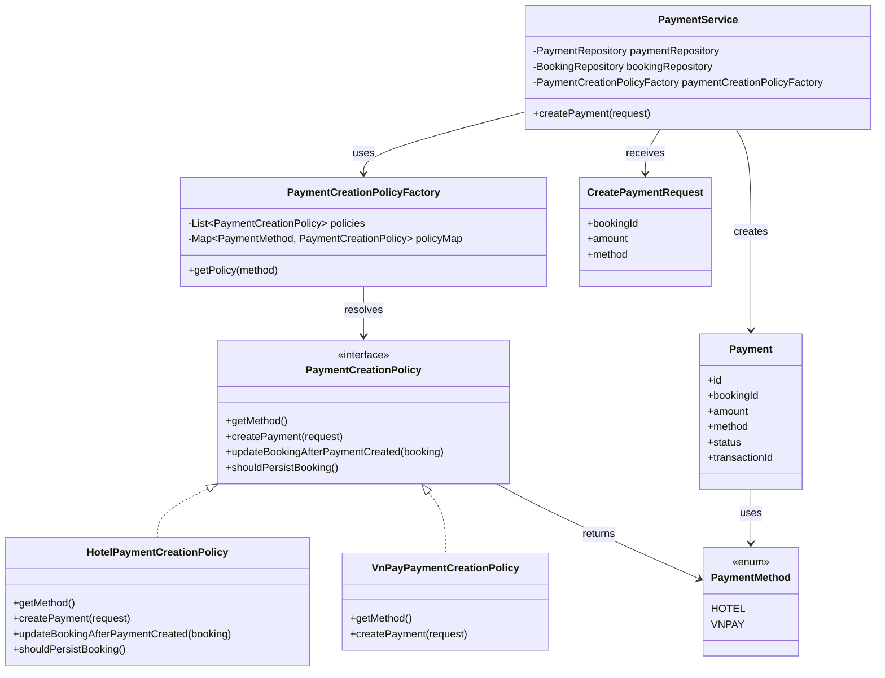

# Chức năng thanh toán và mẫu thiết kế Factory Method

## 1. Chức năng được chọn

Trong đề tài hệ thống đặt phòng khách sạn, chức năng được chọn là **tạo thanh toán cho booking**.

Chức năng này nằm ở backend, trong luồng xử lý tạo payment theo từng phương thức thanh toán:
- Thanh toán tại khách sạn `HOTEL`
- Thanh toán qua cổng VNPay `VNPAY`

Khi khách tạo thanh toán, hệ thống cần khởi tạo `Payment` với trạng thái khác nhau tùy theo phương thức.

## 2. Vấn đề của cách làm thông thường

Nếu viết trực tiếp trong service bằng nhiều nhánh `if/else`, lớp service sẽ bị phình to và khó mở rộng.

Ví dụ khi thêm phương thức thanh toán mới, ta phải sửa lại logic trung tâm. Điều này làm code khó bảo trì và vi phạm nguyên tắc đóng/mở.

## 3. Mẫu thiết kế được sử dụng: Factory Method

Tôi chọn **Factory Method** vì bài toán chính là:
- chọn đúng cách tạo đối tượng `Payment`
- tạo khác nhau theo từng `PaymentMethod`
- giữ cho `PaymentService` không phải biết chi tiết cách khởi tạo của từng loại payment

### Lý do phù hợp
- Tách phần tạo đối tượng ra khỏi phần xử lý nghiệp vụ
- Dễ thêm phương thức thanh toán mới
- Giảm phụ thuộc giữa service và chi tiết từng loại payment

## 4. Các lớp tham gia

- `PaymentService`: lớp điều phối nghiệp vụ tạo payment
- `PaymentCreationPolicy`: interface mô tả cách tạo payment
- `PaymentCreationPolicyFactory`: lớp chọn đúng policy theo `PaymentMethod`
- `HotelPaymentCreationPolicy`: tạo payment cho thanh toán tại khách sạn
- `VnPayPaymentCreationPolicy`: tạo payment cho thanh toán qua VNPay
- `CreatePaymentRequest`: dữ liệu đầu vào để tạo payment
- `Payment`: entity payment được tạo ra
- `PaymentMethod`: enum xác định phương thức thanh toán

## 5. Cách hoạt động

1. Người dùng gửi yêu cầu tạo thanh toán với `bookingId`, `amount` và `method`.
2. `PaymentService` kiểm tra booking có hợp lệ để thanh toán hay không.
3. `PaymentService` gọi `PaymentCreationPolicyFactory` để lấy đúng policy tương ứng với `PaymentMethod`.
4. Factory trả về một policy cụ thể:
   - `HotelPaymentCreationPolicy` nếu method là `HOTEL`
   - `VnPayPaymentCreationPolicy` nếu method là `VNPAY`
5. Policy được chọn sẽ tạo object `Payment` với trạng thái phù hợp.
6. Nếu cần, policy cũng cập nhật trạng thái booking sau khi tạo payment.
7. `PaymentService` lưu payment và trả kết quả về cho client.

## 6. Ý nghĩa của thiết kế này

Thiết kế này giúp hệ thống dễ mở rộng. Khi cần thêm phương thức thanh toán mới, ta chỉ cần tạo thêm một lớp policy mới, không phải sửa logic chính của service.

Như vậy, phần xử lý thanh toán trở nên rõ ràng, dễ bảo trì và dễ kiểm thử hơn.

## 7. Sơ đồ lớp

## 8. Kết luận ngắn

Factory Method phù hợp với chức năng tạo thanh toán vì mỗi phương thức thanh toán có cách khởi tạo riêng. Mẫu này giúp tách trách nhiệm, giảm nhánh điều kiện trong service và giúp hệ thống dễ mở rộng trong tương lai.
